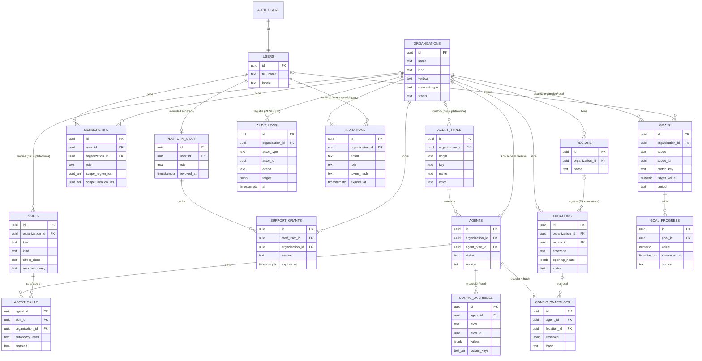

# TECHNICAL_SPEC — Moodly (plataforma B2B de agentes de IA)

> **Documento técnico de arquitectura** del repositorio [`dsvmotion/moodly`](https://github.com/dsvmotion/moodly).
> Generado leyendo el código, las migraciones SQL, los workflows y la documentación del repo, y comprobando en vivo (solo lectura) GitHub, Supabase, el DNS público y `staging.moodlycrm.com`.
>
> - **Fecha del análisis:** viernes 23/10/2026, ~22:00 (hora de Madrid, UTC+2).
> - **Rama analizada:** `main` en el commit **`976bf1f30b461304cfd0bd186af4685216196631`** (23/10/2026 21:06 Madrid, «CI: el despliegue a staging ignora solo lo que config push declara que no puede aplicar (#81)»). 77 commits desde el primero (28/09/2026 18:48).
> - **PRs abiertos analizados aparte (NO están en `main`):**
>   - **#80** `claude/adr-acceptance` (head `eac89f7`, *mergeable*): acepta los ADR 0027 y 0030 y pone STATUS al día.
>   - **#82** `claude/worker-dbos` (head `3eaee8b`, **con conflictos** con `main`): worker con DBOS (incremento W1).
> - **Convenciones de este documento:** 🟢 = en `main` y verificado · 🟡 = en un PR abierto · ⚪ = solo planificado/documentado · 🔴 = bloqueado o roto. Cuando algo no se pudo verificar se dice expresamente. Nunca se reproducen valores de secretos.
> - **Fuentes de verdad del repo (ADR 0023):** ADRs aceptados > `docs/MANUAL.md` > `docs/design/` > prototipo `apps/site/src/app/plataforma` (solo visual) > `docs/audits/` (históricas). El estado real lo lleva `docs/STATUS.md`.

---

## Índice

1. [Resumen, visión y estado actual](#1-resumen-visión-y-estado-actual)
2. [Stack y versiones exactas](#2-stack-y-versiones-exactas)
3. [Estructura del monorepo](#3-estructura-del-monorepo)
4. [Base de datos (Supabase Postgres)](#4-base-de-datos-supabase-postgres)
5. [Autenticación y seguridad](#5-autenticación-y-seguridad)
6. [Frontend: `apps/web` y `apps/site`](#6-frontend-appsweb-y-appssite)
7. [Agentes, skills, configuración y objetivos](#7-agentes-skills-configuración-y-objetivos)
8. [Worker y ejecución duradera (DBOS)](#8-worker-y-ejecución-duradera-dbos)
9. [Integraciones y despliegue (verificado en vivo)](#9-integraciones-y-despliegue-verificado-en-vivo)
10. [CI/CD y scripts](#10-cicd-y-scripts)
11. [Observabilidad](#11-observabilidad)
12. [ADRs](#12-adrs)
13. [Mapa de la lógica principal (qué → dónde)](#13-mapa-de-la-lógica-principal-qué--dónde)
14. [Variables de entorno](#14-variables-de-entorno)
15. [Cómo ejecutar en local y tests](#15-cómo-ejecutar-en-local-y-tests)
16. [Riesgos, deuda técnica y próximos pasos](#16-riesgos-deuda-técnica-y-próximos-pasos)
17. [Anexo: discrepancias entre documentación y estado real](#17-anexo-discrepancias-entre-documentación-y-estado-real)

---

## 1. Resumen, visión y estado actual

### 1.1 Qué es (de `docs/MANUAL.md` §1)

Plataforma **solo B2B** que despliega **agentes de IA que ejecutan trabajo real dentro de una empresa**: responden a clientes, gestionan citas, cualifican leads, actualizan el CRM, coordinan operaciones y preparan la parte administrativa, conectados a las herramientas que el cliente ya usa y con permisos y niveles de autonomía controlados.

- **No es** un chatbot de FAQ, ni un constructor genérico tipo n8n/Zapier, ni sustituye al CRM/facturación/reservas del cliente (opera *sobre* ellos). Toda acción con efecto externo pasa por un motor de políticas (§5.4).
- **Cliente objetivo:** pymes, medianas y cadenas multi-local (clínicas, restaurantes, gestorías, inmobiliarias…). Regla de arquitectura: un negocio pequeño es una organización con **un solo local**; todo se diseña multi-local desde el día 1.
- **Nombre comercial provisional:** «Moodly». En código siempre `BRAND_NAME` (`packages/config/src/index.ts`).
- **Los 4 agentes de serie** (ADR 0023, claves canónicas en `@repo/config` `AGENT_TYPES`):

| `agent_type` | Nombre | Responsabilidad |
|---|---|---|
| `reception` | Recepción | Agenda y citas, lista de espera, recordatorios, recursos/salas, canal de voz |
| `customer` | Atención al cliente | Canales escritos (WhatsApp, Instagram, email, web): dudas, incidencias, reseñas, escalado |
| `sales` | Comercial | Leads, CRM, presupuestos, seguimiento, recuperación, campañas del coach |
| `admin` | Administración | Facturación (vía software del cliente), cobros, gastos, inventario, proveedores, gestoría |

- **Modelo conceptual:** `Agente = Modelo + Conocimiento + Memoria + Objetivos + Skills + Integraciones + Reglas + Permisos` (§1.5).
- **Autonomía por skill:** `suggest` → `draft` → `execute` → `autonomous`, nunca por encima del **techo** de la clase de efecto (§1.6, §5.6).
- **Personalización en tres capas** (plantilla de fábrica → interruptores → modo avanzado) + **herencia multi-local** plantilla → organización → región → local con bloqueos (§1.7, §4.3).
- **Prioridad máxima de producto:** memoria que aprende (cruzada entre agentes y locales), objetivos del negocio y **modo coach** (§5.12, §6).
- **Referencia competitiva:** GuruSup (igualarlo como mínimo en calidad, seguridad e integraciones, §1.8).
- **Modelo de negocio:** setup 1.000–5.000 € en pymes + cuota mensual que cubre la IA; importes finales **[ABIERTO]** (§1.10).

### 1.2 Estado actual: construido vs planificado

| Área | Estado | Evidencia |
|---|---|---|
| Monorepo pnpm + Turborepo, TS strict, ESLint, Vitest, CI | 🟢 | `package.json`, `turbo.json`, `.github/workflows/ci.yml` |
| Multi-tenancy organización → región → local con RLS | 🟢 | 13 migraciones en `packages/db/supabase/migrations/`, 590 aserciones pgTAP |
| Auth (Supabase Auth): login, MFA TOTP, revocación de sesión, freno de login, invitaciones | 🟢 | `apps/web/src/app/login/**`, `apps/web/src/lib/auth/**`, migraciones 2–10 |
| Equipo interno (`platform_staff`), `audit_logs` solo inserción, acceso JIT (`support_grants`) | 🟢 BD · ⚪ UI `/ops` | migraciones `20261006*`; no hay rutas `/ops` en `apps/web` |
| App shell (barra lateral, alcance, ⌘K, i18n es/en, tema, PWA) | 🟢 | `apps/web/src/components/**`, `packages/ui/**` |
| Pantallas con datos reales: Inicio, Agentes, Ajustes (General, Equipo, Sedes, Seguridad, Perfil, Preferencias), Invitación | 🟢 | `apps/web/src/app/app/**` |
| Pantallas de negocio (Conversaciones, Aprobaciones, Clientes, Tareas, Actividad, Informes, Coach, Objetivos, Conocimiento, Memoria) | ⚪ estado vacío | cada `page.tsx` = 5 líneas con `<SectionEmpty>` |
| Catálogo de agentes y skills (`agent_types`, `agents`, `skills`, `agent_skills`) | 🟢 solo lectura desde la app | `20261023150000_agent_catalog.sql` |
| Configuración con herencia + snapshots | 🟢 esquema y funciones; sin UI | `20261023170000_agent_config.sql` |
| Objetivos (`goals`, `goal_progress`) | 🟢 esquema; sin UI | `20261023190000_goals.sql` |
| `tenantDb` / `createServiceDb().forOrganization()` (acceso acotado de plataforma) | 🟢 | `packages/db/src/tenant-db.ts`, `service.ts` (#78) |
| Logs pino + eventos de seguridad; Sentry (UE) con *tunnel* | 🟢 | `apps/web/src/lib/observability/**`, `src/app/monitoring/route.ts` |
| Staging (Supabase `moodly-staging` + Vercel en `staging.moodlycrm.com`) | 🟢 con 🔴 último despliegue en rojo | ver §9 y §10 |
| Worker con DBOS | 🟡 PR #82 (en `main` es un paquete vacío) | §8 |
| Runtime de agentes, LLM router, motor de políticas, aprobaciones, skills reales, canales, conocimiento/RAG, memoria, coach, evals, plantillas | ⚪ | `packages/{agent-core,skills,channels,integrations,knowledge,templates,evals,domain}` = `export {}` |
| WorkOS (SSO/SCIM), WhatsApp Cloud API, Stripe, Langfuse, Railway, Twilio | ⚪ | sin código; ver §9 |

**Fase del roadmap (MANUAL §17):** cerrando la **Fase 0 (Cimientos)** y empezando la **Fase D (runtime de agentes)** del plan de auditoría. La **Fase 1** (primer agente `customer` real con un piloto) depende de decisiones abiertas: vertical/cliente piloto, AI Gateway y proveedor de embeddings, proveedor de KMS (MANUAL §18 #3, #5, #6).

---

## 2. Stack y versiones exactas

### 2.1 Raíz (`/package.json`, `.nvmrc`, `pnpm-workspace.yaml`, `turbo.json`)

| Pieza | Versión | Dónde |
|---|---|---|
| Node | `>=24` (engines); `.nvmrc` = `24` (CI usó 24.21.0) | `package.json`, `.nvmrc` |
| pnpm | `pnpm@11.28.1` (`packageManager`) | `package.json` |
| Turborepo | `turbo` 2.11.7 (`agentGuidance: false`) | `package.json`, `turbo.json` |
| TypeScript | 6.0.3 | `package.json` |
| ESLint | 10.12.0 + `@eslint/js` 10.0.1 + `typescript-eslint` 8.71.1 + `eslint-plugin-react-hooks` 7.1.1 + `globals` 17.13.0 | `package.json`, `eslint.config.js` |
| Vitest | 5.0.5 | `package.json` |
| `@types/node` | 24.19.0 | `package.json` |
| Overrides de seguridad | `source-map-js >=1.2.2`, `vite 8.3.3` | `pnpm-workspace.yaml` |
| Scripts de instalación denegados | `@swc/core`, `@parcel/watcher` (`allowBuilds: false`) | `pnpm-workspace.yaml` |

Tareas de turbo: `build` (dependsOn `^build`, outputs `dist/**`, `.next/**`), `typecheck`, `lint`, `test`, y `@repo/web#build` que además depende de `typecheck`. Script agregado: `pnpm check` = `turbo run typecheck lint test build`.

### 2.2 `apps/web` (`apps/web/package.json`)

| Dependencia | Versión |
|---|---|
| `next` | **16.4.2** (subido por dos avisos críticos de RCE, #50) |
| `react` / `react-dom` | 19.3.0 |
| `@supabase/supabase-js` | 2.117.3 |
| `@supabase/ssr` | 0.12.7 |
| `next-intl` | 4.14.9 |
| `zod` | 4.6.5 |
| `pino` | 10.4.0 |
| `@sentry/nextjs` | 11.6.0 |
| `server-only` | 0.0.1 |
| `@repo/config`, `@repo/db`, `@repo/ui` | `workspace:*` |
| Dev: `@playwright/test` | 1.64.0 |
| Dev: `@axe-core/playwright` | 4.13.0 |
| Dev: `tailwindcss` / `@tailwindcss/postcss` | 4.3.3 |
| Dev: `postcss` | 8.5.29 |
| Dev: `tw-animate-css` | 1.4.0 |

### 2.3 `packages/ui` (`packages/ui/package.json`)

`@tanstack/react-table` 9.2.6 · `@tanstack/react-virtual` 3.14.13 · `class-variance-authority` 0.7.1 · `clsx` 2.1.1 · `cmdk` 1.1.1 · `lucide-react` 1.53.0 · `radix-ui` 1.7.0 · `tailwind-merge` 3.7.0 · peer `react`/`react-dom` ^19.3.0. Exporta **código fuente** (ADR 0018), no `dist`: `./globals.css`, `./lib/*`, `./components/*`, `./hooks/*`.

### 2.4 Otros workspaces

| Workspace | Dependencias |
|---|---|
| `apps/site` | `next` 16.4.2, `react` 19.3.0, `lucide-react` 1.53.0 (JS/JSX, sin TS estricto) |
| `packages/db` | `@supabase/supabase-js` 2.117.3; Supabase CLI **2.118.0** (fijada en CI y en AGENTS.md) |
| `apps/worker` (en `main`) | ninguna |
| `apps/worker` (🟡 PR #82) | `@dbos-inc/dbos-sdk` **5.2.11** (exacta), `pino` 10.4.0, `zod` 4.6.5 |
| Resto de `packages/*` | ninguna (vacíos) |

### 2.5 Base de datos y servicios

- Postgres **17** (local `major_version = 17`; staging `17.11.0.003`, verificado por el conector de Supabase).
- Extensiones usadas por el SQL: `pgcrypto` vía `extensions.gen_random_bytes` / `extensions.digest` (invitaciones, snapshots). pgTAP para tests. **pgvector aún no se usa** (planificado, ADR 0025).
- Planificado (MANUAL §3.2) y **no presente en código**: Vercel AI SDK, pgvector, OpenTelemetry, Langfuse, Stripe, Resend SDK, WorkOS SDK.

---

## 3. Estructura del monorepo

`pnpm-workspace.yaml` declara `apps/*` y `packages/*` (14 workspaces `@repo/*`). Archivos de la raíz: `AGENTS.md` = `CLAUDE.md` (idénticos, 122 líneas, instrucciones para agentes de código), `SECURITY.md`, `eslint.config.js`, `tsconfig.base.json`, `turbo.json`, `.gitleaksignore`, `.nvmrc`.

```
moodly/
├── .github/
│   ├── CODEOWNERS                 # todo @dsvmotion (zonas sensibles explícitas)
│   ├── dependabot.yml             # npm + github-actions, semanal (lunes), cooldown 14 días
│   └── workflows/                 # ci.yml, deploy-staging.yml, security-daily.yml,
│                                  # sensitive-paths.yml, staging-demo.yml (§10)
├── apps/
│   ├── web/                       # 🟢 Next.js 16 — panel del cliente (/app) + login
│   │   ├── e2e/                   # 26 specs Playwright (*.e2e.ts) + helpers.ts
│   │   ├── messages/{es,en}.json  # textos de next-intl
│   │   ├── public/{sw.js,offline.html,icons/}   # PWA
│   │   ├── scripts/               # local-env.ts (genera .env.local), pwa-icons.ts
│   │   ├── src/
│   │   │   ├── app/               # App Router (rutas en §6.1)
│   │   │   │   ├── app/           # /app/** (privado)
│   │   │   │   ├── login/         # /login y /login/mfa
│   │   │   │   ├── monitoring/    # tunnel de Sentry (POST)
│   │   │   │   ├── manifest.ts    # /manifest.webmanifest
│   │   │   │   └── layout.tsx, page.tsx, fonts.ts, globals.css, preferences-actions.ts
│   │   │   ├── components/        # shell: app-frame, app-sidebar, app-topbar, app-command-center,
│   │   │   │                      # app-org-switcher, app-scope-switcher, app-user-menu, settings-nav,
│   │   │   │                      # section-empty, auth-shell, brand-logo, invitations/, mfa/, records/, pwa/
│   │   │   ├── i18n/              # config.ts (es|en, cookie "locale"), request.ts
│   │   │   ├── lib/               # auth/, supabase/, security/, observability/, pwa/,
│   │   │   │                      # navigation, scope, active-org, agents, records, preferences, validation…
│   │   │   ├── proxy.ts           # «middleware» de Next 16: sesión + CSP con nonce
│   │   │   ├── instrumentation.ts / instrumentation-client.ts   # Sentry + request.error
│   │   │   └── no-service-role.test.ts, no-agent-key-logic.test.ts  # tests estructurales
│   │   ├── next.config.ts, playwright.config.ts, postcss.config.mjs, .env.example
│   ├── site/                      # 🟢 Web pública + prototipo navegable (solo visual)
│   │   └── src/{app/[lang]/**, app/plataforma/**, components/**, proxy.js}
│   └── worker/                    # ⚪ en main: src/index.ts = `export {}`  · 🟡 DBOS en PR #82
├── packages/
│   ├── config/    # 🟢 BRAND_NAME y AGENT_TYPES (fuente única de claves de agente)
│   ├── db/        # 🟢 Supabase: migraciones, rollbacks, pgTAP, seed, tipos, tenantDb
│   ├── ui/        # 🟢 sistema de diseño (shadcn/ui + Tailwind v4), código fuente
│   ├── agent-core/    # ⚪ vacío — runtime: contexto, bucle LLM, políticas, aprobaciones
│   ├── skills/        # ⚪ vacío — catálogo de skills
│   ├── integrations/  # ⚪ vacío — conectores y cliente MCP
│   ├── channels/      # ⚪ vacío — WhatsApp, Instagram, email, web
│   ├── knowledge/     # ⚪ vacío — ingesta, chunking, embeddings, recuperación
│   ├── templates/     # ⚪ vacío — plantillas por agent_type × vertical
│   ├── evals/         # ⚪ vacío — conversaciones de referencia y runner
│   └── domain/        # ⚪ vacío — tipos y esquemas Zod del dominio
├── scripts/
│   ├── safe-merge.sh              # mergeo autónomo con comprobaciones
│   ├── merge-guard/               # check-sensitive.sh, sensitive-gate.sh, required-checks.txt,
│   │                              # sensitive-paths.txt (VACÍA), sensitive-paths.suspended.txt, tests/run.sh
│   └── supabase/                  # config-drift.sh + tests/config-drift.test.sh
└── docs/
    ├── MANUAL.md   # 1.221 líneas — fuente de verdad técnica y de producto
    ├── STATUS.md   # estado real (hecho/en curso/bloqueado/próximo)
    ├── adr/        # 0000 plantilla, 0003, 0018–0032 (+ 0027-spike/)
    ├── audits/     # 15 auditorías fechadas (2026-10-07 … 2026-10-23)
    ├── design/     # 10 documentos de diseño (arquitectura enterprise, mapa de pantallas, precios…)
    └── superpowers/
```

**Paquetes vacíos (stubs):** `apps/worker` (en `main`), `packages/agent-core`, `channels`, `domain`, `evals`, `integrations`, `knowledge`, `skills`, `templates`. Todos contienen solo `src/index.ts` con `// Paquete vacío: se implementa en su tarea correspondiente (docs/STATUS.md). export {};` y su `package.json` con `build` (tsc), `typecheck`, `lint`, `test --passWithNoTests`.

**Fronteras forzadas por lint y tests estructurales** (`eslint.config.js`):
- Fuera de `packages/db` y `apps/web`, prohibido importar `@supabase/*` → «Usa `createServiceDb().forOrganization(orgId)` de `@repo/db/service`».
- `apps/web` no puede importar `@repo/db/service` (la app nunca usa la clave secreta). Lo refuerzan `apps/web/src/no-service-role.test.ts` y `packages/db/src/service-boundary.test.ts`.
- Ninguna clave de agente escrita en el código de la web ni `AGENT_TYPES` fuera de `packages/config` (`apps/web/src/no-agent-key-logic.test.ts`).
- 🟡 PR #82 añade: solo `apps/worker` importa `@dbos-inc/*` (regla de lint + `apps/worker/src/dbos-boundary.test.ts`).

---

## 4. Base de datos (Supabase Postgres)

### 4.1 Organización del código de base de datos

| Ruta | Contenido |
|---|---|
| `packages/db/supabase/config.toml` | Configuración de Supabase CLI como código (local + `[remotes.staging]`) |
| `packages/db/supabase/migrations/*.sql` | 13 migraciones en `main` (+2 en PR #82) — fuente de verdad del esquema |
| `packages/db/supabase/rollbacks/*.down.sql` | Una vuelta atrás por migración (13), probadas en cada PR según STATUS |
| `packages/db/supabase/tests/database/*.test.sql` | 19 ficheros pgTAP (00–18) + `_fixtures/tenants.psql` |
| `packages/db/src/database.types.ts` | Tipos generados (`pnpm db:types`), esquema `public` — no editar a mano |
| `packages/db/src/tenant-db.ts`, `service.ts` | Acceso de plataforma acotado por organización (§5.9) |
| `packages/db/src/seed/*` | Seed idempotente **solo local** (`pnpm db:seed`) |
| `packages/db/bootstrap/staging-demo*.sql` | SQL del workflow manual «Staging · organización de demo» |

**Esquemas:** `public` (tablas de negocio, expuesto por PostgREST: `api.schemas = ["public"]`), `private` (helpers de RLS, guardas y tablas internas; `revoke all … from public`, `usage` solo para `authenticated` y `service_role`), `auth` (Supabase Auth), `extensions`; 🟡 `dbos` (PR #82). El MANUAL prevé también `audit` y particionado mensual (ADR 0026) — **no implementado**: `audit_logs` vive en `public`.

**Convenciones de seguridad que siguen todas las tablas** (ADR 0003, AGENTS.md):
- `enable` **y** `force row level security` en todas las tablas.
- `revoke all … from anon`; a `authenticated` se le quitan `truncate, references, trigger` y cualquier privilegio que no use una política (test estructural `15_least_privilege`).
- Toda política empieza por `(select private.session_is_active()) and …` (InitPlan: se evalúa una vez por consulta). Toda política de **escritura** que admite a `org_admin` o al equipo interno exige además `(select private.session_is_aal2())`.
- Helpers `SECURITY DEFINER` con `set search_path = ''`; solo leen. Guardas `guard_*` como **listas blancas** que solo actúan si `current_user = 'authenticated'`.
- No hay **enums** de Postgres: los dominios se modelan con `text` + `check (… in (…))`.

### 4.2 Migraciones en orden (todas en `packages/db/supabase/migrations/`)

| # | Archivo | Qué hace | pgTAP |
|---|---|---|---|
| 1 | `20260929105448_tenants_rls.sql` | Crea esquema `private` y `private.set_updated_at()`. Tablas `organizations`, `regions`, `locations`, `users`, `memberships`. Helpers RLS `has_org_role`, `can_access_location`, `can_access_region`, `can_see_membership`, `can_see_user`. Guardas `validate_membership_scope`, `guard_immutable_columns`, `guard_organization_fields`, `guard_location_structure`, `guard_last_org_admin`. RLS + 15 políticas. | 00–05 |
| 2 | `20260930101908_session_revocation.sql` | `private.session_is_active()` (la sesión del JWT sigue en `auth.sessions`, usuario no borrado ni baneado) como primera condición de las 15 políticas (`alter policy`). Un token copiado antes del logout deja de leer. | 06 |
| 3 | `20261006170108_platform_staff_audit.sql` | `platform_staff` (`platform_admin`/`platform_operator`, `revoked_at`), `validate_identity_separation` (un interno no revocado no puede tener memberships y viceversa), `is_platform_staff()`. `audit_logs` **solo inserción** (`set_at`, `guard_append_only` en UPDATE/DELETE/TRUNCATE también para `service_role`). Políticas de lectura del equipo interno en las 5 tablas de tenants. | 07, 08 |
| 4 | `20261006180000_support_grants.sql` | Acceso **JIT** del equipo interno: `support_grants` (motivo 10–500 caracteres, ventana ≤ 8 h, revocable), `session_is_aal2()`, `staff_can_read(org)` (aal2 + permiso vigente), `is_staff_user()`, guarda y **auditoría automática** (`support_grant.created`/`.revoked` en `audit_logs` dentro de la misma transacción). Reescribe las políticas `*_select_platform_staff` para exigir permiso vigente. | 12 |
| 5 | `20261021090000_login_throttle.sql` | Freno a la fuerza bruta: `private.login_failures` (hash SHA-256 de email e IP), `private.server_keys` (hash de claves de servidor), `server_key_ok`, `register_server_key` (solo `service_role`), RPC `login_throttle`, `login_record_failure` (exigen la clave de servidor) y `login_record_success`. Umbrales en 15 min: email+IP ≥5, email ≥20, IP ≥100; espera 30 s·2^exceso hasta 15 min; purga > 1 día. | 09 |
| 6 | `20261021130000_org_status.sql` | `private.org_is_active(org)`; reescribe los helpers RLS para conceder acceso solo si la organización está `active`. Un miembro de una organización `suspended`/`archived` solo ve su perfil y su membership. | 11 |
| 7 | `20261022090000_invitations.sql` | `invitations` (token de 256 bits; en la BD solo `token_hash`; caduca a los 7 días), `guard_invitation_update` (solo revocar), RPC `create_invitation` (invoker, pasa por RLS) y `accept_invitation` (`SECURITY DEFINER`: valida sesión, token, caducidad, uso, revocación, que el email de la sesión sea el invitado y que la organización esté activa; crea `users` si falta y la membership). **Elimina `memberships_insert`**: la única vía de alta es la invitación. | 10 |
| 8 | `20261022120000_admin_mfa.sql` | MFA obligatorio para administrar: todas las políticas de escritura de `org_admin` (organizations, regions, locations, memberships, invitations) y la inserción del equipo interno en `audit_logs` exigen `session_is_aal2()`. Los managers siguen editando sus locales con aal1. | 13 |
| 9 | `20261023090000_mfa_reads.sql` | MFA también para **leer**: `session_is_active()` exige aal2 a quien tiene un factor verificado (`auth.mfa_factors.status = 'verified'`). Cubre las 28 políticas y `accept_invitation` sin tocarlas. | 14 |
| 10 | `20261023130000_least_privilege_users_guard.sql` | R-20: `revoke insert, delete on organizations`, `revoke delete on regions, locations, users`, `revoke insert on memberships` para `authenticated`. R-35: `private.guard_user_fields()` (solo `full_name`, `locale`, `updated_at` editables). | 15 |
| 11 | `20261023150000_agent_catalog.sql` | `autonomy_rank`, `effect_class_ceiling`; tablas `agent_types`, `agents`, `skills`, `agent_skills`; `validate_agent_type`, `validate_agent_skill`; **siembra los 4 tipos de serie con ids fijos** (`0a9e0000-0000-4000-8000-00000000000{1..4}`); trigger `create_builtin_agents` (cada organización nueva nace con sus 4 agentes en `draft`) y backfill de las existentes. La app solo lee. | 16 |
| 12 | `20261023170000_agent_config.sql` | Utilidades jsonb puras (`jsonb_deep_merge`, `jsonb_leaf_paths`, `config_path_conflicts`, `jsonb_strip_paths`, `config_paths_valid`); tablas `config_overrides` y `config_snapshots`; `config_locks_above`, `validate_config_override` (bloqueos en los dos sentidos), `guard_config_snapshot_immutable`, `resolve_agent_config(agent, location)` y `snapshot_agent_config(agent, location)` (solo `service_role`). La app solo lee. | 17 |
| 13 | `20261023190000_goals.sql` | `goals` y `goal_progress`; `validate_goal`, `validate_goal_progress`; `guard_immutable_columns('organization_id','scope','scope_id')`; políticas por alcance (org_admin con aal2; `region_manager` en sus regiones/locales; `location_manager` en sus locales); el progreso solo lo escribe la plataforma. | 18 |
| 🟡 14 | `20261023200000_dbos_system_schema.sql` (PR #82) | Esquema `dbos` = salida literal de `dbos schema --print-migrations all` de `@dbos-inc/dbos-sdk` 5.2.11 (versión de esquema **123**). Usa `CREATE INDEX CONCURRENTLY`. | 19 (🟡) |
| 🟡 15 | `20261023200100_dbos_worker_role.sql` (PR #82) | Rol `dbos_worker` (`nologin noinherit`, sin DDL): `usage` en `dbos`, CRUD en sus tablas/secuencias, `execute` en sus funciones, *default privileges*; revoca todo en `dbos` a `public`, `anon`, `authenticated`, `service_role`. | 19 (🟡) |

**Rollbacks:** `packages/db/supabase/rollbacks/<misma marca>.down.sql` para las 13 (y las 2 del PR #82). Son SQL manual; no los aplica ningún workflow.

### 4.3 Tablas (estado en `main`)

> Tipos abreviados: `uuid`, `text`, `timestamptz`, `jsonb`, `int`, `numeric`, `date`, `bool`, `uuid[]`, `text[]`. Todas las tablas con `updated_at` tienen el trigger `set_updated_at`.

#### `public.organizations` (migración 1)
| Columna | Tipo | Notas |
|---|---|---|
| `id` | uuid PK | `gen_random_uuid()` |
| `name` | text | no vacío |
| `kind` | text | `business` \| `personal` (default `business`) |
| `vertical`, `plan` | text | nulos permitidos |
| `contract_type` | text | `smb` \| `enterprise` |
| `default_locale` | text | default `es-ES` |
| `data_region` | text | default `eu` |
| `status` | text | `active` \| `suspended` \| `archived` |
| `created_at`, `updated_at` | timestamptz | |

Triggers: `guard_fields` (desde la app solo `name`, `vertical`, `default_locale`), `create_builtin_agents` (AFTER INSERT). Políticas: `organizations_select` (miembro activo), `organizations_update` (org_admin + aal2), `organizations_select_platform_staff` (`staff_can_read`). `authenticated` **no** tiene INSERT/DELETE (las altas son de la plataforma).

#### `public.regions` (1)
`id` uuid PK · `organization_id` uuid FK→organizations ON DELETE CASCADE · `name` text · timestamps · `unique (organization_id, id)` (para FK compuesta). Guardas: `guard_immutable('organization_id')`. Políticas: select (`can_access_region`), insert/update (org_admin + aal2), select del staff.

#### `public.locations` (1)
`id` uuid PK · `organization_id` FK CASCADE · `region_id` uuid (FK compuesta `(organization_id, region_id)` → `regions(organization_id, id)` ON DELETE RESTRICT: un local no puede apuntar a una región de otra organización) · `name` · `address` · `timezone` (default `Europe/Madrid`) · `opening_hours` jsonb `{}` · `status` `active|inactive` · timestamps. Índice `locations_organization_id_idx (organization_id, region_id)`. Guardas: `guard_immutable('organization_id')`, `guard_structure` (managers solo `opening_hours`, `address`, `timezone`). Políticas: select (`can_access_location`), insert (org_admin+aal2), update (managers de su alcance con aal1, o org_admin con aal2), select del staff.

#### `public.users` (1)
`id` uuid PK FK→`auth.users` ON DELETE CASCADE · `full_name` · `locale` (default `es-ES`) · timestamps. Guarda `guard_fields` (solo `full_name`, `locale`). Políticas: `users_select` (`can_see_user`), `users_insert_self`, `users_update_self`, `users_select_platform_staff`.

#### `public.memberships` (1)
`id` PK · `user_id` FK→users CASCADE · `organization_id` FK CASCADE · `role` `org_admin|region_manager|location_manager|staff` · `scope_region_ids uuid[]` · `scope_location_ids uuid[]` · timestamps · `unique (user_id, organization_id)` · check `memberships_scope_matches_role` (org_admin sin alcances; region_manager solo regiones; location_manager/staff solo locales). Índice por `organization_id`. Triggers: `validate_scope` (alcances de la misma organización), `guard_immutable('organization_id','user_id')`, `guard_last_admin` (nunca deja una organización sin `org_admin`, con *advisory lock*), `validate_identity` (separación de identidades con `platform_staff`). Políticas: select (`can_see_membership`), update/delete (org_admin + aal2), select del staff. **Sin INSERT para `authenticated`** (solo `accept_invitation`).

#### `public.platform_staff` (3)
`id` PK · `user_id` uuid **unique** FK→users CASCADE · `role` `platform_admin|platform_operator` · timestamps · `revoked_at`. `authenticated` sin INSERT/UPDATE/DELETE; política `platform_staff_select_self`.

#### `public.audit_logs` (3)
`id` PK · `organization_id` FK→organizations **ON DELETE RESTRICT** (nullable) · `actor_type` `agent|user|platform_staff|system` · `actor_id` uuid · `action` text no vacío · `target` jsonb · `metadata` jsonb · `at` timestamptz (lo fija la BD). Checks: `organization_id` obligatorio salvo `platform_staff`/`system`; `actor_id` obligatorio salvo `system`. Índices `(organization_id, at desc)` y `(at desc)`. Solo inserción (triggers + revokes, también para `service_role`). Políticas: insert del staff (aal2, `actor_id = auth.uid()`), select del staff (aal2), select del `org_admin` de su organización.

#### `public.support_grants` (4)
`id` PK · `staff_user_id` FK→`platform_staff(user_id)` CASCADE · `organization_id` FK CASCADE · `reason` (10–500) · `granted_by` · `created_at` · `expires_at` · `revoked_at` · check ventana ≤ 8 h. Índices `(staff_user_id, organization_id, expires_at)` y `(organization_id)`. Triggers `guard` (fija `granted_by`, `created_at`; solo revocar) y `audit` (escribe en `audit_logs`). Políticas select/insert/update (solo `platform_admin` con aal2 concede o revoca; el interno ve los suyos). Sin DELETE.

#### `public.invitations` (7)
`id` PK · `organization_id` FK CASCADE · `email` (normalizado: minúsculas, sin espacios, 3–320, con `@`) · `role` · `scope_region_ids` · `scope_location_ids` · `token_hash` **unique** · `invited_by` FK→users · `expires_at` (now + 7 días) · `accepted_at` · `accepted_by` FK→users SET NULL · `revoked_at` · `created_at` · check de alcance por rol. Índices por `organization_id`, `invited_by`, `accepted_by`. Triggers `validate_scope`, `guard_invitation_update`. Políticas select/insert/update (org_admin + aal2; `invited_by = auth.uid()`). Sin DELETE.

#### `public.agent_types` (11)
`id` PK · `organization_id` FK CASCADE (null = de la plataforma) · `origin` `builtin|template|custom` · `key` (`^[a-z][a-z0-9_]{1,39}$`) · `name` (1–80) · `color` (`^agent-[a-z]+$`) · `description` · `organization_kind` (`business`) · `base_instructions` · `default_skills text[]` · timestamps · check `(origin = 'custom') = (organization_id is not null)` · `unique nulls not distinct (organization_id, key)`. Políticas: select (catálogo de plataforma para cualquier sesión viva; los propios, miembros) + staff.

#### `public.agents` (11)
`id` PK · `organization_id` FK CASCADE · `agent_type_id` FK→agent_types · `version` int ≥1 · `display_name` (null = nombre del tipo) · `status` `draft|testing|live|paused` (default `draft`) · timestamps · `unique (organization_id, agent_type_id)` (un agente por tipo y organización). Índice `agent_type_id`. Trigger `validate_agent_type`. Solo SELECT para `authenticated`.

#### `public.skills` (11)
`id` PK · `organization_id` (null = plataforma) · `key` · `version` · `kind` `code|composed|mcp` · `name` · `description` · `definition` jsonb (solo `composed`) · `integration_id` uuid (solo `mcp`; FK pendiente de la tabla `integrations`) · `effect_class` `read|internal_write|external_message|external_outreach|financial|destructive` · `default_autonomy` y `max_autonomy` (`suggest|draft|execute|autonomous`) · `required_integration` · `restricted_to_agent_types text[]` · `input_schema`/`output_schema` jsonb · `status` `draft|testing|published` · timestamps. Checks: `code` solo de la plataforma; `default ≤ max ≤ techo de la clase`; `unique nulls not distinct (organization_id, key, version)`. **0 filas en staging** (no hay skills todavía).

#### `public.agent_skills` (11)
PK `(agent_id, skill_id)` · `organization_id` (copia, validada) · `enabled` bool · `autonomy_level` · timestamps. Índices `skill_id`, `organization_id`. Trigger `validate_agent_skill` (misma organización, skill permitida para el tipo, autonomía ≤ `max_autonomy`).

**Techos por clase de efecto** (`private.effect_class_ceiling`): `read`, `internal_write`, `external_message` → `autonomous`; `external_outreach` → `execute`; `financial`, `destructive` → `draft`.

#### `public.config_overrides` (12)
`id` PK · `organization_id` FK · `agent_id` FK→agents CASCADE · `level` `organization|region|location` · `level_id` uuid · `"values"` jsonb (objeto) · `locked_keys text[]` (rutas con puntos válidas) · `version` · timestamps · `unique (agent_id, level, level_id)` · check nivel organización ⇒ `level_id = organization_id`. Trigger `validate_config_override`. Política select por alcance + staff.

#### `public.config_snapshots` (12)
`id` PK · `organization_id` · `agent_id` · `location_id` (null = sin local) · `resolved` jsonb · `hash` (sha256 hex) · `created_at` · `unique nulls not distinct (agent_id, location_id, hash)`. Inmutable (`guard_config_snapshot_immutable`). Lo crea `private.snapshot_agent_config` (worker, `service_role`).

#### `public.goals` (13)
`id` PK · `organization_id` · `scope` `organization|region|location` · `scope_id` · `title` (1–200) · `metric_key` (p. ej. `appointments.booked`) · `direction` `at_least|at_most` · `target_value` numeric · `period` `week|month|quarter|year|once` · `starts_on` date · `due_date` (solo `once`) · `owner_user_id` FK→users SET NULL · `status` `active|paused|achieved|missed|archived` · timestamps. Índices por organización, `(organization_id, scope, scope_id)`, `owner_user_id`. CRUD para `authenticated` según alcance.

#### `public.goal_progress` (13)
`id` PK · `goal_id` FK→goals CASCADE · `organization_id` · `value` numeric · `measured_at` · `source` `internal|integration|manual` · `created_at`. Índices `(goal_id, measured_at desc)`, `organization_id`. Solo SELECT para `authenticated`.

#### Esquema `private`
- `private.login_failures` (`id` identity, `email_hash`, `ip_hash`, `failed_at`; índices por email y por IP) — sin acceso para ningún rol de API.
- `private.server_keys` (`name` PK, `key_hash` sha256, `rotated_at`) — sin acceso ni siquiera para `service_role`; se escribe con `public.register_server_key`.

### 4.4 Funciones y RPC

| Función | Tipo | Quién la ejecuta | Para qué |
|---|---|---|---|
| `private.session_is_active()` | definer | authenticated, service_role | Sesión viva, usuario activo, y aal2 si tiene factor verificado |
| `private.session_is_aal2()` | invoker | authenticated, service_role | `auth.jwt()->>'aal' = 'aal2'` |
| `private.has_org_role(org, roles)` | definer | authenticated, service_role | Membership con rol en organización activa |
| `private.can_access_location / can_access_region` | definer | idem | Alcance por rol |
| `private.can_see_membership / can_see_user` | definer | idem | Visibilidad del equipo |
| `private.org_is_active(org)` | definer | idem | Organización `active` |
| `private.is_platform_staff(roles)`, `staff_can_read(org)`, `is_staff_user(user, active_only)` | definer | idem | Equipo interno y acceso JIT |
| `private.autonomy_rank`, `effect_class_ceiling` | immutable | idem | Autonomía y techos |
| `private.jsonb_*`, `config_path*`, `config_locks_above` | immutable/definer | service_role | Herencia de configuración |
| `private.resolve_agent_config(agent, location)` | invoker | **service_role** | Configuración resuelta org→región→local respetando bloqueos |
| `private.snapshot_agent_config(agent, location)` | — | **service_role** | Crea o reutiliza un snapshot inmutable con hash |
| `public.register_server_key(name, hash)` | definer | **service_role** | Registra el hash de una clave de servidor (p. ej. `login_throttle`) |
| `public.login_throttle(email, ip, key)` | definer | anon, authenticated | Segundos de espera (0 = puede intentar) |
| `public.login_record_failure(email, ip, key)` | definer | anon, authenticated | Registra un fallo |
| `public.login_record_success()` | definer | authenticated | Borra los fallos del propio email |
| `public.create_invitation(org, email, role, regions, locations)` | invoker (RLS) | authenticated | Devuelve el token en claro una sola vez |
| `public.accept_invitation(token)` | **definer** (escribe en tenants) | authenticated | Crea la membership |

Triggers (todos en `private`): `set_updated_at`, `validate_membership_scope`, `guard_immutable_columns`, `guard_organization_fields`, `guard_location_structure`, `guard_last_org_admin`, `validate_identity_separation`, `audit_logs_set_at`, `guard_audit_logs_append_only`, `guard_support_grants`, `audit_support_grants`, `guard_invitation_update`, `guard_user_fields`, `validate_agent_type`, `validate_agent_skill`, `create_builtin_agents`, `validate_config_override`, `guard_config_snapshot_immutable`, `validate_goal`, `validate_goal_progress`.

### 4.5 Diagrama ER (`main`)



### 4.6 Tests pgTAP (`packages/db/supabase/tests/database/`)

| Fichero | Plan | Qué cubre |
|---|---|---|
| `00_rls_enabled` | 20 | Estructural: RLS activado/forzado en todo `public`, toda política empieza por `session_is_active()` |
| `01_org_isolation` | 31 | Un usuario de A no ve ni toca nada de B |
| `02_location_scope` | 35 | Alcance por local y región dentro de una organización |
| `03_org_admin` | 21 | El org_admin ve y gestiona toda su organización |
| `04_security_review` | 32 | Revisión de seguridad previa al merge del PR #2 |
| `05_review_guards` | 21 | Guardas de la revisión humana del PR #2 |
| `06_session_revocation` | 26 | JWT de sesión cerrada no lee |
| `07_platform_staff` | 55 | Identidad separada, lectura del staff |
| `08_audit_logs` | 60 | Solo inserción, también para `service_role` |
| `09_login_throttle` | 28 | Umbrales y clave de servidor |
| `10_invitations` | 31 | Consentimiento, token, caducidad, email |
| `11_org_status` | 20 | Organizaciones suspendidas/archivadas |
| `12_support_grants` | 26 | JIT + MFA + auditoría |
| `13_admin_mfa` | 26 | aal2 en escrituras de admin (estructural) |
| `14_mfa_reads` | 23 | aal2 para leer si hay factor |
| `15_least_privilege` | 16 | Ningún privilegio sin política; guarda de `users` |
| `16_agent_catalog` | 38 | Catálogo, techos, restricciones por tipo |
| `17_agent_config` | 35 | Herencia, bloqueos, snapshots |
| `18_goals` | 46 | Integridad y RLS por alcance |
| **Total `main`** | **590** | Coincide con «pgTAP 590/590» de STATUS |
| 🟡 `19_dbos_schema` (PR #82) | 14 | Esquema `dbos` en versión 123 y privilegios del rol |

Fixtures compartidos: `_fixtures/tenants.psql` (helpers `pg_temp.login_mfa()`/`act_as_mfa()` según AGENTS.md). Además: `packages/db/src/tenant-db.test.ts` (unitarios, `fetch` falso) y `tenant-db.integration.ts` (3 tests contra Supabase local, `pnpm --filter @repo/db test:integration`).

### 4.7 Configuración como código (`packages/db/supabase/config.toml`)

- `project_id = "moodly"`; API en 54321 con `schemas = ["public"]`, `max_rows = 1000`; DB 54322, `major_version = 17`; pooler local desactivado; Studio 54323; SMTP local (Mailpit) 54324; Storage 50 MiB; Realtime activado; Edge runtime Deno 2.
- **Auth:** `site_url = http://127.0.0.1:3000`; `jwt_expiry = 3600`; rotación de refresh tokens (reuse 10 s); **`enable_signup = false`** (registro público cerrado; no tocar `[auth.email] enable_signup`, que apagaría el login por email); sin anónimos; `minimum_password_length = 12`, `password_requirements = lower_upper_letters_digits`; `secure_password_change = true`; `double_confirm_changes = true`; OTP 6 dígitos; **sesiones `timebox = 168h`, `inactivity_timeout = 12h`** (en staging no se aplica hasta el plan Pro, según STATUS); MFA TOTP `enroll/verify` activado, MFA por teléfono desactivado; Twilio SMS `enabled = false`; proveedores externos (Apple, Firebase, Auth0, Cognito, Clerk) desactivados; servidor OAuth desactivado.
- **Rate limits de Auth:** email 2/h, SMS 30, sign-in 30, verificaciones 30, refresh 150.
- **`[remotes.staging]`** → `project_id = "sgeswmdqstonegceusej"`, `site_url` y `additional_redirect_urls = https://staging.moodlycrm.com`. El despliegue aplica esto con `supabase config push` (§10).
- `.gitignore` de Supabase: `.branches`, `.temp`, `.env.keys`, `.env.local`, `.env.*.local`.

### 4.8 Seed de desarrollo (`packages/db/src/seed/`)

`pnpm db:seed` (`run.ts`), **solo contra Supabase local** (`local-only.ts` lo impide en otro host). Datos ficticios con dominios `.test`: 5 organizaciones (Demo A–E), región «A Norte», locales A1–A3, B1, C1, D1, E1; usuarios por rol (org_admin con **TOTP activado**, managers, staff), invitados sin organización, 3 internos (`platform_admin`, `platform_operator`, uno revocado) y un tipo de agente propio «Eventos» (`events`) en Demo C. Contraseñas y secretos TOTP nuevos en cada ejecución, guardados solo en `packages/db/.seed/credentials.local.json` (ignorado por git). Registra el hash de `LOGIN_THROTTLE_KEY`.

### 4.9 Esquema `dbos` (🟡 solo en PR #82)

Tablas creadas por la migración `20261023200000_dbos_system_schema.sql` (generadas por DBOS, no editadas): `dbos_migrations`, `operation_outputs`, `workflow_inputs`, `workflow_status`, `notifications`, `workflow_events`, `scheduler_state`, `workflow_queue`, `event_dispatch_kv`, `streams`, `workflow_events_history`, `workflow_schedules`, `application_versions`, `queues`, `workflow_input`, `workflow_output` (más índices). Acceso solo para el rol `dbos_worker`; no expuesto por la API. En staging **no existe** (verificado: `list_tables` de `public`, `private`, `dbos` no devuelve tablas `dbos`).

### 4.10 Estado de la base de datos de staging (verificado en vivo, solo lectura)

- Proyecto `moodly-staging`, ref `sgeswmdqstonegceusej`, región **`eu-central-1`**, Postgres 17.11, estado `ACTIVE_HEALTHY`, creado el 22/10/2026 22:34 (Madrid). Organización Supabase `dsvmotion`, plan **Free**.
- **Historial de migraciones = las 13 de `main`**, en el mismo orden y con los mismos nombres.
- Tablas presentes: las 16 de `public` + las 2 de `private`, todas con RLS. Filas: `organizations` 1, `regions` 1, `locations` 2, `users` 1, `memberships` 1, `agent_types` 4, `agents` 4, `server_keys` 1; el resto 0. Es decir, **la organización de demo y su primer usuario ya existen en staging** (STATUS aún lo da por pendiente; no se leyó ningún dato personal).
- Avisos de seguridad de Supabase: `rls_enabled_no_policy` (INFO) en `private.login_failures` y `private.server_keys` (esperado: sin acceso por diseño); `*_security_definer_function_executable` (WARN) en `login_throttle`, `login_record_failure`, `login_record_success`, `accept_invitation` (esperado: están diseñadas como RPC protegidas por clave de servidor o por sesión); **«Leaked password protection disabled»** (WARN, no documentado en STATUS; en Supabase esa función requiere plan de pago — no verificado aquí).

---

## 5. Autenticación y seguridad

### 5.1 Modelo general

- **Proveedor de identidad hoy:** Supabase Auth (email + contraseña, TOTP). **WorkOS** está decidido como proveedor de SSO/SCIM enterprise (ADR 0022 §3, producto 2026-10-21) pero **no hay código** (Fase C, después de la D).
- **La barrera de datos es RLS** (MANUAL §10.2, ADR 0003). La web usa siempre la clave **publicable** y el JWT del usuario; **nunca** la service role (`apps/web/src/lib/supabase/env.ts`, test `apps/web/src/no-service-role.test.ts`, lint).
- **El navegador nunca habla con Supabase:** `connect-src 'self'`; todas las consultas salen del servidor de Next (Server Components y Server Actions).

### 5.2 Flujo de login (`apps/web/src/app/login/actions.ts` → `signIn`)

1. Validación con Zod (`signInSchema`, `apps/web/src/lib/validation.ts`).
2. Si falta `LOGIN_THROTTLE_KEY` → error `unavailable` (**fallo cerrado**).
3. `rpc("login_throttle", {email, ip, key})`; si error → `unavailable`; si > 0 → `tooMany` + evento `auth.login_throttled`.
4. `supabase.auth.signInWithPassword`. Si el error es transitorio (5xx o fallo de red, `isTransient` en `src/lib/auth/mfa.ts`) → `unavailable` y **no cuenta** en el freno (R-23). Si es de credenciales → `rpc("login_record_failure")` + `auth.login_failed` + mensaje genérico (no revela si el email existe).
5. Destino tras el login siempre por `safeNextPath()` (`src/lib/auth/routes.ts`: bloquea redirecciones abiertas, caracteres de control, `//`, `\`).
6. Si el usuario tiene un factor verificado → `auth.mfa_required` y redirección a `/login/mfa?next=…` **sin borrar los fallos** (si no, quien sabe la contraseña tendría intentos de código ilimitados).
7. Si no → `rpc("login_record_success")` (borra los fallos de su email) + `auth.login_succeeded`.

IP del cliente: `src/lib/auth/client-ip.ts` (primer valor de `x-forwarded-for` o `x-real-ip`, validado; si no, `"local"`).

### 5.3 MFA TOTP

| Pieza | Archivo | Comportamiento |
|---|---|---|
| Segundo paso del login | `src/app/login/mfa/{page.tsx,actions.ts,mfa-form.tsx}` | `verifyMfa`: mismo freno (`login_throttle` / `login_record_failure`), `verifyTotp` con reintentos ante 5xx/deadlock de Auth (`src/lib/auth/mfa.ts`), `login_record_success` al acertar |
| Alta / confirmación / baja | `src/app/app/mfa-actions.ts` + `src/components/mfa/{mfa-enroll,mfa-disable}.tsx` | `startEnrollment` (limpia factores sin verificar, `enroll` TOTP con issuer `BRAND_NAME`), `confirmEnrollment`, `disableMfa` (**pide el código actual** y pasa por el freno, R-21; luego `unenroll` + `refreshSession`) |
| UI | `/app/ajustes/seguridad` (`src/app/app/ajustes/seguridad/page.tsx`) | Activar/desactivar TOTP |
| DAL | `src/lib/auth/session.ts` → `requireUser()` | Quien tiene un factor verificado y sesión aal1 va a `/login/mfa` |
| BD | migraciones 8 (`admin_mfa`) y 9 (`mfa_reads`) | Escrituras de `org_admin` y del staff exigen aal2; con factor verificado, **también las lecturas** |

**Pendiente (STATUS):** códigos de recuperación y alertas al desactivar MFA. **No** hay MFA obligatorio a nivel de cuenta para `org_admin` que aún no lo ha activado: RLS simplemente le impide escribir hasta que lo active.

### 5.4 Sesiones y revocación

- `src/proxy.ts` usa `getClaims()` (valida la firma) solo para la **redirección optimista** (`routeRedirect`) y para refrescar cookies.
- `requireUser()` (DAL) usa `getUser()` (pregunta a Auth: detecta sesiones cerradas). Nunca `getSession()` en servidor.
- En la base de datos, `private.session_is_active()` comprueba `auth.sessions` (existe, `not_after` futuro), usuario no borrado ni baneado y aal2 si tiene factor. Un JWT copiado antes del logout **no lee nada** aunque siga firmado.
- Logout: `src/app/app/actions.ts` → `signOut({ scope: "local" })`.
- Caducidad de sesiones (`timebox 168h`, `inactivity 12h`) definida en `config.toml`, **no efectiva en staging** mientras Supabase esté en Free (STATUS).

### 5.5 Freno del login (anti fuerza bruta)

Implementado en BD (migración 5) con **clave de servidor**: `LOGIN_THROTTLE_KEY` vive solo en el servidor de la web (Vercel *sensitive*); en la BD solo su hash (`private.server_keys`, registrado con `register_server_key` por `service_role` o por el seed). Así un anónimo con la clave publicable no puede bloquear cuentas ajenas ni llenar la tabla (P0-1). Contadores por email+IP (5), email (20) e IP (100) en 15 min, espera exponencial hasta 15 min, sin bloqueo permanente, purga diaria. **Pendiente:** Cloudflare Turnstile / CAPTCHA de Supabase para las llamadas directas a la API de Auth (STATUS B3).

### 5.6 Invitaciones (alta de miembros)

- Crear: `src/app/app/invitations-actions.ts` → `createInvitation` → `rpc("create_invitation")` (org_admin con aal2). El enlace con el token se **muestra una vez** en la UI (`src/components/invitations/invite-form.tsx`, usado en `/app/ajustes/general`). **No se envía email todavía** (Resend sin integrar; R-22: el token viaja en la query `?token=`).
- Aceptar: `/app/invitacion?token=…` (`src/app/app/invitacion/page.tsx`) → botón (POST) → `acceptInvitation` → `rpc("accept_invitation")`. Solo si el email de la sesión coincide, el token es válido y la organización está activa.
- Revocar: `revokeInvitation` (UPDATE de `revoked_at`, única modificación que permite la guarda).
- Eventos: `org.invitation_created|revoked|accepted`.
- **Pendiente:** que un `location_manager` invite en sus locales, y el alta de cuenta de Auth de quien aún no la tiene (llega con WorkOS).

### 5.7 Equipo interno (platform staff) y acceso JIT

- Tabla `platform_staff` + `support_grants` + `audit_logs` (migraciones 3 y 4; ADR 0021, decisión D3).
- Un interno solo lee datos de una organización con: sesión viva **+ aal2 + permiso vigente** (motivo, ≤ 8 h, revocable) concedido por un `platform_admin` con aal2. Crear/revocar un permiso escribe en `audit_logs` en la misma transacción.
- Identidades separadas: un interno activo no puede tener memberships de cliente.
- **UI `/ops`: ⚪ no existe.** STATUS lo planifica como «`/ops` mínimo, PRs 2–4 (ADR 0021): `requirePlatformStaff()`, `withPlatformStaffAudit()`, `/ops/organizations` y `/ops/audit`».

### 5.8 Auditoría (`audit_logs`)

Solo inserción para todos los roles de API (incluido `service_role`): triggers `guard_append_only` (UPDATE/DELETE) y `guard_append_only_truncate`, más revokes. `at` lo fija la BD. Hoy solo la escriben los triggers de `support_grants` y el staff con aal2; los eventos de la web van a **logs** (pino), no a esta tabla. Pendiente: borrado RGPD frente a `audit_logs` inmutable (ADR 0021, D6).

### 5.9 Acceso de plataforma acotado: `tenantDb` (`packages/db/src/tenant-db.ts`, `service.ts`)

`createServiceDb({ url, secretKey }).forOrganization(orgId)` devuelve un acceso que:
- solo admite tablas con `organization_id` **obligatorio** (tipo `TenantTable` derivado de `database.types.ts`);
- añade `organization_id = <org>` a todo `select`, `update` y `delete`;
- en `insert` pone la organización y **rechaza filas de otra** (`TenantScopeError`); `update` no puede tocar `organization_id`;
- prohíbe recursos embebidos en `select` (`tabla(...)`), `upsert` y `rpc`;
- valida que `organizationId` sea un UUID.

Es el **único** sitio del código de producción que crea un cliente con la clave secreta, y `apps/web` tiene prohibido importarlo. Pensado para el worker (aún sin usar en `main`). Regla de AGENTS.md: `organization_id`, `location_id` y destinatarios **nunca** salen de lo que genera el LLM.

### 5.10 Proxy, cabeceras y cookies

- **`apps/web/src/proxy.ts`** (Next 16 llama «proxy» al antiguo middleware): CSP con **nonce por petición** (`createNonce`, 128 bits) y `strict-dynamic`; refresco de sesión con `@supabase/ssr`; redirección al login conservando `?next=`. *Matcher* excluye `_next/static`, `_next/image`, `favicon.ico`, `sw.js`, `manifest.webmanifest`, `offline.html`, `icons/` y `monitoring`.
- **CSP** (`src/lib/security/headers.ts`): `default-src 'self'`; `script-src 'self' 'nonce-…' 'strict-dynamic'` (+`'unsafe-eval'` solo en dev); `style-src 'self' 'unsafe-inline'`; `img-src 'self' data: blob:`; `connect-src 'self'`; `object-src 'none'`; `frame-ancestors 'none'`; `frame-src 'none'`; `form-action 'self'`; `upgrade-insecure-requests` por https. **Verificado en staging** (`curl -I https://staging.moodlycrm.com/login`).
- **Cabeceras fijas** (`SECURITY_HEADERS`, aplicadas en `next.config.ts`): HSTS 2 años con `includeSubDomains; preload`, `X-Content-Type-Options: nosniff`, `X-Frame-Options: DENY`, `Referrer-Policy: strict-origin-when-cross-origin`, COOP y CORP `same-origin`, `Permissions-Policy` restrictiva, `X-DNS-Prefetch-Control: off`; `poweredByHeader: false`.
- **Cookies** (`src/lib/cookie-options.ts`): de sesión de Supabase `httpOnly` + `Secure` por https (R-29); propias (`locale`, tema, barra lateral, organización activa `org`) `httpOnly`, `SameSite=Lax`, `Secure` por https (R-24). Un e2e comprueba que ninguna cookie es legible desde JavaScript.

### 5.11 Guarda de mergeo y zonas sensibles

- `scripts/merge-guard/sensitive-paths.txt` está **vacía** por decisión de producto (2026-10-22) mientras no haya datos reales; la lista completa está en `sensitive-paths.suspended.txt` (migraciones, rollbacks, `.sql`, `config.toml`, proxy, `lib/auth`, `lib/supabase`, login, logout, `.env`, seed, `agent-core` políticas/autonomía, `.github/`, `scripts/`, configs de test/lint/TS/turbo/Next/PostCSS, `package.json`, lockfile, workspace, `.nvmrc`, `AGENTS.md`/`CLAUDE.md`, `docs/MANUAL.md`).
- `scripts/merge-guard/check-sensitive.sh` sigue bloqueando **tests debilitados** (`.skip`, `.only`, `.todo`, `.fixme`, pgTAP sin `plan`, tests borrados). Lo ejecutan `safe-merge.sh` y el job `sensitive-paths`.
- Etiqueta `revisado-humano`: la ponen/quitan solo personas; `invalidate-review` la quita con cada commit nuevo.
- **Condición de salida a producción (bloqueante, STATUS):** reactivar la revisión humana (copiar líneas a `sensitive-paths.txt`), que el job lea la lista de la rama **base** y no la del PR, y proteger `main` (esto último ya está hecho, §9.7).
- `.github/CODEOWNERS`: `@dsvmotion` en todo y explícitamente en `packages/db/`, `proxy.ts`, `lib/auth`, `lib/supabase`, `lib/security`, `.github/`, `scripts/`, `AGENTS.md`, `CLAUDE.md`, `docs/MANUAL.md` (sin efecto práctico mientras el ruleset no exija revisiones).

### 5.12 `SECURITY.md` y cadena de suministro

- `SECURITY.md`: reporte de vulnerabilidades a `dsv.motion@gmail.com`, respuesta < 3 días laborables, alcance (web, worker, BD, web pública), puerto seguro para investigación de buena fe; remite a `docs/audits/2026-10-20-seguridad-cimientos.md`.
- Actions fijadas por **SHA** de commit; `permissions: contents: read`; `pnpm audit --audit-level=high` en cada PR y a diario; **gitleaks** en cada PR (`.gitleaksignore`); Dependabot semanal con cooldown de 14 días; `allowBuilds` en pnpm 11.
- Auditorías de seguridad en `docs/audits/` (2026-10-20 revisión de plataforma y cimientos, 2026-10-22 re-auditoría, 2026-10-23 estado, frontend y segunda pasada con hallazgos R-1…R-36).

---

## 6. Frontend: `apps/web` y `apps/site`

### 6.1 Rutas de `apps/web` (App Router, `apps/web/src/app/`)

| Ruta | Archivo | Estado | Contenido |
|---|---|---|---|
| `/` | `page.tsx` | 🟢 | Redirige a `/app` (el proxy manda al login si no hay sesión) |
| `/login` | `login/page.tsx`, `login-form.tsx`, `actions.ts` | 🟢 | Login con marca, es/en (F-7) |
| `/login/mfa` | `login/mfa/page.tsx`, `mfa-form.tsx`, `actions.ts` | 🟢 | Código TOTP |
| `/monitoring` | `monitoring/route.ts` | 🟢 | `POST`: tunnel de Sentry (GET → 405, verificado en staging) |
| `/manifest.webmanifest` | `manifest.ts` | 🟢 | Manifest PWA |
| `/app` (layout) | `app/layout.tsx` | 🟢 | Shell: carga organización activa, alcance, agentes, perfil, preferencias |
| `/app` | `app/page.tsx` (153 l.) | 🟢 real | **Inicio (P1):** saludo, organización y rol, pendientes (2º factor; invitaciones sin aceptar para admins), los agentes de la organización con su estado, sedes de su alcance, bandeja del día vacía |
| `/app/agentes` | `app/agentes/page.tsx` | 🟢 real | Agentes del catálogo (RLS); sin organización lo dice |
| `/app/agentes/[tipo]` | `app/agentes/[tipo]/page.tsx` | 🟢 real | Ventana del agente; clave inexistente → 404. Estado «Sin configurar» (draft) |
| `/app/ajustes` | `app/ajustes/page.tsx`, `layout.tsx` | 🟢 | Redirige a General; navegación secundaria con 13 secciones en 5 grupos |
| `/app/ajustes/general` | `ajustes/general/page.tsx` (177 l.) | 🟢 real | Organización, regiones y locales (con `fetchAll` paginado) e **invitaciones** (formulario `InviteForm` y lista) |
| `/app/ajustes/equipo` | `ajustes/equipo/page.tsx` | 🟢 real | Miembros (tabla de personas del alcance) |
| `/app/ajustes/sedes` | `ajustes/sedes/page.tsx` | 🟢 real | Locales (tabla) |
| `/app/ajustes/seguridad` | `ajustes/seguridad/page.tsx` | 🟢 real | MFA TOTP |
| `/app/ajustes/perfil` | `ajustes/perfil/page.tsx` | 🟢 real (solo lectura) | Nombre, email, MFA, organizaciones y rol |
| `/app/ajustes/preferencias` | `ajustes/preferencias/page.tsx` | 🟢 real | Tema e idioma |
| `/app/ajustes/[seccion]` | `ajustes/[seccion]/page.tsx` | ⚪ pendiente | `privacidad`, `roles`, `plan`, `facturacion`, `modelos`, `integraciones`, `auditoria`: dicen qué habrá y con qué llega; sección inventada → 404 |
| `/app/invitacion` | `app/invitacion/page.tsx` | 🟢 real | Aceptar invitación |
| `/app/conversaciones` | `conversaciones/page.tsx` | ⚪ vacío | `<SectionEmpty section="inbox">` |
| `/app/aprobaciones` | `aprobaciones/page.tsx` | ⚪ vacío | `approvals` |
| `/app/tareas` | `tareas/page.tsx` | ⚪ vacío | `tasks` |
| `/app/actividad` | `actividad/page.tsx` | ⚪ vacío | `activity` |
| `/app/informes` | `informes/page.tsx` | ⚪ vacío | `analytics` |
| `/app/coach` | `coach/page.tsx` | ⚪ vacío | `coach` |
| `/app/clientes` | `clientes/page.tsx` | ⚪ vacío | `contacts` |
| `/app/objetivos` | `objetivos/page.tsx` | ⚪ vacío | `goals` (la tabla ya existe; la pantalla P2/P3 es lo siguiente según STATUS) |
| `/app/conocimiento` | `conocimiento/page.tsx` | ⚪ vacío | `knowledge` |
| `/app/memoria` | `memoria/page.tsx` | ⚪ vacío | `memory` |

Rutas del mapa canónico (MANUAL §9.4) **que aún no existen** en `apps/web`: `/app/agenda`, `/app/leads`, `/app/facturas`, `/app/llamadas`, `/app/skills`, `/app/asistente`, `/app/reglas`, `/app/flujos`, `/app/horarios`, `/app/red`, `/app/onboarding`, `/ops/*`, y los detalles `/[id]`.

**Server Actions:** `app/actions.ts` (logout), `app/mfa-actions.ts`, `app/invitations-actions.ts`, `app/organization-actions.ts` (cambiar organización activa, cookie `org`, evento `org.active_changed`), `preferences-actions.ts` (tema, barra lateral, idioma), `login/actions.ts`, `login/mfa/actions.ts`. Todas validan con Zod.

### 6.2 Layout y shell

- `src/app/layout.tsx` (raíz: fuentes `fonts.ts`, tema, `NextIntlClientProvider`, registro del service worker) y `src/app/app/layout.tsx` (shell privado).
- Componentes del shell en `apps/web/src/components/`: `app-frame.tsx`, `app-sidebar.tsx` (logotipo, navegación, agentes, pie con menú de usuario), `app-topbar.tsx` (migas), `app-command-center.tsx` (⌘K), `app-org-switcher.tsx`, `app-scope-switcher.tsx` (organización/región/local; el alcance vive en la URL `?scope=`), `app-user-menu.tsx` (nombre, email, rol, seguridad, ajustes, tema, idioma, salir), `settings-nav.tsx`, `section-empty.tsx`, `auth-shell.tsx`, `brand-logo.tsx`, `records/{locations-table,people-table}.tsx`.
- Navegación como datos: `src/lib/navigation.ts` (`MAIN_NAV`: Inicio, Coach, Aprobaciones, Conversaciones, Tareas, Actividad, Informes; `RECORDS_NAV`: Clientes, Objetivos, Conocimiento, Memoria; `SETTINGS_GROUPS`).
- Datos del shell: `src/lib/scope-data.ts` (`getOrgContext`, `getScopeContext`, `resolveScope`), `active-org.ts`, `agents-data.ts` (`getOrgAgents`: `agents` + `agent_types` vía RLS, traducción de los de serie por clave), `records-data.ts`, `profile-data.ts`, `supabase/fetch-all.ts` (paginación de 1.000 en 1.000 hasta 100.000, para no sufrir el corte silencioso de PostgREST).

### 6.3 i18n

- `next-intl` 4.14.9, **sin prefijo de idioma en la URL**: cookie `locale` (`src/i18n/config.ts`: `LOCALES = ["es","en"]`, por defecto `es`), `src/i18n/request.ts` carga `messages/{locale}.json`. Test de paridad de claves es/en (`src/i18n/messages.test.ts`).
- Las rutas son **identificadores estables en español** (ADR 0023) y no se traducen.
- **Nota:** el código fija el español como idioma por defecto de la app (MANUAL §9.9); la web pública tiene es/en/fr/de y elige por cookie → país → navegador → **inglés**.

### 6.4 PWA (App móvil · Fase 0)

`src/app/manifest.ts` (`start_url /app`, `display standalone`, `orientation portrait`), `public/sw.js` (caché `moodly-shell-v1` solo para `offline.html`, manifest e iconos; navegación *network-first* con página sin conexión; nunca guarda páginas ni datos), `public/offline.html`, `src/components/pwa/service-worker-register.tsx`, `src/lib/pwa/*`, iconos generados con `scripts/pwa-icons.ts`. **Pendiente:** verificación en un iPhone real (la hace producto).

### 6.5 `packages/ui` (sistema de diseño, ADR 0018)

Componentes (`packages/ui/src/components/`): `app-shell`, `badge`, `button`, `checkbox`, `command`, `command-palette`, `confirm-dialog`, `data-table` (TanStack Table + Virtual), `dropdown-menu`, `empty-state`, `error-state`, `global-search`, `input`, `kbd`, `preview-drawer`, `scope-switcher`, `sheet`, `sidebar`, `skeleton`, `toast`. Hooks: `use-restore-focus`. Lib: `command-order` (arreglo del orden de cmdk 1.1.1), `count`, `icons` (re-export de lucide), `keyboard`, `toast-store`, `utils` (`cn`). Estilos: `src/styles/globals.css` con tokens de marca (`--agent-*` por tipo de agente), probados en `tokens.test.ts`. `components.json` de shadcn/ui.

### 6.6 Accesibilidad y tests de la web

26 specs Playwright en `apps/web/e2e/` (a11y con axe en claro/oscuro, active-org, agents, auth, auth-hardening, command, home, i18n, invitations, keyboard, login-throttle, logout, mfa, mfa-reads, pwa, records, roles, scope, security, security-headers, session-revocation, settings, shell-roles, sidebar…). STATUS reporta 118 e2e verdes sobre `main` en local y «121» según la sesión de Claude tras #76 (no re-ejecutado en este análisis). Unitarios con Vitest junto al código (`*.test.ts`).

### 6.7 `apps/site` (web pública + prototipo)

- Next 16 en JS/JSX, puerto 3001. `src/proxy.js` elige idioma (cookie → país `x-vercel-ip-country`/`cf-ipcountry` → `Accept-Language` → **en**) entre `es`, `en`, `fr`, `de`.
- **Páginas públicas** (`src/app/[lang]/…`, cada una con `page.jsx` + `copy.js`): inicio, `producto`, `agentes`, `sectores`, `casos`, `integraciones`, `modelos`, `precios`, `enterprise`, `seguridad`, `implantacion`, `app-movil`, `sobre-nosotros`, `contacto`, `privacidad`, `cookies`, `aviso-legal`, `terminos` (18 rutas contando la portada; STATUS habla de «17 páginas»).
- **Prototipo navegable** (`src/app/plataforma/**`, ~67 pantallas: 54 escritorio + 13 móvil según STATUS): especificación **solo visual** (nunca define claves, contratos ni datos, ADR 0023). Incluye pantallas que aún no existen en la app real: agenda, leads, facturas, llamadas, voz, flujos, reglas, horarios, topes, autonomía, BYOK, residencia, nube, subprocesadores, red, onboarding, checkout, asistente, publicar, revisar, probar, tomar, ingesta, configuración enterprise (2FA, SSO, SCIM, API, auditoría, facturación, plan, modelos, integraciones, roles) y `movil/*`. Textos en `src/components/plataforma-i18n/*.json` (en/fr/de).
- **Despliegue de `apps/site`:** no se encontró evidencia en el repo ni en Vercel de que esté desplegada. `moodlycrm.com` (raíz) responde con un servidor `hcdn` (Hostinger), no con Vercel. *No verificable* si hay otro despliegue.

---

## 7. Agentes, skills, configuración y objetivos

### 7.1 Lo que existe en `main`

| Pieza | Estado | Dónde |
|---|---|---|
| Claves canónicas `reception`, `customer`, `sales`, `admin` + `BRAND_NAME` | 🟢 | `packages/config/src/index.ts` (`AGENT_TYPES` es la **semilla**, no la lista completa) |
| Catálogo en BD: `agent_types` (builtin/template/custom), `agents` (uno por tipo y organización, nacen en `draft`), `skills` (`code`/`composed`/`mcp`), `agent_skills` | 🟢 esquema + RLS de solo lectura (D1, #74) | `20261023150000_agent_catalog.sql`, pgTAP `16_agent_catalog` |
| Techos de autonomía por clase de efecto | 🟢 en BD (checks y triggers) | `private.effect_class_ceiling`, `private.autonomy_rank` |
| Herencia de configuración org → región → local con bloqueos por ruta, merge profundo, snapshots inmutables con hash | 🟢 esquema + funciones (D2, #75) | `20261023170000_agent_config.sql`, pgTAP `17_agent_config` |
| La web pinta los agentes **desde el catálogo** (barra lateral, migas, ⌘K, Inicio, `/app/agentes`, `/app/agentes/[tipo]`) | 🟢 (D3, #76) | `apps/web/src/lib/agents-data.ts`, `agents.ts`, `app/app/agentes/**`; test `no-agent-key-logic.test.ts` |
| Objetivos `goals` + `goal_progress` | 🟢 esquema (sin pantalla ni cálculo) | `20261023190000_goals.sql`, pgTAP `18_goals` |
| Skills reales | ⚪ 0 filas en `skills` (staging); `packages/skills` vacío | — |
| Crear/editar agentes, skills o configuración desde la app | ⚪ la app solo lee | — |

**Resolución de configuración** (`private.resolve_agent_config(p_agent, p_location)`):
`resolved = base ⊕ override(organización) ⊕ override(región del local) ⊕ override(local)`, donde ⊕ es `jsonb_deep_merge` y en cada nivel se eliminan (`jsonb_strip_paths`) las rutas bloqueadas por los niveles superiores. La base es `'{}'` hasta que existan plantillas (`agent_templates`). Los bloqueos se validan **al guardar en los dos sentidos** (un override no puede tocar lo bloqueado arriba; no se puede bloquear arriba lo que un nivel inferior ya cambia) y **también al resolver** (defensa en profundidad). `private.snapshot_agent_config` guarda el resultado con `sha256` y lo reutiliza si no cambió; cada run usará `config_snapshot_id` (tabla `agent_runs` aún no existe).

### 7.2 Lo planificado (no hay código)

| Pieza | Diseño | Estado |
|---|---|---|
| **Runtime de agentes** (`packages/agent-core`) | Flujo de mensaje entrante (MANUAL §5.1): webhook → ingesta → workflow DBOS → montaje de contexto por capas (§5.3) → bucle LLM con tool-calling → motor de políticas (§5.4) → skills (§5.5) → integraciones; coordinación por eventos de dominio con *outbox* (§5.8); «no improvisar» con solicitudes de conocimiento (§5.9); paso a humano (§5.10). Interfaz propia `RunContext`, `step()`, `waitFor()` que implementa el worker con DBOS (ADR 0027) | ⚪ |
| **Enrutador LLM** | Capa propia delgada sobre **Vercel AI SDK**; multi-proveedor y multi-región (API directa, Bedrock, Vertex, Azure OpenAI, Mistral); 3 modos de conexión (claves de la plataforma, BYOK, modelos en la nube del cliente); residencia por organización; secretos con **KMS** y clave por tenant (ADR 0019, aceptado). Abiertos: AI Gateway, proveedor de embeddings, proveedor de KMS (AWS o GCP) | ⚪ |
| **Motor de políticas y aprobaciones** | Clases de efecto y techos (ya en BD), aprobaciones atadas al **hash** de la vista previa (control 3.3), destinatarios fijados por el runtime (3.4), evals de ataque antes de activar ningún agente (3.8) | ⚪ |
| **Conocimiento (RAG)** | `packages/knowledge`; pgvector ≥ 0.8 + full-text híbrido, una sola función de recuperación, recall medido en CI (ADR 0025) | ⚪ |
| **Memoria con procedencia** | ADR 0024 (procedencia, confianza, defensa contra envenenamiento). Requiere antes `contacts` y `runs` (`memory_usages`) | ⚪ |
| **Coach** | MANUAL §5.12: revisiones contra objetivos, recomendaciones con evidencia; fase 2b con señales externas | ⚪ |
| **Asistente de la plataforma** (ADR 0029, propuesto) | Orquestador que **actúa con los permisos del usuario** (su JWT y RLS, mismas Server Actions, nunca service role ni worker); catálogo cerrado de herramientas con lista blanca; fuera siempre: seguridad, roles, techos, secretos, facturación, borrado; proponer → vista previa → confirmar atado al hash; auditoría con `via = assistant`. Fase 2: lectura y diagnóstico; Fase 3: cambios | ⚪ |
| **Agentes y skills ampliables** (ADR 0030; 🟡 aceptado en PR #80) | Tres orígenes de agente (de serie, de plantilla, propios) sobre un solo runtime; tres tipos de skill (`code` en `packages/skills/<key>/`, `composed` sin programar, `mcp` de integraciones; una MCP sin clasificar entra como `external_message`/`draft`); cualquier skill se añade a cualquier agente; versiones `draft`→`testing`→`published`. Fases: 1–2 skills `code`; 3 agentes propios y MCP; 4 Agent Builder; 5 Marketplace. **El modelo de datos ya está en `main`** | 🟢 datos · ⚪ resto |
| **Evals** | `packages/evals`; sets por vertical, bloquean el merge (MANUAL §12.4) | ⚪ |
| **Plantillas por vertical** | `packages/templates`; `agent_templates` como base de la herencia | ⚪ |
| **Pendiente señalado en STATUS** | Que la clave de un tipo propio no pueda coincidir con la de uno de serie (las rutas van por clave) | ⚪ |

---

## 8. Worker y ejecución duradera (DBOS)

### 8.1 En `main`

`apps/worker/` es un **paquete vacío**: `src/index.ts` = `export {};`, sin dependencias, sin `start`. AGENTS.md: «Worker: PENDIENTE (tarea 6 de la Fase 0)». El *spike* de DBOS está en `docs/adr/0027-spike/` (`spike.mjs` + `README.md`), fuera de todo workspace.

### 8.2 En el PR #82 (`claude/worker-dbos`, incremento W1) — 🟡 no mergeado, con conflictos

| Archivo | Qué hace |
|---|---|
| `apps/worker/package.json` | Añade `@dbos-inc/dbos-sdk` 5.2.11, `pino` 10.4.0, `zod` 4.6.5; scripts `dev` (`node --env-file=.env.local src/main.ts`), `start` (`node dist/main.js`), `test:integration`, `env:local` |
| `apps/worker/src/config.ts` | `loadConfig(env)` con Zod: `WORKER_SYSTEM_DATABASE_URL` (postgres/postgresql; **rechaza el puerto 6543** del pooler en modo transacción), `WORKER_EXECUTOR_ID` (regex), `WORKER_APP_VERSION`, `LOG_LEVEL`. Los errores nombran la variable, nunca el valor |
| `apps/worker/src/worker.ts` | `createWorker()`: `DBOS.setConfig({ name: "moodly-worker", systemDatabaseSchemaName: "dbos", runMigrations: false, executorID, applicationVersion, logger, enableOTLP: false })` y `DBOS.launch()` / `DBOS.shutdown()`. Logs de DBOS por pino con `redactConnectionStrings` |
| `apps/worker/src/main.ts` | Proceso: carga config, arranca, para limpio con `SIGTERM`/`SIGINT` |
| `apps/worker/src/logger.ts` | pino con censura de cadenas de conexión |
| `apps/worker/src/index.ts` | API para tests/scripts |
| `apps/worker/src/resume.integration.ts` + `testing/three-steps-worker.ts` + `testing/local-system-db.ts` | Test de integración real |
| `apps/worker/src/{config,logger,dbos-boundary}.test.ts` | Unitarios + frontera (solo `apps/worker` importa `@dbos-inc/*`) |
| `apps/worker/scripts/local-env.ts`, `vitest.integration.config.ts` | Entorno local |
| `packages/db/supabase/migrations/20261023200000_dbos_system_schema.sql` | Esquema `dbos` (829 líneas, versión 123) |
| `packages/db/supabase/migrations/20261023200100_dbos_worker_role.sql` | Rol `dbos_worker` sin DDL |
| `packages/db/supabase/tests/database/19_dbos_schema.test.sql` | 14 aserciones |
| `packages/db/src/seed/{run,local-only,local-supabase}.ts` | El seed da login y contraseña local a `dbos_worker` |
| `.github/workflows/ci.yml` | Job e2e: nuevo paso `pnpm --filter @repo/worker test:integration` (el aumento de `timeout-minutes` a 30 que trae el diff ya está en `main`) |
| `eslint.config.js`, `AGENTS.md`/`CLAUDE.md`, `docs/MANUAL.md`, `docs/STATUS.md` | Regla de lint para `@dbos-inc/*`, comandos y estado W1/W2/W3 |

**Cómo funciona la reanudación tras `SIGKILL`** (`resume.integration.ts`):
1. Lanza `three-steps-worker.ts start <workflowId> <archivo>` con `CRASH_AFTER_STEP2=1`: el workflow `testing.threeSteps` ejecuta `step1` y `step2` con `DBOS.runStep` (cada paso apunta una línea JSON con su `pid` en un archivo) y el proceso se mata con `SIGKILL` antes de `step3`.
2. DBOS ha guardado en `dbos.operation_outputs` el resultado de los pasos 1 y 2 y el workflow sigue `PENDING` en `dbos.workflow_status` con ese `executorID`.
3. Lanza `three-steps-worker.ts recover …` con el **mismo `WORKER_EXECUTOR_ID`** y la misma `applicationVersion`: al hacer `DBOS.launch()`, DBOS vuelve a lanzar los workflows `PENDING` de su executor; el proceso solo espera con `DBOS.retrieveWorkflow(id).getResult()`.
4. El test comprueba que `step1` y `step2` aparecen **una sola vez** (pid del proceso muerto) y `step3` una vez (pid del nuevo).

**Roles sin DDL:** el esquema lo crea la migración (la aplica el CI como `postgres`); el worker se conecta como `dbos_worker` (sin `CREATE`, sin acceso a `public`/`private`; los datos de clientes los tocará con `createServiceDb().forOrganization()`); con `runMigrations: false` DBOS no intenta crear nada y **no arranca** si el esquema falta o está atrasado.

**Las 8 reglas del *spike*** (ADR 0027): `executorID` único por proceso vivo; pasos «al menos una vez» (skills idempotentes); adopción de runs de un worker muerto devolviéndolos a **su cola** (`resumeWorkflow(id, { queueName })`); la cola de conversaciones no usa `priority`; una sola clave de partición por cola (equidad por organización por diseñar); esquema creado por el CI; `applicationVersion` explícita; conexión de **sesión** (no el pooler de transacción, por `LISTEN/NOTIFY`) — **no probado aún contra el Postgres alojado**.

### 8.3 Plan (STATUS en el PR #82)

- **W1** (este PR): esquema + rol + arranque + reanudación.
- **W2:** worker en **Railway** contra staging (login y contraseña del rol desde el gestor de secretos, pooler en modo sesión), despliegues sin solapar `executorID`, primera cola.
- **W3:** workflow encolado desde la web (*outbox*), procesado por el worker y reanudado tras matarlo (criterio de la tarea 6).
- MANUAL §3.2 sigue diciendo «contenedor Node always-on (Fly.io o Railway, región UE)»; STATUS concreta Railway. Railway: cuenta creada por producto, **0 proyectos** según la re-auditoría del 22/10; no verificable desde aquí (no hay conector de Railway).

---

## 9. Integraciones y despliegue (verificado en vivo)

> Comprobaciones hechas el 23/10/2026 ~22:00 (Madrid), **solo lectura**. No se ha leído ni impreso ningún valor de secreto.

### 9.1 Resumen

| Servicio | Estado | Evidencia |
|---|---|---|
| **GitHub** | 🟢 activo | Repo privado `dsvmotion/moodly`; Actions; entorno `staging`; ruleset `main protection` |
| **Supabase** | 🟢 activo (staging, plan Free) | Conector: proyecto `moodly-staging`, 13/13 migraciones |
| **Vercel** | 🟢 activo (staging) — *no visible con el conector* | `staging.moodlycrm.com` responde `server: Vercel`, `x-vercel-id: …fra1…` |
| **Hostinger (DNS)** | 🟢 activo | NS `ns1/ns2.dns-parking.com`; zona de `moodlycrm.com` |
| **Sentry** | 🟢 activo en la web (UE) — *no verificable aquí* | Código + `/monitoring`; STATUS: evento MOODLY-WEB-1 recibido |
| **Resend** | 🟡 DNS publicado; sin código | Registros en DNS; ningún SDK ni envío en el repo |
| **Railway** | ⚪ cuenta creada, sin uso | Sin código ni config (W2 del worker) |
| **WorkOS** | ⚪ planificado (ADR 0022) | Sin código; solo mencionado en `config.toml` y en un comentario SQL |
| **Twilio** | ⚪ desactivado | `[auth.sms.twilio] enabled = false`; en staging la CLI no puede apagarlo (ver §10) |
| **Meta / WhatsApp Cloud API** | ⚪ planificado (ADR 0020) | Solo textos de UI y descripciones |
| **Stripe** | ⚪ planificado | Solo documentación |
| **Langfuse** | ⚪ planificado | Solo documentación |
| **Cloudflare (Turnstile)** | ⚪ planificado | Pendiente B3 |
| **Proveedores LLM / embeddings / KMS** | ⚪ sin decidir proveedor concreto | ADR 0019; MANUAL §18 #5 y #6 |

### 9.2 Vercel

- **Verificado por HTTP:** `https://staging.moodlycrm.com/login` → `HTTP/2 200`, `server: Vercel`, `x-vercel-id` con región **`fra1`**, CSP con nonce, HSTS con preload y `X-Frame-Options: DENY`. `GET /monitoring` → **405** (solo acepta POST).
- **No verificado con el conector:** el conector de Vercel disponible solo ve el equipo **`diegosanjuan` (plan Hobby)** con un único proyecto ajeno (`v0-differing-effect-resume-templat`). **El proyecto `moodly-staging` no aparece**, así que no se pudieron leer sus dominios, variables (nombres) ni plan. Probablemente vive en otro equipo de Vercel (STATUS menciona «Vercel Pro» y la duda R-19 sobre si el equipo es Pro) al que el conector no tiene acceso.
- **Según STATUS/auditorías (no verificado aquí):** proyecto `moodly-staging`, `fra1`, Node 24, build con turbo + typecheck, sirve `main` en `staging.moodlycrm.com`. Variables: `NEXT_PUBLIC_SUPABASE_URL`, `NEXT_PUBLIC_SUPABASE_PUBLISHABLE_KEY`, `LOGIN_THROTTLE_KEY` y `LOG_PSEUDONYM_KEY` (*sensitive*, en Production **y Preview**, R-18; generadas por el agente; **rotar antes de datos reales**), `NEXT_PUBLIC_SENTRY_DSN`, `NEXT_PUBLIC_SENTRY_ENVIRONMENT`. La API de logs respondió como Hobby (retención 1 h) → **R-19 abierto**: Hobby no permite uso comercial ni *log drains*.
- No hay `vercel.json` en el repo. `apps/site` no tiene despliegue verificable.

### 9.3 Supabase

- Ver §4.10. Proyecto `moodly-staging` (`sgeswmdqstonegceusej`), `eu-central-1` (Fráncfort), Postgres 17, organización `dsvmotion` en plan **Free** (sin copias de seguridad; se pausa tras una semana sin uso; sin caducidad de sesiones aplicada).
- Las migraciones solo las aplica el CI (`deploy-staging.yml`). Las 4 primeras se aplicaron una vez a mano con el conector y luego se alinearon por MD5 (R-25); desde entonces está prohibido (AGENTS.md).
- Producción: **no existe**. Condición (STATUS): Supabase Pro en la UE con restauración probada, caducidad de sesiones aplicada, revisión humana reactivada y DPAs firmados.

### 9.4 Sentry

- Código: `apps/web/src/lib/observability/sentry.ts` (`sentryOptions`), `instrumentation.ts` (servidor), `instrumentation-client.ts` (navegador con `tunnel: "/monitoring"`), `src/app/monitoring/route.ts` + `sentry-tunnel.ts` (reenvía solo sobres cuyo DSN coincide con el nuestro, máx. 1 MB), `next.config.ts` (`withSentryConfig` sin source maps, sin releases, sin telemetría).
- Según docs: org **`moodly-ai`**, proyecto **`moodly-web`**, región UE (`de.sentry.io`). Activado solo si hay `NEXT_PUBLIC_SENTRY_DSN`. STATUS: verificado en staging (sobre propio → 200, ajeno → 400, GET → 405; evento MOODLY-WEB-1 recibido y resuelto). En este análisis solo se comprobó el **405** del GET; no hay conector de Sentry para ver la organización.
- Coste aceptado por producto: ~55 KB gzip por página. Worker sin Sentry todavía.

### 9.5 Hostinger DNS (`moodlycrm.com`)

Copia de seguridad previa en `/workspace/b2b/moodlycrm-dns-backup.json` (guardada el 23/10/2026). Estado público verificado con DNS-over-HTTPS (Google):

| Nombre | Tipo | Valor | Para qué |
|---|---|---|---|
| `@` | A | `2.57.91.91` (TTL 50) | Raíz en Hostinger (servidor `hcdn`), no en Vercel |
| `www` | CNAME | `moodlycrm.com.` | — |
| `staging` | CNAME | `90367d35bda21164.vercel-dns-017.com.` | Vercel (staging) |
| `resend._domainkey` | TXT | `p=MIGfMA0…` (clave pública DKIM) | Resend |
| `send` | CNAME | `send.forge.rmta.net.` (resuelve MX `10 feedback.forge.rmta.net` y SPF `v=spf1 ip4:52.3.252.119 ip4:44.222.39.36 ip4:199.249.231.0/24 ~all`) | Envío (Return-Path) |
| `rsend` | CNAME | `rsend-euw1.forge.rmta.net.` | Envío (región `euw1`) |
| **`_dmarc`** | TXT | **`v=DMARC1; p=none; rua=mailto:dsv.motion@gmail.com`** | **Añadido hoy**, modo monitorización |

Observaciones: la raíz no tiene MX ni SPF propios (no recibe correo). STATUS describía «MX y SPF en `send`»; en la zona actual `send` es un **CNAME** a `forge.rmta.net` que aporta ambos. Producción irá en `moodly.com` (decisión de producto, 22/10).

### 9.6 Resend

- **Sin código** de envío en el repo (ni SDK ni llamadas): las invitaciones muestran el enlace en pantalla. B4 del plan: invitaciones por email con el token fuera de la query (R-22).
- STATUS (bloqueado): el dominio se creó en **otra cuenta** de Resend distinta de la conectada al agente; crear otro dominio generaría otra DKIM que chocaría. La sesión de Claude del 23/10 indica que el dominio `moodlycrm.com` ya está **verificado** en Resend — **no verificable desde aquí** (sin conector de Resend). DMARC, que faltaba, ya está publicado.

### 9.7 GitHub

- Repo **privado**, rama por defecto `main`. El usuario `dsvmotion` está en plan **Pro** según el usuario (la API devolvió `plan: null` para el token, así que no se pudo confirmar por API; el hecho de que el ruleset se haya podido crear en un repo privado es consistente con Pro).
- **Ruleset `main protection` (id 25750907)**, creado el **23/10/2026 21:41 (Madrid)**, `enforcement: active`, objetivo `~DEFAULT_BRANCH`:
  - `deletion` (no se puede borrar `main`), `non_fast_forward` (sin *force push*),
  - `required_status_checks` con los 5 checks de `scripts/merge-guard/required-checks.txt`: `typecheck · lint · test · build`, `db · migraciones · pgTAP`, `e2e · Playwright por rol`, `sensitive-paths`, `seguridad · dependencias y secretos` (integración GitHub Actions 15368), **`strict_required_status_checks_policy: false`** (no exige rama al día), **sin revisiones obligatorias**.
- **Entorno `staging`**: regla `branch_policy` con una política de rama personalizada: **solo `main`** (verificado; cierra la parte de GitHub de R-18). Secretos del entorno: `SUPABASE_ACCESS_TOKEN`, `SUPABASE_DB_PASSWORD` (solo nombres). Sin secretos a nivel de repo.
- Últimas ejecuciones (UTC→Madrid): CI de `main` en verde a las 21:06; **«Despliegue a staging» en rojo** a las 21:15 (ver §10.2); CI y `sensitive-paths` de #80 y #82 en verde.

### 9.8 WorkOS, Railway, Meta, Stripe, Langfuse, Twilio, Cloudflare

| Servicio | Situación según docs | Código |
|---|---|---|
| WorkOS | Elegido para SSO/SCIM (ADR 0022 §3). Cuenta con entornos Staging (sandbox) y Production. *Spike* pendiente (Fase C, después de la D) | Ninguno |
| Railway | Elegido para el worker (W2). Cuenta creada, 0 proyectos (re-auditoría 22/10) | Ninguno (ni `Dockerfile` ni `railway.json`) |
| Meta / WhatsApp | Cloud API directa, sin BSP (ADR 0020, aceptado). Cuenta de Meta for Developers creada. Fase E: webhooks firmados (7.1) | Ninguno |
| Stripe | Suscripciones + consumo medido (MANUAL §3.2, §15) | Ninguno |
| Langfuse | Trazas LLM, *self-hosted* o cloud UE (propuesto) | Ninguno |
| Twilio | No se usa. Aparece activado en el Auth de staging; `config.toml` lo pide apagado pero la CLI no puede desactivar el proveedor SMS de un proyecto alojado | Solo `config.toml` y `config-drift.sh` |
| Cloudflare | Cuenta creada; Turnstile planificado (B3) | Ninguno |

---

## 10. CI/CD y scripts

### 10.1 Workflows (`.github/workflows/`)

| Workflow | Disparadores | Jobs (nombre del check) | Qué hace |
|---|---|---|---|
| `ci.yml` «CI» | `pull_request`; `push` a `main`; `concurrency` por ref con cancelación | **`typecheck · lint · test · build`** (15 min) | `pnpm install --frozen-lockfile`, `pnpm typecheck`, `pnpm lint`, `pnpm test`, `bash scripts/supabase/tests/config-drift.test.sh`, `pnpm build` |
| | | **`db · migraciones · pgTAP`** (15 min) | Supabase CLI, `supabase db start`, `supabase db lint --level warning --fail-on warning`, `supabase test db` |
| | | **`e2e · Playwright por rol`** (30 min) | `supabase start` mínimo (sin realtime, storage, studio…), `pnpm db:seed`, `pnpm --filter @repo/db test:integration` (tenantDb), `env:local`, caché de Playwright, build de `@repo/web`, `pnpm --filter @repo/web e2e`, artefacto `playwright`. 🟡 PR #82 añade `pnpm --filter @repo/worker test:integration` |
| | | **`seguridad · dependencias y secretos`** (10 min) | `pnpm audit --audit-level=high` + `gitleaks-action` v3.0.0 |
| `sensitive-paths.yml` | `pull_request` (opened, synchronize, reopened, labeled, unlabeled) | **`sensitive-paths`** (5 min) | Tests de la guarda, `check-sensitive.sh` sobre archivos y diff, veredicto |
| | | `invalidate-review` | Quita `revisado-humano` si hay commit nuevo tras la revisión |
| `deploy-staging.yml` «Despliegue a staging» | `workflow_run` de CI completado en `main` (solo si `success`, evento `push` y mismo repo) o `workflow_dispatch` en `main`; concurrencia `deploy-staging` sin cancelar | `staging · migraciones` (entorno `staging`, `working-directory: packages/db`) | Checkout del **SHA exacto**; Supabase CLI 2.118.0; comprueba secretos; `supabase link`; `db push --dry-run`; `db push --yes`; `migration list`; `config diff`; `config push --yes` (→ `config-push.txt`); `config diff` + `config-drift.sh` |
| `staging-demo.yml` «Staging · organización de demo» | `workflow_dispatch` (input `admin_email`) solo en `main` | `staging · organización de demo` (entorno `staging`) | Valida el email, ejecuta `packages/db/bootstrap/staging-demo.sql` (Clínica Demo: región Madrid, sedes Centro y Norte, la cuenta como `org_admin`), resumen sin datos personales. 🟡 PR #80 añade un paso que **enmascara el email** en los logs (`::add-mask::`) |
| `security-daily.yml` «Seguridad diaria» | `schedule` `23 5 * * *` (05:23 UTC = 07:23 Madrid en verano) + manual | `dependencias · aviso diario` | `pnpm audit --audit-level=high` |

Todas las Actions están fijadas por SHA (`actions/checkout` v7, `pnpm/action-setup` v6.1.0, `actions/setup-node` v7, `supabase/setup-cli` v3.0.1, `actions/cache` v6.1.0, `actions/upload-artifact` v7, `gitleaks/gitleaks-action` v3.0.0). Permisos `contents: read`.

### 10.2 🔴 Fallo actual del despliegue a staging (hallazgo de este análisis)

La última ejecución de «Despliegue a staging» (CI de `main` `976bf1f`, 23/10 21:15 Madrid) aplicó migraciones y **`config push` con éxito**, pero falló en «Configuración, sin diferencias pendientes» con `bash: scripts/supabase/config-drift.sh: No such file or directory` (exit 127). Causa: el job corre con `defaults.run.working-directory: packages/db`, y el paso invoca el script con ruta relativa a la raíz. Arreglo probable (no aplicado): `bash ../../scripts/supabase/config-drift.sh …` o `working-directory: .` en ese paso. La única diferencia pendiente que mostró `config diff` fue `auth.sms.twilio.enabled [update]`, que es justo la que el script debía tolerar.

Implicación adicional: el paso «Aplicar configuración» **ya no falla con 403**, así que el bloqueo del token (`data_api_config_write`) que STATUS describe parece **resuelto** (producto debió de generar un token nuevo).

### 10.3 Scripts (`scripts/`)

| Script | Uso | Qué hace |
|---|---|---|
| `scripts/safe-merge.sh <n>` | Mergeo autónomo de un PR propio | (a) `gh pr checks --watch` y confirma por API que cada check de `required-checks.txt` está en SUCCESS sobre el **head exacto**, que no cambió durante la espera; (b) `check-sensitive.sh` (zonas sensibles + tests debilitados); (c) `gh pr merge --squash --delete-branch --match-head-commit`. Aborta ante cualquier duda |
| `scripts/merge-guard/check-sensitive.sh` | CI y safe-merge | Compara archivos del PR con `sensitive-paths.txt` y busca `.skip/.only/.todo/.fixme`, pgTAP sin plan, tests borrados |
| `scripts/merge-guard/sensitive-gate.sh` | CI | Veredicto con la etiqueta `revisado-humano` |
| `scripts/merge-guard/required-checks.txt` | Fuente única | Los 5 checks obligatorios (los mismos del ruleset) |
| `scripts/merge-guard/sensitive-paths.txt` / `.suspended.txt` | Fuente única | Activa (vacía) / completa (suspendida) |
| `scripts/merge-guard/tests/run.sh` | `bash scripts/merge-guard/tests/run.sh` | 65 tests de la guarda (según STATUS) |
| `scripts/supabase/config-drift.sh <push> <diff>` | Último paso del despliegue | Falla con cualquier `[update]`/`[remote-only]` salvo las propiedades que `config push` declara que no puede aplicar («could not be encoded» / «no Management API field … not pushed»); las `local-only` no cuentan |
| `scripts/supabase/tests/config-drift.test.sh` | CI (`check`) | Tests del anterior |
| `apps/web/scripts/local-env.ts` | `pnpm --filter @repo/web env:local` | Escribe `apps/web/.env.local` (URL, clave publicable, `LOGIN_THROTTLE_KEY`, `LOG_PSEUDONYM_KEY`) |
| `apps/web/scripts/pwa-icons.ts` | Manual | Genera los PNG de la PWA con Chromium |
| `apps/site/scripts/{audit-prototipo.py,tokens-color.py}` | Manual | Auditoría del prototipo y tokens de color |

### 10.4 Procedimiento de mergeo (AGENTS.md)

Mientras no haya datos reales, el agente mergea sus propios PRs (incluidos los sensibles) si: CI en verde sobre el commit exacto, ningún test debilitado y merge *squash* fijando el commit (`--match-head-commit` / `expectedHeadSha`). Después verifica `pnpm check`, `pnpm test:db` y e2e sobre `main`. Ahora el ruleset también lo impone técnicamente (los 5 checks), pero **sin** exigir que la rama esté al día ni revisiones.

---

## 11. Observabilidad

| Pieza | Estado | Archivos |
|---|---|---|
| Logs JSON con **pino** a stdout | 🟢 web · 🟡 worker (PR #82) | `apps/web/src/lib/observability/logger-core.ts` (`createLogger`, `REDACT_PATHS`, `pseudonym`), `logger.ts` (instancia `logger` + `securityEvent()`), `scrub.ts` (`pathOnly`, `redactEmails`) |
| Censura | 🟢 | `password`, `token`, `email`, `access_token`, `refresh_token` (también anidados) y `headers.cookie`/`authorization` → `[redactado]` |
| Seudónimos | 🟢 | HMAC con `LOG_PSEUDONYM_KEY` (≥ 32 caracteres) para emails e IPs; sin clave, sin seudónimos |
| Eventos de seguridad | 🟢 | `events-core.ts`: `auth.login_failed`, `auth.login_throttled`, `auth.login_succeeded`, `auth.mfa_required`, `auth.mfa_failed`, `auth.mfa_throttled`, `auth.mfa_succeeded`, `auth.mfa_enabled`, `auth.mfa_disabled`, `org.active_changed`, `org.invitation_created`, `org.invitation_revoked`, `org.invitation_accepted` |
| `request.error` | 🟢 | `apps/web/src/instrumentation.ts` → `onRequestError`: una línea por error (nombre, mensaje con emails censurados, digest, ruta sin query), deduplicado por digest (últimos 500) |
| Sentry (errores, UE) | 🟢 | §9.4. Sin trazas (`tracesSampleRate` ausente), sin *session replay*, `dataCollection` apagado (usuario, cookies, cabeceras, cuerpos, query, GraphQL, genAI, BD, variables de frames), `beforeSend: scrubEvent`, `beforeBreadcrumb: scrubBreadcrumb` (fuera los de consola), sin integraciones no deseadas |
| Regla de código | 🟢 | En servidor nunca `console.*`; toda acción que cambie permisos/accesos/datos emite su evento (AGENTS.md) |
| OpenTelemetry, Langfuse, métricas de producto, *log drain* y alertas | ⚪ | MANUAL §12; B5 (log drain) bloqueado por plan de Vercel |

---

## 12. ADRs

Estado leído **del propio archivo** de cada ADR (`docs/adr/`), con la columna de MANUAL §19 cuando difiere.

| ADR | Título | Estado (archivo en `main`) | MANUAL §19 / PR |
|---|---|---|---|
| 0000 | Plantilla | — | — |
| 0001–0002, 0004–0017 | (Construcción desde cero, TS monorepo, orquestación propia con Vercel AI SDK, jerarquía y herencia, worker, MCP, motor de políticas, eventos/outbox, admin vía facturación del cliente, Claude Code y Codex, tipos de agente como datos, memoria, objetivos y coach, mapa del negocio, señales externas, coach legal/fiscal) | **por redactar** (no existen archivos) | por redactar |
| 0003 | Supabase Postgres con RLS como barrera de aislamiento | **propuesto** (pendiente de revisión humana de RLS) | MANUAL dice «aceptado» ⚠️ |
| 0018 | `packages/ui` exporta código fuente y criterios de dependencias | **propuesto** | MANUAL dice «aceptado» ⚠️ |
| 0019 | Enrutador de IA multi-proveedor y multi-región; residencia por tenant; BYOK/BYOC; KMS | aceptado (2026-10-14) | aceptado |
| 0020 | WhatsApp por Cloud API directo (sin BSP en el piloto) | aceptado (2026-10-14) | aceptado |
| 0021 | Equipo interno (`platform_staff`), lectura entre tenants y auditoría para `/ops` | **propuesto** (pendiente de revisión humana) | MANUAL dice «en el PR #16» (ya mergeado) ⚠️ |
| 0022 | Identidad, cuentas y permisos a escala enterprise | aceptado el proveedor (WorkOS); el resto propuesto | propuesto |
| 0023 | Fuente de verdad única y vocabulario canónico | propuesto | propuesto |
| 0024 | Memoria: procedencia, confianza y envenenamiento | propuesto | propuesto |
| 0025 | Búsqueda vectorial multi-tenant en un solo Postgres | propuesto | propuesto |
| 0026 | Un solo Postgres al principio: reparto de cargas, umbrales y celdas | propuesto | propuesto |
| 0027 | Ejecución duradera con DBOS Transact sobre Postgres | propuesto (*spike* superado 2026-10-23) | 🟡 **aceptado** en PR #80 |
| 0028 | Portabilidad: Vercel y Supabase por defecto; qué es «BYOC» | propuesto | propuesto |
| 0029 | Asistente: interfaz que actúa con los permisos del usuario | propuesto | propuesto |
| 0030 | Agentes y skills ampliables | propuesto | 🟡 **aceptado** en PR #80 |
| 0031 | Construir frente a adoptar | aceptado (2026-10-21) | aceptado |
| 0032 | Observabilidad: pino, eventos de seguridad y Sentry (UE) | aceptado (2026-10-22) | aceptado |

---

## 13. Mapa de la lógica principal (qué → dónde)

| Qué | Dónde |
|---|---|
| Marca y claves de agente | `packages/config/src/index.ts` (`BRAND_NAME`, `AGENT_TYPES`) |
| Esquema, RLS, guardas, helpers | `packages/db/supabase/migrations/*.sql` |
| Vuelta atrás de cada migración | `packages/db/supabase/rollbacks/*.down.sql` |
| Tests de aislamiento y seguridad en BD | `packages/db/supabase/tests/database/*.test.sql` |
| Config de Supabase (local + staging) | `packages/db/supabase/config.toml` |
| Tipos de la BD | `packages/db/src/database.types.ts` (`pnpm db:types`) |
| Acceso de plataforma acotado por organización | `packages/db/src/tenant-db.ts`, `packages/db/src/service.ts` (`@repo/db/service`) |
| Seed local | `packages/db/src/seed/{run,data,totp,local-only,local-supabase}.ts` |
| Organización de demo de staging | `packages/db/bootstrap/staging-demo.sql` + `.github/workflows/staging-demo.yml` |
| Proxy (sesión + CSP) | `apps/web/src/proxy.ts` |
| DAL de autenticación (`requireUser`, `getSessionAal`) | `apps/web/src/lib/auth/session.ts` |
| Rutas públicas, `safeNextPath`, `routeRedirect` | `apps/web/src/lib/auth/routes.ts` |
| Reintentos TOTP / errores transitorios | `apps/web/src/lib/auth/mfa.ts` |
| IP del cliente | `apps/web/src/lib/auth/client-ip.ts` |
| Cliente de Supabase en servidor | `apps/web/src/lib/supabase/server.ts`, `env.ts`, `fetch-all.ts` |
| Cabeceras y CSP | `apps/web/src/lib/security/headers.ts`, `apps/web/next.config.ts` |
| Opciones de cookies | `apps/web/src/lib/cookie-options.ts` |
| Login / MFA (acciones) | `apps/web/src/app/login/actions.ts`, `apps/web/src/app/login/mfa/actions.ts` |
| Alta/baja de MFA | `apps/web/src/app/app/mfa-actions.ts` |
| Invitaciones | `apps/web/src/app/app/invitations-actions.ts`, `apps/web/src/app/app/invitacion/page.tsx`, `apps/web/src/components/invitations/*` |
| Organización activa | `apps/web/src/app/app/organization-actions.ts`, `apps/web/src/lib/active-org.ts` |
| Alcance (organización/región/local) | `apps/web/src/lib/scope.ts`, `apps/web/src/lib/scope-data.ts`, `apps/web/src/components/app-scope-switcher.tsx` |
| Navegación (barra lateral, ⌘K, Ajustes) | `apps/web/src/lib/navigation.ts`, `apps/web/src/components/app-sidebar.tsx`, `app-command-center.tsx`, `settings-nav.tsx` |
| Agentes en la web | `apps/web/src/lib/agents-data.ts`, `agents.ts`, `apps/web/src/app/app/agentes/**` |
| Tablas de locales y personas | `apps/web/src/lib/records-data.ts`, `apps/web/src/components/records/*` |
| Preferencias (tema, idioma, barra) | `apps/web/src/lib/preferences.ts`, `apps/web/src/app/preferences-actions.ts` |
| Validación (Zod) | `apps/web/src/lib/validation.ts` |
| i18n | `apps/web/src/i18n/{config,request}.ts`, `apps/web/messages/{es,en}.json` |
| Logs y eventos | `apps/web/src/lib/observability/{logger,logger-core,events-core,scrub}.ts` |
| Sentry | `apps/web/src/lib/observability/{sentry,sentry-tunnel}.ts`, `apps/web/src/instrumentation*.ts`, `apps/web/src/app/monitoring/route.ts` |
| PWA | `apps/web/src/app/manifest.ts`, `apps/web/public/sw.js`, `apps/web/src/lib/pwa/*` |
| Componentes base | `packages/ui/src/components/*`, `packages/ui/src/styles/globals.css` |
| Fronteras de importación | `eslint.config.js`, `apps/web/src/no-service-role.test.ts`, `apps/web/src/no-agent-key-logic.test.ts`, `packages/db/src/service-boundary.test.ts` |
| Guarda de mergeo | `scripts/safe-merge.sh`, `scripts/merge-guard/*`, `.github/workflows/sensitive-paths.yml` |
| Despliegue a staging | `.github/workflows/deploy-staging.yml`, `scripts/supabase/config-drift.sh` |
| 🟡 Worker DBOS | `apps/worker/src/{config,worker,main,logger}.ts` (PR #82) |
| 🟡 Esquema `dbos` y rol | `packages/db/supabase/migrations/20261023200{000,100}_*.sql` (PR #82) |
| Web pública / prototipo | `apps/site/src/app/[lang]/**`, `apps/site/src/app/plataforma/**` |
| Fuente de verdad / estado / decisiones | `docs/MANUAL.md`, `docs/STATUS.md`, `docs/adr/*` |
| Instrucciones para agentes de código | `AGENTS.md` (= `CLAUDE.md`) |

---

## 14. Variables de entorno

Solo nombres y propósito; **nunca** valores.

### 14.1 `apps/web` (`apps/web/.env.example`; en local las genera `pnpm --filter @repo/web env:local` en `.env.local`)

| Variable | Ámbito | Propósito |
|---|---|---|
| `NEXT_PUBLIC_SUPABASE_URL` | público | URL de la API de Supabase |
| `NEXT_PUBLIC_SUPABASE_PUBLISHABLE_KEY` | público | Clave publicable (`sb_publishable_…`). La app **nunca** usa la secreta/service role |
| `LOGIN_THROTTLE_KEY` | solo servidor | Clave del freno del login; su hash va en `private.server_keys` vía `register_server_key`. Sin ella, el login falla cerrado |
| `LOG_PSEUDONYM_KEY` | solo servidor | Clave HMAC de seudónimos (≥ 32 caracteres) |
| `LOG_LEVEL` | opcional | `trace`…`error`; por defecto `info` |
| `NEXT_PUBLIC_SENTRY_DSN` | público (por diseño) | Activa Sentry; sin él, Sentry está apagado (local, CI, e2e) |
| `NEXT_PUBLIC_SENTRY_ENVIRONMENT` | público | Entorno en Sentry (por defecto `development`) |
| `CHROMIUM_PATH` | dev/e2e | Chromium ya instalado para Playwright |
| `CI` | CI | Ajusta Playwright (`forbidOnly`, no reutilizar servidor) |
| `NODE_ENV`, `NEXT_RUNTIME` | Next | CSP de desarrollo; Sentry solo en `nodejs` |

### 14.2 `packages/db` / Supabase

| Variable | Propósito |
|---|---|
| `SUPABASE_ACCESS_TOKEN` | Secreto del entorno `staging` de GitHub: CLI para `link`, `db push`, `config diff/push` |
| `SUPABASE_DB_PASSWORD` | Secreto del entorno `staging`: contraseña de la BD |
| `SUPABASE_PROJECT_REF` | Ref del proyecto en el workflow de despliegue (`sgeswmdqstonegceusej`) |
| `OPENAI_API_KEY` | Solo para el asistente de SQL de Supabase Studio local (`config.toml`); el producto no lo usa |
| `SUPABASE_AUTH_SMS_TWILIO_AUTH_TOKEN`, `SUPABASE_AUTH_EXTERNAL_APPLE_SECRET`, `S3_HOST`, `S3_REGION`, `S3_ACCESS_KEY`, `S3_SECRET_KEY` | Referencias `env(...)` de la plantilla de `config.toml` para proveedores desactivados |

### 14.3 `apps/worker` (🟡 PR #82)

| Variable | Propósito |
|---|---|
| `WORKER_SYSTEM_DATABASE_URL` | Conexión Postgres del esquema `dbos` con el rol `dbos_worker` (directa o pooler en modo **sesión**, nunca 6543) |
| `WORKER_EXECUTOR_ID` | ID único por proceso vivo |
| `WORKER_APP_VERSION` | Versión fija por despliegue |
| `LOG_LEVEL` | `debug`/`info`/`warn`/`error` |

---

## 15. Cómo ejecutar en local y tests

**Requisitos** (AGENTS.md): Node 24 (`nvm use`), pnpm 11 vía `corepack enable`, Docker en marcha y Supabase CLI **2.118.0**.

```bash
pnpm install                              # dependencias
pnpm db:start                             # Supabase local (config en packages/db/supabase)
pnpm db:reset                             # reaplica migraciones (borra usuarios de Auth → repetir el seed)
pnpm db:seed                              # seed idempotente; credenciales en packages/db/.seed/credentials.local.json
pnpm db:types                             # regenerar tipos tras una migración
pnpm --filter @repo/web env:local         # escribe apps/web/.env.local
pnpm --filter @repo/web dev               # http://127.0.0.1:3000   (apps/site: puerto 3001)

# Calidad
pnpm typecheck && pnpm lint && pnpm test && pnpm build   # = pnpm check
pnpm db:lint                              # supabase db lint --level warning --fail-on warning
pnpm test:db                              # pgTAP (590 en main)
pnpm --filter @repo/db test:integration   # tenantDb contra Supabase local (con seed)
pnpm build && pnpm --filter @repo/web e2e # Playwright (primera vez: exec playwright install chromium)
bash scripts/merge-guard/tests/run.sh     # tests de la guarda de mergeo
bash scripts/supabase/tests/config-drift.test.sh

# 🟡 Solo con el PR #82
pnpm --filter @repo/worker env:local
pnpm --filter @repo/worker dev
pnpm --filter @repo/worker test:integration   # reanudación tras SIGKILL
```

Puertos locales: API 54321, Postgres 54322 (shadow 54320), Studio 54323, Mailpit 54324, pooler 54329 (desactivado), analytics 54327.

Últimas cifras de verificación según STATUS (no re-ejecutadas en este análisis): `pnpm check` 52/52, pgTAP 590/590, `db lint` limpio, e2e 118/118 en local sobre `main` (la sesión de Claude reporta 121 tras #76), CI de `main` verde en los 5 checks.

**Evals:** pendientes (no hay agentes).

---

## 16. Riesgos, deuda técnica y próximos pasos

> La documentación del repo puede ir por detrás: por ejemplo, STATUS aún dice que GitHub está en plan Free y que `main` no tiene protección (ya resuelto), que el primer usuario de staging no existe (ya existe) y que el token del CI no puede escribir configuración (el último despliegue sí la aplicó).

### 16.1 Bloqueantes antes de datos reales de clientes (STATUS «Bloqueado» y condiciones de salida)

1. **Supabase Free:** sin copias de seguridad ni caducidad de sesiones en staging. Hace falta **Supabase Pro en la UE** con restauración probada.
2. **Revisión humana suspendida:** reactivar `sensitive-paths.txt` (migraciones, RLS, `SECURITY DEFINER`, auth, secretos, la guarda) y hacer que el job lea la lista de la **rama base**.
3. **Plan de Vercel (R-19):** el conector ve el equipo `diegosanjuan` como **Hobby**; Hobby no permite uso comercial ni *log drains*. Confirmar el equipo/plan de `moodly-staging`.
4. **Claves de servidor de staging** (`LOGIN_THROTTLE_KEY`, `LOG_PSEUDONYM_KEY`) generadas por un agente: rotarlas; las de producción las genera una persona.
5. **DPAs** firmados con los proveedores y sub-encargados.
6. **Protección de `main`:** ✅ hecha hoy (ruleset 25750907). Mejoras posibles: exigir rama al día y revisiones cuando haya más de una persona.

### 16.2 Decisiones abiertas de producto (MANUAL §18)

Marca (#1), **vertical y cliente piloto (#3)**, **AI Gateway y embeddings (#5)**, **proveedor de KMS (#6)**, facturación española a integrar (#7), precios (#8), voz (#9), fechas de pentest/ISO/SOC 2 (#10), plan de Supabase (#11), revisión legal de clínicas (#12), pymes o cadenas primero (#13), memorias activas o con confirmación (#14), producto personal (#15), proveedores de señales externas (#16), dominios del coach (#17), agente de marketing (#18), revisión legal del coach (#19). #20 (WorkOS) y #21 (DBOS) están decididos (este último formalizado en PR #80).

### 16.3 Deuda técnica y riesgos detectados

| # | Riesgo / deuda | Detalle |
|---|---|---|
| 1 | 🔴 Despliegue a staging en rojo | Ruta relativa de `config-drift.sh` con `working-directory: packages/db` (§10.2) |
| 2 | PR #82 con conflictos | Hay que mergear `main` en `claude/worker-dbos` y volver a pasar CI tras #80 |
| 3 | 9 paquetes vacíos | Todo el runtime de agentes (núcleo del producto) está sin empezar: `agent-core`, `skills`, `integrations`, `channels`, `knowledge`, `templates`, `evals`, `domain`, worker |
| 4 | Prioridad de producto sin código | Memoria, coach y mapa del negocio (R-28); objetivos solo en esquema |
| 5 | Invitaciones sin email | El enlace se copia a mano y el token va en la query (R-22) hasta integrar Resend (B4) |
| 6 | Sin `/ops` | El acceso JIT del staff solo es usable por SQL/API |
| 7 | Sin CAPTCHA/Turnstile | El freno protege el camino de la app, no llamadas directas a Auth |
| 8 | MFA sin códigos de recuperación ni alertas | Pendiente de A2 |
| 9 | «Leaked password protection» desactivada en staging | Aviso de Supabase no recogido en STATUS |
| 10 | Twilio activado en el Auth de staging | La CLI no puede apagarlo; hacerlo a mano en el panel |
| 11 | ADRs 0001–0017 sin redactar; estados inconsistentes | 0003, 0018, 0021 dicen «propuesto» en el archivo y «aceptado»/«en PR» en el MANUAL |
| 12 | MANUAL §3.2/§3.3 marca como [PROPUESTO] piezas en uso | R-27 de la auditoría |
| 13 | Equidad entre organizaciones en las colas | Una cola DBOS admite una sola clave de partición (regla 5): por diseñar |
| 14 | Conexión de sesión de DBOS no probada contra Supabase alojado | Regla 8; se comprueba en W2 |
| 15 | `audit_logs` inmutable frente a borrado RGPD | ADR 0021 D6 |
| 16 | Supabase Realtime y sesiones cerradas | «3d» siempre abierto |
| 17 | Identidad de GitHub separada para el agente | «3e»: los agentes mergean con la cuenta de Diego |
| 18 | `apps/site` sin despliegue verificable | La raíz `moodlycrm.com` sirve Hostinger |
| 19 | App móvil sin verificar en iPhone real | Fase 0 PWA |
| 20 | Clave de tipo propio vs clave de serie | Que no puedan coincidir (rutas por clave) |

### 16.4 Próximos pasos (orden según STATUS y el plan vigente `docs/audits/2026-10-23-auditoria-estado.md`)

1. Mergear **#80** (ADR 0027 y 0030 aceptados).
2. Arreglar el paso `config-drift` del despliegue y relanzarlo.
3. Resolver conflictos y mergear **#82** (W1); después **W2** (worker en Railway contra staging) y **W3** (outbox → worker → reanudación).
4. Controles previos a la primera skill: aprobaciones atadas al hash (3.3), destinatarios fijados por el runtime (3.4), evals de ataque (3.8).
5. `/ops` mínimo (PRs 2–4 del ADR 0021).
6. Pantalla `/app/objetivos` (alta/edición) y cálculo del progreso en el worker; luego `contacts`, `runs` y memoria con procedencia (ADR 0024).
7. Pantallas de negocio (fase D): ventana de agente P5 y Aprobaciones.
8. B3/B4/B5: Turnstile, Resend para invitaciones, higiene de staging (log drain, alertas).
9. Fase C (WorkOS) solo si aparece un cliente enterprise que necesite SSO; Fase E (WhatsApp Cloud API con webhooks firmados, OAuth).
10. Para la Fase 1: decidir vertical y cliente piloto, AI Gateway, embeddings y KMS.

---

## 17. Anexo: discrepancias entre documentación y estado real

| Documento dice | Estado real (verificado el 23/10/2026 ~22:00 Madrid) |
|---|---|
| STATUS: «Protección de `main`: GitHub devuelve 403… plan Free» | Ruleset **`main protection`** (id 25750907) activo desde las 21:41, con los 5 checks, sin borrado ni *force push* |
| STATUS: «GitHub Actions no arranca… minutos del plan Free» | El CI corre con normalidad (último de `main` en verde a las 21:06) |
| STATUS: «Primer usuario de staging: falta que producto cree su cuenta» | Staging tiene 1 organización, 1 región, 2 locales, 1 usuario, 1 membership y 4 agentes (la demo está creada) |
| STATUS: «config push falla con 403 (`data_api_config_write`)» | En la última ejecución «Aplicar configuración» terminó **bien**; el fallo actual es otro (ruta del script) |
| STATUS: «Resend: falta DMARC» | `_dmarc` publicado: `v=DMARC1; p=none; rua=mailto:dsv.motion@gmail.com` |
| STATUS: «Resend: MX y SPF en `send`» | `send` es un CNAME a `send.forge.rmta.net` (que aporta MX y SPF) |
| STATUS: «3.2 `createServiceDb().forOrganization` en curso» | Mergeado en `main` (#78) |
| STATUS/AGENTS: DBOS «pendiente de aceptar» | Aceptado en PR #80 (aún no mergeado) |
| MANUAL §19: ADR 0003 y 0018 «aceptado», 0021 «en el PR #16» | Los archivos dicen «propuesto» |
| MANUAL §3.2: hosting «Vercel Pro» / STATUS «Vercel Pro» | El conector de Vercel solo ve un equipo **Hobby** sin el proyecto `moodly-staging`; el plan real del proyecto no se pudo confirmar |
| STATUS: «Web pública, 17 páginas» | 18 rutas bajo `[lang]` contando la portada (17 + inicio) |
| MANUAL §3.2: Supabase «[PROPUESTO]», hosting Vercel «[PROPUESTO]» | Ambos en uso en staging |

---

*Fin del documento. Generado sin modificar el repositorio: archivo fuera del clon (`/workspace/b2b/TECHNICAL_SPEC.md`), sin commit ni push.*
