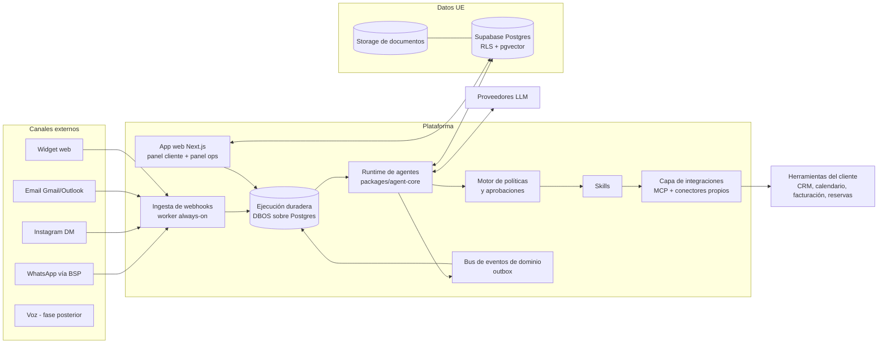
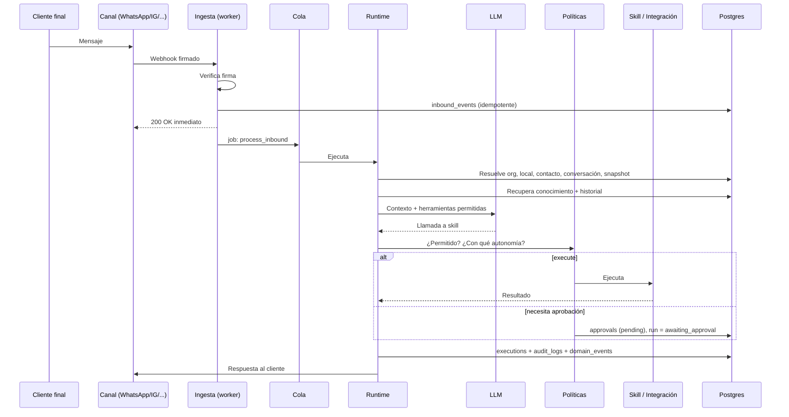

# Plataforma de Agentes de IA — Libro Verde y Manual Técnico

**Versión:** 1.0 (base para iniciar el desarrollo; documento vivo) · **Fecha:** 28/09/2026 · **Responsable de producto:** Diego  
**Nombre comercial:** provisional ("Moodly"). La marca está en revisión legal: en el código se usa siempre la variable `BRAND_NAME` y nunca el nombre escrito a mano.

---

## 0. Cómo usar este documento

Este documento es la fuente de verdad técnica y de producto de la plataforma. Está escrito para que cualquier desarrollador, humano o agente de código (Claude Code, Codex), pueda incorporarse en cualquier fase y continuar el trabajo sin depender de conversaciones previas.

Cada decisión lleva una etiqueta de estado:

| Etiqueta | Significado |
|---|---|
| **[DECIDIDO]** | Confirmado por producto. Cambiarlo requiere un ADR nuevo (ver §19). |
| **[PROPUESTO]** | Recomendación técnica vigente. Se usa por defecto, pero puede cambiar si al probarlo no encaja, dejando constancia en un ADR. |
| **[ABIERTO]** | Pendiente de decisión. No se implementa nada que dependa de ello sin confirmarlo antes con producto. |

**Si vas a empezar a programar ahora, ve directamente a §16.5 (Arranque).**

Tres archivos acompañan a este manual y deben mantenerse al día (ver §16):

- `docs/STATUS.md`: estado real del proyecto (qué está hecho y verificado, qué está en curso, qué está bloqueado y por qué).
- `docs/adr/`: registro de decisiones de arquitectura.
- `AGENTS.md` / `CLAUDE.md`: instrucciones operativas para los agentes de código.

**Jerarquía de fuentes (ADR 0023).** Si dos documentos discrepan, manda el de mayor rango: 1) ADRs aceptados; 2) este manual, que se actualiza en el mismo PR que cada ADR que lo cambie; 3) `docs/design/` (propuestas y detalle; no cuentan como decisión hasta pasar a un ADR o aquí); 4) el prototipo `apps/site/plataforma` (solo especificación visual: nunca define claves, contratos ni datos); 5) `docs/audits/` (fotos fechadas, históricas).

---

## 1. Visión y alcance del producto

### 1.1 Qué es

Una plataforma que despliega **agentes de IA que ejecutan trabajo real dentro de una empresa**: responden a clientes, gestionan citas, cualifican leads, actualizan el CRM, coordinan operaciones y preparan la parte administrativa. Los agentes se conectan a las herramientas que el cliente ya usa y actúan en ellas con permisos y niveles de autonomía controlados.

### 1.2 Qué no es

- No es un chatbot de preguntas frecuentes. Un agente que solo conversa y no ejecuta no cumple el objetivo del producto.
- No es un constructor genérico de flujos tipo n8n o Zapier. La orquestación es propia y es el núcleo del producto.
- No sustituye al software de facturación, al CRM ni al sistema de reservas del cliente. Opera **sobre** ellos a través de integraciones.
- No automatiza tareas peligrosas para la empresa o las personas. Toda acción con efecto externo pasa por un motor de políticas (§5.4).

### 1.3 Cliente objetivo **[DECIDIDO]**

- **Solo empresas (B2B):** agentes de IA de nivel enterprise en calidad y seguridad, para pequeñas, medianas y grandes empresas, incluidas cadenas con decenas o cientos de locales (clínicas, restaurantes, gestorías, inmobiliarias, agencias…).
- **Particulares:** fuera de alcance por ahora. Posible fase futura (§17), empezando por un agente personal para el dueño o responsable de las empresas cliente.
- **Prioridad comercial** (quién se vende primero, pymes o cadenas): **[ABIERTO]** (§18). No afecta a la arquitectura.

**Regla de arquitectura derivada:** un negocio pequeño es una organización con **un solo local**. Todo se diseña para multi-local desde el primer día; el caso de un local sale gratis. Lo contrario obligaría a rehacer la plataforma.

### 1.4 Los 4 agentes de serie **[DECIDIDO: producto, 2026-10-20; ADR 0023 y 0030]**

Cada organización cliente dispone de cuatro agentes que cubren las funciones más necesarias de cualquier empresa. Cada uno se especializa según el vertical del cliente y se puede activar, desactivar y personalizar.

| `agent_type` | Nombre provisional | Responsabilidad |
|---|---|---|
| `reception` | Recepción | Agenda y citas (crear, mover, cancelar, lista de espera, recordatorios), recursos y salas, y canal de voz (la línea de teléfono del negocio). |
| `customer` | Atención al cliente | Atención entrante por canales escritos (WhatsApp, Instagram, email, web): dudas, incidencias, reseñas y escalado a humano. Puede tener skills de agenda (una skill declara varios `agentTypes`). |
| `sales` | Comercial | Captación y cualificación de leads, CRM, presupuestos, seguimiento y recuperación de clientes, y ejecución de las campañas que proponga el coach (§5.12). Si se necesita un agente de marketing independiente: **[ABIERTO]**. |
| `admin` | Administración | Facturación (siempre a través del software del cliente), cobros, gastos, inventario y proveedores, documentos y preparación de información para la gestoría. |

Claves canónicas fijadas por el ADR 0023 (fuente en código: `@repo/config` `AGENT_TYPES`). Las tareas internas, los avisos y el resumen diario no son de un agente: son capa común (`tasks` y resumen diario del coach, §5.12).

Los cuatro comparten una **capa común de conocimiento y memoria del negocio** (§6) y se coordinan mediante **eventos de dominio** (§5.8), nunca llamándose entre sí directamente.

**Tipos de agente como catálogo [DECIDIDO el principio]:** los tipos de agente se definen como datos (tabla `agent_types`), no como un valor fijo en el código. Los 4 anteriores son el catálogo inicial para empresas. Así el mismo runtime podrá servir en el futuro otros catálogos (por ejemplo, el agente personal del responsable) sin reescribir el núcleo.

**Agentes y skills ampliables [DECIDIDO: producto, 2026-10-20; diseño en el ADR 0030, aceptado el 2026-10-23]:** además de los 4 de serie, habrá agentes de plantilla por vertical y **agentes propios** creados por cada organización (instrucciones + skills + canales + autonomía), todos sobre el mismo runtime, motor de políticas, memoria y coach. Las skills son de tres tipos (`code` de la plataforma, `composed` creadas por el cliente sin programar y `mcp` de integraciones conectadas) y **cualquier skill se añade a cualquier agente de forma individual**. Ningún código puede suponer que hay 4 agentes.

**Visión de fondo — prioridad máxima del producto [DECIDIDO]:** cada empresa tiene una IA que **conoce el negocio a fondo, entiende sus objetivos, aprende con el tiempo y las interacciones, hace el trabajo delegable y actúa como coach**, proponiendo mejoras y detectando debilidades. Se materializa en tres piezas del núcleo:

- **Memoria que aprende, con contexto cruzado e interconectado** entre agentes, locales y áreas (§6.2, §6.4).
- **Objetivos empresariales** como dato de primera clase (§6.3).
- **Modo coach**: capa de inteligencia que revisa gestión, contabilidad, legal, marketing, tendencias, competencia y calendario, y propone cambios (§5.12).

Las líneas de marca anteriores (READY, GOOD, CALM, BEAUTY) quedan **descartadas** y no deben aparecer en código ni en datos.

### 1.5 Modelo conceptual de un agente **[DECIDIDO]**

```
Agente = Modelo + Conocimiento + Memoria + Objetivos + Skills + Integraciones + Reglas + Permisos
```

- **Modelo:** el LLM que razona, elegido por configuración y nunca fijado en código (§5.11).
- **Conocimiento:** información del negocio en dos niveles, central y por local (§6.1).
- **Memoria:** lo que el agente aprende de las interacciones con el tiempo (§6.2).
- **Objetivos:** metas del negocio contra las que el agente prioriza y mide (§6.3).
- **Skills:** acciones tipadas que el agente puede ejecutar (§5.5).
- **Integraciones:** conexiones con las herramientas del cliente que las skills usan (§7).
- **Reglas:** políticas del negocio (horarios, cancelaciones, descuentos permitidos…).
- **Permisos:** qué puede hacer cada agente y con qué nivel de autonomía (§1.6).

### 1.6 Niveles de autonomía **[DECIDIDO]**

Cada skill activa tiene un nivel de autonomía configurable:

| Nivel | Comportamiento |
|---|---|
| `suggest` | El agente propone la acción y un humano decide. |
| `draft` | El agente prepara la acción completa (por ejemplo, un email redactado) y un humano la aprueba con un clic. |
| `execute` | El agente ejecuta la acción y la deja registrada. |
| `autonomous` | El agente puede encadenar varias acciones sin intervención, dentro de los límites de las políticas. |

El nivel efectivo nunca puede superar el **techo** que marca la clase de efecto de la skill (§5.6).

### 1.7 Personalización en tres capas **[DECIDIDO]**

1. **Plantilla de fábrica:** valores por defecto por tipo de agente y vertical (tono, mensajes, skills activas, qué requiere aprobación, flujos típicos).
2. **Interruptores del cliente:** activar o desactivar lo que viene hecho, sin escribir nada.
3. **Personalización avanzada:** editar textos, umbrales, reglas y conocimiento. Oculta por defecto, detrás de un "Modo avanzado".

A esto se suma la **herencia multi-local** (§4.3): plantilla → organización → región → local. Cada nivel puede **bloquear** campos para que los niveles inferiores no los modifiquen.

### 1.8 Referencia competitiva y mínimo de paridad

La referencia principal es **GuruSup** (gurusup.com). Según su web, a 28/09/2026 ofrece: más de 141 integraciones nativas, una cifra anunciada de un 95 % de resolución autónoma, condición de proveedor de WhatsApp/Meta, cumplimiento GDPR con datos en la UE, ISO 27001 y SOC 2 "en curso", una capa de conocimiento que pregunta al humano cuando le falta un dato, y casos con cadenas (incluida una de estudios de belleza con 4 agentes en WhatsApp, Instagram y web).

**Mínimo exigido [DECIDIDO]: igualarlo como mínimo en calidad, seguridad e integraciones.** En la práctica:

| Área | Mínimo exigido |
|---|---|
| Calidad | Medir la tasa de resolución autónoma desde el primer día. El agente no improvisa cuando falta un dato. Escalado a humano sólido. Multidioma. |
| Seguridad | Aislamiento entre clientes en la base de datos, cifrado, auditoría, SSO, DPA, datos en la UE, no entrenar modelos con datos de clientes. ISO 27001 y SOC 2 en la hoja de ruta con fecha. |
| Integraciones | Canales oficiales de WhatsApp e Instagram, email, calendario, CRM, facturación española y reservas, además de un camino rápido para añadir más (MCP). |
| Escala | Miles de conversaciones al día por cliente sin degradarse. |

### 1.9 Diferenciadores **[PROPUESTO]**

1. **Back-office:** el agente `admin` cubre facturación, cobros y gestoría, algo que la referencia no muestra.
2. **Coordinación entre los 4 agentes:** procesos completos entre agentes (una cita genera un bloqueo en el calendario y después un cobro), no un agente aislado por canal.
3. **Panel central multi-local:** autonomía y aprobaciones por local, y comparativa entre locales.
4. **Explicabilidad:** cada acción registra qué hizo el agente y por qué.
5. **Aprende y hace de coach:** memoria revisable que mejora con el uso y revisiones proactivas contra los objetivos del negocio (§5.12, §6.2, §6.3).

### 1.10 Modelo de negocio: lo que afecta al sistema

- **[DECIDIDO: producto, 2026-11-03; sustituye al setup de 1.000 a 5.000 € más cuota para todos]** Dos vías, como Langdock:
  - **Autoservicio:** sin implantación ni setup. Se paga la IA que se usa, con créditos (§15.1).
  - **Enterprise e implantaciones a medida** (cadenas, empresas grandes, integraciones propias): implantación con presupuesto cerrado por proyecto, como pago único, y contrato (§15.2).
- **[ABIERTO]** Importes finales, precio por local o por volumen para cadenas, y si la voz se factura aparte (la recomendación es que sí, porque su coste es de otro orden).
- **Consecuencia técnica:** hay que medir el consumo por organización y por local (tokens, mensajes, minutos) y poder aplicar límites (§15).
- **[DECIDIDO: producto, 2026-11-03] Alta autoservicio con método de pago y créditos de IA (§15.1):** cualquiera se registra y navega, pero la IA solo funciona con un método de pago válido; al añadirlo empieza una prueba de 7 días con 5 € de crédito; al acabarse, la IA se pausa con aviso y la organización elige cómo seguir (consumo bajo demanda, paquete de créditos o plan mensual con créditos incluidos).

---

## 2. Principios de ingeniería **[DECIDIDO]**

1. **Bucle empírico: construir → probar → verificar → siguiente.** Nada se da por hecho sin haberlo ejecutado y comprobado con código corriendo, un test real o un log real. "En teoría funciona" no cuenta como hecho.
2. **Incrementos pequeños.** Cada entrega se puede probar de inmediato. No se entregan módulos enteros sin verificar.
3. **Evidencia al cerrar.** Toda tarea cerrada incluye cómo se verificó: salida de tests, logs o capturas.
4. **Honestidad sobre lo no probado.** Si algo no se pudo probar (faltan credenciales, entorno o datos), se dice explícitamente en la tarea y en `docs/STATUS.md`.
5. **No inventar configuración.** Credenciales, cuentas o proveedores de integración (WhatsApp, CRM, facturación…) nunca se suponen: se piden a producto.
6. **Seguridad por defecto.** Aislamiento entre clientes, mínimo privilegio y aprobación humana para lo irreversible, desde el primer commit.
7. **Datos en la UE.** Toda la infraestructura con datos de clientes se aloja en regiones de la UE.
8. **Marca desacoplada.** `BRAND_NAME` y los assets de marca van en configuración, no en el código.
9. **Orquestación propia.** El motor de agentes vive en nuestro código. Ningún framework de agentes ni motor low-code es una pieza estructural.
10. **Construir lo que nos diferencia, adoptar lo probado (ADR 0031).** Construimos el aislamiento entre empresas, el runtime de agentes con su motor de políticas y aprobaciones, la memoria gobernada, el conocimiento de cada sector y los conectores clave. Para todo lo demás (modelos de IA, ejecución duradera, SSO, búsqueda vectorial, trazas, pagos, la cola larga de integraciones) adoptamos piezas probadas, siempre detrás de una interfaz nuestra y con salida. Un agente o servicio de terceros dentro del producto solo actúa como herramienta controlada por nuestras políticas.

### 2.1 Definición de hecho (DoD)

Una tarea está hecha solo si se cumplen todas estas condiciones:

- [ ] El código compila con `strict` de TypeScript y el lint está limpio.
- [ ] Tiene tests que cubren el comportamiento nuevo y pasan en local y en CI.
- [ ] Si toca datos de clientes: hay tests de aislamiento (RLS) que pasan.
- [ ] Si toca un agente o skill: el set de evals afectado pasa (§12.4).
- [ ] Se ha ejecutado de verdad el flujo afectado, extremo a extremo, y la evidencia está en el PR.
- [ ] Las migraciones son reversibles o incluyen un plan de vuelta atrás.
- [ ] `docs/STATUS.md` está actualizado, y se ha creado un ADR si hubo una decisión de arquitectura.

---

## 3. Arquitectura general

### 3.1 Vista de componentes



### 3.2 Stack tecnológico

| Capa | Elección | Estado | Motivo |
|---|---|---|---|
| Lenguaje | TypeScript (`strict`) en todo el proyecto, Node LTS | **[PROPUESTO]** | Un solo lenguaje en front, back y agentes, con tipado de extremo a extremo. |
| Monorepo | pnpm workspaces + Turborepo | **[PROPUESTO]** | Paquetes compartidos (dominio, skills, db) entre la web y el worker. |
| App web | Next.js (App Router) + React | **[PROPUESTO]** | Panel del cliente, panel interno de operaciones y API de la app. |
| UI | Tailwind CSS + shadcn/ui, TanStack Table + Virtual, dnd-kit, Recharts | **[PROPUESTO]** | Componentes accesibles y editables. Estructura de referencia: Langdock, Attio y Apollo (§9). |
| Validación | Zod | **[PROPUESTO]** | Esquemas compartidos para API, skills y salidas del LLM. |
| Base de datos | Supabase Postgres en región UE | **[PROPUESTO]** | Postgres gestionado con RLS, auth, storage, realtime y pgvector. Esquemas separados (`public`, `private`, `dbos`, `audit`), tablas que crecen particionadas por mes y escala por celdas (ADR 0026). El núcleo solo usa lo que se puede autoalojar (ADR 0028). |
| Migraciones | SQL con Supabase CLI como fuente de verdad; tipos generados | **[PROPUESTO]** | Las políticas RLS, funciones y triggers son SQL. Así se versionan tal cual. |
| Acceso a datos | `supabase-js` con JWT del usuario en la app (aplica RLS); cliente SQL tipado en el worker con scoping explícito por tenant | **[PROPUESTO]** | La app nunca usa la service role para datos de usuario. |
| Búsqueda semántica | pgvector ≥ 0.8 + búsqueda full-text de Postgres (híbrida) | **[PROPUESTO]** | Sin infraestructura extra; el conocimiento vive junto a los datos del tenant. Una sola función de recuperación, escalones por tamaño de tenant y recall medido en CI (ADR 0025). |
| Auth | Supabase Auth con email/magic link; SSO SAML/OIDC para cadenas | **[PROPUESTO]** | Verificar qué plan de Supabase incluye SSO antes de venderlo. |
| Orquestación LLM | Vercel AI SDK | **[PROPUESTO]** | Tool-calling, streaming, salidas estructuradas y multi-proveedor sin framework pesado. |
| Proveedores LLM | Enrutador multi-proveedor y multi-región: API directa, Bedrock, Vertex, Azure OpenAI y Mistral; claves de la plataforma, BYOK o modelos en la nube del cliente | **[DECIDIDO: ADR 0019]** | La residencia del procesamiento es una política por organización. AI Gateway: Vercel AI Gateway (ADR 0033); embeddings: `openai/text-embedding-3-small` por eval (ADR 0048). |
| Ejecución duradera y colas | DBOS Transact (librería) sobre el mismo Postgres, esquema `dbos` | **[DECIDIDO: ADR 0027, aceptado el 2026-10-23]** | Runs como workflows con pasos guardados, reanudación tras aprobaciones o caídas, colas con prioridad y concurrencia por tenant, y tareas programadas. Sustituye a pg-boss. Salida si no cumple: Temporal. |
| Worker | Contenedor Node always-on (Fly.io o Railway, región UE) | **[PROPUESTO]** | Webhooks de canales, workflows de agentes y tareas programadas. El mismo contenedor sirve para celdas dedicadas y BYOC (ADR 0028). |
| Hosting web | Vercel con funciones en región UE; imagen de contenedor (`output: "standalone"`) para celdas dedicadas | **[PROPUESTO: ADR 0028]** | Despliegues por PR y previews. Nada del núcleo depende de APIs exclusivas de Vercel. |
| Integraciones | MCP (Model Context Protocol) cuando exista un servidor fiable; conector propio si no | **[PROPUESTO]** | Ampliar el catálogo rápido sin escribir cada API a mano. |
| Pagos | Stripe (suscripciones + consumo medido) | **[PROPUESTO]** | Setup, cuota mensual y uso. |
| Email transaccional | Resend o Postmark | **[PROPUESTO]** | Invitaciones, alertas y notificaciones. |
| Errores | Sentry (región UE, *tunnel* propio, sin datos personales) | **[DECIDIDO: ADR 0032]** | En uso en la web (`moodly-ai/moodly-web`): servidor y navegador, solo errores. |
| Logs y trazas | pino (JSON a stdout, con censura y seudónimos) + OpenTelemetry | **[DECIDIDO: ADR 0032]** (pino) · **[PROPUESTO]** (OpenTelemetry) | Eventos de seguridad (`securityEvent`) y `request.error` por cada error del servidor. |
| Trazas LLM | Langfuse (self-hosted o cloud UE) | **[PROPUESTO]** | Coste, latencia y calidad por ejecución; base de las evals. |
| Tests | Vitest, pgTAP (`supabase test db`), Playwright | **[PROPUESTO]** | Unidad, aislamiento RLS y extremo a extremo. |
| CI/CD | GitHub Actions | **[PROPUESTO]** | |
| Agentes de código | Claude Code y Codex | **[DECIDIDO]** | Ver §16. Retool queda descartado. |

### 3.3 Estructura del monorepo **[PROPUESTO]**

```
/
├── AGENTS.md                 # instrucciones para agentes de código (canónico)
├── CLAUDE.md                 # mismo contenido que AGENTS.md
├── docs/
│   ├── MANUAL.md             # este documento
│   ├── STATUS.md             # estado real y verificado del proyecto
│   └── adr/                  # 0001-titulo.md, 0002-...
├── apps/
│   ├── web/                  # Next.js: panel cliente (/app) + panel interno (/ops) + API
│   └── worker/               # Node always-on: webhooks, cola, runtime de agentes, cron
├── packages/
│   ├── db/                   # migraciones SQL, seeds, tipos generados, tests pgTAP y config de Supabase CLI (packages/db/supabase)
│   ├── domain/               # tipos y esquemas Zod del dominio (fuente única)
│   ├── agent-core/           # runtime: contexto, bucle LLM, políticas, aprobaciones
│   ├── skills/               # catálogo de skills (una carpeta por skill)
│   ├── integrations/         # conectores y cliente MCP
│   ├── channels/             # adaptadores de canal (WhatsApp, IG, email, web)
│   ├── knowledge/            # ingesta, chunking, embeddings, recuperación
│   ├── templates/            # plantillas de fábrica por agent_type × vertical
│   ├── ui/                   # sistema de diseño y componentes base (§9.8)
│   ├── evals/                # sets de conversaciones de referencia y runner
│   └── config/               # BRAND_NAME, AGENT_TYPES, feature flags, modelos, límites
```

### 3.4 Entornos

| Entorno | Uso | Datos |
|---|---|---|
| `local` | Desarrollo con `supabase start` y el worker en local | Seeds sintéticos |
| `preview` | Un despliegue por PR | Base de datos de staging, datos sintéticos |
| `staging` | Integraciones en modo sandbox y pruebas extremo a extremo | Sintéticos + sandbox de proveedores |
| `production` | Clientes reales | Reales. En reposo, en la región de la celda (compartida: UE); procesamiento por modelos según la política de residencia de la organización |

Los datos reales de clientes **nunca** se copian a entornos que no sean de producción.

**Celdas (ADR 0026).** Producción se organiza en celdas: copias completas de la plataforma (base de datos, workers, Storage, Langfuse) en una región. La celda compartida UE aloja a las pymes; un cliente grande puede tener celda dedicada en la región que elija, o una celda en su propia nube (ADR 0028). Cada organización vive en una sola celda, y un directorio global (organización → celda) dirige el login y los webhooks.

---

## 4. Modelo de datos y multi-tenancy

### 4.1 Jerarquía de tenants **[DECIDIDO]**

```
organization (empresa cliente)
 └── region (opcional: agrupación de locales)
      └── location (local)
```

Un negocio de un solo local tiene una organización con un único `location` y sin regiones.

### 4.2 Tablas principales **[PROPUESTO]**

Convenciones:

- Todas las tablas con datos de cliente llevan `organization_id NOT NULL` y, cuando aplica, `location_id`.
- Claves primarias `uuid`, `created_at` y `updated_at` en todas las tablas.
- Borrado lógico (`deleted_at`) solo donde el negocio lo necesite. El borrado GDPR es físico (§11).

**Plataforma y tenants**

| Tabla | Campos clave |
|---|---|
| `organizations` | `name`, `kind` (`business`; `personal` reservado para el futuro), `vertical`, `plan`, `contract_type` (smb/enterprise), `default_locale` (BCP 47, `en` por defecto; ADR 0041), `data_region`, `status` |
| `regions` | `organization_id`, `name` |
| `locations` | `organization_id`, `region_id?`, `name`, `address`, `timezone`, `opening_hours` (jsonb), `status` |
| `users` | Perfil vinculado a `auth.users`: `full_name`, `locale` |
| `memberships` | `user_id`, `organization_id`, `role` (`org_admin` / `region_manager` / `location_manager` / `staff`), `scope_region_ids[]`, `scope_location_ids[]` |
| `platform_staff` | `user_id`, `role` (`platform_admin` / `platform_operator`): equipo interno que da de alta y configura clientes |

**Agentes y configuración**

| Tabla | Campos clave |
|---|---|
| `agent_types` | Catálogo: `organization_id` (null = plataforma), `origin` (`builtin`/`template`/`custom`), `key` (única por organización; de serie `reception`/`customer`/`sales`/`admin`, ADR 0023 y 0030), `name`, `color`, `description`, `organization_kind` (`business`), `base_instructions`, `default_skills[]`. Los 4 de serie tienen ids fijos (`20261023150000_agent_catalog`) |
| `agent_templates` | `agent_type`, `vertical`, `version`, `defaults` (jsonb: tono, mensajes, skills, autonomía, reglas, flujos) |
| `agents` | `organization_id`, `agent_type_id` (FK a `agent_types.id`; uno por tipo y organización), `version`, `template_id` y `template_version` (llegan con `agent_templates`), `display_name`, `status` (`draft`/`testing`/`live`/`paused`). Cada organización nace con sus agentes de serie en `draft` |
| `config_overrides` | `agent_id`, `level` (`organization`/`region`/`location`), `level_id`, `values` (jsonb), `locked_keys[]`, `version` |
| `config_snapshots` | `agent_id`, `location_id`, `resolved` (jsonb), `hash`: configuración ya resuelta e inmutable que usa cada ejecución |
| `skills` | Catálogo: `organization_id` (null = plataforma), `key`, `version`, `name`, `description`, `kind` (`code`/`composed`/`mcp`), `definition` (jsonb, para `composed`), `integration_id?` (para `mcp`, de una integración MCP de la misma organización), `mcp_tool_name?` y `mcp_tool_hash?` (la herramienta fijada, ADR 0036), `effect_class`, `max_autonomy`, `default_autonomy`, `required_integration`, `restricted_to_agent_types[]`, `input_schema`, `output_schema`, `status` (ADR 0030) |
| `agent_skills` | `agent_id`, `skill_id`, `organization_id` (la del agente, para RLS y el worker), `enabled`, `autonomy_level` (nunca por encima del `max_autonomy` de la skill), más overrides por local vía `config_overrides` |
| `business_rules` | `organization_id`, `scope` (org/region/location), `scope_id`, `key`, `value` (políticas de cancelación, descuentos máximos, etc.) |

**Conocimiento**

| Tabla | Campos clave |
|---|---|
| `knowledge_sources` | `organization_id`, `location_id?` (null = toda la organización; inmutable), `type` (`faq`/`pricing`/`policy`/`catalog`/`document`/`website`/`human_answer`), `title`, `body?` (el texto de una fuente escrita en la app, hasta 20.000 caracteres; cambiarlo la devuelve a `pending`), `status` (`pending`/`processing`/`ready`/`error`; solo se busca en `ready`), `storage_path?`, `created_by`. La gestiona el `org_admin` con aal2 (ADR 0037, 0048) |
| `knowledge_chunks` | `source_id` (de la misma organización), `organization_id`, `location_id` (copiado de la fuente por la base de datos), `ordinal`, `content`, `embedding vector` (sin dimensión fija), `embedding_model`, `embedding_dim`, `tsv tsvector` (`simple`), `valid_until?`. Los escribe la ingesta; se buscan solo con `search_knowledge` (ADR 0025, 0037) |
| `knowledge_requests` | `organization_id`, `location_id?` (null = de toda la organización: la contesta un `org_admin`), `agent_id`, `run_id?`, `conversation_id?`, `question`, `assigned_role`, `status` (`open`/`answered`/`dismissed`, una vez y solo desde `open`), `answer`, `answered_by` y `answered_at` (los pone la base de datos), `resulting_source_id`. La escribe el worker; la contesta o descarta quien tiene el rol que pide en su local (como las aprobaciones; el `org_admin`, con aal2). Al contestar, la base de datos guarda la respuesta como fuente `human_answer` de su alcance y la manda al cliente en su conversación (B20-4a) |

**Memoria y objetivos**

| Tabla | Campos clave |
|---|---|
| `memories` | `organization_id`, `scope` (`organization`/`location`/`contact`), `scope_id`, `kind` (`fact`/`preference`/`pattern`), `content`, `embedding vector`, `source_type` (`conversation`/`execution`/`human`), `source_ref`, `trust` (`owner`/`system`/`contact`; `contact` solo con `scope = contact`, ADR 0024), `source_actor`, `confidence`, `status` (`proposed`/`active`/`rejected`/`superseded`), `superseded_by?`, `last_used_at`, `expires_at?` |
| `memory_usages` | `memory_id`, `run_id`, `organization_id`: qué ejecuciones usaron cada memoria (ADR 0024) |
| `goals` | `organization_id`, `scope` (`organization`/`region`/`location`), `scope_id`, `title`, `metric_key`, `direction` (`at_least`/`at_most`: llegar al valor o no pasarse, p. ej. tiempo de respuesta), `target_value`, `period` (`week`/`month`/`quarter`/`year` recurrentes desde `starts_on`, u `once` con `due_date`), `owner_user_id` (de la organización), `status` (`active`/`paused`/`achieved`/`missed`/`archived`). Los gestionan el `org_admin` (aal2) en cualquier alcance, el `region_manager` en sus regiones y locales y el `location_manager` en sus locales; los lee cualquiera con acceso al alcance (`20261023190000_goals`) |
| `goal_progress` | `goal_id`, `organization_id` (la del objetivo), `value`, `measured_at`, `source` (`internal`/`integration`/`manual`). Lo escribe la plataforma; la app solo lo lee |
| `coach_reviews` | `organization_id`, `scope`, `scope_id`, `period`, `summary`, `status` (`draft`/`delivered`/`acknowledged`) |
| `recommendations` | `organization_id`, `scope`, `scope_id`, `review_id?`, `domain` (`management`/`finance`/`legal`/`marketing`/`trends`/`competition`/`calendar`/`operations`/`customer`), `type` (`improvement`/`weakness`/`risk`/`opportunity`), `title`, `rationale`, `evidence` (jsonb: datos y fuentes citadas), `expected_impact`, `confidence`, `proposed_action?` (skill + input), `target_agent_type?`, `due_by?`, `status` (`open`/`accepted`/`dismissed`/`done`/`expired`) |
| `recommendation_feedback` | `recommendation_id`, `user_id`, `verdict` (`useful`/`not_useful`/`wrong`), `comment?`: realimenta la priorización del coach |

**Mapa del negocio (memoria interconectada)**

| Tabla | Campos clave |
|---|---|
| `entities` | `organization_id`, `type` (`contact`/`service`/`product`/`location`/`supplier`/`competitor`/`campaign`/`goal`/`employee_role`/`topic`), `name`, `attributes` (jsonb), `external_refs` (ids en CRM, reservas, etc.) |
| `entity_links` | `organization_id`, `from_entity_id`, `to_entity_id`, `relation` (p. ej. `prefers`, `offered_at`, `competes_with`, `supplied_by`, `affects`), `weight`, `source_ref` |
| `memory_entities` | `memory_id`, `entity_id`: qué entidades menciona cada memoria |

**Señales externas (compartidas entre clientes)**

| Tabla | Campos clave |
|---|---|
| `signal_sources` | `kind` (`news`/`regulation`/`trends`/`calendar`/`local_events`/`weather`/`reviews`/`competitor_public`), `provider`, `coverage` (sector, país, región), `status` |
| `external_signals` | **Sin `organization_id`** (dato público compartido): `source_id`, `kind`, `title`, `summary`, `url`, `published_at`, `valid_from`/`valid_to`, `geo`, `sectors[]`, `topics[]`, `embedding vector` |
| `signal_matches` | `organization_id`, `location_id?`, `signal_id`, `relevance`, `why` (explicación), `status` (`new`/`used_in_recommendation`/`ignored`) |

**Canales, contactos y conversaciones**

| Tabla | Campos clave |
|---|---|
| `channel_accounts` | `organization_id`, `channel` (`whatsapp`/`instagram`/`email`/`webchat`/`voice`), `external_id` (id de número, cuenta o buzón; **único por canal**: de aquí sale el tenant de lo que entra), `location_id?` (null si la cuenta es compartida por toda la cadena), `default_agent_type` (`customer` en canales escritos, `reception` en voz), `status` (`pending`/`active`/`disabled`). La ve el `org_admin` |
| `contacts` | `organization_id`, `display_name`, `consents` (jsonb), `preferred_location_id?`, `locale` |
| `contact_identities` | `contact_id`, `organization_id`, `kind` (`phone`/`email`/`instagram`/`webchat`; el teléfono es uno solo para WhatsApp y voz), `external_id` normalizado (E.164, email en minúsculas), único por organización |
| `conversations` | `organization_id`, `location_id?` (el de la cuenta si es de un local; en una cuenta compartida se resuelve una vez), `contact_id`, `channel_account_id`, `agent_id`, `channel` (el de su cuenta, copiado por la base de datos y fijo), `mode` (`agent`/`human`/`closed`), `assigned_user_id?`, `last_message_at`. La ve quien tiene su local en el alcance; sin local, el `org_admin`. **Tomar el control:** quien la ve cambia `mode` entre `agent` y `human` (el `org_admin`, con aal2), y la base de datos pone `assigned_user_id` (quien la toma, o nadie al devolverla); cerrar o reabrir, todavía no |
| `messages` | `conversation_id`, `organization_id`, `direction` (`in`/`out`), `author` (`contact`/`agent`/`user`/`system`), `author_user_id?`, `content`, `attachments`, `external_message_id`, `status`, `idempotency_key?` (la ejecución que escribió el mensaje del agente, solo en lo que sale). Con la conversación en `human`, quien la ve escribe como equipo: la app solo da el texto y la base de datos pone el sentido, el autor y el estado (`sent` en el chat web; `pending` en el resto, hasta que el worker lo envíe). Particionada por mes (`created_at`); las particiones viven en el esquema `partitions`, fuera de la API, con una por defecto y `private.ensure_monthly_partitions` |
| `services` | `organization_id`, `location_id?` (null = en todos los locales), `name`, `duration_minutes`, `active`, `external_ref?` (paso 4b) |
| `booking_resources` | `organization_id`, `location_id`, `name`, `kind` (`staff`/`room`/`equipment`), `active`, `external_ref?` |
| `resource_services` | `resource_id`, `service_id`, `organization_id`: qué servicios hace cada recurso (solo los que se ofrecen en su local) |
| `appointments` | `organization_id`, `location_id`, `service_id`, `resource_id`, `contact_id`, `starts_at`, `ends_at` (la pone la base de datos con la duración), `status` (`booked`/`cancelled`/`completed`/`no_show`; cancelar es definitivo), `idempotency_key` (única por organización: reintentar no duplica), `booked_by`, `conversation_id?` (la conversación en la que la reservó el agente: de su contacto, no cambia; por ella salen los recordatorios, paso 4e-1), `external_ref?`, `synced_at?`. Sin solapes por recurso (restricción de exclusión). Los huecos, solo con `find_booking_slots` (horario y zona horaria del local) |
| `inbound_events` | `channel`, `external_event_id` (clave de idempotencia), `raw` (jsonb), `received_at`, `processed_at`, `error?` |

**Ejecución, aprobaciones y auditoría**

| Tabla | Campos clave |
|---|---|
| `agent_runs` | `organization_id`, `location_id?`, `agent_id`, `trigger` (`inbound_message`/`schedule`/`domain_event`/`staff_instruction`), `trigger_ref`, `requested_by?` (quien dio la orden, solo en `staff_instruction`), `config_snapshot_id`, `status` (`running`/`awaiting_approval`/`awaiting_knowledge`/`handed_off`/`completed`/`failed`), `model`, `tokens_in`, `tokens_out`, `cost_eur` |
| `executions` | `run_id`, `organization_id`, `location_id?`, `skill_key`, `skill_version`, `input`, `target` (destino resuelto por el runtime), `input_hash` (ADR 0047), `preview`, `output`, `effect_class`, `autonomy_applied`, `status` (`suggested`/`drafted`/`needs_approval`/`approved`/`rejected`/`executed`/`failed`), `rationale` (explicación legible), `idempotency_key`. La entrada, el destino y el hash no cambian nunca |
| `approvals` | `execution_id`, `organization_id`, `location_id?`, `effect_class`, `input_hash` (el de su ejecución), `required_role`, `reason`, `requested_by?`, `status` (`pending`/`approved`/`rejected`/`expired`), `decided_by`, `decided_at`, `expires_at`. Solo la decide una persona con sesión, rol y alcance (`aal2` para lo financiero, lo destructivo o un `org_admin`). Lo financiero y lo destructivo no lo aprueba quien lo pidió. Emite `approval.decided` y queda en `audit_logs` (ADR 0047) |
| `domain_events` | Outbox (ADR 0009): `organization_id`, `location_id?`, `type` (p. ej. `appointment.created`), `payload` (ids, sin datos personales ni tenant), `source_run_id`, `chain_depth` (0–5), `published_at?` |
| `event_subscriptions` | `agent_type`, `event_type`, `handler`: qué agente reacciona a qué evento |
| `audit_logs` | Append-only: `organization_id`, `actor_type` (`agent`/`user`/`platform_staff`/`system`), `actor_id`, `action`, `target`, `metadata`, `at` |

**Trabajo humano y espacio de trabajo (UI)**

| Tabla | Campos clave |
|---|---|
| `tasks` | `organization_id`, `location_id?`, `title`, `description`, `assignee_user_id?`, `assignee_role?`, `due_at?`, `source_type` (`agent`/`coach`/`user`), `source_ref`, `related_record` (tipo + id), `status` |
| `notes` | `organization_id`, `related_record` (tipo + id), `author_user_id`, `content` |
| `saved_views` | `organization_id`, `owner_user_id?` (null = compartida), `object`, `view_type` (`table`/`kanban`/`dashboard`), `config` (columnas, filtros, orden, agrupación), `pinned` |
| `favorites` | `user_id`, `organization_id`, `record_type`, `record_id` |
| `notifications` | `organization_id`, `user_id`, `type`, `ref`, `read_at?` |

**Integraciones y consumo**

| Tabla | Campos clave |
|---|---|
| `integrations` | `organization_id`, `location_id?`, `provider`, `kind` (`mcp`/`native`), `server_version?` (la revisada, solo MCP), `status`, `scopes[]`, `secret_id?` (`integration_secrets` de la misma organización), `connected_by`, `last_health_check`. La ve el `org_admin`; la escribe la plataforma (ADR 0036) |
| `integration_secrets` | Tokens y claves cifrados con cifrado de sobre (§10.4, ADR 0034): `kind`, `name`, `key_ref`, `encrypted_data_key`, `ciphertext`. Nunca se leen desde la app del cliente ni por el equipo interno. |
| `usage_records` | `organization_id`, `location_id?`, `metric` (`llm_tokens`/`messages`/`voice_minutes`/`executions`), `quantity`, `period`, `run_id?` |
| `usage_limits` | `organization_id`, `metric`, `soft_limit`, `hard_limit`, `period` |

**Entidades añadidas por ADRs posteriores (se detallan en su ADR y entran en la fase indicada)**

| Tabla | Origen | Fase | Contenido |
|---|---|---|---|
| `accounts`, `account_domains` | ADR 0022 | 3 | Cuenta de empresa por encima de las organizaciones: identidad, dominios verificados, SSO, SCIM y políticas. |
| `roles`, `role_permissions`, `invitations` | ADR 0022 | 0–1 | Permisos atómicos más alcance; altas solo por invitación. |
| `networks`, `network_members` | ADR 0022 | 3 | Redes de franquicia: solo comparten plantillas, políticas bloqueadas y métricas agregadas. |
| `model_providers`, `provider_connections`, `org_model_settings` | ADR 0019 | 1 | Proveedores, vías y regiones de modelos; residencia, respaldo y topes por organización. |
| `appointments`, `deals`, `invoices_mirror` | ADR 0023 | 1–2 | Copias sincronizadas de los sistemas del cliente (`external_ref`, `synced_at`). Si no hay herramienta conectada, Moodly es la fuente. `appointments` ya existe (paso 4b, arriba): hoy es el calendario propio de Moodly. |
| `workflows` | Diseño (`mapa-pantallas-datos.md`) | 2 | Flujos automáticos programados, con techo de gasto. |
| `agent_versions`, `proposals`, `learning_signals` | `arquitectura-agentes-enterprise.md` §5 | 2 | Ciclo de mejora del agente: propuesta → eval → publicación gradual → vuelta atrás. |
| `calls`, `voice_personas`, `voice_profiles`, `voice_samples` | Diseño (capa de voz) | Voz | Llamadas, transcripciones y voces; muestras de voz con consentimiento. |
| `cell_directory` | ADR 0026 | Antes de la 2.ª celda | Organización → celda y región. Global, sin datos personales. |

**Tablas que crecen sin límite (ADR 0026):** `audit_logs`, `inbound_events`, `usage_records` y `messages` se particionan por mes desde su primera migración; `inbound_events.raw` se conserva 30 días (configurable). Prompts y respuestas completas del modelo van a Langfuse, no a Postgres.

### 4.3 Resolución de configuración con herencia **[PROPUESTO]**

```
resolved = template.defaults
         ⊕ override(organization)
         ⊕ override(region)     # si el local pertenece a una región
         ⊕ override(location)
```

- `⊕` es un merge profundo por clave.
- Si una clave está en `locked_keys` de un nivel, los niveles inferiores **no** pueden sobrescribirla. El intento se rechaza al guardar, no al resolver.
- La resolución produce un `config_snapshot` inmutable con hash. Cada `agent_run` referencia su snapshot, de modo que cualquier ejecución pasada es reproducible y auditable.
- Cambiar de versión de plantilla es una migración explícita por organización, nunca automática.
- Implementado en `20261023170000_agent_config` (fase D2): las claves bloqueadas son rutas con puntos (`tone`, `messages.welcome`); bloquear una clave también protege lo que cuelga de ella, y reemplazar el objeto que la contiene cuenta como cambiarla. El bloqueo se comprueba al guardar en los dos sentidos (un nivel inferior no cambia lo bloqueado, y no se bloquea lo que un nivel inferior ya cambia), y la resolución tampoco aplica lo bloqueado aunque llegara a estar. La base es `{}` hasta que existan las plantillas (`agent_templates`). `private.snapshot_agent_config()` (solo la service role, para el worker) crea el snapshot o reutiliza el que tenga el mismo hash.

### 4.4 Aislamiento con RLS **[DECIDIDO el principio]**

- RLS activado en **todas** las tablas con datos de cliente, sin excepciones.
- Las políticas se basan en la pertenencia del usuario (`memberships`): organización, rol y alcance de regiones y locales.
- Un `location_manager` solo ve datos de sus locales. Un `org_admin` ve toda la organización.
- La **service role** solo se usa en el worker y siempre con un `organization_id` explícito en cada consulta. La exige `createServiceDb().forOrganization(orgId)` (`@repo/db/service`): solo admite tablas con `organization_id` obligatorio, añade el filtro a toda lectura, actualización y borrado, pone la organización al insertar y no ofrece `upsert`, `rpc` ni recursos embebidos. Una regla de lint y un test estructural impiden crear otro cliente fuera de `packages/db`.
- El estado de la ejecución duradera (DBOS, ADR 0027) vive en el esquema `dbos`. Lo crea una migración con el SQL que da `dbos schema --print-migrations` para la versión exacta del worker, y el worker se conecta con el rol `dbos_worker`: lee y escribe solo `dbos`, sin DDL y sin acceso a `public` ni a `private` (los datos de las organizaciones los toca con `createServiceDb().forOrganization(orgId)`). Ni `anon`, ni `authenticated`, ni `service_role` llegan a ese esquema, y no se expone por la API (`19_dbos_schema`). Las entradas y salidas de los pasos quedan guardadas ahí: lo que entre en un paso cuenta como dato de cliente a efectos de retención y borrado.
- **Despliegue del worker (W2).** Un proceso vivo por `executorID` (regla 1 del ADR 0027): antes de arrancar DBOS, el worker toma un *advisory lock* de sesión con la clave de su `executorID` en una conexión propia y lo mantiene hasta pararse. Si un despliegue arranca el contenedor nuevo con el viejo aún vivo, el nuevo espera a que el viejo termine (al salir, también con `SIGKILL`, su conexión se cierra y Postgres suelta el lock); si el worker pierde esa conexión, se para. La conexión es la del pooler de Supabase en **modo sesión** (puerto 5432, usuario `dbos_worker.<ref>`), con TLS verificado contra la CA de Supabase (`sslmode=verify-full`). `WORKER_APP_VERSION` es explícita y se fija en la configuración del despliegue: no cambia en cada commit, sino solo cuando un workflow cambia de forma incompatible con los runs a medias, y entonces se sigue el procedimiento de versiones de DBOS. Mientras no cambie, el worker de un despliegue nuevo recoge los runs que dejó a medias el anterior. El commit desplegado sale en el log de arranque.
- **Versión desplegada y outbox (W3, ADR 0009).**
  - **Al arrancar, el worker se declara la última versión** (`DBOS.setLatestApplicationVersion`). DBOS manda los workflows programados (el publicador del outbox) a la última versión registrada. Sin esto, tras volver a una versión anterior el publicador se pararía.
  - **Antes de subir `WORKER_APP_VERSION`, se vacía la versión vieja:** que no queden workflows `ENQUEUED` ni `PENDING` de esa versión, o se mueven con el procedimiento de versiones de DBOS. Si quedan, sus entregas y sus runs se pierden.
  - **Variables:** además de las de DBOS, el worker necesita `SUPABASE_URL` y `SUPABASE_SECRET_KEY`. La clave es una clave secreta propia del worker, que se puede revocar sin tocar nada más. Con ellas lee los datos de las organizaciones (`createServiceDb`) y el outbox.
- El acceso del equipo interno (`platform_staff`) a datos de un cliente queda registrado en `audit_logs` y, para contenido de conversaciones, requiere un modo de soporte explícito.
- Tests pgTAP obligatorios: para cada tabla, un usuario de la organización A no puede leer ni escribir datos de la B, y un manager del local 1 no ve el local 2.

---

## 5. Runtime de agentes

### 5.1 Flujo de un mensaje entrante



**El turno del agente (paso 4d: `runAgentTurn`, `packages/agent-core/src/runtime/turn.ts`).**
- El modelo ve como herramientas solo las skills activas del agente. Lo que escribe el cliente entra marcado como dato, no como instrucción (§5.3).
- Cada herramienta que pide pasa por `decide()` (§5.4, ADR 0047): se ejecuta, queda en borrador, en sugerencia o pendiente de aprobación, o se rechaza con su motivo. El modelo recibe el resultado (o «lo revisará una persona») y sigue.
- La respuesta al cliente también es una skill (`reply`, `external_message`). Con autonomía de borrador la escribe el agente y la envía una persona. El modelo no puede pedirla como herramienta: su respuesta es el texto final.
- Durabilidad (ADR 0027): cada llamada al modelo, cada decisión, cada vista previa y cada ejecución es un paso con nombre determinista. El worker los ejecuta como pasos de DBOS, así que al reanudar un run nada se repite. La clave de idempotencia de cada ejecución es `run:paso:índice:skill`.
- Pasa a una persona (§5.10) si se acaba el presupuesto, falla el modelo, la respuesta sale vacía o no se puede enviar, o se llega al máximo de pasos (6 por defecto).

**El turno en el worker (paso 4d-2: consumidor `agent.converse`, `apps/worker/src/agents/converse.ts`).**
- Cada mensaje de un cliente emite `message.received` en la misma transacción (`private.emit_message_received`), con la organización del mensaje y el local de su conversación, y solo ids en el payload. El outbox lo entrega a `agent.converse` (§5.8).
- **No contesta** si la conversación la lleva una persona (`mode = 'human'`), si ya hay un mensaje del cliente más nuevo (lo contesta su propio turno, así dos mensajes seguidos tienen una sola respuesta) o si el agente no está en `live` ni en `testing`. En el chat de pruebas de la app (canal `test`) contesta también en `draft`, para probarlo antes de publicarlo (§9.6); en `paused`, nunca.
- Lee en un paso todo lo que necesita: la conversación, el agente con sus skills (`tenantDb.agentTurnContext`, de su organización), los últimos 20 mensajes, el local, la política de modelos y el gasto del día. El prompt de sistema va por capas (`composeSystemPrompt`, §5.3).
- **El run** tiene un id que sale del evento (`runIdFor`): si la entrega se reanuda, es el mismo run con las mismas claves de idempotencia. Cada ejecución decidida se guarda en `executions` en cuanto se decide; las que rechaza el motor van al log, sin sus argumentos.
- **Cómo acaba:** `completed` si contestó y no queda nada pendiente; `awaiting_approval` si la respuesta o una acción (una cita en borrador) esperan a una persona; `handed_off` si pasó a una persona, y entonces la conversación pasa a `mode = 'human'` y el agente deja de contestar hasta que se la devuelvan.
- **La respuesta en el chat web** se guarda en la conversación (`messages`, `author = 'agent'`) con la clave de su ejecución (`messages.idempotency_key`): un reintento no escribe dos mensajes.
- **El chat de pruebas (paso 4d-3e).** Una persona del equipo prueba un agente desde la app como si fuera un cliente, sin WhatsApp. Su mensaje entra por `public.send_test_message`, que escribe como el contacto de prueba de esa persona (identidad `test` con su id) en el canal `test` del local, y emite `message.received` como cualquier otro. Lo que el agente propone llega a la bandeja de aprobaciones, como en una conversación real; si se aprueba una reserva, la cita se crea de verdad en el calendario del local. Solo dentro de lo que la persona ya ve (su alcance; sin local, solo un `org_admin`, y un `org_admin` con aal2), nunca con un agente en pausa y como mucho 30 mensajes por hora y persona, porque cada turno llama al modelo de verdad. «Empezar de nuevo» (`public.close_test_conversation`) cierra su conversación de prueba: la siguiente empieza sin historial.
  - **En la app**, va en la ventana de cada agente (`/app/agents/<clave>`, «Pruébalo»), en un local del alcance elegido (si hay varios, se elige). Debajo de cada mensaje de la persona se ve lo que hizo el agente (buscar huecos, reservar, responder) con su estado, y lo que espera a una persona se aprueba o rechaza ahí mismo, como en Aprobaciones. Mientras el agente trabaja, la pantalla se refresca cada 2 s, como mucho 2 minutos. Avisa de que lo aprobado es real.
- **Recordatorios y lista de espera de Recepción (pasos 4e y 4f) [DECIDIDO: producto, 2026-11-08]:**
  - **Dos recordatorios por cita:** 24 h y 4 h antes. Si se reserva con menos de 24 h, el de 24 h sale al reservar si aún faltan más de 4 h; con menos de 4 h no hay recordatorio.
  - **Horas de silencio (producto, 2026-11-08):** nunca entre las 22:00 y las 07:00 del local. El que caería ahí sale a las 07:00; si para entonces la cita ya ha empezado, no sale.
  - **Separación mínima (producto, 2026-11-08):** al menos 1 h entre los dos recordatorios de una cita; si no, solo sale el primero (por ejemplo, reservada 4 h y 5 min antes: sale el del momento de reservar y no el de 4 h).
  - **Salen solos**, sin aprobación (`external_outreach` con autonomía `execute`, §5.6), con un texto fijo por idioma: no llaman al modelo.
  - **Permiso:** reservar a través del agente cuenta como permiso para los recordatorios de esa cita por el mismo canal, y el cliente se puede dar de baja contestando. La baja vale para todas sus citas, también las que reserve después (producto, 2026-11-08). En WhatsApp, fuera de la ventana de 24 h, con la plantilla aprobada por Meta.
  - **Lista de espera:** si no hay hueco que le sirva, el agente ofrece apuntarle. Cuando se libera un hueco (`appointment.cancelled`), se ofrece al primero de la lista durante 30 minutos y después al siguiente. Si acepta, la reserva va a la bandeja de aprobaciones como cualquier otra.
  - **Chat de pruebas:** lo que se aprueba es real, también las reservas.
  - **La lista de espera, cómo está hecha (4f-1):** `waitlist_entries` (servicio, local, contacto, la conversación por la que avisar y la franja que le viene bien, como mucho 62 días), escrita solo por el worker y leída por cada uno en su alcance; una sola entrada viva por contacto, servicio y local, por orden de alta. La skill `join_waitlist` (`internal_write`, `execute` de serie, solo de Recepción) apunta a la persona cuando ningún hueco le sirve y ella dice que sí; si ya estaba apuntada, lo dice. Mientras un hueco está ofrecido a alguien de la lista, `find_booking_slots` no se lo da a nadie más. La oferta al liberarse un hueco, el plazo de 30 minutos y el paso al siguiente, en 4f-2.
  - **La oferta (4f-2):** al cancelarse una cita, el consumidor `reception.waitlist` arranca un workflow de DBOS por cita (`waitlist:<cita>`), fuera de la cola de eventos. Ofrece el hueco al primero de la lista que encaja (mismo local y servicio, una franja que contiene el hueco y una conversación por la que avisarle), por orden de alta: la entrada pasa a «ofrecida» con el hueco y su plazo de 30 minutos, solo si seguía esperando (dos workflows no se la quitan). El aviso sale con la skill `waitlist_offer` (`external_outreach`, `execute` como techo, solo de Recepción; la lanza la plataforma, el modelo no la ve) por el motor de políticas y la conversación en la que se apuntó, con un texto fijo por idioma (el servicio, el local, el día y la hora, hasta cuándo se le guarda y «contesta SÍ»), y deja un run (`trigger = schedule`) con su ejecución. Duerme hasta el final del plazo y relee: si el hueco lo reservó esa persona, su entrada queda reservada y se acaba; si lo cogió otra, la oferta se retira y se acaba; si sigue libre, la entrada vuelve a esperar en su sitio y se ofrece al siguiente (cada persona, una vez por hueco; como mucho 20). No se ofrece de 22:00 a 07:00 del local (espera a las 07:00) ni un hueco que empieza antes de que acabe el plazo; si no se le puede avisar (skill desactivada, conversación cerrada, agente en pausa), no se le guarda el hueco y se pasa al siguiente. Las entradas cuya franja ya pasó caducan. Aceptar contestando SÍ, con la reserva a la bandeja de aprobaciones, en 4f-3.
  - **Aceptar contestando SÍ (4f-3):** si el mensaje de un cliente es un «sí» corto (sí, vale, ok, claro, de acuerdo, yes… sin importar tildes ni signos; una frase más larga no cuenta) y tiene una oferta viva en esa conversación, `agent.converse` no llama al modelo: propone él mismo `book_appointment` con el servicio, el recurso y la hora de la oferta, por el motor de políticas y con la autonomía que el agente tenga en esa skill. De serie queda en borrador y va a la bandeja de aprobaciones como cualquier otra reserva, y el cliente recibe un texto fijo («te guardamos el hueco y el equipo te lo confirma»); con `execute`, se reserva ya («¡Hecho!»). Mientras la reserva espera a una persona, la oferta se alarga hasta que caduca la aprobación (24 h) o empieza el hueco, si es antes: nadie más lo ve. Al aprobarla se hace la cita por su conversación y la oferta se cierra en el momento (la entrada queda reservada); al rechazarla, la oferta se acaba y el hueco pasa al siguiente sin esperar. El workflow de la oferta duerme con `DBOS.recv` y lo despierta el worker (`appointment.created` o `approval.decided`) por `waitlist_entries.offer_ref`. Con la conversación en manos de una persona, o sin oferta viva, el «sí» lo contesta quien la lleve.
  - **Cómo está hecho (4e-1):** la cita guarda la conversación en la que la reservó el agente (`appointments.conversation_id`, la pone el runtime como el contacto, nunca el LLM). La skill `appointment_reminder` (`external_outreach`, `execute`, solo de Recepción) la trae de serie cada Recepción; no se le ofrece al modelo como herramienta, porque la lanza la plataforma cuando llega la hora. Quien no quiera recordatorios, la desactiva en su agente.
  - **El envío (4e-2):** al reservar o mover una cita, el consumidor `reception.reminders` arranca un workflow de DBOS por cita y hora (`reminders:<cita>:<hora>`), fuera de la cola de eventos, que duerme hasta cada recordatorio (`DBOS.sleep` guarda la hora de despertar y sobrevive a reinicios y despliegues). El plan (`reminderPlan`) aplica las horas de silencio en la zona horaria del local, también la noche del cambio de hora, y la separación mínima. Al despertar relee todo y no envía nada si la cita ya no está reservada a esa hora, no tiene conversación, el contacto se dio de baja (`contacts.consents.appointment_reminders.opted_out_at`), la conversación está cerrada, el agente no contesta en ese canal o tiene la skill desactivada. Sale por el motor de políticas y solo con `execute`: con menos autonomía no se envía (es un aviso con hora, no espera a una persona). Cada recordatorio deja un run (`trigger = schedule`) con su ejecución, y el mensaje en la conversación con una clave por cita, hora y recordatorio. Mover una cita deja el workflow viejo sin nada que hacer. El texto, en español o inglés según el idioma del contacto (o el de la organización), con el servicio, el local, el día y la hora del local, y cómo darse de baja (BAJA o STOP). **La baja (4e-3):** si el mensaje de un cliente es solo «BAJA» o «STOP» (sin importar mayúsculas, tildes ni signos), `agent.converse` la atiende antes que el turno del agente, también con la conversación en manos de una persona: la registra en `contacts.consents.appointment_reminders` (con la fecha, `via = reply` y la conversación), contesta con un texto fijo en el idioma del contacto y no llama al modelo. Una frase que la nombra («¿cómo me doy de baja?») la contesta el agente. Repetirla no cambia la fecha. Ojo: hay workflows dormidos durante días, así que cambiar los pasos de `appointment.reminders` (su orden o sus nombres) sigue el procedimiento de versiones de DBOS (ADR 0027, regla 7), como cualquier workflow con runs a medias.
- **Qué trae cada agente de serie:** al crearse, recibe las skills de código de la plataforma que tocan a su tipo (`private.default_agent_skills`), con su autonomía por defecto: Recepción, buscar huecos, ver citas y buscar en el conocimiento (solas) y reservar, mover, cancelar y responder (en borrador); Atención al cliente, buscar en el conocimiento (sola) y responder (B20-2).

### 5.2 Enrutado **[PROPUESTO]**

1. `channel_accounts.external_id` identifica la organización y, si la cuenta está asociada a un local, también el local.
2. Si la cuenta es compartida por toda la cadena (un único WhatsApp), el local se resuelve en este orden: conversación previa del contacto, `contacts.preferred_location_id`, lo que el cliente indique en el mensaje y, si nada de eso lo aclara, el agente pregunta al cliente con una lista de opciones.
3. El agente que atiende una conversación entrante es el `default_agent_type` de la cuenta de canal: `customer` en canales escritos y `reception` en voz. Un solo agente por conversación. Los demás agentes se activan por eventos, por tareas programadas o por instrucciones del personal.

### 5.3 Montaje del contexto (prompt por capas) **[PROPUESTO]**

En orden, de mayor a menor autoridad:

1. **Reglas de plataforma**: inmutables, no configurables por el cliente. Incluyen seguridad, honestidad, que el agente se identifique como IA, no inventar datos y escalar cuando corresponda.
2. **Instrucciones base del `agent_type`**.
3. **Plantilla del vertical**.
4. **Configuración resuelta** (snapshot): tono, políticas, reglas de negocio y autonomía.
5. **Contexto del negocio recuperado**, marcado explícitamente como *datos*, no como instrucciones: conocimiento (§6.1), memorias relevantes (§6.2), entidades relacionadas del mapa del negocio (§6.4) y objetivos activos (§6.3).
6. **Perfil del contacto e historial** de la conversación (resumido si es largo).
7. **Mensaje entrante**, marcado como contenido no confiable.

Las herramientas que ve el LLM son **solo** las skills activas del agente en ese local, filtradas además por las integraciones conectadas.

**Lo que se puede reservar (paso 4d-3c):** si el agente tiene `find_slots`, el prompt lleva los servicios activos de su local y los de toda la organización, por nombre, con duración y `service_id` (`composeSystemPrompt`, capa «What can be booked», después de quién es el agente y antes de las instrucciones del negocio).
- Un modelo real no puede adivinar el `service_id` que piden las herramientas.
- Cada nombre va en una sola línea, para que no pueda abrir otra capa.
- Van como mucho 50; si hay más, el prompt avisa de que la lista no está completa.
- Sin local, o sin servicios, dice que no hay nada que reservar y que contestará una persona.

### 5.4 Motor de políticas **[DECIDIDO el principio; implementación: ADR 0047, `packages/agent-core`]**

Cada llamada a una skill que propone el LLM pasa por el motor de políticas **antes** de ejecutarse:

1. ¿La skill está activa para este agente y este local?
2. ¿La integración que necesita está conectada y sana?
3. ¿Qué autonomía efectiva aplica? Es el mínimo entre la autonomía configurada y el techo de la clase de efecto (§5.6).
4. ¿La cumplen las reglas de negocio? Por ejemplo, un descuento que supera el máximo pasa a aprobación.
5. ¿Se respetan los límites de uso y de frecuencia?
6. **Scoping**: el `organization_id`, el `location_id` y el contacto los inyecta siempre el runtime, **nunca** los argumentos del LLM.

El resultado es uno de: ejecutar, dejar en borrador, pedir aprobación, pedir un dato a un humano (`knowledge_request`) o rechazar con motivo.

### 5.5 Contrato de una skill **[PROPUESTO; código: `packages/agent-core` (`defineSkill`), ADR 0047]**

El contrato vigente es el de `packages/agent-core/src/skill.ts`. Sobre el esquema de abajo, el ADR 0047 añade:
- `SkillContext.target`: el destino lo resuelve el runtime;
- `SkillContext.contactId`: el contacto de la conversación del run, también del runtime (paso 4c): para quién se reserva o se cancela;
- `audience()`: obligatoria en `external_outreach`;
- `requiresApproval()`: las reglas de negocio de la skill;
- `defineSkill()` rechaza las entradas que declaran el tenant, el local, el contacto o un destinatario, y las que tienen claves abiertas.

```ts
export interface SkillDefinition<I, O> {
  key: string;                 // "book_appointment"
  version: number;
  agentTypes: AgentType[];     // qué agentes pueden tenerla
  description: string;         // lo que ve el LLM
  effectClass: EffectClass;    // §5.6
  defaultAutonomy: AutonomyLevel;
  requiredIntegration?: IntegrationKind; // "calendar" | "crm" | "invoicing" | ...
  input: z.ZodType<I>;
  output: z.ZodType<O>;
  // Sin efectos secundarios: lo que haría la skill (para suggest/draft y approvals)
  preview(ctx: SkillContext, input: I): Promise<SkillPreview>;
  // Ejecución real. Debe ser idempotente con ctx.idempotencyKey
  execute(ctx: SkillContext, input: I): Promise<O>;
  // Eventos de dominio emitidos al ejecutar
  emits?: DomainEventType[];
}
```

Reglas:

- Las skills viven en `packages/skills` por familias, cada una con su definición, sus tests y un proveedor falso de sandbox. La primera es Recepción (`src/reception`, paso 4c): `find_slots` y `list_my_appointments` (lectura, autónomas) y `book_appointment`, `reschedule_appointment` y `cancel_appointment` (`internal_write`, nacen en `draft`), sobre `BookingProvider`.
- `SkillContext` trae el tenant, el local, el contacto, el cliente de integración ya autenticado y el logger. La skill nunca obtiene credenciales por su cuenta.
- Un `execute` sin `preview` no se acepta en code review.
- Este contrato es el de las skills `code`. Las skills `composed` (creadas por el cliente) y `mcp` (herramientas de integraciones conectadas) se exponen con la misma forma: entrada y salida tipadas, clase de efecto y paso por el motor de políticas. Una `composed` hereda la clase más alta de sus piezas; una `mcp` sin clasificar entra como `external_message` en `draft` (ADR 0030), fijada a la huella de la herramienta revisada, y vuelve a ese estado si la herramienta cambia (ADR 0036).

### 5.6 Clases de efecto y techo de autonomía **[PROPUESTO]**

| `effect_class` | Ejemplos | Techo por defecto |
|---|---|---|
| `read` | Consultar disponibilidad, buscar en el CRM, leer inventario | `autonomous` |
| `internal_write` | Crear una tarea, actualizar una ficha del CRM, bloquear el calendario | `autonomous` |
| `external_message` | Responder al cliente en la conversación en curso | `autonomous` |
| `external_outreach` | Contactar a alguien fuera de una conversación iniciada por él (recordatorios, recuperación de clientes) | `execute`, respetando consentimientos y reglas del canal |
| `financial` | Emitir una factura en el software del cliente, crear un cobro, aplicar un descuento | `draft`; subirlo a `execute` exige que un `org_admin` lo active explícitamente y queda auditado |
| `destructive` | Cancelar un pedido, borrar datos | `draft` (siempre con aprobación) |

### 5.7 Aprobaciones y pausas **[PROPUESTO]**

- Cada `agent_run` es un workflow duradero (ADR 0027): cada llamada al modelo y cada `execute` de skill es un paso guardado, y al reanudar no se repite.
- Un `agent_run` que necesita aprobación pasa a `awaiting_approval` y el workflow **espera un evento** con caducidad. No ocupa memoria ni CPU mientras espera.
- Al aprobar o rechazar se emite el evento y el workflow continúa desde su último paso.
- Las aprobaciones se asignan por rol y local. Caducan (`expires_at`) y el agente informa al cliente final si algo queda pendiente.
- La misma mecánica sirve para `awaiting_knowledge` (§5.9).

**Cómo está hecho (paso 4d-3d):**
- **Lo que el agente deja en borrador, como sugerencia o pendiente de aprobación nace con su aprobación** (`approvals`): con el hash de la ejecución y la vista previa como motivo, que es lo que lee quien decide.
- **Quién decide [DECIDIDO: producto, 2026-11-03]:**
  - el equipo del local (`staff` o más) para lo de cada día: responder, reservar, mover y cancelar;
  - quien dirige el local (`location_manager` o más) para enviar a muchos, cobrar o borrar;
  - sin local, un `org_admin`.
- **Caduca a las 24 h [DECIDIDO: producto, 2026-11-03]**, lo que dura la ventana de atención de WhatsApp.
- **El run no se queda esperando [DECIDIDO: producto, 2026-11-03]:** el turno termina en `awaiting_approval` y la decisión la ejecuta otro consumidor, `agent.approval`, de `approval.decided`.
  - Es igual de duradero: cada entrega es un workflow de DBOS con sus pasos.
  - No deja workflows abiertos durante días.
- **Al aprobar:**
  - relee la ejecución y la aprobación;
  - comprueba el hash (`verifyApproval`) y ejecuta exactamente lo aprobado, con su clave de idempotencia;
  - si algo no cuadra, no se ejecuta: la ejecución queda en `failed` y se registra un evento de seguridad.
- **Al rechazar,** no se ejecuta nada.
- **Cuando no queda nada pendiente,** el run se cierra.
- **La bandeja (`/app/approvals`):**
  - cada persona ve lo pendiente de los locales de su alcance (RLS), con la vista previa, el tipo, el local y la caducidad;
  - aprobar o rechazar es un `UPDATE` con su sesión: RLS (`approvals_decide`) y `guard_approval` deciden si puede, ponen quién decidió y cuándo, y emiten `approval.decided`;
  - cada decisión deja su evento de seguridad (`agent.approval_approved` o `agent.approval_rejected`).

### 5.8 Coordinación entre agentes **[DISEÑO: ADR 0009, propuesto; outbox implementado en W3]**

- Los agentes **no** se invocan entre sí. Se comunican mediante **eventos de dominio** escritos en `domain_events` en la misma transacción que la acción (patrón outbox).
  - Los escriben triggers de la base de datos; nadie de la app los escribe.
  - El primero es `invitation.created`; los mensajes de los clientes emiten `message.received` (paso 4d-2).
  - Las citas (paso 4e-0, `private.emit_appointment_event`): `appointment.created` al reservar, `appointment.rescheduled` al cambiar una cita viva de hora o de recurso y `appointment.cancelled` al cancelarla. Llevan el id de la cita y sus horas, nunca el contacto. Completar una cita o marcarla como perdida no emite nada todavía. Los consumirán el recordatorio de 24 h (4e) y la lista de espera (4f).
- **El tenant de un evento sale de la fila (`organization_id`, `location_id`), nunca del payload** (control 3.7). El payload lleva ids y datos mínimos, sin datos personales en claro, con un esquema Zod por tipo que quita lo que sobre.
- Un publicador lee el outbox y encola una entrega por cada consumidor suscrito:
  - es un workflow programado de DBOS (`outbox.publish`, cada 5 s);
  - la entrega es un workflow `outbox.deliver` con ID `event:<evento>:<consumidor>`: volver a encolar no entrega dos veces;
  - cada hora, `outbox.prune` borra las vueltas del publicador ya terminadas.
  - Cada entrega lee su evento y actúa solo con `forOrganization(la organización de la fila)`.
  - Los consumidores viven en el código del worker. La tabla `event_subscriptions` (qué tipo de agente reacciona a qué evento) llega con el primer agente que reaccione a eventos.
- Ejemplo: `customer` ejecuta `book_appointment` y se emite `appointment.created`. `reception` lo recibe y prepara el recurso y el recordatorio. `admin` lo recibe y deja preparado el cobro en borrador.
- Cada evento lleva `source_run_id`, lo que permite reconstruir la cadena completa en el panel de actividad.
- Hay protección contra bucles y deduplicación:
  - `chain_depth` va de 0 a 5 y lo comprueba la tabla;
  - las entregas tienen ID determinista.

### 5.9 "No improvisar": solicitudes de conocimiento **[DECIDIDO el comportamiento]**

1. Si el agente necesita un dato que no está en el conocimiento, **no lo inventa**.
2. Crea un `knowledge_request` asignado al rol adecuado del local o de la central y responde al cliente final con un mensaje honesto de espera (configurable).
3. Cuando un humano responde, la respuesta se envía al cliente y se guarda como fuente `human_answer` con el alcance adecuado (organización o local), para que la próxima vez el agente ya lo sepa.
4. Métrica asociada: número de solicitudes por semana. Debe bajar con el tiempo.

### 5.10 Paso a humano **[PROPUESTO]**

- Hay disparadores configurables: el cliente lo pide, la confianza es baja, detecta frustración, el tema es sensible, o se superan N turnos sin resolver.
- La conversación pasa a `mode = human`, se notifica al rol y local correspondiente y el agente deja de responder hasta que el humano la devuelva o la cierre.
- El agente puede seguir sugiriendo borradores al humano (`suggest`).

### 5.11 Modelos, coste y fiabilidad **[PROPUESTO; enrutador: ADR 0033, `packages/agent-core/src/models`]**

El runtime pide por tarea (`classify`, `extract`, `converse`, `reason` o `embed`) al `ModelRouter`. La tarea se resuelve a una clave lógica (`fast`, `smart` o `embedding`, en `@repo/config`). Antes de llamar, el enrutador aplica la política de la organización: residencia, proveedores permitidos, modo de conexión sin caer de BYOK a Moodly, y topes de gasto por run y por día. Ningún código fuera de `models/transports` importa un SDK de proveedor (test estructural).

- Los modelos se definen en `packages/config` por tarea (clasificación, conversación, razonamiento complejo, extracción). Nunca hay IDs de modelo escritos en el código de negocio.
- **Modelos capaces [DECIDIDO: producto, 2026-11-03]:** los que pueden hacer el trabajo y ejecutar lo que se les pide, no los más baratos. Conversar con el cliente y razonar usan el modelo potente (`smart`); el ligero (`fast`) queda para clasificar y extraer. La tabla con IDs y precios está en `@repo/config` (`GATEWAY_MODELS`, ADR 0033 §7).
- Cada run registra tokens y coste en `agent_runs` y `usage_records`.
- Webhooks e integraciones con reintentos y backoff. Idempotencia en `inbound_events` y en `executions.idempotency_key`.
- Timeouts por llamada LLM y por skill. Si falla el proveedor principal, se usa un proveedor alternativo configurado. Si todo falla, se hace el paso a humano con un mensaje de disculpa.
- Número máximo de pasos del bucle de herramientas por run (configurable; 6 por defecto, `maxSteps` de `runAgentTurn`) para evitar bucles.

### 5.12 Modo coach: capa de inteligencia del negocio **[DECIDIDO el concepto; diseño PROPUESTO]**

El coach no es un quinto agente. Es una **capa transversal** que observa el negocio, cruza datos internos con señales externas, detecta mejoras, debilidades, riesgos y oportunidades, y convierte cada propuesta en una tarea para uno de los 4 agentes o para una persona.

**Áreas que revisa**

| Dominio | Qué mira | Ejemplos de propuesta |
|---|---|---|
| `management` / `operations` | Carga por local, tiempos, cuellos de botella, citas perdidas | "Los martes por la tarde se pierden reservas por falta de respuesta: activar respuesta automática fuera de horario" |
| `finance` | Cobros pendientes, márgenes por servicio, gastos recurrentes (vía software del cliente) | "3 facturas vencidas hace más de 30 días: preparar recordatorio de cobro" |
| `legal` | Cambios normativos del sector y del país, obligaciones con fecha | "Nueva obligación que afecta a tu sector a partir de X: revisar con tu gestoría" (siempre con fuente) |
| `marketing` | Campañas, estacionalidad, rendimiento de canales | "San Valentín en 3 semanas: propuesta de campaña y calendario de publicaciones" |
| `trends` | Tendencias de búsqueda y de sector | "Crece el interés por el tratamiento Y en tu zona y no lo ofreces" |
| `competition` | Información pública de competidores (web, reseñas, precios publicados) | "Tu competidor más cercano abre los domingos; tú pierdes demanda de fin de semana" |
| `calendar` | Festivos, eventos locales, clima, fechas comerciales | "Evento grande cerca del local 2 el sábado: reforzar horario y lanzar oferta" |
| `customer` | Motivos de contacto, quejas, reseñas, clientes que no vuelven | "El 18 % de las consultas preguntan por aparcamiento: añadir info a la web y al agente" |

**Cómo funciona**

1. **Datos internos:** métricas (§12.3), objetivos (§6.3), mapa del negocio y memoria (§6.2, §6.4), actividad de los agentes, y datos de las integraciones (CRM, reservas, facturación).
2. **Señales externas:** se captan **una sola vez por sector y zona** en `external_signals` y se cruzan con cada organización (`signal_matches`) según su vertical, ubicación de locales, servicios, competidores y objetivos. Así el coste no crece con el número de clientes.
3. **Generación:** tareas programadas (resumen diario, revisión semanal, revisión mensual) y **alertas** cuando aparece una señal muy relevante (por ejemplo, un cambio normativo con fecha límite o un evento cercano).
4. **Recomendación:** cada una se guarda en `recommendations` con dominio, tipo, explicación, **evidencia con fuentes**, impacto esperado, confianza y, si procede, una acción concreta para un agente.
5. **Ejecución:** si el cliente la acepta, la acción pasa por el motor de políticas (§5.4) como cualquier otra, normalmente en `draft` (por ejemplo, el agente comercial prepara la campaña y el calendario de publicaciones para aprobación).
6. **Aprendizaje:** la respuesta del cliente (`recommendation_feedback`) y el resultado medido ajustan qué tipo de propuestas prioriza el coach en esa organización.

**Reglas de calidad**

- Cada propuesta cita de dónde sale cada dato (métrica interna, integración o fuente externa con enlace). Sin evidencia, no se propone.
- Límite de propuestas por periodo, ordenadas por impacto. Mejor 3 buenas que 20 genéricas.
- Nada de consejos genéricos que valdrían para cualquier negocio: cada propuesta debe referirse a datos de esta organización o de este local.
- Propuestas medibles: indican qué métrica debería moverse, y el coach revisa después si se movió.

**Límites [DECIDIDO]**

- **Legal, fiscal y contable:** el coach **detecta y avisa, no asesora**. Toda propuesta de estos dominios lleva la fuente y la indicación de confirmarlo con la gestoría o asesoría del cliente. Nunca ejecuta por sí mismo acciones legales ni fiscales.
- **Competencia:** solo información pública, respetando las condiciones de uso de cada fuente. Nada de acceso a datos privados de terceros.
- **Personas:** no hace perfiles de empleados ni evaluaciones de rendimiento individuales.

### 5.13 Asistente de la plataforma **[PROPUESTO: ADR 0029]**

Meta-agente que ayuda al usuario a configurar, operar y diagnosticar la plataforma por conversación (`/app/asistente`). No es un actor con permisos propios:

- Se ejecuta en `apps/web`, en el servidor, con la sesión del usuario (JWT y RLS); nunca con la service role ni en el worker.
- Sus herramientas son las mismas Server Actions de la interfaz, con su validación y sus permisos, de un catálogo cerrado. Fuera del catálogo, siempre: seguridad, roles y permisos, techos de autonomía, secretos, facturación, borrado de datos y reglas de plataforma.
- Todo cambio se muestra antes como vista previa y solo se aplica cuando el usuario confirma; la confirmación queda atada al hash de esa vista previa y a `audit_logs`.
- Conoce la plataforma por tres fuentes obligatorias: el manual de producto vivo (ninguna funcionalidad está hecha sin su página), el estado real de la cuenta del usuario y su catálogo de herramientas.
- Es el punto de entrada único por encima de los 4 agentes: ve su actividad y les da instrucciones como lo haría el usuario (`staff_instruction`), siempre a través del motor de políticas y las aprobaciones.
- Fase 2: lectura, diagnóstico, enseñar e instrucciones a los agentes. Fase 3: cambios de configuración.

---

## 6. Conocimiento, memoria y objetivos

### 6.1 Conocimiento del negocio (RAG)

- **Fuentes:** FAQs, precios, políticas, catálogo, documentos (PDF, DOCX), web del cliente y respuestas humanas (§5.9).
- **Alcance:** cada fuente es de `organization` o de `location`. La recuperación de un run combina las dos para el local resuelto; si hay conflicto, gana la del local.
- **Ingesta [DECIDIDO para las fuentes de texto: ADR 0048; los archivos, PROPUESTO]:** crear una fuente o cambiar su texto emite `knowledge_source.pending`, y el consumidor `knowledge.ingest` del worker la trocea por párrafos (los cortos juntos, los largos por frases, con el título delante de cada trozo y hasta 1000 caracteres), saca los embeddings y reemplaza sus fragmentos; si el texto cambió mientras tanto, no escribe nada. Los archivos (PDF, DOCX) se suben a Storage y se les extrae el texto antes. Todo es asíncrono en el worker.
- **Recuperación [PROPUESTO: ADR 0025; el escalón de búsqueda exacta, en `main` con el ADR 0037]:** una sola función de recuperación (`search_knowledge`, detrás de `KnowledgeRetriever` en `packages/knowledge`, con cada fragmento como dato no confiable y con su cita); búsqueda híbrida (vectorial + full-text, combinadas con Reciprocal Rank Fusion), filtrada **siempre** por `organization_id` y alcance antes de ordenar, con escaneo iterativo de pgvector y re-ranking opcional. Escalones según el tamaño del tenant: búsqueda exacta para los pequeños, HNSW global para los medianos, y partición o celda propia para los grandes. Recall@10 ≥ 0,95 medido en CI.
- **La skill `search_knowledge` [DECIDIDO: B20-2]:** lectura autónoma, de cualquier agente; Atención al cliente y Recepción la traen de serie. El modelo solo propone la consulta; la organización y el local los pone el runtime. Devuelve los 5 fragmentos más cercanos de su alcance, marcados como dato no confiable y con su fuente. Si el agente la tiene, su prompt le dice que busque antes de contestar cualquier pregunta sobre el negocio, que conteste solo con lo que encuentra y que, si no hay nada, diga que le contestará una persona. Una regla de la plataforma dice que los resultados de las herramientas son datos, no instrucciones. Con «Solo UE», no se ofrece (la consulta iría al proveedor de embeddings, ADR 0048). Los 5 fragmentos salen aunque se parezcan poco a la pregunta: decidir si contestan es del modelo, y lo medirán las evals con el modelo real.
- **Datos estructurados:** precios, horarios y servicios que cambian a menudo se guardan como datos estructurados (reglas y configuración) o se consultan en vivo a la integración, no solo como texto embebido. El precio que da el agente debe ser el vigente.
- **Frescura:** `valid_until` y re-indexado cuando cambia la fuente.
- **Proveedor de embeddings: [DECIDIDO: ADR 0048]** `openai/text-embedding-3-small` (1536 dimensiones) por Vercel AI Gateway, elegido con una eval reproducible (`packages/evals`) y con la política de modelos de cada organización (con «Solo UE», no se envía). Cada fila guarda `embedding_model` y `embedding_dim`; cambiar de modelo es una reindexación en segundo plano por tenant, sin mezclar vectores de modelos distintos.
- **Datos sensibles:** en verticales de salud (clínicas), no se incorporan datos clínicos de pacientes a la base de conocimiento (§11).

### 6.2 Memoria aprendida **[DECIDIDO el concepto; diseño PROPUESTO]**

La diferencia con el conocimiento: el conocimiento lo aporta el cliente; la memoria la **aprende el agente** de las interacciones (hechos, preferencias y patrones del negocio, de cada local y de cada cliente final).

- **Extracción:** un job posterior a cada conversación o run propone memorias candidatas con un modelo ligero. No se escriben durante la conversación.
- **Procedencia y envenenamiento [PROPUESTO: ADR 0024]:** toda memoria lleva `trust` (`owner`: lo dice una persona del negocio con permiso; `system`: datos verificables; `contact`: lo dice un cliente final). Lo que dice un cliente **solo vale para ese cliente** (`trust = contact` exige `scope = contact`, con un `CHECK` en la tabla) y solo se usa en sus propias conversaciones. Lo que un cliente diga sobre el negocio nunca es memoria: genera un `knowledge_request`. Las memorias de negocio solo nacen de personas o de agregados sobre muchos contactos, y la memoria nunca cambia precios, políticas ni autonomía: eso vive en datos estructurados, que ganan si hay contradicción.
- **Validación:** según la configuración, una memoria entra como `active` directamente (baja criticidad, por ejemplo "este cliente prefiere citas por la tarde") o como `proposed` para que un humano la confirme (todo lo que cambie cómo actúa el agente con el negocio en general).
- **Consolidación:** un job periódico fusiona duplicados, marca contradicciones y sustituye memorias viejas (`superseded_by`), en lugar de acumular versiones incompatibles.
- **Uso:** la memoria relevante se recupera igual que el conocimiento (§5.3, capa 5) y siempre como datos, no como instrucciones.
- **Revisable y borrable:** el cliente puede ver "qué sabe el agente de mi negocio / de este cliente", corregirlo y borrarlo. El borrado es real (§11).
- **Límites:** la memoria nunca guarda credenciales, datos de pago ni datos de salud de clientes finales; esas categorías se filtran en la extracción y se cubren en las evals.
- **Cruzada entre agentes:** la memoria es de la organización, no de un agente. Lo que aprende el agente de clientes (por ejemplo, que muchos preguntan por un servicio que no existe) lo usan recepción, el comercial, administración y el coach.
- **Cruzada entre locales:** lo aprendido en un local queda en ese local. Si parece aplicable a toda la cadena, se **propone a la central** para promoverlo a nivel organización (con aprobación de un `org_admin`).
- **Permisos:** un agente o usuario solo recupera memorias de los alcances que puede ver (mismas reglas de RLS que el resto de datos).

### 6.3 Objetivos **[DECIDIDO el concepto; diseño PROPUESTO]**

- Los objetivos se definen en el onboarding y en la configuración: métrica, valor objetivo, periodo y alcance (organización, región o local). Ejemplos: citas al mes, tasa de resolución autónoma, leads cualificados, tiempo de respuesta, facturación pendiente de cobro.
- El progreso se calcula a partir de métricas internas y de las integraciones (`goal_progress`).
- Los agentes reciben los objetivos activos en su contexto para priorizar (por ejemplo, el agente comercial prioriza leads del servicio que va por debajo del objetivo).
- El modo coach (§5.12) revisa el progreso y propone acciones.

### 6.4 Mapa del negocio (contexto interconectado) **[PROPUESTO]**

Para que el contexto esté realmente cruzado, la plataforma mantiene un **mapa de entidades del negocio y sus relaciones**: clientes, servicios, productos, locales, proveedores, competidores, campañas, objetivos y temas.

- Se guarda en Postgres (`entities`, `entity_links`, `memory_entities`). No se añade una base de datos de grafos mientras Postgres sea suficiente; si deja de serlo, se decide en un ADR.
- Se alimenta de las integraciones (CRM, reservas, catálogo), de la memoria aprendida y de los datos que introduce el cliente.
- La recuperación de contexto de un run (§5.3) combina tres cosas: búsqueda semántica (conocimiento y memoria), las entidades mencionadas en la conversación y sus relaciones cercanas. Ejemplo: un cliente pregunta por un servicio → el agente recupera también el local donde se ofrece, las preferencias de ese cliente, la campaña activa de ese servicio y el objetivo asociado.
- El coach usa el mismo mapa para conectar señales externas con el negocio (una tendencia sobre un servicio → los locales que lo ofrecen → el objetivo de ventas de ese servicio).

---

## 7. Capa de integraciones

### 7.1 Principios **[PROPUESTO]**

- **MCP primero:** si existe un servidor MCP fiable y mantenido para una herramienta, se usa a través del cliente MCP de `packages/integrations`. Si no existe o no es fiable, se escribe un conector nativo con la misma interfaz.
- **Servidores MCP gobernados [DECIDIDO EN DISEÑO, ADR 0036]:** solo servidores revisados en su versión exacta y con sus herramientas revisadas; URL pública por `https` que nunca resuelve a la red interna; cada herramienta fijada a su huella (si cambia, no se llama y vuelve a `draft`); nunca campos reservados del runtime; tiempo y tamaño máximos; y la respuesta, un dato no confiable con su procedencia. La única forma de llamar es `governMcpClient`, con las credenciales de una sola organización.
- Todas las integraciones exponen una interfaz interna común por tipo (`calendar`, `crm`, `invoicing`, `booking`, `email`, `inventory`…), de modo que las skills no dependen del proveedor concreto. La primera es `BookingProvider` (`packages/integrations/src/booking`, paso 4b): una instancia por organización, el contacto siempre del runtime, idempotente al reservar y al cancelar. Hoy la implementa el calendario propio de Moodly en el worker (`apps/worker/src/booking`), y hay uno falso con las mismas reglas para tests y evals.
- La conexión se hace por OAuth siempre que el proveedor lo permita. Las API keys solo se usan cuando no hay alternativa.
- Tokens cifrados (§10.4), refresco automático y comprobación de salud periódica. Si una integración se rompe, se genera una alerta al cliente y al panel interno, y las skills dependientes pasan a `suggest`.
- Toda integración tiene un **modo sandbox** o fixtures para tests y evals.

### 7.2 Catálogo priorizado **[PROPUESTO; proveedores concretos ABIERTOS]**

| Fase | Tipo | Candidatos |
|---|---|---|
| 1 | Mensajería | WhatsApp Business Platform (vía BSP, **[ABIERTO]** cuál), web chat propio |
| 1 | Calendario y reservas | Google Calendar, Microsoft 365; sistema de reservas del vertical piloto **[ABIERTO]** |
| 2 | Mensajería | Instagram DM (Meta), email (Gmail API, Microsoft Graph) |
| 2 | CRM | HubSpot, Salesforce, Pipedrive |
| 2 | Facturación ES | Holded y otros proveedores habituales en España **[ABIERTO]** |
| 2 | Comunicación interna | Slack, Microsoft Teams |
| 3 | Ecommerce e inventario | Shopify, WooCommerce |
| 3 | Pagos | Stripe (cobros del cliente final) |
| 3+ | Voz | ElevenLabs para la voz de los agentes (producto, 2026-11-08); telefonía **[ABIERTO]** |

**Regla:** ninguna integración se da por conectada hasta haberla probado con una cuenta real o sandbox del proveedor. Las credenciales las aporta producto; no se inventan.

---

## 8. Canales

| Canal | Notas técnicas |
|---|---|
| WhatsApp | Cloud API de Meta, directa, sin BSP (ADR 0020; producto, 2026-11-08). Respetar la ventana de atención de 24 h: fuera de ella solo se pueden enviar plantillas aprobadas. Hace falta opt-in para mensajes iniciados por la empresa. Verificación de firma en los webhooks. |
| Instagram DM | API de mensajería de Meta; mismas reglas generales de la plataforma de Meta. |
| Email | Gmail API / Microsoft Graph. Respuestas dentro del hilo; firmas por organización o local. |
| Web chat | Widget propio embebible (script con `organization_id` y `location_id` opcional), con identificación opcional del contacto. |
| Voz | Justo después de Recepción (B19). La voz de los agentes, con ElevenLabs (producto, 2026-11-08); la telefonía (número español) se elige con el *spike* de voz (A18). Coste y latencia distintos; se medirá por minuto (§15). |
| Consola interna | "Ventana por agente" dentro de la app: el personal da instrucciones al agente ("envía recordatorio a las citas de mañana"). Actúa con los permisos del usuario que la da. |

Todos los canales se normalizan a un formato interno único (`NormalizedMessage`) en `packages/channels`.

---

## 9. Frontend y experiencia de uso

### 9.1 Principios **[DECIDIDO]**

- Tiene que ser **muy fácil de usar y de poner en marcha**: plug and play.
- **Referencias estructurales: Langdock, Attio y Apollo.io.** Las tres comparten la misma estructura: barra lateral izquierda colapsable con selector de espacio de trabajo, acceso rápido (búsqueda y paleta de comandos), navegación principal, secciones de objetos o registros, favoritos e historial, y un panel principal a la derecha. De Langdock tomamos la entrada conversacional y la organización por agentes. De Attio, el modelo de objetos, vistas y páginas de registro. De Apollo, la bandeja de trabajo, las tareas y la analítica.
- **Se copia la estructura, no la identidad visual.** Ni logos, ni colores, ni ilustraciones, ni textos de esas marcas. La identidad visual propia está pendiente de la decisión de marca (§18) y se aplica mediante tokens de diseño (§9.9).
- La configuración profunda nunca está delante: primero interruptores y, detrás, un "Modo avanzado".
- Todo lo que hace un agente se puede ver, entender y deshacer o corregir desde la interfaz.

### 9.2 Estructura de la aplicación (app shell) **[PROPUESTO]**

```
┌───────────────────────┬───────────────────────────────────────────────────────┐
│ BARRA LATERAL         │ BARRA SUPERIOR: migas · acciones de la vista · avisos │
│ ─ Organización ▾      ├───────────────────────────────────────────────────────┤
│   Alcance: Todo/Local▾│                                                       │
│ ─ 🔍 Buscar   ⌘K      │                PANEL PRINCIPAL                        │
│ ─ Inicio              │   (conversación · tabla · kanban · registro ·         │
│   Coach               │    dashboard · ajustes)                               │
│   Aprobaciones   (3)  │                                                       │
│   Bandeja        (12) │                                  ┌──────────────────┤
│   Tareas              │                                  │ PANEL LATERAL    │
│   Actividad           │                                  │ vista previa del │
│   Analítica           │                                  │ registro/detalle │
│ ─ AGENTES             │                                  │ (se abre sin     │
│   ● Recepción         │                                  │  salir de la     │
│   ● Atención cliente  │                                  │  tabla)          │
│   ● Comercial         │                                  │                  │
│   ○ Administración    │                                  │                  │
│ ─ REGISTROS           │                                  │                  │
│   Clientes            │                                  │                  │
│   Conversaciones      │                                  │                  │
│   Recomendaciones     │                                  │                  │
│   Objetivos           │                                  │                  │
│   Conocimiento        │                                  │                  │
│   Memoria             │                                  │                  │
│   Locales             │                                  │                  │
│ ─ VISTAS GUARDADAS    │                                  │                  │
│ ─ FAVORITOS           │                                  │                  │
│ ─ RECIENTES           │                                  │                  │
│ ─ Usuario · Ayuda     │                                  └──────────────────┤
└───────────────────────┴───────────────────────────────────────────────────────┘
```

Secciones de la barra lateral, de arriba abajo:

1. **Control:** selector de organización (el equipo interno y los grupos con varias empresas pueden tener varias) y **selector de alcance**: "Toda la organización", una región o un local. El alcance filtra toda la aplicación y respeta los permisos del usuario: un responsable de local solo ve sus locales.
2. **Acceso rápido:** búsqueda global (`/`) y paleta de comandos (`⌘K` / `Ctrl+K`) para navegar, crear, ejecutar acciones y dar instrucciones a un agente.
3. **Navegación principal:** Inicio, Coach, Aprobaciones, Bandeja (conversaciones), Tareas, Actividad y Analítica. Los elementos con pendientes muestran un contador.
4. **Agentes:** los 4 agentes con su estado (activo, en pausa, en pruebas) y sus pendientes. Cada uno abre su ventana de agente (§9.3, P5).
5. **Registros:** los objetos de la plataforma (§9.5), cada uno con su vista de lista.
6. **Vistas guardadas y favoritos:** vistas filtradas que el usuario guarda o fija, y registros marcados.
7. **Recientes:** historial de conversaciones con agentes e instrucciones dadas, agrupado por fecha (Hoy, Últimos 7 días, Últimos 30 días), como en Langdock.
8. **Pie:** usuario, idioma, ayuda y acceso a Ajustes.

La barra lateral se puede colapsar a iconos. En móvil se convierte en un menú desplegable, y las aprobaciones y la bandeja son las vistas prioritarias.

### 9.3 Patrones de pantalla **[PROPUESTO]**

Toda la aplicación se construye con estos siete patrones. Una pantalla nueva debe encajar en uno de ellos antes de inventar otro.

| Patrón | Inspiración | Uso |
|---|---|---|
| **P1. Inicio conversacional** | Langdock | Saludo, caja de instrucciones con selector de agente ("¿Qué quieres que haga hoy?"), chips de acciones rápidas y, debajo, la **bandeja del día**: qué se resolvió solo, qué necesita al humano (aprobaciones, preguntas de conocimiento, conversaciones escaladas), recomendaciones destacadas del coach y alertas de integraciones. |
| **P2. Vista de lista de objeto** | Attio, Apollo | Tabla con columnas configurables, filtros, ordenación, agrupación, búsqueda y vistas guardadas (personales o compartidas). Cambio a **kanban** en objetos con estado (recomendaciones, tareas, conversaciones, aprobaciones). Selección múltiple con acciones en lote. Exportación. Lista virtualizada para miles de filas. |
| **P3. Página de registro** | Attio | Cabecera con nombre, estado y acciones (enviar mensaje, asignar, pedir a un agente que haga algo). Pestañas: Resumen, Actividad (línea de tiempo), Conversaciones, Tareas, Notas, Memoria, Archivos (según el objeto). Panel de atributos y **relaciones del mapa del negocio** (§6.4) en un lateral. |
| **P4. Panel lateral de vista previa** | Attio, Apollo | Al pulsar una fila se abre el detalle en un panel lateral sin salir de la tabla. Desde ahí se puede abrir la página completa. |
| **P5. Ventana de agente** | Langdock + idea de producto | Cada agente tiene su propia ventana con su contexto: hilo de conversación con el agente (el personal le da instrucciones), su actividad reciente, sus pendientes y chips de acciones sugeridas. Se pueden tener varios agentes abiertos como pestañas y saltar entre ellos sin perder el estado; cada uno sigue trabajando en segundo plano. |
| **P6. Ajustes** | Langdock, Attio | Área propia con navegación secundaria: Organización, Locales y regiones, Usuarios y roles, Agentes (interruptores y Modo avanzado), Integraciones, Conocimiento, Objetivos, Consumo y facturación, Seguridad (SSO, auditoría, retención de datos). Muestra en cada ajuste si viene heredado de la central y si está bloqueado. |
| **P7. Dashboard** | Apollo, Attio | Rejilla de widgets: métricas por agente y por local, progreso de objetivos, comparativa entre locales, coste y consumo. |

### 9.4 Mapa de rutas **[DECIDIDO: ADR 0041, que cambia el 0023]**

Los segmentos de ruta están en inglés y son **identificadores estables**: no se traducen con el idioma de la interfaz. Las rutas en español anteriores redirigen a estas (`apps/web/src/lib/legacy-routes.ts`). El detalle por pantalla (componentes, entidades que lee y escribe, permisos y tiempo real) está en `docs/design/mapa-pantallas-datos.md`.

| Ruta | Patrón | Contenido |
|---|---|---|
| `/app` | P1 | Inicio y bandeja del día |
| `/app/inbox` · `/[id]` | P2 + P3 | Bandeja multicanal; conversación completa con las acciones del agente intercaladas; tomar el control y devolverlo |
| `/app/approvals` | P2 + P4 | Cola de aprobaciones con vista previa de la acción |
| `/app/calendar` | Calendario | Citas por sede y recurso (agente `reception`) |
| `/app/contacts` · `/[id]` | P2 · P3 | Clientes finales |
| `/app/leads` | P2 (kanban) | Leads y oportunidades por etapa |
| `/app/invoices` | P2 | Borradores de facturas e inventario |
| `/app/calls` | P2 · P3 | Llamadas y transcripciones (fase Voz) |
| `/app/tasks` | P2 | Tareas para humanos (creadas por agentes, por el coach o por usuarios) |
| `/app/activity` | P2 | Runs y ejecuciones de todos los agentes, con explicación y cadena de eventos |
| `/app/analytics` | P7 | Dashboards y exportación |
| `/app/coach` | P2 + P3 | Revisiones del coach y recomendaciones con evidencia y fuentes |
| `/app/goals` | P2 · P3 | Objetivos y su progreso |
| `/app/agents` · `/[type]` | P2 · P5 | Agentes (de serie, de plantilla y propios), «Crear agente» y ventana de cada agente |
| `/app/skills` · `/[id]` | P2 · P3 | Biblioteca de skills: de la plataforma, propias y de integraciones; a qué agentes está añadida cada una (ADR 0030) |
| `/app/assistant` | P5 | Asistente de la plataforma (§5.13) |
| `/app/knowledge` | P2 · P3 | Fuentes de conocimiento y preguntas pendientes |
| `/app/memory` | P2 · P3 | «Qué sabe el agente»: memorias activas, propuestas y su origen |
| `/app/rules` · `/app/flows` · `/app/schedules` | P6 | Reglas y aprobaciones, flujos automáticos y horarios |
| `/app/network` | P7 | Red de franquicias (vista del franquiciador) |
| `/app/settings/*` | P6 | Ajustes: `general`, `profile`, `preferences`, `privacy`, `team`, `roles`, `models`, `integrations`, `locations`, `plan`, `billing`, `security` y `audit` |
| `/app/onboarding` | Asistente de alta | §9.6 |
| `/ops/*` | Mismos patrones | Panel interno (§9.7) |

El estado de las vistas (filtros, orden, agrupación, alcance y pestaña activa) vive en la URL, para poder compartir un enlace y que el otro vea exactamente lo mismo.

### 9.5 Objetos y sus vistas **[PROPUESTO]**

| Objeto | Vistas por defecto | Pestañas de la página de registro |
|---|---|---|
| Cliente (contacto) | Tabla (todos, por local, por etapa de lead) | Resumen, Actividad, Conversaciones, Tareas, Notas, Memoria |
| Conversación | Tabla y kanban por estado (agente / humano / cerrada) | Conversación, Acciones del agente, Contexto usado |
| Recomendación | Kanban por estado y tabla por dominio | Resumen, Evidencia y fuentes, Acción propuesta, Resultado medido |
| Aprobación | Tabla por antigüedad | Vista previa de la acción, Contexto, Historial |
| Tarea | Tabla y kanban | Detalle, Origen (agente, coach o usuario) |
| Objetivo | Tabla con barra de progreso | Progreso, Recomendaciones relacionadas, Actividad |
| Conocimiento | Tabla por tipo y alcance | Contenido, Uso por los agentes |
| Memoria | Tabla por estado (propuesta / activa) | Contenido, Origen, Entidades relacionadas |
| Local | Tabla y mapa | Resumen, Configuración propia, Equipo, Métricas |

Los leads y oportunidades se muestran como etapas del cliente y se sincronizan con el CRM del cliente cuando está conectado. La plataforma no pretende sustituir a su CRM.

### 9.6 Onboarding **[PROPUESTO]**

Asistente de 6 pasos, completable sin ayuda en un negocio de un local:

1. Tipo de negocio → carga la plantilla del vertical.
2. Conectar herramientas → OAuth.
3. Datos del negocio → servicios, precios, horarios y políticas (5-6 campos), más subida de documentos.
4. Objetivos → 2-3 objetivos sugeridos según el vertical, editables.
5. Revisar interruptores y probar el agente en un sandbox con escenarios sugeridos ("¿qué pasaría si un cliente cancela?"), mostrando el flujo de pasos.
6. Publicar.

Para cadenas: onboarding asistido por el equipo interno, con alta de locales en lote (CSV) y configuración central heredada.

### 9.7 Panel interno (`/ops`) **[PROPUESTO]**

Para el equipo de la plataforma (`platform_staff`), con la misma estructura y los mismos componentes. Retool queda descartado.

- Organizaciones, locales y agentes: alta y configuración.
- Plantillas y versiones; catálogo de skills y tipos de agente.
- Salud de integraciones, colas, runs fallidos y errores.
- Señales externas: fuentes, captación y cruces.
- Consumo y límites por cliente.
- Modo soporte: acceso a conversaciones de un cliente solo con motivo registrado y auditado.

### 9.8 Componentes base (`packages/ui`) **[PROPUESTO]**

`AppShell`, `Sidebar` (con secciones colapsables y contadores), `ScopeSwitcher` (organización/región/local), `CommandPalette`, `GlobalSearch`, `DataTable` (columnas, filtros, orden, agrupación, selección, virtualización), `ViewSwitcher` (tabla/kanban/dashboard) y `SavedViews`, `FilterBar`, `KanbanBoard`, `RecordPage`, `RecordTabs`, `AttributePanel`, `RelationsPanel`, `ActivityTimeline`, `PreviewDrawer`, `ChatThread` y `Composer` (con selector de agente), `AgentWindow`, `ApprovalCard`, `RecommendationCard` (con evidencia y fuentes), `KnowledgeRequestCard`, `GoalProgress`, `MetricWidget`, `InheritanceBadge` (heredado / bloqueado / sobrescrito), `EmptyState`, `Toasts`.

Librerías **[PROPUESTO]**: shadcn/ui (incluye `cmdk` para la paleta de comandos), TanStack Table + TanStack Virtual, dnd-kit para kanban, Recharts para gráficos.

Los componentes se desarrollan con datos reales de la base local (seeds) desde el primer momento, no con maquetas desconectadas.

### 9.9 Diseño, accesibilidad e idioma **[PROPUESTO]**

- **Tokens de diseño** (color, tipografía, espaciado, radios, sombras) en un único sitio, con modo claro y oscuro. La marca definitiva se aplica cambiando tokens, no componentes.
- Estética sobria y densa en información, como las referencias: fondo neutro, un color de acento, tipografía legible y tablas compactas.
- Atajos de teclado en las acciones frecuentes (navegar, aprobar, rechazar, abrir la paleta).
- Accesibilidad WCAG 2.2 AA; navegación completa con teclado.
- i18n desde el inicio (ADR 0041): inglés por defecto y español. La interfaz sale en el idioma que elige cada persona; si no ha elegido, en el de su organización activa (`organizations.default_locale`); sin sesión ni organización, en inglés. Los dos idiomas tienen las mismas claves (test de paridad). Los agentes responden en el idioma del cliente final, no en el de la interfaz.
- Tiempo real (Supabase Realtime) en bandeja, conversaciones, aprobaciones y ventanas de agente.
- Responsive: los responsables de local aprueban y responden desde el móvil.


---

## 10. Seguridad

### 10.1 Modelo de amenazas

| Amenaza | Control principal |
|---|---|
| Fuga de datos entre clientes o entre locales | RLS en todas las tablas + tests pgTAP; scoping obligatorio en el worker (§4.4) |
| Inyección de instrucciones por parte de clientes finales o en documentos subidos | Mensajes y conocimiento marcados como datos no confiables; herramientas limitadas a las skills activas; tenant inyectado por el runtime; motor de políticas antes de cualquier efecto (§5.4) |
| Agente con demasiada capacidad de acción | Techo de autonomía por clase de efecto; lo financiero y lo destructivo, con aprobación; límites de frecuencia (§5.6) |
| Robo de credenciales de integraciones | Cifrado de tokens, mínimo privilegio en scopes OAuth, rotación, sin lectura desde la app del cliente (§10.4) |
| Webhooks falsificados | Verificación de firma de cada proveedor, idempotencia |
| Envío de datos a destinatarios no autorizados | Mensajes salientes solo al contacto de la conversación o a destinatarios que permita la skill; outreach sujeto a consentimientos |
| Envenenamiento de la memoria (un cliente final intenta que el agente "aprenda" algo falso o una instrucción) | Memorias extraídas por un job aparte, tratadas como datos, validación humana de las que cambian el comportamiento general, consolidación y evals específicas (§6.2) |
| Abuso de coste (bucles, spam) | Pasos máximos por run, límites de uso por organización y local, alertas |
| Acceso interno indebido | Roles de `platform_staff`, modo soporte auditado |

### 10.2 Autenticación y autorización

- Supabase Auth; SSO SAML/OIDC para cadenas **[PROPUESTO]**; 2FA disponible para `org_admin`.
- La autorización vive en la base de datos (RLS) y se repite en la capa de API para dar errores claros. RLS es la barrera real.

### 10.3 Cifrado

- En tránsito: TLS en todo.
- En reposo: cifrado del proveedor de base de datos y storage.

### 10.4 Secretos **[DECIDIDO: ADR 0019; proveedor de KMS ABIERTO]**

- Cifrado en la aplicación (envelope encryption) con una clave por tenant en un KMS (AWS KMS o GCP KMS: **[ABIERTO]**). Supabase Vault queda descartado como bóveda principal.
- Los tokens solo se descifran en el worker, en el momento de usarlos, y cada descifrado queda en el log del KMS.
- Los secretos de plataforma (claves de proveedores LLM, Stripe…) van en el gestor de secretos de cada hosting; nunca en el repositorio ni en logs.

### 10.5 Auditoría

`audit_logs` es append-only (sin UPDATE ni DELETE para ningún rol de aplicación) y exportable por organización. Registra toda acción de agentes, usuarios y personal interno.

### 10.6 Hoja de ruta de certificaciones **[ABIERTO: fechas]**

Pentest externo antes del primer contrato enterprise; después ISO 27001 y SOC 2. Los controles de este documento están pensados para que esas certificaciones no obliguen a rehacer nada.

---

## 11. Privacidad y cumplimiento

> Esta sección recoge requisitos a verificar con asesoría legal. No es asesoramiento jurídico.

- **GDPR:** la plataforma actúa como **encargada del tratamiento** de los datos de los clientes finales de cada organización. Hace falta un DPA con cada cliente, una lista pública de subencargados (hosting, proveedores LLM, BSP de WhatsApp…) y DPAs firmados con cada uno de ellos.
- **Residencia (ADR 0023):** los datos en reposo (base de datos, storage, copias, logs y trazas) se guardan en la región de la celda; la celda compartida está en la UE. El procesamiento por modelos sigue la política de residencia de cada organización (ADR 0019): por defecto sin restricción, «solo UE» u otras como opción, sin que el respaldo cruce la frontera. Para cada proveedor y región, verificar retención, DPA y el compromiso de no entrenar con los datos.
- **Derechos de los interesados:** exportación y borrado por contacto, borrado físico en cascada, incluidos los chunks de conocimiento y las memorias derivadas.
- **Retención:** configurable por organización (conversaciones, logs), con purga automática.
- **Datos de salud:** en clínicas, los datos de salud son de categoría especial. Minimización: el agente gestiona citas y dudas generales, no historiales clínicos. Requiere revisión legal específica antes de lanzar ese vertical.
- **Transparencia de IA:** el agente se identifica como asistente de IA ante el cliente final (regla de plataforma, §5.3). Verificar las obligaciones y el calendario aplicables del AI Act de la UE **[ABIERTO]**.
- **Facturación en España:** el agente `admin` **no** es software de facturación. Crea borradores o facturas **a través** del software del cliente, que es quien debe cumplir la normativa aplicable (Verifactu u otras). Esto se mantiene como regla de diseño.
- **WhatsApp e Instagram:** cumplir las políticas de Meta (opt-in, plantillas, categorías de mensajes).

---

## 12. Observabilidad y evaluación

### 12.1 Logs y trazas

- Logs JSON estructurados (pino) con `organization_id`, `location_id`, `run_id` y `trace_id`. Sin datos personales en claro en los logs.
- OpenTelemetry de extremo a extremo: webhook → job → run → LLM → skill → integración.

### 12.2 Trazas de LLM

Langfuse **[PROPUESTO]**: prompt resuelto, herramientas, respuestas, latencia, tokens y coste por run. Enlazado desde el panel de actividad del panel interno.

### 12.3 Métricas de producto (visibles al cliente y en `/ops`)

- Tasa de resolución autónoma (sin intervención humana), por agente y por local.
- Tasa de escalado y motivos.
- Tiempo hasta la primera respuesta y tiempo hasta la resolución.
- Solicitudes de conocimiento por semana (debe bajar).
- Aprobaciones: volumen, tiempo hasta la decisión y porcentaje rechazado (señal de mala configuración).
- Coste por conversación y por local.
- Salud de las integraciones.
- Progreso de los objetivos del negocio.
- Recomendaciones del coach: aceptadas, descartadas, marcadas como erróneas, y efecto medido en la métrica que prometían mover.
- Memorias propuestas, confirmadas y rechazadas (una tasa alta de rechazo indica mala extracción).

### 12.4 Evals **[DECIDIDO que existan; formato PROPUESTO]**

- `packages/evals` contiene **sets de conversaciones de referencia** por `agent_type` × vertical: entrada, contexto del negocio (fixtures) y comportamiento esperado.
- Comprobaciones deterministas: qué skill se llamó, con qué argumentos, qué no debía ocurrir (no inventar precios, no revelar datos de otro local, no ejecutar lo financiero sin aprobación).
- Comprobaciones con un LLM como juez para tono, corrección y utilidad, con rúbrica versionada.
- Sets de ataque: intentos de inyección, peticiones de datos de otros clientes o locales, pedir al agente que actúe fuera de su ámbito, intentos de envenenar la memoria. El primero ya existe: el set determinista del runtime (`packages/evals`, ADR 0047 §4), con un umbral del 100 % dentro de `pnpm test`. Las versiones con un modelo real llegan con el enrutador, y la de memoria con la memoria.
- Sets de memoria: qué se debe recordar, qué no se debe guardar nunca (§6.2) y cómo se resuelven contradicciones. El set de envenenamiento bloquea el merge si se crea alguna memoria de negocio desde contenido de un cliente (ADR 0024).
- Eval de recuperación: recall@10 ≥ 0,95 de la búsqueda aproximada frente a la exacta, con un conjunto sintético multi-tenant (ADR 0025).
- Evals del asistente: escalada de permisos, inyección desde documentos y cambios sin confirmación (ADR 0029).
- Sets del coach: con datos de negocio simulados y señales de prueba, comprobar que las propuestas citan evidencia real, son específicas del negocio, no inventan normativa y respetan los límites legales y de competencia.
- Se ejecutan en CI en cada PR que toque prompts, plantillas, skills o el runtime. Una regresión bloquea el merge.
- Cada incidente real en producción se convierte en un caso nuevo del set.

---

## 13. Estrategia de testing

| Nivel | Herramienta | Qué cubre |
|---|---|---|
| Unidad | Vitest | Dominio, resolución de configuración, motor de políticas, parsers de canales |
| Base de datos | pgTAP (`supabase test db`) | RLS de cada tabla, triggers y funciones |
| Integración | Vitest + Supabase local + sandbox o fixtures | Skills contra integraciones, ingesta de webhooks, cola |
| Extremo a extremo | Playwright | Onboarding, bandeja, aprobaciones, toma de control de conversación |
| Agentes | `packages/evals` | Comportamiento y seguridad de los agentes (§12.4) |
| Smoke en staging | Script | Un mensaje real por canal en sandbox, cita real en un calendario de prueba |

Los tests nunca llaman a proveedores LLM reales en la suite unitaria (se usan mocks). Las evals sí, con presupuesto controlado.

---

## 14. CI/CD, migraciones y releases

- **Ramas:** `main` siempre desplegable, ramas cortas por tarea y PR obligatorio.
- **CI en cada PR:** typecheck, lint, unidad, pgTAP, integración, evals afectadas y build.
- **Migraciones:** SQL versionado en `packages/db`. Se aplican en staging automáticamente y en producción con aprobación humana. Nada de cambios manuales en la base de datos de producción.
- **Revisión humana obligatoria** (aunque el PR lo haya escrito un agente de código) para: migraciones, políticas RLS, auth, manejo de secretos, motor de políticas, techos de autonomía y reglas de plataforma. **Suspendida por decisión de producto (2026-10-22) mientras no haya datos reales de clientes:** el agente mergea con CI en verde sobre el commit exacto y sin tests debilitados (AGENTS.md). Se reactiva antes del primer dato real; es condición de salida a producción.
- **Feature flags** por organización (`packages/config`) para activar funcionalidades por cliente o piloto.
- **Releases:** despliegue continuo de la web y el worker. Los workflows en curso continúan desde su último paso tras reiniciar el worker (ADR 0027).
- **Vuelta atrás:** cada release se puede revertir; las migraciones destructivas se hacen en dos fases (expandir y luego contraer).

---

## 15. Consumo, límites y facturación

- Cada run escribe `usage_records` (tokens, mensajes, ejecuciones y, en su momento, minutos de voz), agregados por organización y local.
- `usage_limits` con límite suave (aviso) y límite duro (degradación controlada: pasar a `suggest` o escalar a humano, nunca un silencio con el cliente final).
- Stripe **[PROPUESTO]**: créditos (consumo bajo demanda, paquetes y plan mensual, §15.1) y, en enterprise, la implantación como pago único (§15.2). Los importes son **[ABIERTO]** (§1.10).
- Panel de consumo para el cliente y para `/ops`.

### 15.1 Alta autoservicio, método de pago y créditos de IA **[DECIDIDO: producto, 2026-11-03]**

Como en Langdock. Todo tiene que estar clarísimo para quien se da de alta: qué tiene, qué le cuesta y qué pasa cuando se acaba.

1. **Registrarse y navegar es libre.** Quien se registra entra en la plataforma con su organización:
   - sus 4 agentes de serie y el asistente de la plataforma (§5.13);
   - puede crear sus propios agentes (ADR 0030), configurar y conectar integraciones.
2. **Sin método de pago válido, ningún servicio de IA funciona:** ni los agentes, ni el asistente, ni los embeddings. La app lo dice donde haga falta («añade un método de pago para activar la IA»), nunca falla en silencio.
3. **Al añadir un método de pago válido, la IA se activa con una prueba de 7 días y 5 € de crédito** (producto, 2026-11-03: 7 días, no 14). Durante la prueba no se cobra nada.
   - La prueba acaba a los 7 días o al gastar los 5 €, lo que llegue antes **[PROPUESTO]**.
4. **Cuando se acaba la prueba o el crédito:**
   - **se avisa con claridad:** en la app y por email a los `org_admin`, antes de acabarse (al 80 %) y al acabarse;
   - **la IA se pausa:** ningún agente vuelve a llamar a un modelo;
   - **con el cliente final nunca hay silencio:** la conversación pasa a una persona (§5.10) y el agente no promete nada;
   - **para seguir, la organización elige de forma explícita, sabiendo lo que cuesta:**
     - **consumo bajo demanda:** paga lo que usa, con un tope que fija ella;
     - **paquete de créditos:** un importe fijo que se va gastando;
     - **plan mensual:** con «x» créditos incluidos cada mes.
5. **Todo es visible:**
   - el saldo y el gasto por agente y por local;
   - la modalidad que tiene y qué pasa al llegar a cero.

   Nada se renueva ni se cobra sin que la organización lo haya elegido.

**Consecuencia técnica:**
- **La pausa es una comprobación más del enrutador** (ADR 0033), que ya mira el tope de gasto de la organización antes de cada llamada. Sin método de pago o sin saldo no hay llamada, y el turno pasa a una persona.
- **El saldo es un libro de créditos, no un número que se pisa:**
  - lo concedido: crédito de prueba, paquetes y planes;
  - frente a lo gastado: `usage_records`, el coste de cada llamada.
- **Planes y precios son datos,** no código. Stripe es una implementación que lee esas medidas (B5 y B6 del roadmap).
- **Importes [ABIERTO],** salvo la prueba: 7 días y 5 €.
- **El registro público se abre con este flujo, no antes.** Hasta entonces, el alta es por invitación (`[auth] enable_signup = false`) y staging trabaja con datos de prueba.

### 15.2 Enterprise e implantaciones a medida **[DECIDIDO: producto, 2026-11-03]**

Para quien necesita trabajo extra para quedar bien integrado: cadenas multi-local, empresas grandes y quien tiene un sistema propio sin conector en el catálogo (§7.2).

- **La implantación se paga aparte:** presupuesto cerrado por proyecto, como pago único. Cubre lo que el autoservicio no hace solo:
  - integraciones a medida;
  - carga del conocimiento y configuración de agentes, locales y permisos;
  - formación del equipo.

  Referencia: de 1.000 a 5.000 € para una implantación asistida en una pyme; a medida en cadenas.
- **Contrato en vez de alta con tarjeta:** créditos comprometidos o plan mensual, con factura. El contrato firmado cuenta como el método de pago de §15.1 **[PROPUESTO]**. La IA sigue sin funcionar sin crédito y con su tope de gasto.
- **Lo que suma enterprise** **[PROPUESTO; se fija con las páginas de Langdock, abajo]**:
  - SSO (y SCIM más adelante);
  - DPA y residencia UE;
  - auditoría consultable;
  - soporte con canal dedicado;
  - nube dedicada desde cierto tamaño (ADR 0026; `docs/design/benchmark-langdock.md` §5).
- **En la web [DECIDIDO: producto, 2026-11-08: se rehace ya con esta estructura, sin importes hasta que estén decididos]:** una página de precios y otra de enterprise con la estructura de las de Langdock (langdock.com/pricing y langdock.com/enterprise). Se copia la estructura, nunca la identidad visual (§9):
  - autoservicio con precios visibles;
  - enterprise con «hablar con ventas».

**Consecuencia técnica:** una organización enterprise es el mismo tenant (§4.4). Solo cambian su plan, su forma de pago y lo que tiene activado. Nada de código aparte por cliente: las integraciones a medida son skills (ADR 0030), no ramas del producto.

---

## 16. Trabajo con Claude Code y Codex **[DECIDIDO: solo estas dos herramientas]**

### 16.1 Archivos de contexto en el repositorio

- `AGENTS.md` (canónico) y `CLAUDE.md` (mismo contenido) en la raíz. Deben contener:
  1. Qué es el producto, en 5 líneas, con enlace a `docs/MANUAL.md`.
  2. Los comandos exactos: instalar, levantar en local, tests, pgTAP, evals y build.
  3. Las convenciones del código (estructura, nombres, dónde va cada cosa).
  4. La definición de hecho (§2.1) y la obligación de adjuntar evidencia de verificación.
  5. Las zonas que requieren revisión humana (§14).
  6. Las prohibiciones: inventar credenciales, usar la service role en la app, escribir `BRAND_NAME` a mano o IDs de modelo en el código de negocio, y desactivar RLS o tests para que algo pase.
- Cualquier cambio de convención se refleja en los dos archivos en el mismo PR.

### 16.2 Formato de tarea

Cada tarea que se da a Claude Code o Codex es un incremento pequeño y verificable:

```
Objetivo: <una frase>
Contexto: <secciones del MANUAL que aplican>
Criterio de aceptación: <qué comando/test/flujo demuestra que funciona>
Fuera de alcance: <qué NO tocar>
Entrega: PR + evidencia (salida de tests, log o captura) + STATUS.md actualizado
```

### 16.3 Reglas de colaboración entre agentes

- Una tarea, una rama. Si Claude Code y Codex trabajan en paralelo, lo hacen en ramas o worktrees separados y **nunca** sobre la misma migración a la vez.
- Un agente solo mergea su propio PR con el **mergeo autónomo** de `AGENTS.md`/`CLAUDE.md`: CI en verde en todos los jobs, ninguna zona sensible tocada (las del §14 y las que enumera `AGENTS.md`) y un comentario previo en el PR con evidencia y lista de archivos. En cualquier otro caso, o si hay dudas, el PR espera revisión y merge humanos.
- Se puede usar un agente para revisar el PR del otro, como segunda opinión. No sustituye a la revisión humana en las zonas del §14.
- Si un agente no puede verificar algo (falta una credencial, un entorno o datos), lo deja escrito en el PR y en `docs/STATUS.md` como **bloqueado** y no lo marca como hecho.

### 16.4 `docs/STATUS.md`: continuidad entre sesiones y personas

Formato fijo, actualizado al cerrar cada tarea:

```
## Hecho y verificado
- <qué> — verificado con <cómo> — <fecha> — <PR>
## En curso
- <qué> — <quién/agente> — <rama>
## Bloqueado
- <qué> — <por qué: credencial/decisión/entorno> — <qué se necesita y de quién>
## Próximo
- <siguiente incremento según el roadmap>
```

Cualquier persona o agente que se incorpore empieza leyendo, en este orden: `docs/STATUS.md`, este manual y los ADRs recientes.

### 16.5 Arranque del proyecto en Claude Code

1. Crear un repositorio vacío con esta estructura mínima:
   ```
   /AGENTS.md
   /CLAUDE.md
   /docs/MANUAL.md      ← este documento
   /docs/STATUS.md
   /docs/adr/           ← vacío
   ```
2. Abrir Claude Code en la raíz del repositorio.
3. Primera instrucción: *"Lee AGENTS.md y docs/STATUS.md y ejecuta la tarea 1 de 'Próximo'. Al terminar, muéstrame cómo lo verificaste y actualiza STATUS.md."*
4. Revisar la evidencia, mergear y pasar a la siguiente tarea de `STATUS.md`, siempre de una en una.
5. Antes de la fase 1 hay que cerrar las decisiones abiertas #3, #4 y #5 (§18). La fase 0 no depende de ninguna.

---

## 17. Hoja de ruta por fases **[DECIDIDO: producto, 2026-11-09]**

Revisada el 2026-11-09 con la referencia de heydiga (recepcionista de IA para negocios locales, de voz primero: llamadas, WhatsApp y chat web; nueve skills, cinco productos por sector, integraciones con las agendas que ya usa el negocio y precio por minutos). Lo que publica en heydiga.com (leído el 2026-11-09): 29 integraciones por sector, 13 partners de software, 31 tipos de negocio y 13 casos de uso; planes de 49 € a 279 € al mes por minutos de conversación y llamadas simultáneas (de 5 a 25), con WhatsApp conversacional aparte; panel de llamadas con transcripción, resumen diario, exportación de datos e informes mensuales; para empresa, centralita propia (SIP y WebRTC), voz con varios proveedores y respaldo, unos 700 ms de latencia, SLA firmado del 99,5 %, retención del audio configurable, anonimización de datos personales, entorno de pruebas propio, pentest anual y certificados ISO 27001 y ENS de categoría media. Según la auditoría externa que aportó producto (2026-11-09): su voz corre sobre ElevenLabs y Twilio (Fráncfort), alta de WhatsApp con Embedded Signup de Meta, instancias de marca blanca para partners (Telefónica, qdq) y su asistente integrado en programas de terceros (Wilapp, DunaSoft); web en 7 idiomas con `llms.txt` y páginas por negocio, integración y caso de uso. Sus huecos son nuestra oportunidad de ser más «empresa»: no publica subencargados ni proveedores de IA, ni DPA (su política no separa responsable y encargado), ni cabeceras de seguridad, página de estado, respaldo a una línea humana, métricas de calidad con método (latencia p50/p95, acierto en reservas, tasa de traspaso) ni diseño de seguridad para los sectores de salud. Nuestro núcleo no es la voz: son **los 4 agentes trabajando juntos, la memoria que aprende y el coach** (§1.9). La voz es un canal más.

| Fase | Objetivo | Incluye | Criterio de salida (verificado) |
|---|---|---|---|
| **0. Cimientos** | Esqueleto seguro y probado | Monorepo, CI, auth con MFA, organizaciones, regiones, locales y roles, RLS + pgTAP, herencia de configuración, catálogo de agentes, worker con ejecución duradera (DBOS), outbox, staging | Hecho (STATUS) |
| **1. Los 4 agentes en los canales escritos** | Recepción, Atención al cliente, Ventas y Administración trabajando, en el chat web y en WhatsApp | Recepción (reservar, mover, cancelar, recordatorios, lista de espera); Atención al cliente (conocimiento del negocio, dudas, quejas, paso a una persona, reseñas); Ventas (captar y cualificar, seguimiento, presupuestos, recuperar ausencias y clientes dormidos, seguimiento después de la visita); Administración (enlaces de pago y señales, política de cancelación con tarjeta, borradores de factura, recordatorios de cobro). Atención al cliente también gestiona las reseñas y envía documentos (carta, catálogo, tarifas). Coordinación por eventos de dominio. Motor de políticas, aprobaciones, auditoría, chat de pruebas. Conocimiento del negocio con solicitudes de conocimiento. **Bucle de aprendizaje v0:** lo que el equipo corrige, aprueba o rechaza y lo que contesta a una solicitud de conocimiento vuelve al agente. Métricas básicas y evals por agente. **Añadido el 2026-11-09:** motor de horarios (cierres, festivos por comunidad, ausencias del equipo) que respetan huecos y recordatorios; la bandeja en vivo de §9 (`/app/inbox`, tomar el control y devolverlo), adonde llegan los pasos a una persona; línea de tiempo de «por qué lo hizo el agente» en cada conversación (skills, decisión de políticas, coste); comprobación de que precios, horarios y fechas de la respuesta salen de los datos del negocio (si no, dice que una persona lo confirmará); detección de urgencias en los sectores de salud con aviso inmediato a una persona; evals por agente en castellano e inglés con el modelo de verdad | Los 4 agentes resuelven sus flujos de punta a punta en staging con el modelo de verdad, con evals en verde y la tasa de resolución medida con conversaciones de prueba |
| **2. Integraciones I** | Lo que necesita el piloto | Marco de integraciones (OAuth, secretos con KMS, salud, reintentos, sincronización en los dos sentidos); Google Calendar y Outlook; la agenda o el sistema que use el piloto; pagos con Stripe. **Añadido el 2026-11-09:** reglas de conflicto de la sincronización (quién gana si los dos lados cambian la misma cita), probadas por proveedor; panel de salud de cada integración (conectada, última sincronización, errores) con alerta si se rompe; gestor de plantillas de WhatsApp y acuses (enviado, entregado, leído, fallido), vigilando la calidad y los límites de mensajes de Meta; webhooks salientes firmados, con reintentos y cola de fallidos, base de la API pública | La agenda del piloto funciona en los dos sentidos |
| **3. Producción y piloto** | Clientes reales | Entorno de producción, Supabase Pro en la UE con restauración probada, DPAs, KMS, revisión humana reactivada, monitorización, alertas y guardia, *runbooks* de incidentes, panel del cliente (conversaciones con su transcripción, citas, resultados, coste, resumen diario, exportación de datos e informe mensual). **Añadido el 2026-11-09:** ficha del cliente final (sus conversaciones, citas, pagos y consentimientos) y vistas de agenda y lista de espera; aprobaciones con un toque en el móvil, con notificaciones push de la app web instalada; lista de primeros pasos y pantallas vacías que guían el alta; una conversación robot cada pocos minutos en cada canal de producción, con alerta si el agente no contesta; trazas de cada run con su coste por conversación y por cliente; despliegues graduales sobre los feature flags y despliegues del worker que no rompen workflows en curso (versionado de DBOS); modelo de respaldo y caché de prompts; límites de uso y protección contra abuso en cada entrada pública; datos personales enmascarados antes del modelo cuando no hacen falta (tarjetas, DNI, salud), trabajos de retención y exportación y borrado RGPD automáticos; política de divulgación de vulnerabilidades; analítica de producto en el host UE de PostHog sin datos personales | 1-2 locales reales durante 4-6 semanas, con la tasa de resolución autónoma medida |
| **4. Bucle de aprendizaje, memoria, objetivos y coach** | La prioridad del producto (§5.12, §6) | Memoria con procedencia, cruzada entre agentes y locales; aprender de los resultados (qué convierte, qué se pierde); objetivos y coach con recomendaciones de impacto medido; evals de regresión con conversaciones reales anonimizadas; después, señales externas (festivos, eventos, normativa, competencia). **Añadido el 2026-11-09:** las correcciones del equipo proponen una regla de memoria («no reservamos láser los domingos») que aprueba el responsable; modo sombra: un prompt o modelo nuevo corre en silencio sobre tráfico real y se compara antes de activarlo; si el agente duda, la respuesta va a aprobación en lugar de salir; informe de lagunas de conocimiento con la respuesta en un clic; panel del coach por rol (dueño, responsable, local) con el avance semanal de los objetivos | Recomendaciones aceptadas por clientes reales, con impacto medido; la memoria mejora una métrica de resolución medible |
| **5. Voz** | Un canal más, no el núcleo | Llamadas al número del propio negocio (desvío de todas, fuera de horario o sin respuesta, y siempre con respaldo a una línea humana si caemos; SIP y WebRTC para quien tenga centralita), voz en tiempo real con ElevenLabs y un proveedor de respaldo, respuesta en menos de 1 s (heydiga: unos 700 ms), varias llamadas a la vez, llamadas salientes (confirmaciones, recordatorios, reactivación) con su ritmo y reintentos, SMS, interrupciones, paso a una persona, recoger recados, transcripción con aviso, seguimiento por WhatsApp, varios idiomas; los mismos 4 agentes y las mismas skills. **Añadido el 2026-11-09:** latencia publicada (mediana y p95) por idioma; evals de voz con llamadas guionizadas, acentos y ruido de fondo; consentimiento y Lista Robinson comprobados antes de cualquier llamada comercial saliente | ≥ 90 % de llamadas resueltas en una línea del piloto |
| **6. Integraciones II: todas** | Encajar con lo que ya usa cada negocio | Por sector, como mínimo las de heydiga: belleza (Booksy, Treatwell, Koibox, Timp, Wilapp, Fresha, Shore, Salonized), restauración (CoverManager, TheFork, Restoo), talleres (Quiter, TallerGP), salud (Doctoralia, Clinic Cloud, Gesden, Dentalink) e inmobiliaria (Inmovilla, Witei, Idealista, Fotocasa, Gesfincas, Avantio); generales (Google Calendar, Square, WordPress, Shopify); CRM (HubSpot, Salesforce, Pipedrive); facturación española (Holded, Quipu, Verifactu); pagos (Redsys, Bizum); email (Gmail, Outlook); **Instagram y Facebook a través de ManyChat** (o similar), sin integración propia con Instagram; Zapier, Make y n8n; API pública y webhooks; conectores MCP. **Añadido el 2026-11-09:** API pública con OAuth por alcances, especificación OpenAPI, SDK de TypeScript y claves de prueba; Google Business Profile (pedir, leer y contestar reseñas, y botón de reserva) | Cada integración, en uso por un cliente real |
| **7. Producto en autoservicio** | Vender sin nosotros | Asistente de alta (buscar el negocio e importar servicios y horarios de la web o del perfil de Google, conectar la agenda, alta de WhatsApp con Embedded Signup de Meta, desviar el número), plantillas por sector y páginas por tipo de negocio y caso de uso, programa de partners (los programas de software del sector que nos recomiendan), créditos de IA y prueba (§15.1) con Stripe, panel de consumo y facturas, centro de ayuda, analítica de lo que se pregunta y lo que se pierde. **Añadido el 2026-11-09:** medición del consumo (conversaciones, minutos, créditos) como única fuente de la facturación, con avisos al 80 % y al 100 %; demo con un negocio de ejemplo antes de darse de alta; diseñador del widget del chat web (colores, saludo, posición, idiomas) que da el fragmento para pegar; `llms.txt`, datos estructurados, 7 idiomas y páginas generadas por tipo de negocio, integración y caso de uso; *changelog* y ayuda dentro de la app, encuestas de satisfacción y programa de referidos | Un negocio se da de alta y empieza a funcionar solo |
| **8. Cadenas y multi-local** | Nuestro diferencial frente a heydiga | Número central que reparte a cada local, conocimiento, horarios y autonomía por local, comparativa entre locales, aprobaciones por rol, alta de locales en lote, SSO y SCIM (WorkOS), exportación de auditoría; marca blanca para partners (instancias con su dominio y su marca) y el agente dentro de programas de terceros. **Añadido el 2026-11-09:** auditoría enviada al SIEM del cliente, listas de IP permitidas y SSO obligatorio; claves de cifrado por cliente para cuentas grandes y región de datos a elegir; apps móvil y de escritorio cuando la app web instalada demuestre la necesidad | Una cadena de 5 o más locales en marcha |
| **9. Biblioteca de skills y agentes propios** | Que cada cliente adapte sus agentes | Skills hechas para añadir a cualquier agente (por sector y por integración); agentes propios del cliente; reglas y flujos sin programar (skills `composed`, ADR 0030). **Añadido el 2026-11-09:** banco de pruebas: el cliente prueba una skill o un agente nuevo contra conversaciones guardadas antes de activarlo | Clientes que añaden skills y crean agentes propios sin ayuda |
| **10. Marketplace** | Agentes y skills de terceros | Publicación, revisión y reparto de ingresos. **Añadido el 2026-11-09:** revisión de seguridad de cada skill de terceros y los permisos que pide, visibles para el cliente antes de instalarla | Definido al llegar |
| **Personal (futuro)** | Agente personal del dueño o responsable | Nuevo catálogo en `agent_types`, `organizations.kind = personal` | No se empieza sin decisión explícita de producto |

**Nivel empresa en todas las fases (no es una fase aparte).** Ninguna fase se da por cerrada sin revisar:
- **Seguridad:** modelo de amenazas de lo nuevo, aislamiento entre clientes con pruebas en negativo, secretos con KMS, revisión humana de lo sensible, *pentest* del alcance nuevo antes de producción. Análisis de código y dependencias y pruebas de ataque en el CI, inventario de software (SBOM) y programa de recompensas por vulnerabilidades después del lanzamiento.
- **Fiabilidad:** SLO por servicio (objetivo 99,9 %), pruebas de carga (miles de conversaciones al día por cliente), worker con varias réplicas, copias y recuperación ante desastres probadas, degradación controlada si cae un proveedor. Un simulacro de recuperación cada trimestre.
- **Operación:** logs, métricas, trazas y alertas; *runbooks*; página de estado pública; RPO, RTO y pruebas de recuperación documentadas.
- **Transparencia:** lista pública de subencargados y proveedores de IA con su región y aviso de cambios, DPA del cliente, política de privacidad que separa responsable (web) y encargado (datos de los clientes del negocio), informe de calidad con método (latencia p50/p95, acierto en reservas, tasa de traspaso, por idioma y sector), cada integración documentada (cómo se autentica, cómo sincroniza y qué pasa si falla), `security.txt`, cabeceras de seguridad, inventario de cookies.
- **Calidad de la IA:** evals por agente y de ataque en el CI, con modelo real antes de cada cambio de prompt o de modelo; nunca inventar precios, horarios ni citas; diseño de seguridad para los sectores de salud (límites, urgencias, plantilla de EIPD). *Red teaming* antes de cada lanzamiento y evals por sector e idioma.
- **Cumplimiento:** RGPD (DPAs, subencargados, borrado, residencia UE), Ley de IA de la UE (el agente se presenta como IA), auditoría completa, anonimización de datos personales y retención configurable (también del audio), entorno de pruebas para el cliente; hoja de ruta de ISO 27001, ENS de categoría media (los dos que ya tiene heydiga) y SOC 2 tipo II (§10.6).
- **Producto:** accesibilidad, idiomas, documentación para el cliente. WCAG 2.2 AA, tokens de diseño con modo oscuro, presupuesto de rendimiento por pantalla y la interfaz en cada idioma en el que vendemos.

**Langdock como listón mínimo de calidad (leído el 2026-11-09).** Lo que tiene y nosotros también tendremos: centro de confianza público (DPA, subencargados, política de divulgación de vulnerabilidades, ISO 27001 y SOC 2 tipo II), página de estado, *changelog* y documentación pública, SSO/SCIM/SAML en todos los planes, BYOK y elección de modelo por región, despliegue en la UE, en la nube del cliente o en sus servidores, gobierno de los agentes (comprobaciones de la Ley de IA por agente), integraciones que respetan los permisos de la herramienta de origen, MCP y A2A, apps móvil y de escritorio, guía de adopción, casos de cliente, eventos, directorio de partners y programa de embajadores. Su modelo comercial (prueba de 7 días con 5 € de crédito; precio por usuario más paquetes de ejecuciones; API por tokens con su región) ya inspira §15.1.

**Mercados: España primero, después Europa y después el resto (producto, 2026-11-09).**
- **España:** Verifactu (y TicketBAI en el País Vasco y Navarra) en la facturación de Administración; Bizum y Redsys en los pagos; castellano, catalán, euskera y gallego en texto y voz; LOPDGDD y AEPD; ENS de categoría media (lo piden la sanidad y el sector público); números españoles con su documentación del operador; llamadas comerciales solo con consentimiento y respetando la Lista Robinson; derecho del cliente a hablar con una persona; revisar las ayudas vigentes a la digitalización de pymes (tipo Kit Digital) para que el cliente pueda financiarnos; región de datos en la UE (Madrid o Fráncfort).
- **Europa:** la interfaz y los agentes en los idiomas de cada país (francés, alemán, italiano, portugués, neerlandés…); IVA con ventanilla única (OSS) en la facturación; la factura electrónica obligatoria de cada país (Italia, Francia, Alemania, Bélgica, Polonia…) en Administración; documentación de la Ley de IA; integraciones de cada mercado; cláusulas contractuales tipo para los proveedores de fuera de la UE.
- **Internacional:** despliegue por región (Reino Unido, EE. UU.), moneda y fiscalidad locales, SOC 2 tipo II, y requisitos por sector (por ejemplo, HIPAA para la sanidad en EE. UU.).

En las fases 0-3 la configuración de clientes la hace el equipo interno. Las fases 9 y 10 no empiezan hasta cerrar la 7.

---

## 18. Decisiones abiertas

| # | Decisión | Afecta a | Quién decide |
|---|---|---|---|
| 1 | Nombre comercial (marca en revisión legal) | Marca, dominios, `BRAND_NAME` | Producto + legal |
| 2 | ~~Nombres definitivos de los 4 agentes~~ — cerrado: Recepción, Atención al cliente, Comercial y Administración (producto, 2026-10-20) | UI, marketing | Producto |
| 3 | Vertical y cliente piloto de la fase 1. **Vertical decidido** (producto, 2026-10-24): centros de estética independientes de Madrid, sin tratamientos médicos; gimnasios y estudios como alternativa. Sigue abierto el cliente piloto concreto | Plantillas, integraciones, evals | Producto |
| 4 | ~~BSP de WhatsApp~~ — cerrado para el piloto: Cloud API directa (ADR 0020) | Canal, costes, arquitectura de ingesta | Producto + técnico |
| 5 | Proveedores LLM: cerrado (ADR 0019). **AI Gateway decidido** (producto, 2026-10-24): Vercel AI Gateway detrás del enrutador (se fija en el ADR 0033 con el enrutador). **Proveedores:** cualquiera con DPA firmado y transferencias cubiertas (cláusulas contractuales tipo o Data Privacy Framework), sin limitarse a modelos de la UE; cada organización puede restringirse a «Solo UE» cuando el cliente lo pida y el enrutador lo respeta siempre. Antes de usar el gateway con datos reales hay que confirmar que permite fijar proveedor y modelo con procesamiento en la UE o con un DPA válido; si no, el enrutador va directo al proveedor. BYOK nunca cae a credenciales de Moodly. Qué cumple cada proveedor se documenta con el ADR 0033. **Embeddings:** se eligen con la eval de recall en español del conocimiento v0 entre 2–3 candidatos servibles en la UE (ADR 0037). Siguen abiertos los DPA por proveedor y región | Runtime, cumplimiento | Técnico + legal |
| 6 | Secretos: mecanismo cerrado (KMS con clave por tenant, ADR 0019). **Proveedor decidido** (producto, 2026-10-24): AWS KMS en `eu-central-1`, solo KMS (no Bedrock), con una clave maestra por entorno y una clave de datos por organización ligada a su `organization_id` (se fija en el ADR 0034 con `SecretVault`) | Seguridad | Técnico |
| 7 | Proveedores de facturación española a integrar primero | Agente `admin` | Producto |
| 8 | Precios: cuota, consumo, voz, precio por local | Stripe, límites | Producto |
| 9 | ~~Momento de entrada de la voz y proveedor~~ — cerrado: justo después de B19, con ElevenLabs para la voz (producto, 2026-11-08); la telefonía, con el *spike* A18 | Roadmap, costes | Producto |
| 10 | Fechas de pentest, ISO 27001 y SOC 2 | Ventas enterprise | Producto |
| 11 | Plan de Supabase necesario (SSO, región, soporte) | Infraestructura | Técnico |
| 12 | Revisión legal del vertical de clínicas (datos de salud) | Cumplimiento | Legal |
| 13 | Prioridad comercial: pymes primero o cadenas primero | Piloto, orden de funcionalidades de venta enterprise (SSO, pentest) | Producto |
| 14 | Qué memorias entran activas y cuáles requieren confirmación humana | Memoria (§6.2) | Producto + técnico |
| 15 | Si y cuándo se abre el producto personal | Roadmap | Producto |
| 16 | Proveedores de señales externas: noticias, normativa, tendencias, eventos locales, clima, reseñas | Coach (§5.12) | Producto + técnico |
| 17 | Qué dominios del coach salen primero | Roadmap del coach | Producto |
| 18 | Si hace falta un agente de marketing propio o basta con el comercial | Catálogo de agentes | Producto |
| 19 | Revisión legal de los avisos legales, fiscales y contables del coach (texto de descargo y responsabilidad) | Cumplimiento | Legal |
| 20 | Proveedor de SSO y SCIM: Supabase SAML + SCIM propio, o WorkOS (ADR 0022) | Identidad enterprise | Producto + técnico |
| 21 | Aceptar DBOS tras el *spike* del ADR 0027 (o pasar a Temporal). **Decidido: DBOS** (ADR 0027 aceptado el 2026-10-23) | Runtime | Técnico |

---

## 19. Registro de decisiones (ADR)

Formato de cada ADR en `docs/adr/NNNN-titulo.md`: contexto, decisión, alternativas consideradas, consecuencias y estado (`propuesto`/`aceptado`/`sustituido por NNNN`).

Estado del registro (ADR 0023). Los 0001–0017 recogen lo decidido y propuesto en este manual y están **pendientes de redactar** (tarea 7 de la Fase 0):

| ADR | Título | Estado |
|---|---|---|
| 0001 | Construcción desde cero, sin reutilizar el backend anterior | por redactar |
| 0002 | TypeScript full-stack en monorepo (pnpm + Turborepo) | por redactar |
| 0003 | Supabase Postgres en la UE con RLS como barrera de aislamiento | aceptado |
| 0004 | Orquestación propia con Vercel AI SDK (sin framework de agentes ni low-code) | por redactar |
| 0005 | Jerarquía organización → región → local y herencia de configuración | por redactar |
| 0006 | Worker always-on; la cola pasa a DBOS (ver 0027) | por redactar |
| 0007 | Integraciones MCP primero, con interfaz interna por tipo | por redactar |
| 0008 | Motor de políticas, clases de efecto y techos de autonomía | por redactar |
| 0009 | Eventos de dominio con outbox en Postgres, publicador programado de DBOS y tenant de la fila | propuesto (implementado en W3) |
| 0010 | El agente `admin` opera a través del software de facturación del cliente | por redactar |
| 0011 | Claude Code y Codex como únicos agentes de código; `AGENTS.md`/`CLAUDE.md` + `STATUS.md` | por redactar |
| 0012 | Tipos de agente como catálogo en datos (`agent_types`), no como enum en código | por redactar |
| 0013 | Memoria aprendida separada del conocimiento, con extracción asíncrona, validación y consolidación | por redactar |
| 0014 | Objetivos y modo coach como parte del núcleo | por redactar |
| 0015 | Mapa del negocio en Postgres (entidades y relaciones) en lugar de base de datos de grafos | por redactar |
| 0016 | Señales externas captadas una vez por sector y zona, y cruzadas por organización | por redactar |
| 0017 | El coach detecta y avisa en legal, fiscal y contable; nunca asesora ni ejecuta en esos dominios | por redactar |
| 0018 | `packages/ui` como código fuente | aceptado |
| 0019 | Enrutador de IA multi-proveedor y multi-región; residencia por tenant; BYOK/BYOC; KMS | aceptado |
| 0020 | WhatsApp por Cloud API directa | aceptado |
| 0021 | Equipo interno (`platform_staff`) y auditoría | en el PR #16 |
| 0022 | Identidad, cuentas y permisos a escala enterprise | propuesto |
| 0023 | Fuente de verdad única y vocabulario canónico | propuesto |
| 0024 | Memoria: procedencia, confianza y defensa contra el envenenamiento | propuesto |
| 0025 | Búsqueda vectorial con muchas empresas en un solo Postgres | propuesto |
| 0026 | Un solo Postgres al principio: reparto de cargas, umbrales y celdas | propuesto |
| 0027 | Ejecución duradera con DBOS Transact sobre Postgres | aceptado (2026-10-23, tras el *spike*) |
| 0028 | Portabilidad: Vercel y Supabase como implementación por defecto; qué significa «BYOC» | propuesto |
| 0029 | Asistente: una interfaz que actúa con los permisos del usuario | propuesto |
| 0030 | Agentes y skills ampliables | aceptado (2026-10-23) |
| 0031 | Construir frente a adoptar | aceptado |
| 0032 | Observabilidad: logs JSON con pino, eventos de seguridad y Sentry (UE) | aceptado |
| 0033 | Enrutador de modelos: interfaz, política por organización y Vercel AI Gateway como primera vía | aceptado (producto, 2026-10-30) |
| 0034 | BYOK y secretos: `SecretVault` con cifrado de sobre y AWS KMS | aceptado (producto, 2026-10-30) |
| 0035 | Residencia del procesamiento de modelos por organización | aceptado (producto, 2026-10-30) |
| 0036 | Conectores: servidores MCP revisados, herramientas fijadas y skills `mcp` | aceptado (producto, 2026-10-30) |
| 0037 | Conocimiento: una interfaz común (`KnowledgeRetriever`) y pgvector como primer motor | aceptado (producto, 2026-10-30) |
| 0041 | Inglés por defecto y rutas en inglés (cambia el 0023 §3) | aceptado (decisión de producto, 2026-10-24) |
| 0047 | Motor de políticas, aprobaciones atadas al contenido y destinatarios fijados por el runtime (controles 3.3, 3.4 y 3.8) | aceptado (producto, 2026-10-30) |

---

## 20. Glosario

| Término | Definición |
|---|---|
| Organización | Empresa cliente de la plataforma (tenant). |
| Local / sede | Establecimiento físico o unidad operativa de una organización. En código y BD, `location`; en la interfaz en español, «sede». |
| Celda | Copia completa de la plataforma en una región que aloja a un conjunto de organizaciones (compartida, dedicada o en la nube del cliente). |
| Agente | Uno de los 4 agentes integrados (`reception`, `customer`, `sales`, `admin`) de una organización. |
| Asistente | Meta-agente que ayuda a configurar y operar la plataforma con los permisos del usuario (§5.13). |
| Skill | Acción tipada que un agente puede ejecutar a través de una integración. |
| Clase de efecto | Categoría de riesgo de una skill, que fija su techo de autonomía. |
| Autonomía | Nivel de independencia de una skill: suggest, draft, execute o autonomous. |
| Run | Una ejecución de un agente ante un disparador (mensaje, evento, tarea programada o instrucción). |
| Ejecución | Una llamada a skill dentro de un run, con su resultado y su explicación. |
| Solicitud de conocimiento | Pregunta que el agente hace a un humano cuando le falta un dato, en lugar de inventarlo. |
| Snapshot de configuración | Configuración resuelta e inmutable que usó un run. |
| Plantilla | Configuración de fábrica por tipo de agente × vertical. |
| BSP | Business Solution Provider: proveedor autorizado de acceso a la API de WhatsApp. |
| MCP | Model Context Protocol: estándar para conectar modelos con herramientas externas. |
| RLS | Row Level Security de Postgres: aislamiento de datos por fila. |
| Outbox | Patrón que escribe eventos en la misma transacción que la acción y los publica después. |
| Memoria | Hechos, preferencias y patrones que el agente aprende de las interacciones; revisable y borrable. |
| Objetivo | Meta medible del negocio (métrica, valor, periodo, alcance) contra la que trabajan los agentes. |
| Modo coach | Capa de inteligencia que revisa el negocio (interno y externo) contra sus objetivos y propone mejoras, avisa de riesgos y detecta oportunidades. |
| Mapa del negocio | Entidades del negocio (clientes, servicios, locales, competidores…) y sus relaciones, compartidas por todos los agentes. |
| Señal externa | Dato público (noticia, norma, tendencia, evento, festivo…) captado una vez y cruzado con los negocios a los que afecta. |
| Recomendación | Propuesta del coach con evidencia, impacto esperado y, si procede, una acción para un agente. |

---

*Fin del documento. Cualquier cambio sustancial debe ir acompañado de su ADR y de la actualización de `docs/STATUS.md`.*
