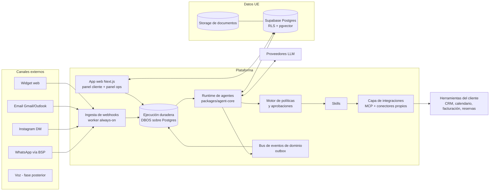
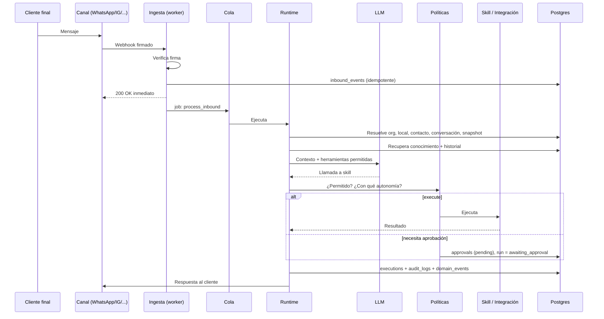

# Plataforma de Agentes de IA — Libro Verde y Manual Técnico

**Versión:** 1.0 (base para iniciar el desarrollo; documento vivo) · **Fecha:** 28/09/2026 · **Responsable de producto:** Diego  
**Nombre comercial:** provisional ("Moodly"). La marca está en revisión legal: en el código se usa siempre la variable `BRAND_NAME` y nunca el nombre escrito a mano.

---

## 0. Cómo usar este documento

Este documento es la fuente de verdad técnica y de producto de la plataforma. Está escrito para que cualquier desarrollador, humano o agente de código (Claude Code, Codex), pueda incorporarse en cualquier fase y continuar el trabajo sin depender de conversaciones previas.

Cada decisión lleva una etiqueta de estado:

| Etiqueta | Significado |
|---|---|
| **[DECIDIDO]** | Confirmado por producto. Cambiarlo requiere un ADR nuevo (ver §19). |
| **[PROPUESTO]** | Recomendación técnica vigente. Se usa por defecto, pero puede cambiar si al probarlo no encaja, dejando constancia en un ADR. |
| **[ABIERTO]** | Pendiente de decisión. No se implementa nada que dependa de ello sin confirmarlo antes con producto. |

**Si vas a empezar a programar ahora, ve directamente a §16.5 (Arranque).**

Tres archivos acompañan a este manual y deben mantenerse al día (ver §16):

- `docs/STATUS.md`: estado real del proyecto (qué está hecho y verificado, qué está en curso, qué está bloqueado y por qué).
- `docs/adr/`: registro de decisiones de arquitectura.
- `AGENTS.md` / `CLAUDE.md`: instrucciones operativas para los agentes de código.

**Jerarquía de fuentes (ADR 0023).** Si dos documentos discrepan, manda el de mayor rango: 1) ADRs aceptados; 2) este manual, que se actualiza en el mismo PR que cada ADR que lo cambie; 3) `docs/design/` (propuestas y detalle; no cuentan como decisión hasta pasar a un ADR o aquí); 4) el prototipo `apps/site/plataforma` (solo especificación visual: nunca define claves, contratos ni datos); 5) `docs/audits/` (fotos fechadas, históricas).

---

## 1. Visión y alcance del producto

### 1.1 Qué es

Una plataforma que despliega **agentes de IA que ejecutan trabajo real dentro de una empresa**: responden a clientes, gestionan citas, cualifican leads, actualizan el CRM, coordinan operaciones y preparan la parte administrativa. Los agentes se conectan a las herramientas que el cliente ya usa y actúan en ellas con permisos y niveles de autonomía controlados.

### 1.2 Qué no es

- No es un chatbot de preguntas frecuentes. Un agente que solo conversa y no ejecuta no cumple el objetivo del producto.
- No es un constructor genérico de flujos tipo n8n o Zapier. La orquestación es propia y es el núcleo del producto.
- No sustituye al software de facturación, al CRM ni al sistema de reservas del cliente. Opera **sobre** ellos a través de integraciones.
- No automatiza tareas peligrosas para la empresa o las personas. Toda acción con efecto externo pasa por un motor de políticas (§5.4).

### 1.3 Cliente objetivo **[DECIDIDO]**

- **Solo empresas (B2B):** agentes de IA de nivel enterprise en calidad y seguridad, para pequeñas, medianas y grandes empresas, incluidas cadenas con decenas o cientos de locales (clínicas, restaurantes, gestorías, inmobiliarias, agencias…).
- **Particulares:** fuera de alcance por ahora. Posible fase futura (§17), empezando por un agente personal para el dueño o responsable de las empresas cliente.
- **Prioridad comercial** (quién se vende primero, pymes o cadenas): **[ABIERTO]** (§18). No afecta a la arquitectura.

**Regla de arquitectura derivada:** un negocio pequeño es una organización con **un solo local**. Todo se diseña para multi-local desde el primer día; el caso de un local sale gratis. Lo contrario obligaría a rehacer la plataforma.

### 1.4 Los 4 agentes de serie **[DECIDIDO: producto, 2026-10-20; ADR 0023 y 0030]**

Cada organización cliente dispone de cuatro agentes que cubren las funciones más necesarias de cualquier empresa. Cada uno se especializa según el vertical del cliente y se puede activar, desactivar y personalizar.

| `agent_type` | Nombre provisional | Responsabilidad |
|---|---|---|
| `reception` | Recepción | Agenda y citas (crear, mover, cancelar, lista de espera, recordatorios), recursos y salas, y canal de voz (la línea de teléfono del negocio). |
| `customer` | Atención al cliente | Atención entrante por canales escritos (WhatsApp, Instagram, email, web): dudas, incidencias, reseñas y escalado a humano. Puede tener skills de agenda (una skill declara varios `agentTypes`). |
| `sales` | Comercial | Captación y cualificación de leads, CRM, presupuestos, seguimiento y recuperación de clientes, y ejecución de las campañas que proponga el coach (§5.12). Si se necesita un agente de marketing independiente: **[ABIERTO]**. |
| `admin` | Administración | Facturación (siempre a través del software del cliente), cobros, gastos, inventario y proveedores, documentos y preparación de información para la gestoría. |

Claves canónicas fijadas por el ADR 0023 (fuente en código: `@repo/config` `AGENT_TYPES`). Las tareas internas, los avisos y el resumen diario no son de un agente: son capa común (`tasks` y resumen diario del coach, §5.12).

Los cuatro comparten una **capa común de conocimiento y memoria del negocio** (§6) y se coordinan mediante **eventos de dominio** (§5.8), nunca llamándose entre sí directamente.

**Tipos de agente como catálogo [DECIDIDO el principio]:** los tipos de agente se definen como datos (tabla `agent_types`), no como un valor fijo en el código. Los 4 anteriores son el catálogo inicial para empresas. Así el mismo runtime podrá servir en el futuro otros catálogos (por ejemplo, el agente personal del responsable) sin reescribir el núcleo.

**Agentes y skills ampliables [DECIDIDO: producto, 2026-10-20; diseño PROPUESTO en el ADR 0030]:** además de los 4 de serie, habrá agentes de plantilla por vertical y **agentes propios** creados por cada organización (instrucciones + skills + canales + autonomía), todos sobre el mismo runtime, motor de políticas, memoria y coach. Las skills son de tres tipos (`code` de la plataforma, `composed` creadas por el cliente sin programar y `mcp` de integraciones conectadas) y **cualquier skill se añade a cualquier agente de forma individual**. Ningún código puede suponer que hay 4 agentes.

**Visión de fondo — prioridad máxima del producto [DECIDIDO]:** cada empresa tiene una IA que **conoce el negocio a fondo, entiende sus objetivos, aprende con el tiempo y las interacciones, hace el trabajo delegable y actúa como coach**, proponiendo mejoras y detectando debilidades. Se materializa en tres piezas del núcleo:

- **Memoria que aprende, con contexto cruzado e interconectado** entre agentes, locales y áreas (§6.2, §6.4).
- **Objetivos empresariales** como dato de primera clase (§6.3).
- **Modo coach**: capa de inteligencia que revisa gestión, contabilidad, legal, marketing, tendencias, competencia y calendario, y propone cambios (§5.12).

Las líneas de marca anteriores (READY, GOOD, CALM, BEAUTY) quedan **descartadas** y no deben aparecer en código ni en datos.

### 1.5 Modelo conceptual de un agente **[DECIDIDO]**

```
Agente = Modelo + Conocimiento + Memoria + Objetivos + Skills + Integraciones + Reglas + Permisos
```

- **Modelo:** el LLM que razona, elegido por configuración y nunca fijado en código (§5.11).
- **Conocimiento:** información del negocio en dos niveles, central y por local (§6.1).
- **Memoria:** lo que el agente aprende de las interacciones con el tiempo (§6.2).
- **Objetivos:** metas del negocio contra las que el agente prioriza y mide (§6.3).
- **Skills:** acciones tipadas que el agente puede ejecutar (§5.5).
- **Integraciones:** conexiones con las herramientas del cliente que las skills usan (§7).
- **Reglas:** políticas del negocio (horarios, cancelaciones, descuentos permitidos…).
- **Permisos:** qué puede hacer cada agente y con qué nivel de autonomía (§1.6).

### 1.6 Niveles de autonomía **[DECIDIDO]**

Cada skill activa tiene un nivel de autonomía configurable:

| Nivel | Comportamiento |
|---|---|
| `suggest` | El agente propone la acción y un humano decide. |
| `draft` | El agente prepara la acción completa (por ejemplo, un email redactado) y un humano la aprueba con un clic. |
| `execute` | El agente ejecuta la acción y la deja registrada. |
| `autonomous` | El agente puede encadenar varias acciones sin intervención, dentro de los límites de las políticas. |

El nivel efectivo nunca puede superar el **techo** que marca la clase de efecto de la skill (§5.6).

### 1.7 Personalización en tres capas **[DECIDIDO]**

1. **Plantilla de fábrica:** valores por defecto por tipo de agente y vertical (tono, mensajes, skills activas, qué requiere aprobación, flujos típicos).
2. **Interruptores del cliente:** activar o desactivar lo que viene hecho, sin escribir nada.
3. **Personalización avanzada:** editar textos, umbrales, reglas y conocimiento. Oculta por defecto, detrás de un "Modo avanzado".

A esto se suma la **herencia multi-local** (§4.3): plantilla → organización → región → local. Cada nivel puede **bloquear** campos para que los niveles inferiores no los modifiquen.

### 1.8 Referencia competitiva y mínimo de paridad

La referencia principal es **GuruSup** (gurusup.com). Según su web, a 28/09/2026 ofrece: más de 141 integraciones nativas, una cifra anunciada de un 95 % de resolución autónoma, condición de proveedor de WhatsApp/Meta, cumplimiento GDPR con datos en la UE, ISO 27001 y SOC 2 "en curso", una capa de conocimiento que pregunta al humano cuando le falta un dato, y casos con cadenas (incluida una de estudios de belleza con 4 agentes en WhatsApp, Instagram y web).

**Mínimo exigido [DECIDIDO]: igualarlo como mínimo en calidad, seguridad e integraciones.** En la práctica:

| Área | Mínimo exigido |
|---|---|
| Calidad | Medir la tasa de resolución autónoma desde el primer día. El agente no improvisa cuando falta un dato. Escalado a humano sólido. Multidioma. |
| Seguridad | Aislamiento entre clientes en la base de datos, cifrado, auditoría, SSO, DPA, datos en la UE, no entrenar modelos con datos de clientes. ISO 27001 y SOC 2 en la hoja de ruta con fecha. |
| Integraciones | Canales oficiales de WhatsApp e Instagram, email, calendario, CRM, facturación española y reservas, además de un camino rápido para añadir más (MCP). |
| Escala | Miles de conversaciones al día por cliente sin degradarse. |

### 1.9 Diferenciadores **[PROPUESTO]**

1. **Back-office:** el agente `admin` cubre facturación, cobros y gestoría, algo que la referencia no muestra.
2. **Coordinación entre los 4 agentes:** procesos completos entre agentes (una cita genera un bloqueo en el calendario y después un cobro), no un agente aislado por canal.
3. **Panel central multi-local:** autonomía y aprobaciones por local, y comparativa entre locales.
4. **Explicabilidad:** cada acción registra qué hizo el agente y por qué.
5. **Aprende y hace de coach:** memoria revisable que mejora con el uso y revisiones proactivas contra los objetivos del negocio (§5.12, §6.2, §6.3).

### 1.10 Modelo de negocio: lo que afecta al sistema

- **[DECIDIDO]** Setup por agente o por paquete (de 1.000 a 5.000 € en pymes; contratos a medida para cadenas) más una **cuota mensual** que cubre el uso de IA.
- **[ABIERTO]** Importes finales, precio por local o por volumen para cadenas, y si la voz se factura aparte (la recomendación es que sí, porque su coste es de otro orden).
- **Consecuencia técnica:** hay que medir el consumo por organización y por local (tokens, mensajes, minutos) y poder aplicar límites (§15).

---

## 2. Principios de ingeniería **[DECIDIDO]**

1. **Bucle empírico: construir → probar → verificar → siguiente.** Nada se da por hecho sin haberlo ejecutado y comprobado con código corriendo, un test real o un log real. "En teoría funciona" no cuenta como hecho.
2. **Incrementos pequeños.** Cada entrega se puede probar de inmediato. No se entregan módulos enteros sin verificar.
3. **Evidencia al cerrar.** Toda tarea cerrada incluye cómo se verificó: salida de tests, logs o capturas.
4. **Honestidad sobre lo no probado.** Si algo no se pudo probar (faltan credenciales, entorno o datos), se dice explícitamente en la tarea y en `docs/STATUS.md`.
5. **No inventar configuración.** Credenciales, cuentas o proveedores de integración (WhatsApp, CRM, facturación…) nunca se suponen: se piden a producto.
6. **Seguridad por defecto.** Aislamiento entre clientes, mínimo privilegio y aprobación humana para lo irreversible, desde el primer commit.
7. **Datos en la UE.** Toda la infraestructura con datos de clientes se aloja en regiones de la UE.
8. **Marca desacoplada.** `BRAND_NAME` y los assets de marca van en configuración, no en el código.
9. **Orquestación propia.** El motor de agentes vive en nuestro código. Ningún framework de agentes ni motor low-code es una pieza estructural.
10. **Construir lo que nos diferencia, adoptar lo probado (ADR 0031).** Construimos el aislamiento entre empresas, el runtime de agentes con su motor de políticas y aprobaciones, la memoria gobernada, el conocimiento de cada sector y los conectores clave. Para todo lo demás (modelos de IA, ejecución duradera, SSO, búsqueda vectorial, trazas, pagos, la cola larga de integraciones) adoptamos piezas probadas, siempre detrás de una interfaz nuestra y con salida. Un agente o servicio de terceros dentro del producto solo actúa como herramienta controlada por nuestras políticas.

### 2.1 Definición de hecho (DoD)

Una tarea está hecha solo si se cumplen todas estas condiciones:

- [ ] El código compila con `strict` de TypeScript y el lint está limpio.
- [ ] Tiene tests que cubren el comportamiento nuevo y pasan en local y en CI.
- [ ] Si toca datos de clientes: hay tests de aislamiento (RLS) que pasan.
- [ ] Si toca un agente o skill: el set de evals afectado pasa (§12.4).
- [ ] Se ha ejecutado de verdad el flujo afectado, extremo a extremo, y la evidencia está en el PR.
- [ ] Las migraciones son reversibles o incluyen un plan de vuelta atrás.
- [ ] `docs/STATUS.md` está actualizado, y se ha creado un ADR si hubo una decisión de arquitectura.

---

## 3. Arquitectura general

### 3.1 Vista de componentes



### 3.2 Stack tecnológico

| Capa | Elección | Estado | Motivo |
|---|---|---|---|
| Lenguaje | TypeScript (`strict`) en todo el proyecto, Node LTS | **[PROPUESTO]** | Un solo lenguaje en front, back y agentes, con tipado de extremo a extremo. |
| Monorepo | pnpm workspaces + Turborepo | **[PROPUESTO]** | Paquetes compartidos (dominio, skills, db) entre la web y el worker. |
| App web | Next.js (App Router) + React | **[PROPUESTO]** | Panel del cliente, panel interno de operaciones y API de la app. |
| UI | Tailwind CSS + shadcn/ui, TanStack Table + Virtual, dnd-kit, Recharts | **[PROPUESTO]** | Componentes accesibles y editables. Estructura de referencia: Langdock, Attio y Apollo (§9). |
| Validación | Zod | **[PROPUESTO]** | Esquemas compartidos para API, skills y salidas del LLM. |
| Base de datos | Supabase Postgres en región UE | **[PROPUESTO]** | Postgres gestionado con RLS, auth, storage, realtime y pgvector. Esquemas separados (`public`, `private`, `dbos`, `audit`), tablas que crecen particionadas por mes y escala por celdas (ADR 0026). El núcleo solo usa lo que se puede autoalojar (ADR 0028). |
| Migraciones | SQL con Supabase CLI como fuente de verdad; tipos generados | **[PROPUESTO]** | Las políticas RLS, funciones y triggers son SQL. Así se versionan tal cual. |
| Acceso a datos | `supabase-js` con JWT del usuario en la app (aplica RLS); cliente SQL tipado en el worker con scoping explícito por tenant | **[PROPUESTO]** | La app nunca usa la service role para datos de usuario. |
| Búsqueda semántica | pgvector ≥ 0.8 + búsqueda full-text de Postgres (híbrida) | **[PROPUESTO]** | Sin infraestructura extra; el conocimiento vive junto a los datos del tenant. Una sola función de recuperación, escalones por tamaño de tenant y recall medido en CI (ADR 0025). |
| Auth | Supabase Auth con email/magic link; SSO SAML/OIDC para cadenas | **[PROPUESTO]** | Verificar qué plan de Supabase incluye SSO antes de venderlo. |
| Orquestación LLM | Vercel AI SDK | **[PROPUESTO]** | Tool-calling, streaming, salidas estructuradas y multi-proveedor sin framework pesado. |
| Proveedores LLM | Enrutador multi-proveedor y multi-región: API directa, Bedrock, Vertex, Azure OpenAI y Mistral; claves de la plataforma, BYOK o modelos en la nube del cliente | **[DECIDIDO: ADR 0019]** | La residencia del procesamiento es una política por organización. Pendiente en piloto: AI Gateway y proveedor de embeddings. |
| Ejecución duradera y colas | DBOS Transact (librería) sobre el mismo Postgres, esquema `dbos` | **[PROPUESTO: ADR 0027]** | Runs como workflows con pasos guardados, reanudación tras aprobaciones o caídas, colas con prioridad y concurrencia por tenant, y tareas programadas. Sustituye a pg-boss. Salida si no cumple: Temporal. |
| Worker | Contenedor Node always-on (Fly.io o Railway, región UE) | **[PROPUESTO]** | Webhooks de canales, workflows de agentes y tareas programadas. El mismo contenedor sirve para celdas dedicadas y BYOC (ADR 0028). |
| Hosting web | Vercel con funciones en región UE; imagen de contenedor (`output: "standalone"`) para celdas dedicadas | **[PROPUESTO: ADR 0028]** | Despliegues por PR y previews. Nada del núcleo depende de APIs exclusivas de Vercel. |
| Integraciones | MCP (Model Context Protocol) cuando exista un servidor fiable; conector propio si no | **[PROPUESTO]** | Ampliar el catálogo rápido sin escribir cada API a mano. |
| Pagos | Stripe (suscripciones + consumo medido) | **[PROPUESTO]** | Setup, cuota mensual y uso. |
| Email transaccional | Resend o Postmark | **[PROPUESTO]** | Invitaciones, alertas y notificaciones. |
| Errores | Sentry | **[PROPUESTO]** | |
| Logs y trazas | pino (JSON) + OpenTelemetry | **[PROPUESTO]** | |
| Trazas LLM | Langfuse (self-hosted o cloud UE) | **[PROPUESTO]** | Coste, latencia y calidad por ejecución; base de las evals. |
| Tests | Vitest, pgTAP (`supabase test db`), Playwright | **[PROPUESTO]** | Unidad, aislamiento RLS y extremo a extremo. |
| CI/CD | GitHub Actions | **[PROPUESTO]** | |
| Agentes de código | Claude Code y Codex | **[DECIDIDO]** | Ver §16. Retool queda descartado. |

### 3.3 Estructura del monorepo **[PROPUESTO]**

```
/
├── AGENTS.md                 # instrucciones para agentes de código (canónico)
├── CLAUDE.md                 # mismo contenido que AGENTS.md
├── docs/
│   ├── MANUAL.md             # este documento
│   ├── STATUS.md             # estado real y verificado del proyecto
│   └── adr/                  # 0001-titulo.md, 0002-...
├── apps/
│   ├── web/                  # Next.js: panel cliente (/app) + panel interno (/ops) + API
│   └── worker/               # Node always-on: webhooks, cola, runtime de agentes, cron
├── packages/
│   ├── db/                   # migraciones SQL, seeds, tipos generados, tests pgTAP y config de Supabase CLI (packages/db/supabase)
│   ├── domain/               # tipos y esquemas Zod del dominio (fuente única)
│   ├── agent-core/           # runtime: contexto, bucle LLM, políticas, aprobaciones
│   ├── skills/               # catálogo de skills (una carpeta por skill)
│   ├── integrations/         # conectores y cliente MCP
│   ├── channels/             # adaptadores de canal (WhatsApp, IG, email, web)
│   ├── knowledge/            # ingesta, chunking, embeddings, recuperación
│   ├── templates/            # plantillas de fábrica por agent_type × vertical
│   ├── ui/                   # sistema de diseño y componentes base (§9.8)
│   ├── evals/                # sets de conversaciones de referencia y runner
│   └── config/               # BRAND_NAME, AGENT_TYPES, feature flags, modelos, límites
```

### 3.4 Entornos

| Entorno | Uso | Datos |
|---|---|---|
| `local` | Desarrollo con `supabase start` y el worker en local | Seeds sintéticos |
| `preview` | Un despliegue por PR | Base de datos de staging, datos sintéticos |
| `staging` | Integraciones en modo sandbox y pruebas extremo a extremo | Sintéticos + sandbox de proveedores |
| `production` | Clientes reales | Reales. En reposo, en la región de la celda (compartida: UE); procesamiento por modelos según la política de residencia de la organización |

Los datos reales de clientes **nunca** se copian a entornos que no sean de producción.

**Celdas (ADR 0026).** Producción se organiza en celdas: copias completas de la plataforma (base de datos, workers, Storage, Langfuse) en una región. La celda compartida UE aloja a las pymes; un cliente grande puede tener celda dedicada en la región que elija, o una celda en su propia nube (ADR 0028). Cada organización vive en una sola celda, y un directorio global (organización → celda) dirige el login y los webhooks.

---

## 4. Modelo de datos y multi-tenancy

### 4.1 Jerarquía de tenants **[DECIDIDO]**

```
organization (empresa cliente)
 └── region (opcional: agrupación de locales)
      └── location (local)
```

Un negocio de un solo local tiene una organización con un único `location` y sin regiones.

### 4.2 Tablas principales **[PROPUESTO]**

Convenciones:

- Todas las tablas con datos de cliente llevan `organization_id NOT NULL` y, cuando aplica, `location_id`.
- Claves primarias `uuid`, `created_at` y `updated_at` en todas las tablas.
- Borrado lógico (`deleted_at`) solo donde el negocio lo necesite. El borrado GDPR es físico (§11).

**Plataforma y tenants**

| Tabla | Campos clave |
|---|---|
| `organizations` | `name`, `kind` (`business`; `personal` reservado para el futuro), `vertical`, `plan`, `contract_type` (smb/enterprise), `default_locale`, `data_region`, `status` |
| `regions` | `organization_id`, `name` |
| `locations` | `organization_id`, `region_id?`, `name`, `address`, `timezone`, `opening_hours` (jsonb), `status` |
| `users` | Perfil vinculado a `auth.users`: `full_name`, `locale` |
| `memberships` | `user_id`, `organization_id`, `role` (`org_admin` / `region_manager` / `location_manager` / `staff`), `scope_region_ids[]`, `scope_location_ids[]` |
| `platform_staff` | `user_id`, `role` (`platform_admin` / `platform_operator`): equipo interno que da de alta y configura clientes |

**Agentes y configuración**

| Tabla | Campos clave |
|---|---|
| `agent_types` | Catálogo: `organization_id` (null = plataforma), `origin` (`builtin`/`template`/`custom`), `key` (única por organización; de serie `reception`/`customer`/`sales`/`admin`, ADR 0023 y 0030), `color`, `description`, `organization_kind` (`business`), `base_instructions`, `default_skills[]` |
| `agent_templates` | `agent_type`, `vertical`, `version`, `defaults` (jsonb: tono, mensajes, skills, autonomía, reglas, flujos) |
| `agents` | `organization_id`, `agent_type_id` (FK a `agent_types.id`), `version`, `template_id`, `template_version`, `display_name`, `status` (`draft`/`testing`/`live`/`paused`) |
| `config_overrides` | `agent_id`, `level` (`organization`/`region`/`location`), `level_id`, `values` (jsonb), `locked_keys[]`, `version` |
| `config_snapshots` | `agent_id`, `location_id`, `resolved` (jsonb), `hash`: configuración ya resuelta e inmutable que usa cada ejecución |
| `skills` | Catálogo: `organization_id` (null = plataforma), `key`, `version`, `kind` (`code`/`composed`/`mcp`), `definition` (jsonb, para `composed`), `integration_id?` (para `mcp`), `effect_class`, `max_autonomy`, `default_autonomy`, `required_integration`, `restricted_to_agent_types[]`, `input_schema`, `output_schema`, `status` (ADR 0030) |
| `agent_skills` | `agent_id`, `skill_id`, `enabled`, `autonomy_level`, más overrides por local vía `config_overrides` |
| `business_rules` | `organization_id`, `scope` (org/region/location), `scope_id`, `key`, `value` (políticas de cancelación, descuentos máximos, etc.) |

**Conocimiento**

| Tabla | Campos clave |
|---|---|
| `knowledge_sources` | `organization_id`, `scope` (`organization`/`location`), `scope_id`, `type` (`faq`/`pricing`/`policy`/`catalog`/`document`/`website`/`human_answer`), `status`, `storage_path?` |
| `knowledge_chunks` | `source_id`, `organization_id`, `scope`, `scope_id`, `content`, `embedding vector`, `embedding_model`, `embedding_dim`, `tsv tsvector`, `valid_until?` (ADR 0025) |
| `knowledge_requests` | `organization_id`, `location_id?`, `agent_id`, `run_id`, `question`, `context`, `assigned_role`, `status` (`open`/`answered`/`dismissed`), `answer`, `answered_by`, `resulting_source_id` |

**Memoria y objetivos**

| Tabla | Campos clave |
|---|---|
| `memories` | `organization_id`, `scope` (`organization`/`location`/`contact`), `scope_id`, `kind` (`fact`/`preference`/`pattern`), `content`, `embedding vector`, `source_type` (`conversation`/`execution`/`human`), `source_ref`, `trust` (`owner`/`system`/`contact`; `contact` solo con `scope = contact`, ADR 0024), `source_actor`, `confidence`, `status` (`proposed`/`active`/`rejected`/`superseded`), `superseded_by?`, `last_used_at`, `expires_at?` |
| `memory_usages` | `memory_id`, `run_id`, `organization_id`: qué ejecuciones usaron cada memoria (ADR 0024) |
| `goals` | `organization_id`, `scope` (`organization`/`region`/`location`), `scope_id`, `title`, `metric_key`, `target_value`, `period` / `due_date`, `owner_user_id`, `status` |
| `goal_progress` | `goal_id`, `organization_id`, `value`, `measured_at`, `source` (métrica interna o integración) |
| `coach_reviews` | `organization_id`, `scope`, `scope_id`, `period`, `summary`, `status` (`draft`/`delivered`/`acknowledged`) |
| `recommendations` | `organization_id`, `scope`, `scope_id`, `review_id?`, `domain` (`management`/`finance`/`legal`/`marketing`/`trends`/`competition`/`calendar`/`operations`/`customer`), `type` (`improvement`/`weakness`/`risk`/`opportunity`), `title`, `rationale`, `evidence` (jsonb: datos y fuentes citadas), `expected_impact`, `confidence`, `proposed_action?` (skill + input), `target_agent_type?`, `due_by?`, `status` (`open`/`accepted`/`dismissed`/`done`/`expired`) |
| `recommendation_feedback` | `recommendation_id`, `user_id`, `verdict` (`useful`/`not_useful`/`wrong`), `comment?`: realimenta la priorización del coach |

**Mapa del negocio (memoria interconectada)**

| Tabla | Campos clave |
|---|---|
| `entities` | `organization_id`, `type` (`contact`/`service`/`product`/`location`/`supplier`/`competitor`/`campaign`/`goal`/`employee_role`/`topic`), `name`, `attributes` (jsonb), `external_refs` (ids en CRM, reservas, etc.) |
| `entity_links` | `organization_id`, `from_entity_id`, `to_entity_id`, `relation` (p. ej. `prefers`, `offered_at`, `competes_with`, `supplied_by`, `affects`), `weight`, `source_ref` |
| `memory_entities` | `memory_id`, `entity_id`: qué entidades menciona cada memoria |

**Señales externas (compartidas entre clientes)**

| Tabla | Campos clave |
|---|---|
| `signal_sources` | `kind` (`news`/`regulation`/`trends`/`calendar`/`local_events`/`weather`/`reviews`/`competitor_public`), `provider`, `coverage` (sector, país, región), `status` |
| `external_signals` | **Sin `organization_id`** (dato público compartido): `source_id`, `kind`, `title`, `summary`, `url`, `published_at`, `valid_from`/`valid_to`, `geo`, `sectors[]`, `topics[]`, `embedding vector` |
| `signal_matches` | `organization_id`, `location_id?`, `signal_id`, `relevance`, `why` (explicación), `status` (`new`/`used_in_recommendation`/`ignored`) |

**Canales, contactos y conversaciones**

| Tabla | Campos clave |
|---|---|
| `channel_accounts` | `organization_id`, `channel` (`whatsapp`/`instagram`/`email`/`webchat`/`voice`), `external_id` (id de número, cuenta o buzón), `location_id?` (null si la cuenta es compartida por toda la cadena), `default_agent_type` (`customer` en canales escritos, `reception` en voz), `status` |
| `contacts` | `organization_id`, `display_name`, `consents` (jsonb), `preferred_location_id?`, `locale` |
| `contact_identities` | `contact_id`, `channel`, `external_id` (teléfono, handle, email) |
| `conversations` | `organization_id`, `location_id?`, `contact_id`, `channel_account_id`, `agent_id`, `mode` (`agent`/`human`/`closed`), `assigned_user_id?`, `last_message_at` |
| `messages` | `conversation_id`, `organization_id`, `direction` (`in`/`out`), `author` (`contact`/`agent`/`user`), `content`, `attachments`, `external_message_id`, `status` |
| `inbound_events` | `channel`, `external_event_id` (clave de idempotencia), `raw` (jsonb), `received_at`, `processed_at`, `error?` |

**Ejecución, aprobaciones y auditoría**

| Tabla | Campos clave |
|---|---|
| `agent_runs` | `organization_id`, `location_id?`, `agent_id`, `trigger` (`inbound_message`/`schedule`/`domain_event`/`staff_instruction`), `trigger_ref`, `config_snapshot_id`, `status` (`running`/`awaiting_approval`/`awaiting_knowledge`/`handed_off`/`completed`/`failed`), `model`, `tokens_in`, `tokens_out`, `cost_eur` |
| `executions` | `run_id`, `organization_id`, `skill_key`, `skill_version`, `input`, `output`, `effect_class`, `autonomy_applied`, `status` (`suggested`/`drafted`/`needs_approval`/`approved`/`rejected`/`executed`/`failed`), `rationale` (explicación legible), `idempotency_key` |
| `approvals` | `execution_id`, `organization_id`, `location_id?`, `required_role`, `status` (`pending`/`approved`/`rejected`/`expired`), `decided_by`, `decided_at`, `expires_at` |
| `domain_events` | Outbox: `organization_id`, `location_id?`, `type` (p. ej. `appointment.created`), `payload`, `source_run_id`, `published_at?` |
| `event_subscriptions` | `agent_type`, `event_type`, `handler`: qué agente reacciona a qué evento |
| `audit_logs` | Append-only: `organization_id`, `actor_type` (`agent`/`user`/`platform_staff`/`system`), `actor_id`, `action`, `target`, `metadata`, `at` |

**Trabajo humano y espacio de trabajo (UI)**

| Tabla | Campos clave |
|---|---|
| `tasks` | `organization_id`, `location_id?`, `title`, `description`, `assignee_user_id?`, `assignee_role?`, `due_at?`, `source_type` (`agent`/`coach`/`user`), `source_ref`, `related_record` (tipo + id), `status` |
| `notes` | `organization_id`, `related_record` (tipo + id), `author_user_id`, `content` |
| `saved_views` | `organization_id`, `owner_user_id?` (null = compartida), `object`, `view_type` (`table`/`kanban`/`dashboard`), `config` (columnas, filtros, orden, agrupación), `pinned` |
| `favorites` | `user_id`, `organization_id`, `record_type`, `record_id` |
| `notifications` | `organization_id`, `user_id`, `type`, `ref`, `read_at?` |

**Integraciones y consumo**

| Tabla | Campos clave |
|---|---|
| `integrations` | `organization_id`, `location_id?`, `provider`, `kind` (`mcp`/`native`), `status`, `scopes[]`, `connected_by`, `last_health_check` |
| `integration_secrets` | Tokens cifrados (§10.4). Nunca se leen desde la app del cliente. |
| `usage_records` | `organization_id`, `location_id?`, `metric` (`llm_tokens`/`messages`/`voice_minutes`/`executions`), `quantity`, `period`, `run_id?` |
| `usage_limits` | `organization_id`, `metric`, `soft_limit`, `hard_limit`, `period` |

**Entidades añadidas por ADRs posteriores (se detallan en su ADR y entran en la fase indicada)**

| Tabla | Origen | Fase | Contenido |
|---|---|---|---|
| `accounts`, `account_domains` | ADR 0022 | 3 | Cuenta de empresa por encima de las organizaciones: identidad, dominios verificados, SSO, SCIM y políticas. |
| `roles`, `role_permissions`, `invitations` | ADR 0022 | 0–1 | Permisos atómicos más alcance; altas solo por invitación. |
| `networks`, `network_members` | ADR 0022 | 3 | Redes de franquicia: solo comparten plantillas, políticas bloqueadas y métricas agregadas. |
| `model_providers`, `provider_connections`, `org_model_settings` | ADR 0019 | 1 | Proveedores, vías y regiones de modelos; residencia, respaldo y topes por organización. |
| `appointments`, `deals`, `invoices_mirror` | ADR 0023 | 1–2 | Copias sincronizadas de los sistemas del cliente (`external_ref`, `synced_at`). Si no hay herramienta conectada, Moodly es la fuente. |
| `workflows` | Diseño (`mapa-pantallas-datos.md`) | 2 | Flujos automáticos programados, con techo de gasto. |
| `agent_versions`, `proposals`, `learning_signals` | `arquitectura-agentes-enterprise.md` §5 | 2 | Ciclo de mejora del agente: propuesta → eval → publicación gradual → vuelta atrás. |
| `calls`, `voice_personas`, `voice_profiles`, `voice_samples` | Diseño (capa de voz) | Voz | Llamadas, transcripciones y voces; muestras de voz con consentimiento. |
| `cell_directory` | ADR 0026 | Antes de la 2.ª celda | Organización → celda y región. Global, sin datos personales. |

**Tablas que crecen sin límite (ADR 0026):** `audit_logs`, `inbound_events`, `usage_records` y `messages` se particionan por mes desde su primera migración; `inbound_events.raw` se conserva 30 días (configurable). Prompts y respuestas completas del modelo van a Langfuse, no a Postgres.

### 4.3 Resolución de configuración con herencia **[PROPUESTO]**

```
resolved = template.defaults
         ⊕ override(organization)
         ⊕ override(region)     # si el local pertenece a una región
         ⊕ override(location)
```

- `⊕` es un merge profundo por clave.
- Si una clave está en `locked_keys` de un nivel, los niveles inferiores **no** pueden sobrescribirla. El intento se rechaza al guardar, no al resolver.
- La resolución produce un `config_snapshot` inmutable con hash. Cada `agent_run` referencia su snapshot, de modo que cualquier ejecución pasada es reproducible y auditable.
- Cambiar de versión de plantilla es una migración explícita por organización, nunca automática.

### 4.4 Aislamiento con RLS **[DECIDIDO el principio]**

- RLS activado en **todas** las tablas con datos de cliente, sin excepciones.
- Las políticas se basan en la pertenencia del usuario (`memberships`): organización, rol y alcance de regiones y locales.
- Un `location_manager` solo ve datos de sus locales. Un `org_admin` ve toda la organización.
- La **service role** solo se usa en el worker y siempre con un `organization_id` explícito en cada consulta. Existe una función helper obligatoria que lo exige.
- El acceso del equipo interno (`platform_staff`) a datos de un cliente queda registrado en `audit_logs` y, para contenido de conversaciones, requiere un modo de soporte explícito.
- Tests pgTAP obligatorios: para cada tabla, un usuario de la organización A no puede leer ni escribir datos de la B, y un manager del local 1 no ve el local 2.

---

## 5. Runtime de agentes

### 5.1 Flujo de un mensaje entrante



### 5.2 Enrutado **[PROPUESTO]**

1. `channel_accounts.external_id` identifica la organización y, si la cuenta está asociada a un local, también el local.
2. Si la cuenta es compartida por toda la cadena (un único WhatsApp), el local se resuelve en este orden: conversación previa del contacto, `contacts.preferred_location_id`, lo que el cliente indique en el mensaje y, si nada de eso lo aclara, el agente pregunta al cliente con una lista de opciones.
3. El agente que atiende una conversación entrante es el `default_agent_type` de la cuenta de canal: `customer` en canales escritos y `reception` en voz. Un solo agente por conversación. Los demás agentes se activan por eventos, por tareas programadas o por instrucciones del personal.

### 5.3 Montaje del contexto (prompt por capas) **[PROPUESTO]**

En orden, de mayor a menor autoridad:

1. **Reglas de plataforma**: inmutables, no configurables por el cliente. Incluyen seguridad, honestidad, que el agente se identifique como IA, no inventar datos y escalar cuando corresponda.
2. **Instrucciones base del `agent_type`**.
3. **Plantilla del vertical**.
4. **Configuración resuelta** (snapshot): tono, políticas, reglas de negocio y autonomía.
5. **Contexto del negocio recuperado**, marcado explícitamente como *datos*, no como instrucciones: conocimiento (§6.1), memorias relevantes (§6.2), entidades relacionadas del mapa del negocio (§6.4) y objetivos activos (§6.3).
6. **Perfil del contacto e historial** de la conversación (resumido si es largo).
7. **Mensaje entrante**, marcado como contenido no confiable.

Las herramientas que ve el LLM son **solo** las skills activas del agente en ese local, filtradas además por las integraciones conectadas.

### 5.4 Motor de políticas **[DECIDIDO el principio]**

Cada llamada a una skill que propone el LLM pasa por el motor de políticas **antes** de ejecutarse:

1. ¿La skill está activa para este agente y este local?
2. ¿La integración que necesita está conectada y sana?
3. ¿Qué autonomía efectiva aplica? Es el mínimo entre la autonomía configurada y el techo de la clase de efecto (§5.6).
4. ¿La cumplen las reglas de negocio? Por ejemplo, un descuento que supera el máximo pasa a aprobación.
5. ¿Se respetan los límites de uso y de frecuencia?
6. **Scoping**: el `organization_id`, el `location_id` y el contacto los inyecta siempre el runtime, **nunca** los argumentos del LLM.

El resultado es uno de: ejecutar, dejar en borrador, pedir aprobación, pedir un dato a un humano (`knowledge_request`) o rechazar con motivo.

### 5.5 Contrato de una skill **[PROPUESTO]**

```ts
export interface SkillDefinition<I, O> {
  key: string;                 // "book_appointment"
  version: number;
  agentTypes: AgentType[];     // qué agentes pueden tenerla
  description: string;         // lo que ve el LLM
  effectClass: EffectClass;    // §5.6
  defaultAutonomy: AutonomyLevel;
  requiredIntegration?: IntegrationKind; // "calendar" | "crm" | "invoicing" | ...
  input: z.ZodType<I>;
  output: z.ZodType<O>;
  // Sin efectos secundarios: lo que haría la skill (para suggest/draft y approvals)
  preview(ctx: SkillContext, input: I): Promise<SkillPreview>;
  // Ejecución real. Debe ser idempotente con ctx.idempotencyKey
  execute(ctx: SkillContext, input: I): Promise<O>;
  // Eventos de dominio emitidos al ejecutar
  emits?: DomainEventType[];
}
```

Reglas:

- Cada skill vive en `packages/skills/<key>/` con su definición, sus tests y un fixture de sandbox.
- `SkillContext` trae el tenant, el local, el contacto, el cliente de integración ya autenticado y el logger. La skill nunca obtiene credenciales por su cuenta.
- Un `execute` sin `preview` no se acepta en code review.
- Este contrato es el de las skills `code`. Las skills `composed` (creadas por el cliente) y `mcp` (herramientas de integraciones conectadas) se exponen con la misma forma: entrada y salida tipadas, clase de efecto y paso por el motor de políticas. Una `composed` hereda la clase más alta de sus piezas; una `mcp` sin clasificar entra como `external_message` en `draft` (ADR 0030).

### 5.6 Clases de efecto y techo de autonomía **[PROPUESTO]**

| `effect_class` | Ejemplos | Techo por defecto |
|---|---|---|
| `read` | Consultar disponibilidad, buscar en el CRM, leer inventario | `autonomous` |
| `internal_write` | Crear una tarea, actualizar una ficha del CRM, bloquear el calendario | `autonomous` |
| `external_message` | Responder al cliente en la conversación en curso | `autonomous` |
| `external_outreach` | Contactar a alguien fuera de una conversación iniciada por él (recordatorios, recuperación de clientes) | `execute`, respetando consentimientos y reglas del canal |
| `financial` | Emitir una factura en el software del cliente, crear un cobro, aplicar un descuento | `draft`; subirlo a `execute` exige que un `org_admin` lo active explícitamente y queda auditado |
| `destructive` | Cancelar un pedido, borrar datos | `draft` (siempre con aprobación) |

### 5.7 Aprobaciones y pausas **[PROPUESTO]**

- Cada `agent_run` es un workflow duradero (ADR 0027): cada llamada al modelo y cada `execute` de skill es un paso guardado, y al reanudar no se repite.
- Un `agent_run` que necesita aprobación pasa a `awaiting_approval` y el workflow **espera un evento** con caducidad. No ocupa memoria ni CPU mientras espera.
- Al aprobar o rechazar se emite el evento y el workflow continúa desde su último paso.
- Las aprobaciones se asignan por rol y local. Caducan (`expires_at`) y el agente informa al cliente final si algo queda pendiente.
- La misma mecánica sirve para `awaiting_knowledge` (§5.9).

### 5.8 Coordinación entre agentes **[PROPUESTO]**

- Los agentes **no** se invocan entre sí. Se comunican mediante **eventos de dominio** escritos en `domain_events` en la misma transacción que la acción (patrón outbox).
- Un publicador lee el outbox y encola un job por cada suscripción (`event_subscriptions`).
- Ejemplo: `customer` ejecuta `book_appointment` y se emite `appointment.created`. `reception` lo recibe y prepara el recurso y el recordatorio. `admin` lo recibe y deja preparado el cobro en borrador.
- Cada evento lleva `source_run_id`, lo que permite reconstruir la cadena completa en el panel de actividad.
- Hay protección contra bucles: profundidad máxima de cadena por evento y deduplicación.

### 5.9 "No improvisar": solicitudes de conocimiento **[DECIDIDO el comportamiento]**

1. Si el agente necesita un dato que no está en el conocimiento, **no lo inventa**.
2. Crea un `knowledge_request` asignado al rol adecuado del local o de la central y responde al cliente final con un mensaje honesto de espera (configurable).
3. Cuando un humano responde, la respuesta se envía al cliente y se guarda como fuente `human_answer` con el alcance adecuado (organización o local), para que la próxima vez el agente ya lo sepa.
4. Métrica asociada: número de solicitudes por semana. Debe bajar con el tiempo.

### 5.10 Paso a humano **[PROPUESTO]**

- Hay disparadores configurables: el cliente lo pide, la confianza es baja, detecta frustración, el tema es sensible, o se superan N turnos sin resolver.
- La conversación pasa a `mode = human`, se notifica al rol y local correspondiente y el agente deja de responder hasta que el humano la devuelva o la cierre.
- El agente puede seguir sugiriendo borradores al humano (`suggest`).

### 5.11 Modelos, coste y fiabilidad **[PROPUESTO]**

- Los modelos se definen en `packages/config` por tarea (clasificación, conversación, razonamiento complejo, extracción). Nunca hay IDs de modelo escritos en el código de negocio.
- Enrutado por coste: modelo ligero para clasificar y extraer, modelo potente para conversaciones complejas y decisiones con efecto.
- Cada run registra tokens y coste en `agent_runs` y `usage_records`.
- Webhooks e integraciones con reintentos y backoff. Idempotencia en `inbound_events` y en `executions.idempotency_key`.
- Timeouts por llamada LLM y por skill. Si falla el proveedor principal, se usa un proveedor alternativo configurado. Si todo falla, se hace el paso a humano con un mensaje de disculpa.
- Número máximo de pasos del bucle de herramientas por run (configurable) para evitar bucles.

### 5.12 Modo coach: capa de inteligencia del negocio **[DECIDIDO el concepto; diseño PROPUESTO]**

El coach no es un quinto agente. Es una **capa transversal** que observa el negocio, cruza datos internos con señales externas, detecta mejoras, debilidades, riesgos y oportunidades, y convierte cada propuesta en una tarea para uno de los 4 agentes o para una persona.

**Áreas que revisa**

| Dominio | Qué mira | Ejemplos de propuesta |
|---|---|---|
| `management` / `operations` | Carga por local, tiempos, cuellos de botella, citas perdidas | "Los martes por la tarde se pierden reservas por falta de respuesta: activar respuesta automática fuera de horario" |
| `finance` | Cobros pendientes, márgenes por servicio, gastos recurrentes (vía software del cliente) | "3 facturas vencidas hace más de 30 días: preparar recordatorio de cobro" |
| `legal` | Cambios normativos del sector y del país, obligaciones con fecha | "Nueva obligación que afecta a tu sector a partir de X: revisar con tu gestoría" (siempre con fuente) |
| `marketing` | Campañas, estacionalidad, rendimiento de canales | "San Valentín en 3 semanas: propuesta de campaña y calendario de publicaciones" |
| `trends` | Tendencias de búsqueda y de sector | "Crece el interés por el tratamiento Y en tu zona y no lo ofreces" |
| `competition` | Información pública de competidores (web, reseñas, precios publicados) | "Tu competidor más cercano abre los domingos; tú pierdes demanda de fin de semana" |
| `calendar` | Festivos, eventos locales, clima, fechas comerciales | "Evento grande cerca del local 2 el sábado: reforzar horario y lanzar oferta" |
| `customer` | Motivos de contacto, quejas, reseñas, clientes que no vuelven | "El 18 % de las consultas preguntan por aparcamiento: añadir info a la web y al agente" |

**Cómo funciona**

1. **Datos internos:** métricas (§12.3), objetivos (§6.3), mapa del negocio y memoria (§6.2, §6.4), actividad de los agentes, y datos de las integraciones (CRM, reservas, facturación).
2. **Señales externas:** se captan **una sola vez por sector y zona** en `external_signals` y se cruzan con cada organización (`signal_matches`) según su vertical, ubicación de locales, servicios, competidores y objetivos. Así el coste no crece con el número de clientes.
3. **Generación:** tareas programadas (resumen diario, revisión semanal, revisión mensual) y **alertas** cuando aparece una señal muy relevante (por ejemplo, un cambio normativo con fecha límite o un evento cercano).
4. **Recomendación:** cada una se guarda en `recommendations` con dominio, tipo, explicación, **evidencia con fuentes**, impacto esperado, confianza y, si procede, una acción concreta para un agente.
5. **Ejecución:** si el cliente la acepta, la acción pasa por el motor de políticas (§5.4) como cualquier otra, normalmente en `draft` (por ejemplo, el agente comercial prepara la campaña y el calendario de publicaciones para aprobación).
6. **Aprendizaje:** la respuesta del cliente (`recommendation_feedback`) y el resultado medido ajustan qué tipo de propuestas prioriza el coach en esa organización.

**Reglas de calidad**

- Cada propuesta cita de dónde sale cada dato (métrica interna, integración o fuente externa con enlace). Sin evidencia, no se propone.
- Límite de propuestas por periodo, ordenadas por impacto. Mejor 3 buenas que 20 genéricas.
- Nada de consejos genéricos que valdrían para cualquier negocio: cada propuesta debe referirse a datos de esta organización o de este local.
- Propuestas medibles: indican qué métrica debería moverse, y el coach revisa después si se movió.

**Límites [DECIDIDO]**

- **Legal, fiscal y contable:** el coach **detecta y avisa, no asesora**. Toda propuesta de estos dominios lleva la fuente y la indicación de confirmarlo con la gestoría o asesoría del cliente. Nunca ejecuta por sí mismo acciones legales ni fiscales.
- **Competencia:** solo información pública, respetando las condiciones de uso de cada fuente. Nada de acceso a datos privados de terceros.
- **Personas:** no hace perfiles de empleados ni evaluaciones de rendimiento individuales.

### 5.13 Asistente de la plataforma **[PROPUESTO: ADR 0029]**

Meta-agente que ayuda al usuario a configurar, operar y diagnosticar la plataforma por conversación (`/app/asistente`). No es un actor con permisos propios:

- Se ejecuta en `apps/web`, en el servidor, con la sesión del usuario (JWT y RLS); nunca con la service role ni en el worker.
- Sus herramientas son las mismas Server Actions de la interfaz, con su validación y sus permisos, de un catálogo cerrado. Fuera del catálogo, siempre: seguridad, roles y permisos, techos de autonomía, secretos, facturación, borrado de datos y reglas de plataforma.
- Todo cambio se muestra antes como vista previa y solo se aplica cuando el usuario confirma; la confirmación queda atada al hash de esa vista previa y a `audit_logs`.
- Conoce la plataforma por tres fuentes obligatorias: el manual de producto vivo (ninguna funcionalidad está hecha sin su página), el estado real de la cuenta del usuario y su catálogo de herramientas.
- Es el punto de entrada único por encima de los 4 agentes: ve su actividad y les da instrucciones como lo haría el usuario (`staff_instruction`), siempre a través del motor de políticas y las aprobaciones.
- Fase 2: lectura, diagnóstico, enseñar e instrucciones a los agentes. Fase 3: cambios de configuración.

---

## 6. Conocimiento, memoria y objetivos

### 6.1 Conocimiento del negocio (RAG)

- **Fuentes:** FAQs, precios, políticas, catálogo, documentos (PDF, DOCX), web del cliente y respuestas humanas (§5.9).
- **Alcance:** cada fuente es de `organization` o de `location`. La recuperación de un run combina las dos para el local resuelto; si hay conflicto, gana la del local.
- **Ingesta [PROPUESTO]:** subida a Storage, extracción de texto, troceado por secciones (no por tamaño fijo a ciegas), embeddings y guardado en `knowledge_chunks`. Todo es asíncrono en el worker.
- **Recuperación [PROPUESTO: ADR 0025]:** una sola función de recuperación; búsqueda híbrida (vectorial + full-text, combinadas con Reciprocal Rank Fusion), filtrada **siempre** por `organization_id` y alcance antes de ordenar, con escaneo iterativo de pgvector y re-ranking opcional. Escalones según el tamaño del tenant: búsqueda exacta para los pequeños, HNSW global para los medianos, y partición o celda propia para los grandes. Recall@10 ≥ 0,95 medido en CI.
- **Datos estructurados:** precios, horarios y servicios que cambian a menudo se guardan como datos estructurados (reglas y configuración) o se consultan en vivo a la integración, no solo como texto embebido. El precio que da el agente debe ser el vigente.
- **Frescura:** `valid_until` y re-indexado cuando cambia la fuente.
- **Proveedor de embeddings: [ABIERTO]** (se fija en el piloto, a través del enrutador del ADR 0019). Cada fila guarda `embedding_model` y `embedding_dim`; cambiar de modelo es una reindexación en segundo plano por tenant, sin mezclar vectores de modelos distintos.
- **Datos sensibles:** en verticales de salud (clínicas), no se incorporan datos clínicos de pacientes a la base de conocimiento (§11).

### 6.2 Memoria aprendida **[DECIDIDO el concepto; diseño PROPUESTO]**

La diferencia con el conocimiento: el conocimiento lo aporta el cliente; la memoria la **aprende el agente** de las interacciones (hechos, preferencias y patrones del negocio, de cada local y de cada cliente final).

- **Extracción:** un job posterior a cada conversación o run propone memorias candidatas con un modelo ligero. No se escriben durante la conversación.
- **Procedencia y envenenamiento [PROPUESTO: ADR 0024]:** toda memoria lleva `trust` (`owner`: lo dice una persona del negocio con permiso; `system`: datos verificables; `contact`: lo dice un cliente final). Lo que dice un cliente **solo vale para ese cliente** (`trust = contact` exige `scope = contact`, con un `CHECK` en la tabla) y solo se usa en sus propias conversaciones. Lo que un cliente diga sobre el negocio nunca es memoria: genera un `knowledge_request`. Las memorias de negocio solo nacen de personas o de agregados sobre muchos contactos, y la memoria nunca cambia precios, políticas ni autonomía: eso vive en datos estructurados, que ganan si hay contradicción.
- **Validación:** según la configuración, una memoria entra como `active` directamente (baja criticidad, por ejemplo "este cliente prefiere citas por la tarde") o como `proposed` para que un humano la confirme (todo lo que cambie cómo actúa el agente con el negocio en general).
- **Consolidación:** un job periódico fusiona duplicados, marca contradicciones y sustituye memorias viejas (`superseded_by`), en lugar de acumular versiones incompatibles.
- **Uso:** la memoria relevante se recupera igual que el conocimiento (§5.3, capa 5) y siempre como datos, no como instrucciones.
- **Revisable y borrable:** el cliente puede ver "qué sabe el agente de mi negocio / de este cliente", corregirlo y borrarlo. El borrado es real (§11).
- **Límites:** la memoria nunca guarda credenciales, datos de pago ni datos de salud de clientes finales; esas categorías se filtran en la extracción y se cubren en las evals.
- **Cruzada entre agentes:** la memoria es de la organización, no de un agente. Lo que aprende el agente de clientes (por ejemplo, que muchos preguntan por un servicio que no existe) lo usan recepción, el comercial, administración y el coach.
- **Cruzada entre locales:** lo aprendido en un local queda en ese local. Si parece aplicable a toda la cadena, se **propone a la central** para promoverlo a nivel organización (con aprobación de un `org_admin`).
- **Permisos:** un agente o usuario solo recupera memorias de los alcances que puede ver (mismas reglas de RLS que el resto de datos).

### 6.3 Objetivos **[DECIDIDO el concepto; diseño PROPUESTO]**

- Los objetivos se definen en el onboarding y en la configuración: métrica, valor objetivo, periodo y alcance (organización, región o local). Ejemplos: citas al mes, tasa de resolución autónoma, leads cualificados, tiempo de respuesta, facturación pendiente de cobro.
- El progreso se calcula a partir de métricas internas y de las integraciones (`goal_progress`).
- Los agentes reciben los objetivos activos en su contexto para priorizar (por ejemplo, el agente comercial prioriza leads del servicio que va por debajo del objetivo).
- El modo coach (§5.12) revisa el progreso y propone acciones.

### 6.4 Mapa del negocio (contexto interconectado) **[PROPUESTO]**

Para que el contexto esté realmente cruzado, la plataforma mantiene un **mapa de entidades del negocio y sus relaciones**: clientes, servicios, productos, locales, proveedores, competidores, campañas, objetivos y temas.

- Se guarda en Postgres (`entities`, `entity_links`, `memory_entities`). No se añade una base de datos de grafos mientras Postgres sea suficiente; si deja de serlo, se decide en un ADR.
- Se alimenta de las integraciones (CRM, reservas, catálogo), de la memoria aprendida y de los datos que introduce el cliente.
- La recuperación de contexto de un run (§5.3) combina tres cosas: búsqueda semántica (conocimiento y memoria), las entidades mencionadas en la conversación y sus relaciones cercanas. Ejemplo: un cliente pregunta por un servicio → el agente recupera también el local donde se ofrece, las preferencias de ese cliente, la campaña activa de ese servicio y el objetivo asociado.
- El coach usa el mismo mapa para conectar señales externas con el negocio (una tendencia sobre un servicio → los locales que lo ofrecen → el objetivo de ventas de ese servicio).

---

## 7. Capa de integraciones

### 7.1 Principios **[PROPUESTO]**

- **MCP primero:** si existe un servidor MCP fiable y mantenido para una herramienta, se usa a través del cliente MCP de `packages/integrations`. Si no existe o no es fiable, se escribe un conector nativo con la misma interfaz.
- Todas las integraciones exponen una interfaz interna común por tipo (`calendar`, `crm`, `invoicing`, `booking`, `email`, `inventory`…), de modo que las skills no dependen del proveedor concreto.
- La conexión se hace por OAuth siempre que el proveedor lo permita. Las API keys solo se usan cuando no hay alternativa.
- Tokens cifrados (§10.4), refresco automático y comprobación de salud periódica. Si una integración se rompe, se genera una alerta al cliente y al panel interno, y las skills dependientes pasan a `suggest`.
- Toda integración tiene un **modo sandbox** o fixtures para tests y evals.

### 7.2 Catálogo priorizado **[PROPUESTO; proveedores concretos ABIERTOS]**

| Fase | Tipo | Candidatos |
|---|---|---|
| 1 | Mensajería | WhatsApp Business Platform (vía BSP, **[ABIERTO]** cuál), web chat propio |
| 1 | Calendario y reservas | Google Calendar, Microsoft 365; sistema de reservas del vertical piloto **[ABIERTO]** |
| 2 | Mensajería | Instagram DM (Meta), email (Gmail API, Microsoft Graph) |
| 2 | CRM | HubSpot, Salesforce, Pipedrive |
| 2 | Facturación ES | Holded y otros proveedores habituales en España **[ABIERTO]** |
| 2 | Comunicación interna | Slack, Microsoft Teams |
| 3 | Ecommerce e inventario | Shopify, WooCommerce |
| 3 | Pagos | Stripe (cobros del cliente final) |
| 3+ | Voz | Telefonía + STT/TTS o plataforma de voz **[ABIERTO]** |

**Regla:** ninguna integración se da por conectada hasta haberla probado con una cuenta real o sandbox del proveedor. Las credenciales las aporta producto; no se inventan.

---

## 8. Canales

| Canal | Notas técnicas |
|---|---|
| WhatsApp | API oficial vía BSP **[ABIERTO]** qué proveedor. Respetar la ventana de atención de 24 h: fuera de ella solo se pueden enviar plantillas aprobadas. Hace falta opt-in para mensajes iniciados por la empresa. Verificación de firma en los webhooks. |
| Instagram DM | API de mensajería de Meta; mismas reglas generales de la plataforma de Meta. |
| Email | Gmail API / Microsoft Graph. Respuestas dentro del hilo; firmas por organización o local. |
| Web chat | Widget propio embebible (script con `organization_id` y `location_id` opcional), con identificación opcional del contacto. |
| Voz | Fase posterior. Coste y latencia distintos; se medirá por minuto (§15). |
| Consola interna | "Ventana por agente" dentro de la app: el personal da instrucciones al agente ("envía recordatorio a las citas de mañana"). Actúa con los permisos del usuario que la da. |

Todos los canales se normalizan a un formato interno único (`NormalizedMessage`) en `packages/channels`.

---

## 9. Frontend y experiencia de uso

### 9.1 Principios **[DECIDIDO]**

- Tiene que ser **muy fácil de usar y de poner en marcha**: plug and play.
- **Referencias estructurales: Langdock, Attio y Apollo.io.** Las tres comparten la misma estructura: barra lateral izquierda colapsable con selector de espacio de trabajo, acceso rápido (búsqueda y paleta de comandos), navegación principal, secciones de objetos o registros, favoritos e historial, y un panel principal a la derecha. De Langdock tomamos la entrada conversacional y la organización por agentes. De Attio, el modelo de objetos, vistas y páginas de registro. De Apollo, la bandeja de trabajo, las tareas y la analítica.
- **Se copia la estructura, no la identidad visual.** Ni logos, ni colores, ni ilustraciones, ni textos de esas marcas. La identidad visual propia está pendiente de la decisión de marca (§18) y se aplica mediante tokens de diseño (§9.9).
- La configuración profunda nunca está delante: primero interruptores y, detrás, un "Modo avanzado".
- Todo lo que hace un agente se puede ver, entender y deshacer o corregir desde la interfaz.

### 9.2 Estructura de la aplicación (app shell) **[PROPUESTO]**

```
┌───────────────────────┬───────────────────────────────────────────────────────┐
│ BARRA LATERAL         │ BARRA SUPERIOR: migas · acciones de la vista · avisos │
│ ─ Organización ▾      ├───────────────────────────────────────────────────────┤
│   Alcance: Todo/Local▾│                                                       │
│ ─ 🔍 Buscar   ⌘K      │                PANEL PRINCIPAL                        │
│ ─ Inicio              │   (conversación · tabla · kanban · registro ·         │
│   Coach               │    dashboard · ajustes)                               │
│   Aprobaciones   (3)  │                                                       │
│   Bandeja        (12) │                                  ┌──────────────────┤
│   Tareas              │                                  │ PANEL LATERAL    │
│   Actividad           │                                  │ vista previa del │
│   Analítica           │                                  │ registro/detalle │
│ ─ AGENTES             │                                  │ (se abre sin     │
│   ● Recepción         │                                  │  salir de la     │
│   ● Atención cliente  │                                  │  tabla)          │
│   ● Comercial         │                                  │                  │
│   ○ Administración    │                                  │                  │
│ ─ REGISTROS           │                                  │                  │
│   Clientes            │                                  │                  │
│   Conversaciones      │                                  │                  │
│   Recomendaciones     │                                  │                  │
│   Objetivos           │                                  │                  │
│   Conocimiento        │                                  │                  │
│   Memoria             │                                  │                  │
│   Locales             │                                  │                  │
│ ─ VISTAS GUARDADAS    │                                  │                  │
│ ─ FAVORITOS           │                                  │                  │
│ ─ RECIENTES           │                                  │                  │
│ ─ Usuario · Ayuda     │                                  └──────────────────┤
└───────────────────────┴───────────────────────────────────────────────────────┘
```

Secciones de la barra lateral, de arriba abajo:

1. **Control:** selector de organización (el equipo interno y los grupos con varias empresas pueden tener varias) y **selector de alcance**: "Toda la organización", una región o un local. El alcance filtra toda la aplicación y respeta los permisos del usuario: un responsable de local solo ve sus locales.
2. **Acceso rápido:** búsqueda global (`/`) y paleta de comandos (`⌘K` / `Ctrl+K`) para navegar, crear, ejecutar acciones y dar instrucciones a un agente.
3. **Navegación principal:** Inicio, Coach, Aprobaciones, Bandeja (conversaciones), Tareas, Actividad y Analítica. Los elementos con pendientes muestran un contador.
4. **Agentes:** los 4 agentes con su estado (activo, en pausa, en pruebas) y sus pendientes. Cada uno abre su ventana de agente (§9.3, P5).
5. **Registros:** los objetos de la plataforma (§9.5), cada uno con su vista de lista.
6. **Vistas guardadas y favoritos:** vistas filtradas que el usuario guarda o fija, y registros marcados.
7. **Recientes:** historial de conversaciones con agentes e instrucciones dadas, agrupado por fecha (Hoy, Últimos 7 días, Últimos 30 días), como en Langdock.
8. **Pie:** usuario, idioma, ayuda y acceso a Ajustes.

La barra lateral se puede colapsar a iconos. En móvil se convierte en un menú desplegable, y las aprobaciones y la bandeja son las vistas prioritarias.

### 9.3 Patrones de pantalla **[PROPUESTO]**

Toda la aplicación se construye con estos siete patrones. Una pantalla nueva debe encajar en uno de ellos antes de inventar otro.

| Patrón | Inspiración | Uso |
|---|---|---|
| **P1. Inicio conversacional** | Langdock | Saludo, caja de instrucciones con selector de agente ("¿Qué quieres que haga hoy?"), chips de acciones rápidas y, debajo, la **bandeja del día**: qué se resolvió solo, qué necesita al humano (aprobaciones, preguntas de conocimiento, conversaciones escaladas), recomendaciones destacadas del coach y alertas de integraciones. |
| **P2. Vista de lista de objeto** | Attio, Apollo | Tabla con columnas configurables, filtros, ordenación, agrupación, búsqueda y vistas guardadas (personales o compartidas). Cambio a **kanban** en objetos con estado (recomendaciones, tareas, conversaciones, aprobaciones). Selección múltiple con acciones en lote. Exportación. Lista virtualizada para miles de filas. |
| **P3. Página de registro** | Attio | Cabecera con nombre, estado y acciones (enviar mensaje, asignar, pedir a un agente que haga algo). Pestañas: Resumen, Actividad (línea de tiempo), Conversaciones, Tareas, Notas, Memoria, Archivos (según el objeto). Panel de atributos y **relaciones del mapa del negocio** (§6.4) en un lateral. |
| **P4. Panel lateral de vista previa** | Attio, Apollo | Al pulsar una fila se abre el detalle en un panel lateral sin salir de la tabla. Desde ahí se puede abrir la página completa. |
| **P5. Ventana de agente** | Langdock + idea de producto | Cada agente tiene su propia ventana con su contexto: hilo de conversación con el agente (el personal le da instrucciones), su actividad reciente, sus pendientes y chips de acciones sugeridas. Se pueden tener varios agentes abiertos como pestañas y saltar entre ellos sin perder el estado; cada uno sigue trabajando en segundo plano. |
| **P6. Ajustes** | Langdock, Attio | Área propia con navegación secundaria: Organización, Locales y regiones, Usuarios y roles, Agentes (interruptores y Modo avanzado), Integraciones, Conocimiento, Objetivos, Consumo y facturación, Seguridad (SSO, auditoría, retención de datos). Muestra en cada ajuste si viene heredado de la central y si está bloqueado. |
| **P7. Dashboard** | Apollo, Attio | Rejilla de widgets: métricas por agente y por local, progreso de objetivos, comparativa entre locales, coste y consumo. |

### 9.4 Mapa de rutas **[DECIDIDO: ADR 0023]**

Los segmentos de ruta están en español y son **identificadores estables**: no se traducen con el idioma de la interfaz. El detalle por pantalla (componentes, entidades que lee y escribe, permisos y tiempo real) está en `docs/design/mapa-pantallas-datos.md`.

| Ruta | Patrón | Contenido |
|---|---|---|
| `/app` | P1 | Inicio y bandeja del día |
| `/app/conversaciones` · `/[id]` | P2 + P3 | Bandeja multicanal; conversación completa con las acciones del agente intercaladas; tomar el control y devolverlo |
| `/app/aprobaciones` | P2 + P4 | Cola de aprobaciones con vista previa de la acción |
| `/app/agenda` | Calendario | Citas por sede y recurso (agente `reception`) |
| `/app/clientes` · `/[id]` | P2 · P3 | Clientes finales |
| `/app/leads` | P2 (kanban) | Leads y oportunidades por etapa |
| `/app/facturas` | P2 | Borradores de facturas e inventario |
| `/app/llamadas` | P2 · P3 | Llamadas y transcripciones (fase Voz) |
| `/app/tareas` | P2 | Tareas para humanos (creadas por agentes, por el coach o por usuarios) |
| `/app/actividad` | P2 | Runs y ejecuciones de todos los agentes, con explicación y cadena de eventos |
| `/app/informes` | P7 | Dashboards y exportación |
| `/app/coach` | P2 + P3 | Revisiones del coach y recomendaciones con evidencia y fuentes |
| `/app/objetivos` | P2 · P3 | Objetivos y su progreso |
| `/app/agentes` · `/[tipo]` | P2 · P5 | Agentes (de serie, de plantilla y propios), «Crear agente» y ventana de cada agente |
| `/app/skills` · `/[id]` | P2 · P3 | Biblioteca de skills: de la plataforma, propias y de integraciones; a qué agentes está añadida cada una (ADR 0030) |
| `/app/asistente` | P5 | Asistente de la plataforma (§5.13) |
| `/app/conocimiento` | P2 · P3 | Fuentes de conocimiento y preguntas pendientes |
| `/app/memoria` | P2 · P3 | «Qué sabe el agente»: memorias activas, propuestas y su origen |
| `/app/reglas` · `/app/flujos` · `/app/horarios` | P6 | Reglas y aprobaciones, flujos automáticos y horarios |
| `/app/red` | P7 | Red de franquicias (vista del franquiciador) |
| `/app/ajustes/*` | P6 | Ajustes: general, perfil, preferencias, privacidad, equipo, roles, modelos, integraciones, sedes, plan, facturación, seguridad y auditoría |
| `/app/onboarding` | Asistente de alta | §9.6 |
| `/ops/*` | Mismos patrones | Panel interno (§9.7) |

El estado de las vistas (filtros, orden, agrupación, alcance y pestaña activa) vive en la URL, para poder compartir un enlace y que el otro vea exactamente lo mismo.

### 9.5 Objetos y sus vistas **[PROPUESTO]**

| Objeto | Vistas por defecto | Pestañas de la página de registro |
|---|---|---|
| Cliente (contacto) | Tabla (todos, por local, por etapa de lead) | Resumen, Actividad, Conversaciones, Tareas, Notas, Memoria |
| Conversación | Tabla y kanban por estado (agente / humano / cerrada) | Conversación, Acciones del agente, Contexto usado |
| Recomendación | Kanban por estado y tabla por dominio | Resumen, Evidencia y fuentes, Acción propuesta, Resultado medido |
| Aprobación | Tabla por antigüedad | Vista previa de la acción, Contexto, Historial |
| Tarea | Tabla y kanban | Detalle, Origen (agente, coach o usuario) |
| Objetivo | Tabla con barra de progreso | Progreso, Recomendaciones relacionadas, Actividad |
| Conocimiento | Tabla por tipo y alcance | Contenido, Uso por los agentes |
| Memoria | Tabla por estado (propuesta / activa) | Contenido, Origen, Entidades relacionadas |
| Local | Tabla y mapa | Resumen, Configuración propia, Equipo, Métricas |

Los leads y oportunidades se muestran como etapas del cliente y se sincronizan con el CRM del cliente cuando está conectado. La plataforma no pretende sustituir a su CRM.

### 9.6 Onboarding **[PROPUESTO]**

Asistente de 6 pasos, completable sin ayuda en un negocio de un local:

1. Tipo de negocio → carga la plantilla del vertical.
2. Conectar herramientas → OAuth.
3. Datos del negocio → servicios, precios, horarios y políticas (5-6 campos), más subida de documentos.
4. Objetivos → 2-3 objetivos sugeridos según el vertical, editables.
5. Revisar interruptores y probar el agente en un sandbox con escenarios sugeridos ("¿qué pasaría si un cliente cancela?"), mostrando el flujo de pasos.
6. Publicar.

Para cadenas: onboarding asistido por el equipo interno, con alta de locales en lote (CSV) y configuración central heredada.

### 9.7 Panel interno (`/ops`) **[PROPUESTO]**

Para el equipo de la plataforma (`platform_staff`), con la misma estructura y los mismos componentes. Retool queda descartado.

- Organizaciones, locales y agentes: alta y configuración.
- Plantillas y versiones; catálogo de skills y tipos de agente.
- Salud de integraciones, colas, runs fallidos y errores.
- Señales externas: fuentes, captación y cruces.
- Consumo y límites por cliente.
- Modo soporte: acceso a conversaciones de un cliente solo con motivo registrado y auditado.

### 9.8 Componentes base (`packages/ui`) **[PROPUESTO]**

`AppShell`, `Sidebar` (con secciones colapsables y contadores), `ScopeSwitcher` (organización/región/local), `CommandPalette`, `GlobalSearch`, `DataTable` (columnas, filtros, orden, agrupación, selección, virtualización), `ViewSwitcher` (tabla/kanban/dashboard) y `SavedViews`, `FilterBar`, `KanbanBoard`, `RecordPage`, `RecordTabs`, `AttributePanel`, `RelationsPanel`, `ActivityTimeline`, `PreviewDrawer`, `ChatThread` y `Composer` (con selector de agente), `AgentWindow`, `ApprovalCard`, `RecommendationCard` (con evidencia y fuentes), `KnowledgeRequestCard`, `GoalProgress`, `MetricWidget`, `InheritanceBadge` (heredado / bloqueado / sobrescrito), `EmptyState`, `Toasts`.

Librerías **[PROPUESTO]**: shadcn/ui (incluye `cmdk` para la paleta de comandos), TanStack Table + TanStack Virtual, dnd-kit para kanban, Recharts para gráficos.

Los componentes se desarrollan con datos reales de la base local (seeds) desde el primer momento, no con maquetas desconectadas.

### 9.9 Diseño, accesibilidad e idioma **[PROPUESTO]**

- **Tokens de diseño** (color, tipografía, espaciado, radios, sombras) en un único sitio, con modo claro y oscuro. La marca definitiva se aplica cambiando tokens, no componentes.
- Estética sobria y densa en información, como las referencias: fondo neutro, un color de acento, tipografía legible y tablas compactas.
- Atajos de teclado en las acciones frecuentes (navegar, aprobar, rechazar, abrir la paleta).
- Accesibilidad WCAG 2.1 AA; navegación completa con teclado.
- i18n desde el inicio: español por defecto e inglés. Los agentes responden en el idioma del cliente final.
- Tiempo real (Supabase Realtime) en bandeja, conversaciones, aprobaciones y ventanas de agente.
- Responsive: los responsables de local aprueban y responden desde el móvil.


---

## 10. Seguridad

### 10.1 Modelo de amenazas

| Amenaza | Control principal |
|---|---|
| Fuga de datos entre clientes o entre locales | RLS en todas las tablas + tests pgTAP; scoping obligatorio en el worker (§4.4) |
| Inyección de instrucciones por parte de clientes finales o en documentos subidos | Mensajes y conocimiento marcados como datos no confiables; herramientas limitadas a las skills activas; tenant inyectado por el runtime; motor de políticas antes de cualquier efecto (§5.4) |
| Agente con demasiada capacidad de acción | Techo de autonomía por clase de efecto; lo financiero y lo destructivo, con aprobación; límites de frecuencia (§5.6) |
| Robo de credenciales de integraciones | Cifrado de tokens, mínimo privilegio en scopes OAuth, rotación, sin lectura desde la app del cliente (§10.4) |
| Webhooks falsificados | Verificación de firma de cada proveedor, idempotencia |
| Envío de datos a destinatarios no autorizados | Mensajes salientes solo al contacto de la conversación o a destinatarios que permita la skill; outreach sujeto a consentimientos |
| Envenenamiento de la memoria (un cliente final intenta que el agente "aprenda" algo falso o una instrucción) | Memorias extraídas por un job aparte, tratadas como datos, validación humana de las que cambian el comportamiento general, consolidación y evals específicas (§6.2) |
| Abuso de coste (bucles, spam) | Pasos máximos por run, límites de uso por organización y local, alertas |
| Acceso interno indebido | Roles de `platform_staff`, modo soporte auditado |

### 10.2 Autenticación y autorización

- Supabase Auth; SSO SAML/OIDC para cadenas **[PROPUESTO]**; 2FA disponible para `org_admin`.
- La autorización vive en la base de datos (RLS) y se repite en la capa de API para dar errores claros. RLS es la barrera real.

### 10.3 Cifrado

- En tránsito: TLS en todo.
- En reposo: cifrado del proveedor de base de datos y storage.

### 10.4 Secretos **[DECIDIDO: ADR 0019; proveedor de KMS ABIERTO]**

- Cifrado en la aplicación (envelope encryption) con una clave por tenant en un KMS (AWS KMS o GCP KMS: **[ABIERTO]**). Supabase Vault queda descartado como bóveda principal.
- Los tokens solo se descifran en el worker, en el momento de usarlos, y cada descifrado queda en el log del KMS.
- Los secretos de plataforma (claves de proveedores LLM, Stripe…) van en el gestor de secretos de cada hosting; nunca en el repositorio ni en logs.

### 10.5 Auditoría

`audit_logs` es append-only (sin UPDATE ni DELETE para ningún rol de aplicación) y exportable por organización. Registra toda acción de agentes, usuarios y personal interno.

### 10.6 Hoja de ruta de certificaciones **[ABIERTO: fechas]**

Pentest externo antes del primer contrato enterprise; después ISO 27001 y SOC 2. Los controles de este documento están pensados para que esas certificaciones no obliguen a rehacer nada.

---

## 11. Privacidad y cumplimiento

> Esta sección recoge requisitos a verificar con asesoría legal. No es asesoramiento jurídico.

- **GDPR:** la plataforma actúa como **encargada del tratamiento** de los datos de los clientes finales de cada organización. Hace falta un DPA con cada cliente, una lista pública de subencargados (hosting, proveedores LLM, BSP de WhatsApp…) y DPAs firmados con cada uno de ellos.
- **Residencia (ADR 0023):** los datos en reposo (base de datos, storage, copias, logs y trazas) se guardan en la región de la celda; la celda compartida está en la UE. El procesamiento por modelos sigue la política de residencia de cada organización (ADR 0019): por defecto sin restricción, «solo UE» u otras como opción, sin que el respaldo cruce la frontera. Para cada proveedor y región, verificar retención, DPA y el compromiso de no entrenar con los datos.
- **Derechos de los interesados:** exportación y borrado por contacto, borrado físico en cascada, incluidos los chunks de conocimiento y las memorias derivadas.
- **Retención:** configurable por organización (conversaciones, logs), con purga automática.
- **Datos de salud:** en clínicas, los datos de salud son de categoría especial. Minimización: el agente gestiona citas y dudas generales, no historiales clínicos. Requiere revisión legal específica antes de lanzar ese vertical.
- **Transparencia de IA:** el agente se identifica como asistente de IA ante el cliente final (regla de plataforma, §5.3). Verificar las obligaciones y el calendario aplicables del AI Act de la UE **[ABIERTO]**.
- **Facturación en España:** el agente `admin` **no** es software de facturación. Crea borradores o facturas **a través** del software del cliente, que es quien debe cumplir la normativa aplicable (Verifactu u otras). Esto se mantiene como regla de diseño.
- **WhatsApp e Instagram:** cumplir las políticas de Meta (opt-in, plantillas, categorías de mensajes).

---

## 12. Observabilidad y evaluación

### 12.1 Logs y trazas

- Logs JSON estructurados (pino) con `organization_id`, `location_id`, `run_id` y `trace_id`. Sin datos personales en claro en los logs.
- OpenTelemetry de extremo a extremo: webhook → job → run → LLM → skill → integración.

### 12.2 Trazas de LLM

Langfuse **[PROPUESTO]**: prompt resuelto, herramientas, respuestas, latencia, tokens y coste por run. Enlazado desde el panel de actividad del panel interno.

### 12.3 Métricas de producto (visibles al cliente y en `/ops`)

- Tasa de resolución autónoma (sin intervención humana), por agente y por local.
- Tasa de escalado y motivos.
- Tiempo hasta la primera respuesta y tiempo hasta la resolución.
- Solicitudes de conocimiento por semana (debe bajar).
- Aprobaciones: volumen, tiempo hasta la decisión y porcentaje rechazado (señal de mala configuración).
- Coste por conversación y por local.
- Salud de las integraciones.
- Progreso de los objetivos del negocio.
- Recomendaciones del coach: aceptadas, descartadas, marcadas como erróneas, y efecto medido en la métrica que prometían mover.
- Memorias propuestas, confirmadas y rechazadas (una tasa alta de rechazo indica mala extracción).

### 12.4 Evals **[DECIDIDO que existan; formato PROPUESTO]**

- `packages/evals` contiene **sets de conversaciones de referencia** por `agent_type` × vertical: entrada, contexto del negocio (fixtures) y comportamiento esperado.
- Comprobaciones deterministas: qué skill se llamó, con qué argumentos, qué no debía ocurrir (no inventar precios, no revelar datos de otro local, no ejecutar lo financiero sin aprobación).
- Comprobaciones con un LLM como juez para tono, corrección y utilidad, con rúbrica versionada.
- Sets de ataque: intentos de inyección, peticiones de datos de otros clientes o locales, pedir al agente que actúe fuera de su ámbito, intentos de envenenar la memoria.
- Sets de memoria: qué se debe recordar, qué no se debe guardar nunca (§6.2) y cómo se resuelven contradicciones. El set de envenenamiento bloquea el merge si se crea alguna memoria de negocio desde contenido de un cliente (ADR 0024).
- Eval de recuperación: recall@10 ≥ 0,95 de la búsqueda aproximada frente a la exacta, con un conjunto sintético multi-tenant (ADR 0025).
- Evals del asistente: escalada de permisos, inyección desde documentos y cambios sin confirmación (ADR 0029).
- Sets del coach: con datos de negocio simulados y señales de prueba, comprobar que las propuestas citan evidencia real, son específicas del negocio, no inventan normativa y respetan los límites legales y de competencia.
- Se ejecutan en CI en cada PR que toque prompts, plantillas, skills o el runtime. Una regresión bloquea el merge.
- Cada incidente real en producción se convierte en un caso nuevo del set.

---

## 13. Estrategia de testing

| Nivel | Herramienta | Qué cubre |
|---|---|---|
| Unidad | Vitest | Dominio, resolución de configuración, motor de políticas, parsers de canales |
| Base de datos | pgTAP (`supabase test db`) | RLS de cada tabla, triggers y funciones |
| Integración | Vitest + Supabase local + sandbox o fixtures | Skills contra integraciones, ingesta de webhooks, cola |
| Extremo a extremo | Playwright | Onboarding, bandeja, aprobaciones, toma de control de conversación |
| Agentes | `packages/evals` | Comportamiento y seguridad de los agentes (§12.4) |
| Smoke en staging | Script | Un mensaje real por canal en sandbox, cita real en un calendario de prueba |

Los tests nunca llaman a proveedores LLM reales en la suite unitaria (se usan mocks). Las evals sí, con presupuesto controlado.

---

## 14. CI/CD, migraciones y releases

- **Ramas:** `main` siempre desplegable, ramas cortas por tarea y PR obligatorio.
- **CI en cada PR:** typecheck, lint, unidad, pgTAP, integración, evals afectadas y build.
- **Migraciones:** SQL versionado en `packages/db`. Se aplican en staging automáticamente y en producción con aprobación humana. Nada de cambios manuales en la base de datos de producción.
- **Revisión humana obligatoria** (aunque el PR lo haya escrito un agente de código) para: migraciones, políticas RLS, auth, manejo de secretos, motor de políticas, techos de autonomía y reglas de plataforma.
- **Feature flags** por organización (`packages/config`) para activar funcionalidades por cliente o piloto.
- **Releases:** despliegue continuo de la web y el worker. Los workflows en curso continúan desde su último paso tras reiniciar el worker (ADR 0027).
- **Vuelta atrás:** cada release se puede revertir; las migraciones destructivas se hacen en dos fases (expandir y luego contraer).

---

## 15. Consumo, límites y facturación

- Cada run escribe `usage_records` (tokens, mensajes, ejecuciones y, en su momento, minutos de voz), agregados por organización y local.
- `usage_limits` con límite suave (aviso) y límite duro (degradación controlada: pasar a `suggest` o escalar a humano, nunca un silencio con el cliente final).
- Stripe **[PROPUESTO]**: setup como pago único, suscripción mensual y consumo medido. Los importes son **[ABIERTO]** (§1.10).
- Panel de consumo para el cliente y para `/ops`.

---

## 16. Trabajo con Claude Code y Codex **[DECIDIDO: solo estas dos herramientas]**

### 16.1 Archivos de contexto en el repositorio

- `AGENTS.md` (canónico) y `CLAUDE.md` (mismo contenido) en la raíz. Deben contener:
  1. Qué es el producto, en 5 líneas, con enlace a `docs/MANUAL.md`.
  2. Los comandos exactos: instalar, levantar en local, tests, pgTAP, evals y build.
  3. Las convenciones del código (estructura, nombres, dónde va cada cosa).
  4. La definición de hecho (§2.1) y la obligación de adjuntar evidencia de verificación.
  5. Las zonas que requieren revisión humana (§14).
  6. Las prohibiciones: inventar credenciales, usar la service role en la app, escribir `BRAND_NAME` a mano o IDs de modelo en el código de negocio, y desactivar RLS o tests para que algo pase.
- Cualquier cambio de convención se refleja en los dos archivos en el mismo PR.

### 16.2 Formato de tarea

Cada tarea que se da a Claude Code o Codex es un incremento pequeño y verificable:

```
Objetivo: <una frase>
Contexto: <secciones del MANUAL que aplican>
Criterio de aceptación: <qué comando/test/flujo demuestra que funciona>
Fuera de alcance: <qué NO tocar>
Entrega: PR + evidencia (salida de tests, log o captura) + STATUS.md actualizado
```

### 16.3 Reglas de colaboración entre agentes

- Una tarea, una rama. Si Claude Code y Codex trabajan en paralelo, lo hacen en ramas o worktrees separados y **nunca** sobre la misma migración a la vez.
- Un agente solo mergea su propio PR con el **mergeo autónomo** de `AGENTS.md`/`CLAUDE.md`: CI en verde en todos los jobs, ninguna zona sensible tocada (las del §14 y las que enumera `AGENTS.md`) y un comentario previo en el PR con evidencia y lista de archivos. En cualquier otro caso, o si hay dudas, el PR espera revisión y merge humanos.
- Se puede usar un agente para revisar el PR del otro, como segunda opinión. No sustituye a la revisión humana en las zonas del §14.
- Si un agente no puede verificar algo (falta una credencial, un entorno o datos), lo deja escrito en el PR y en `docs/STATUS.md` como **bloqueado** y no lo marca como hecho.

### 16.4 `docs/STATUS.md`: continuidad entre sesiones y personas

Formato fijo, actualizado al cerrar cada tarea:

```
## Hecho y verificado
- <qué> — verificado con <cómo> — <fecha> — <PR>
## En curso
- <qué> — <quién/agente> — <rama>
## Bloqueado
- <qué> — <por qué: credencial/decisión/entorno> — <qué se necesita y de quién>
## Próximo
- <siguiente incremento según el roadmap>
```

Cualquier persona o agente que se incorpore empieza leyendo, en este orden: `docs/STATUS.md`, este manual y los ADRs recientes.

### 16.5 Arranque del proyecto en Claude Code

1. Crear un repositorio vacío con esta estructura mínima:
   ```
   /AGENTS.md
   /CLAUDE.md
   /docs/MANUAL.md      ← este documento
   /docs/STATUS.md
   /docs/adr/           ← vacío
   ```
2. Abrir Claude Code en la raíz del repositorio.
3. Primera instrucción: *"Lee AGENTS.md y docs/STATUS.md y ejecuta la tarea 1 de 'Próximo'. Al terminar, muéstrame cómo lo verificaste y actualiza STATUS.md."*
4. Revisar la evidencia, mergear y pasar a la siguiente tarea de `STATUS.md`, siempre de una en una.
5. Antes de la fase 1 hay que cerrar las decisiones abiertas #3, #4 y #5 (§18). La fase 0 no depende de ninguna.

---

## 17. Hoja de ruta por fases

| Fase | Objetivo | Incluye | Criterio de salida (verificado) |
|---|---|---|---|
| **0. Cimientos** | Esqueleto seguro y probado | Monorepo, CI, auth, organizaciones, regiones, locales, roles, catálogo `agent_types`, app shell (barra lateral, selector de alcance, ⌘K, `DataTable` base) sobre datos reales, esquema + RLS + pgTAP, herencia de configuración, worker con ejecución duradera (DBOS, ADR 0027), `/ops` mínimo, `AGENTS.md`/`CLAUDE.md`, `STATUS.md` | Una organización de prueba con 3 locales y usuarios de cada rol; los tests de aislamiento pasan en CI; en la app, cada rol ve solo lo que le corresponde (comprobado con capturas) |
| **1. Primer agente real** | Agente `customer` para el vertical piloto **[ABIERTO]** | Web chat + un canal real (WhatsApp por Cloud API directa, ADR 0020), conocimiento central y por local, solicitudes de conocimiento, motor de políticas, aprobaciones, auditoría, una integración real (calendario o reservas), métricas básicas y evals del vertical | Conversaciones reales en producción con un piloto de 1-2 locales durante varias semanas, con la tasa de resolución autónoma medida |
| **2. Los 4 agentes + coach interno** | `reception`, `sales`, `admin` + coordinación + inteligencia sobre datos internos | Eventos de dominio, CRM, facturación ES, Instagram, email, panel de analítica multi-local, memoria aprendida cruzada, mapa del negocio, objetivos y coach sobre datos internos (gestión, finanzas, clientes), asistente en modo lectura y diagnóstico (ADR 0029) | Un flujo completo entre agentes (cita → recurso y recordatorio → cobro en borrador) con un cliente real; recomendaciones del coach aceptadas y con impacto medido |
| **2b. Coach con señales externas** | El coach mira fuera del negocio | Captación compartida de señales (calendario y festivos, eventos locales, noticias y cambios normativos del sector, tendencias, competencia pública), cruce por organización, alertas | Propuestas de marketing y calendario basadas en eventos, y avisos normativos con fuente, aceptadas por clientes reales |
| **3. Producto vendible a escala** | Autoservicio y enterprise | Onboarding sin ayuda, plantillas por vertical, Stripe, SSO, alta de locales en lote, pentest, hardening, asistente con cambios confirmados (ADR 0029), agentes propios y skills de integraciones MCP (ADR 0030), celda dedicada y prueba de humo autoalojada (ADR 0026, 0028) | Un negocio completa el onboarding solo; un contrato de cadena firmado |
| **4. Agent Builder** | Skills y flujos personalizados por cliente | Editor de reglas y flujos, skills `composed` creadas por el cliente sin programar (ADR 0030) | Definido al llegar |
| **5. Marketplace** | Agentes y skills de terceros | Publicación, revisión y reparto de ingresos | Definido al llegar |
| **Voz** | Canal de voz | Telefonía + STT/TTS | Fase **[ABIERTA]** |
| **Personal (futuro)** | Agente personal del dueño o responsable de las empresas cliente; después, quizá particulares | Nuevo catálogo en `agent_types`, `organizations.kind = personal` | Fase **[ABIERTA]**. No se empieza sin decisión explícita de producto |

Las fases 4 y 5 **no** se empiezan hasta cerrar la 3. En las fases 0-1 la configuración de clientes la hace el equipo interno, de forma manual o semi-manual.

---

## 18. Decisiones abiertas

| # | Decisión | Afecta a | Quién decide |
|---|---|---|---|
| 1 | Nombre comercial (marca en revisión legal) | Marca, dominios, `BRAND_NAME` | Producto + legal |
| 2 | ~~Nombres definitivos de los 4 agentes~~ — cerrado: Recepción, Atención al cliente, Comercial y Administración (producto, 2026-10-20) | UI, marketing | Producto |
| 3 | Vertical y cliente piloto de la fase 1 | Plantillas, integraciones, evals | Producto |
| 4 | ~~BSP de WhatsApp~~ — cerrado para el piloto: Cloud API directa (ADR 0020) | Canal, costes, arquitectura de ingesta | Producto + técnico |
| 5 | Proveedores LLM: cerrado (ADR 0019). Siguen abiertos el AI Gateway y el proveedor de embeddings (se miden en piloto) y los DPA por proveedor y región | Runtime, cumplimiento | Técnico + legal |
| 6 | Secretos: mecanismo cerrado (KMS con clave por tenant, ADR 0019). Sigue abierto el proveedor: AWS KMS o GCP KMS | Seguridad | Técnico |
| 7 | Proveedores de facturación española a integrar primero | Agente `admin` | Producto |
| 8 | Precios: cuota, consumo, voz, precio por local | Stripe, límites | Producto |
| 9 | Momento de entrada de la voz y proveedor | Roadmap, costes | Producto |
| 10 | Fechas de pentest, ISO 27001 y SOC 2 | Ventas enterprise | Producto |
| 11 | Plan de Supabase necesario (SSO, región, soporte) | Infraestructura | Técnico |
| 12 | Revisión legal del vertical de clínicas (datos de salud) | Cumplimiento | Legal |
| 13 | Prioridad comercial: pymes primero o cadenas primero | Piloto, orden de funcionalidades de venta enterprise (SSO, pentest) | Producto |
| 14 | Qué memorias entran activas y cuáles requieren confirmación humana | Memoria (§6.2) | Producto + técnico |
| 15 | Si y cuándo se abre el producto personal | Roadmap | Producto |
| 16 | Proveedores de señales externas: noticias, normativa, tendencias, eventos locales, clima, reseñas | Coach (§5.12) | Producto + técnico |
| 17 | Qué dominios del coach salen primero | Roadmap del coach | Producto |
| 18 | Si hace falta un agente de marketing propio o basta con el comercial | Catálogo de agentes | Producto |
| 19 | Revisión legal de los avisos legales, fiscales y contables del coach (texto de descargo y responsabilidad) | Cumplimiento | Legal |
| 20 | Proveedor de SSO y SCIM: Supabase SAML + SCIM propio, o WorkOS (ADR 0022) | Identidad enterprise | Producto + técnico |
| 21 | Aceptar DBOS tras el *spike* del ADR 0027 (o pasar a Temporal) | Runtime | Técnico |

---

## 19. Registro de decisiones (ADR)

Formato de cada ADR en `docs/adr/NNNN-titulo.md`: contexto, decisión, alternativas consideradas, consecuencias y estado (`propuesto`/`aceptado`/`sustituido por NNNN`).

Estado del registro (ADR 0023). Los 0001–0017 recogen lo decidido y propuesto en este manual y están **pendientes de redactar** (tarea 7 de la Fase 0):

| ADR | Título | Estado |
|---|---|---|
| 0001 | Construcción desde cero, sin reutilizar el backend anterior | por redactar |
| 0002 | TypeScript full-stack en monorepo (pnpm + Turborepo) | por redactar |
| 0003 | Supabase Postgres en la UE con RLS como barrera de aislamiento | aceptado |
| 0004 | Orquestación propia con Vercel AI SDK (sin framework de agentes ni low-code) | por redactar |
| 0005 | Jerarquía organización → región → local y herencia de configuración | por redactar |
| 0006 | Worker always-on; la cola pasa a DBOS (ver 0027) | por redactar |
| 0007 | Integraciones MCP primero, con interfaz interna por tipo | por redactar |
| 0008 | Motor de políticas, clases de efecto y techos de autonomía | por redactar |
| 0009 | Coordinación entre agentes por eventos de dominio (outbox) | por redactar |
| 0010 | El agente `admin` opera a través del software de facturación del cliente | por redactar |
| 0011 | Claude Code y Codex como únicos agentes de código; `AGENTS.md`/`CLAUDE.md` + `STATUS.md` | por redactar |
| 0012 | Tipos de agente como catálogo en datos (`agent_types`), no como enum en código | por redactar |
| 0013 | Memoria aprendida separada del conocimiento, con extracción asíncrona, validación y consolidación | por redactar |
| 0014 | Objetivos y modo coach como parte del núcleo | por redactar |
| 0015 | Mapa del negocio en Postgres (entidades y relaciones) en lugar de base de datos de grafos | por redactar |
| 0016 | Señales externas captadas una vez por sector y zona, y cruzadas por organización | por redactar |
| 0017 | El coach detecta y avisa en legal, fiscal y contable; nunca asesora ni ejecuta en esos dominios | por redactar |
| 0018 | `packages/ui` como código fuente | aceptado |
| 0019 | Enrutador de IA multi-proveedor y multi-región; residencia por tenant; BYOK/BYOC; KMS | aceptado |
| 0020 | WhatsApp por Cloud API directa | aceptado |
| 0021 | Equipo interno (`platform_staff`) y auditoría | en el PR #16 |
| 0022 | Identidad, cuentas y permisos a escala enterprise | propuesto |
| 0023 | Fuente de verdad única y vocabulario canónico | propuesto |
| 0024 | Memoria: procedencia, confianza y defensa contra el envenenamiento | propuesto |
| 0025 | Búsqueda vectorial con muchas empresas en un solo Postgres | propuesto |
| 0026 | Un solo Postgres al principio: reparto de cargas, umbrales y celdas | propuesto |
| 0027 | Ejecución duradera con DBOS Transact sobre Postgres | propuesto (pendiente de *spike*) |
| 0028 | Portabilidad: Vercel y Supabase como implementación por defecto; qué significa «BYOC» | propuesto |
| 0029 | Asistente: una interfaz que actúa con los permisos del usuario | propuesto |
| 0030 | Agentes y skills ampliables | propuesto |
| 0031 | Construir frente a adoptar | aceptado |

---

## 20. Glosario

| Término | Definición |
|---|---|
| Organización | Empresa cliente de la plataforma (tenant). |
| Local / sede | Establecimiento físico o unidad operativa de una organización. En código y BD, `location`; en la interfaz en español, «sede». |
| Celda | Copia completa de la plataforma en una región que aloja a un conjunto de organizaciones (compartida, dedicada o en la nube del cliente). |
| Agente | Uno de los 4 agentes integrados (`reception`, `customer`, `sales`, `admin`) de una organización. |
| Asistente | Meta-agente que ayuda a configurar y operar la plataforma con los permisos del usuario (§5.13). |
| Skill | Acción tipada que un agente puede ejecutar a través de una integración. |
| Clase de efecto | Categoría de riesgo de una skill, que fija su techo de autonomía. |
| Autonomía | Nivel de independencia de una skill: suggest, draft, execute o autonomous. |
| Run | Una ejecución de un agente ante un disparador (mensaje, evento, tarea programada o instrucción). |
| Ejecución | Una llamada a skill dentro de un run, con su resultado y su explicación. |
| Solicitud de conocimiento | Pregunta que el agente hace a un humano cuando le falta un dato, en lugar de inventarlo. |
| Snapshot de configuración | Configuración resuelta e inmutable que usó un run. |
| Plantilla | Configuración de fábrica por tipo de agente × vertical. |
| BSP | Business Solution Provider: proveedor autorizado de acceso a la API de WhatsApp. |
| MCP | Model Context Protocol: estándar para conectar modelos con herramientas externas. |
| RLS | Row Level Security de Postgres: aislamiento de datos por fila. |
| Outbox | Patrón que escribe eventos en la misma transacción que la acción y los publica después. |
| Memoria | Hechos, preferencias y patrones que el agente aprende de las interacciones; revisable y borrable. |
| Objetivo | Meta medible del negocio (métrica, valor, periodo, alcance) contra la que trabajan los agentes. |
| Modo coach | Capa de inteligencia que revisa el negocio (interno y externo) contra sus objetivos y propone mejoras, avisa de riesgos y detecta oportunidades. |
| Mapa del negocio | Entidades del negocio (clientes, servicios, locales, competidores…) y sus relaciones, compartidas por todos los agentes. |
| Señal externa | Dato público (noticia, norma, tendencia, evento, festivo…) captado una vez y cruzado con los negocios a los que afecta. |
| Recomendación | Propuesta del coach con evidencia, impacto esperado y, si procede, una acción para un agente. |

---

*Fin del documento. Cualquier cambio sustancial debe ir acompañado de su ADR y de la actualización de `docs/STATUS.md`.*
