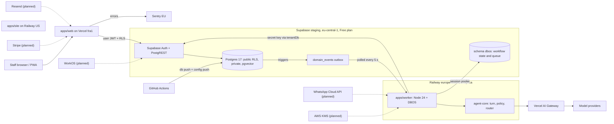
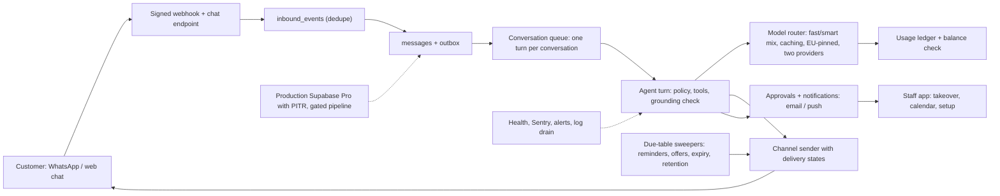

# Moodly: auditoría de preproducción, decisiones y plan del piloto (2026-11-10)

> Commit auditado: main @ bfbe4af. Las secciones 18 y 19 mandan sobre las anteriores donde difieran. La sección 20 recoge lo que cambió en main después de la auditoría. El registro de alcance vive en `docs/scope.yaml`.

## 0. Header

- **Audited commit:** `main` at `bfbe4aff30346da9ed2a1128e6be60fb2caa7bad`, 2026-11-10 01:54 +0100 (#157). The clone is shallow (50 commits, from 2026-10-30), so older history comes from `docs/STATUS.md`.
- **Method:** eleven parallel read-only reviews (database, agent runtime, worker, web security, frontend, site, CI/process, plan, ADRs, previous audits, branches). I re-tested the highest-severity claims myself; those rows say "re-run". Other VERIFIED rows were verified by a reviewer reading the cited code.
- **Ran locally, all green** (Node 24.22.1, pnpm 11.28.1, Supabase CLI 2.118.0, Docker):

| Check | Result |
|---|---|
| `pnpm install --frozen-lockfile`, typecheck, build | pass (19/19 typecheck tasks; Next 16.4.2, 27 routes) |
| lint | pass, 1 warning (`packages/ui/src/components/data-table.tsx:147`) |
| unit tests | 998 passed in 91 files |
| merge-guard / config-drift suites | 67/67 and 11/11 |
| `db:lint`, pgTAP | clean; 1,145 tests in 39 files pass |
| integration | `tenantDb` 5/5; worker 57/57 (492 s) |
| e2e | 175 passed (4.6 min) |

- **Hosted, read-only:** Supabase advisors and migration list, Railway service config and logs, Vercel deployments and runtime errors, Sentry issues, GitHub PRs and CI runs.
- **Not done:** no real-model evals, no workflow runs, no hosted writes, no GitHub writes.
- **Not verifiable:** staging HTTP response headers (this environment's network policy blocks those hosts); GitHub branch protection, environment branch rules, Vercel env scoping, signed DPAs.
- **Side effects:** no tracked file changed (`git status` clean). The runs left untracked, git-ignored build output, `.env.local` and seed credentials, and one reviewer's `git merge-tree` wrote unreachable objects into `.git`.

Path prefixes used below: `MIG/` = `packages/db/supabase/migrations/`, `CFG` = `packages/db/supabase/config.toml`, `WK/` = `apps/worker/src/`, `WEB/` = `apps/web/src/`, `CORE/` = `packages/agent-core/src/`, `SK/` = `packages/skills/src/`, `SITE/` = `apps/site/src/`, `WF/` = `.github/workflows/`, `MG/` = `scripts/merge-guard/`, `M:n` / `S:n` = line n of `docs/MANUAL.md` / `docs/STATUS.md`.

## 1. Executive summary

**Verdict.** The foundation is unusually disciplined for a six-week-old codebase: database isolation, the agent safety core and the test suites are real. But the product cannot yet reach a customer, the owner cannot operate it, each conversation costs more than the proposed price, and the engineering controls are an honor system.

- **Paying pilot: not ready.** There is no customer-facing channel. Staff cannot reply or take over on `main`, and cannot see appointments or change services and hours. Nothing notifies anyone when an approval or hand-off is waiting.
- **Production with real data: not ready.** There is no production environment, backup, erasure path or signed DPA, and human review is suspended behind a guard that a PR can rewrite.

**Top 5 risks**
1. **No channel, no pilot customer, Meta lead time not started** (O-01, A-03). Every "sent" message is a database row.
2. **Unit economics** (B-01, B-02). Every turn uses the top-tier model: about €0.25 per conversation as booked, against a proposed €0.10–0.20 of revenue. No metering or credit ledger exists.
3. **Governance** (P-01 to P-04). The merge guard gates no paths and runs from the PR's own branch; all commits carry one identity; 49 PRs merged in 7 active days.
4. **Compliance and operations** (H-01 to H-03, J-01, J-02). "EU only" switches the AI off, yet the site promises EU processing. No backups, health checks or alerts.
5. **Runtime behaviour under real traffic** (R-01 to R-07). Concurrent turns double-reply, a model hiccup silently flips conversations to human, approvals never expire, the agent can post after a takeover.

**Top 5 strengths**
1. **Tenant isolation in the database:** 37/37 tables with forced RLS, session revocation and MFA enforced in SQL, structural tests that fail the build on a missing policy.
2. **Agent safety core:** tenant, contact and recipient never come from model output; approvals are human-only and bound to a hash; every reply and write starts as a draft.
3. **Test discipline:** about 2,380 automated tests green, systematic negative cases, a real-worker SIGKILL-resume test.
4. **CI and supply-chain hygiene:** actions pinned by SHA, read-only tokens, exact dependency pins, config-drift check.
5. **Honesty in the app:** no fake data, unbuilt areas say so, STATUS records its own blockers.

**Three decisions for the founder now** (all three were decided on 2026-11-10; decision 1 went a different way, see section 18)
1. **Re-cut the pilot:** Reception and Customer only, on WhatsApp plus web chat, concierge onboarding, Moodly's own calendar. Start the legal entity, brand and Meta verification this week.
2. **Set the cost policy:** a target cost per conversation, the model mix that meets it, what one credit is, and whether EU processing is the default.
3. **Fix governance before any real data:** a separate agent identity, a guard that runs from the base branch, and a named reviewer for migrations, RLS, auth and the guard.

## 2. Scorecard

| Dim | Score | Strengths | Weaknesses and risks | Improve (finding IDs) |
|---|---|---|---|---|
| A Product & plan | 4 | Clear vision; safe-by-default autonomy | Pilot sits behind three phases; Phase 1 exit unreachable; differentiator unbuilt | A-01…A-04 |
| B Business model | 3 | Per-run cost is recorded; budgets exist | Cost above price; no metering; credit undefined | B-01…B-03 |
| C Architecture | 6 | Clean web/worker split, no package cycles, thin router | One shared queue, no channel layer, about 42 % of backend logic in PL/pgSQL, scaffolding ahead of need | R-01, O-01, O-02, G-07, A-04 |
| D Data model | 7 | Forced RLS, composite tenant FKs, exclusion constraint on appointments | No erasure or retention, no rollbacks after migration 15, weak state machine | H-02, D-01…D-06 |
| E Code quality | 7 | Small typed modules, Zod at boundaries, largest web file 314 lines | Site is untyped and unlinted; duplicated helpers; three empty packages | N-05, A-04 |
| F Testing | 7 | Negatives everywhere; `retries: 0`; real integration tests | e2e never runs the worker; no concurrency, deletion or load tests; mutation claims not automated | P-03, P-06, K-01 |
| G Security | 6 | DB-level MFA and revocation; no service role in web; nonce CSP | Controls bypassable through the Auth API; open redirect; guard and secrets reachable from PRs | G-01…G-09, P-01, P-05 |
| H Compliance | 2 | AI-disclosure rule; log redaction | Almost all prose: no entity, DPA, erasure, DPIA; contradictory EU promise | H-01…H-05 |
| I Performance | 5 | RLS InitPlan pattern; fine at pilot scale | 8–20 s per tool turn, no streaming or caching; UI polls every 2–5 s | B-01, M-10, J-04 |
| J Reliability & ops | 2 | Executor lease, idempotent steps, config as code | No production, backups, health checks, alerts or runbooks; one replica | J-01…J-05 |
| K AI quality | 4 | Policy attack set; eval checks have negative tests | Real-model evals optional; regex checks; 25 single-turn cases | K-01…K-05 |
| L i18n | 4 | es/en parity test; locale resolution per ADR 0041 | Agent-side texts es/en only; hard-coded Spanish; no fr/it/de in the app | L-01 |
| M Frontend & UX | 4 | Solid tokens, accessibility foundations, URL-held state | Owner cannot run the business from the app | M-01…M-10 |
| N Website & GTM | 2 | Pricing structure matches §15; no trackers | Fake forms, unbuilt claims, placeholder legal, prototype as "Log in" | N-01…N-05 |
| O Integrations & channels | 1 | `BookingProvider` interface; MCP URL guard | Nothing real: no channel, connector, OAuth or key provider | O-01, O-02 |
| P Process & governance | 3 | Evidence culture; exact-commit merges | Honor-system controls; unreviewable volume; bus factor 1 | P-01…P-09 |
| Q Enterprise readiness | 2 | Tenancy model, JIT staff access, audit table | No SSO, audit viewer, SLA, trust centre or pentest | Q-01 |
| Z Other | 3 | — | No legal entity or insurance; pilot unsigned; knowledge lives in chat sessions | §16 |

## 3. Repository map

| Workspace | Role | Size (non-test TS / tests) | Maturity |
|---|---|---|---|
| `apps/web` | Staff app: Next.js 16, Supabase Auth, RLS reads, Server Actions | 6,685 / 4,396 lines, 175 e2e | Partial: 14 real screens, 14 stubs |
| `apps/worker` | DBOS worker: outbox, agent turn, approvals, reminders, waitlist, ingest | 7,026 lines, 130 unit + 57 integration | Built for the test channel only |
| `apps/site` | Public site and 67-screen prototype, plain JS | about 13,300 lines, 0 tests | Prototype |
| `packages/db` | 35 migrations, pgTAP, seed, `tenantDb` | 2,724 TS + about 7,100 SQL + 6,500 pgTAP | Built |
| `packages/agent-core` | `decide()`, skills contract, approvals hash, turn loop, model router | 1,473 / 1,660 | Built |
| `packages/skills` | Reception skills, `reply`, `search_knowledge` | 770 / 1,040 | Built for 2 of 4 agents |
| `packages/integrations` | `BookingProvider`, MCP governance | 809 / 622 | Scaffold (no transport, no callers) |
| `packages/knowledge` | Chunker, retriever interface, pgvector adapter | 229 / 150 | Built (text only) |
| `packages/evals` | Attack set, conversation harness, embeddings eval | 2,093 / 392 | Partial |
| `packages/ui` | 20 components, tokens | 1,653 / 270 | Partial |
| `packages/config` | Brand, agent keys, model table | 89 | Built |
| `packages/channels`, `domain`, `templates` | — | 2 lines each | Stub |

Dependency graph, no cycles: `web → config, db, ui`; `worker → agent-core, db, integrations, knowledge, skills`; `skills → agent-core, integrations, knowledge`; `integrations → agent-core → config`; `evals → agent-core, integrations, knowledge, skills`; `site` isolated.

## 4. Branches and open PRs (nothing here is in `main`)

| Branch (PR) | Stream | Contains | State |
|---|---|---|---|
| `claude/b20-4b-ask-team` (#159, ready) | V1 | `ask_team` skill plus catalogue migration `20261110110000` | In progress. Tells customers "a person will reply" with no staff screen for the request |
| `claude/pending-for-team` (#160, draft) | V1 | #159 plus pending approvals listed in the system prompt | Stacked on #159. Puts model-written reply text into the system prompt |
| `claude/nice-einstein-q1b00r` (#154, draft) | V2 | Inbox takeover: two actions, composer, three e2e | In progress, 7 behind. Edits V1-owned seed files; composer works on channels with no delivery |
| `claude/reception-tools-english` (#153, ready) | V1 | Tool descriptions in English | In progress; real-model evals green once |
| `claude/v3-adr-0046` (#158, draft) | V3 | ADR 0046 draft (copilot and coach) | Awaits product. Contradicts itself on running in the worker; builds on unaccepted ADRs 0024 and 0029; no cost or staff-privacy rules |
| `claude/v4-evals-modelos` (#152, draft) | V4 | `--model` flag; a model-path failure stops the run | In progress. Fixes a defect on `main` (K-02) |
| `claude/v4-evals-huecos` (#155, draft) | V4 | #152 plus 5 cases | Stacked; evals check failed |
| `claude/v4-evals-sectores` (#156, draft) | V4 | #155 plus 17 sector cases (47 total) | Stacked; evals failed on a gateway error. **Loosens a safety check** (see below) |
| `claude/v4-evals-agentes-wip` (no PR) | V4 | Harness WIP | Already in `main` via #141 and #142; delete |
| `claude/wonderful-shannon-yabmms` (#117, draft) | pre-workstreams | One STATUS note | Stale since 2026-11-03 |
| `dependabot/…parches-y-menores` (#131) | bot | next 16.4.3, ai 7.0.153, Sentry 11.9.0 and five more | 22 behind; the AI SDK bump is not covered by the evals path filter |

The loosened check in #156 (`checks.ts:147-154`, commit 9b2b032) adds "si / cuando / if / when" to the words that exempt a sentence from the claim detector. "Si estás embarazada es seguro hacerte el láser" then passes a safety check it fails on `main`. CLAUDE.md requires telling product before merging a change like this.

## 5. Status of previous audit findings

126 findings reviewed: 52 closed, 23 partial, 42 open, 9 not verifiable, 0 regressed. Eighteen of the open ones are controls for features not yet built.

| IDs | Finding | Status | Evidence / what remains |
|---|---|---|---|
| R-16, R-20, R-23, R-24, R-29…R-35 | MFA on reads, least privilege, cookie flags, seed and i18n hygiene | Closed | `MIG/20261023090000_mfa_reads.sql`, pgTAP `14`, `15`; `WEB/lib/cookie-options.ts:13-24`; `WEB/i18n/messages.test.ts` |
| R-1, R-2, R-4, R-5, R-11, R-12, R-14, R-15, P0-2, P1-1 | Next RCE, daily audit, invitations, GraphQL, CI | Closed | `apps/web/package.json` (16.4.2); `WF/security-daily.yml`; `CFG:16` |
| 1.2…1.7, 2.1…2.3, 3.2, 3.3, 3.4, 3.7, 5.1, C-1…C-3, C-6…C-8, A1 | Headers, RLS, scoped worker client, approval hash, recipients | Closed | pgTAP `00`, `13`, `22`; `packages/db/src/tenant-db.ts`; `CORE/policy.ts` |
| F-1…F-7, F-11, F-12 | Navigation, Home, Settings, login | Closed | `WEB/lib/navigation.ts`; ADR 0041 |
| R-17, R-21, R-25, R-28, C-4, 1.1, A2…A4, 2.4, 3.1, 3.8, 4.6, 5.4, 5.5, 6.1, 7.3, 8.1, F-10 | Auth config as code, MFA disable, product code, throttle, alerts | Partial | Controls exist in the web layer or locally only; no alerts, KMS or `/ops` |
| R-13 | Guard reads its list from the PR branch | Open | `WF/sensitive-paths.yml:33-53` (P-01) |
| R-22 | Invitation token in the URL | Open | `WEB/app/app/invitations-actions.ts:55` |
| C-5, 2.5, B2 | Session expiry, backups, Supabase Pro | Open | `CFG:467-469`; S:130 |
| 3.5 | Output filter before sending | Open, silently dropped | Promised "with Reception" in ADR 0047:130; Reception shipped without it |
| 4.4, 4.5, 5.3, 6.3, 8.5, A5 | Erasure, DPIA, traces with personal data, secret rotation, incident plan | Open | Nothing in repo |
| 8.3, 8.4 | Public prototype without noindex; forms send nothing | Open | Prototype went public on 2026-11-08 without the mitigation |
| F-8, F-9, R-27, R-37 | Topbar actions, mobile bar, stale MANUAL, full message catalogue to the browser | Open | `WEB/components/app-topbar.tsx`; `WEB/app/layout.tsx:34` |
| 3.6, 4.1…4.3, 6.2, 6.4, 7.1, 7.2, 7.4…7.7, Phase C, Phase E | Controls for unbuilt features | Open | Ship with the feature |
| R-18, R-19, R-26, R-36, B1, 8.2, 5.2, P0-4, P0-5 | Preview and CI secret scoping, plan, branch protection, DPAs | Not verifiable | Hosted settings or contracts; P0-4/P0-5 come from an audit "delivered in chat" that is not in the repo |

Recurring patterns:
- Controls are placed in the web layer while the Supabase API stays directly reachable.
- Secrets become reachable from non-`main` code; this was fixed once and reintroduced by `evals.yml`.
- Some fixes exist only in local config and never took effect on the hosted project.
- Several findings were closed by a written rule rather than a control.

## 6. Plan versus reality, and documentation drift

| Plan says | Reality on `main` |
|---|---|
| Phase 1: four agents on web chat and WhatsApp (M:1258) | Two agents have skills; `sales` and `admin` have none, not even `reply`. No channel exists |
| Priority is memory, goals, coach | Three empty pages; no `memories` table; goals are 194 lines of schema with no reader |
| "No improvisar": knowledge requests (M:665) | Table and trigger only; the skill is on an unmerged branch |
| Runs write `usage_records`; router has a fallback provider (M:684-686) | No such table; one transport |
| Four tables partitioned by month (M:428) | Only `messages` |
| EU by default (M:156) | Default residency `any`; the only route is declared non-EU |
| STATUS is the continuity record | Thirteen merged PRs are missing or still "en PR" (#126, #128, #136, #137, #140, #142, #143, #145, #147, #148, #150, #151, #157) |
| ADR register (§19) | 0003, 0009, 0018, 0021 and 0023 say "proposed" in the file while cited as binding; 0048 is unregistered; 15 of 0001–0017 unwritten; 0038–0040 and 0042–0046 referenced without files |
| `SECURITY.md:18`: sensitive changes get human review | Suspended since 2026-10-22 |
| CLAUDE.md: attack set of 25 cases | 27 in code, exercising policy code, not a model |
| `TECHNICAL_SPEC.md` | Describes commit `976bf1f`: empty worker, 13 migrations, Spanish routes. Archive or delete it |

Five phase and ID schemes coexist (MANUAL 0–10, old 0–5, audit Phases A–E, roadmap blocks, STATUS B1–B6), and "B5" means two different things.

## 7. Critical flow walkthroughs

**(a) Inbound message to reply.**
- The only inbound path is the staff test chat: `public.send_test_message` (`MIG/20261104090000_test_chat.sql:66-173`) inserts a row and a trigger emits `message.received`.
- The outbox publisher polls every 5 s and enqueues `agent.converse` on one shared queue with concurrency 4 (`WK/events/outbox.ts:25,178`).
- `prepare` does about nine sequential reads, loads the last 20 messages and up to 50 services (`WK/agents/converse.ts:173-256`). The turn loop makes up to six model calls, and every tool call passes `decide()` (`CORE/policy.ts:96-136`).
- The reply is a draft by default, so it waits for a human approval.
- Gaps: no ordering per conversation (R-01), silent hand-off on any model error (R-03), no channel (O-01).

**(b) Booking, reminders, waitlist.**
- `find_slots` reads one open/close window per weekday. `book_appointment` creates a draft and an approval; after approval the worker verifies the hash and inserts.
- Double booking is prevented by an exclusion constraint (`MIG/20261031140000_bookings.sql:136-139`).
- Each appointment starts a DBOS workflow that sleeps until the 24 h and 4 h reminders and re-reads state on waking. A cancellation starts a waitlist workflow with 30-minute offers.
- Gaps: any instant is bookable (R-08), sleepers are fragile across deploys (R-09), no closures or split shifts (D-06), and no message reaches a real customer.

**(c) Knowledge.**
- An org admin with MFA writes a text source; the worker chunks by paragraph (1,000 characters), embeds with `openai/text-embedding-3-small` and replaces chunks in two non-transactional calls.
- Retrieval is one embedding call plus a SQL function that filters by organization and location, then fuses cosine and keyword rank. Results are tagged untrusted.
- Gaps: retrieval quality and availability (K-04); no files or URLs.

**(d) Human takeover.**
- The database part is merged (`MIG/20261109230000_inbox_takeover.sql`): staff can flip `mode` and insert messages under RLS.
- The inbox on `main` is read-only; the UI is in draft PR #154.
- The worker checks `mode` once at load, so an in-flight turn, a later approval, reminders and offers still post (R-02). Staff messages on non-test channels stay `pending` forever.

**(e) Login, MFA, invitations.**
- `signIn` validates with Zod, calls the throttle (hashed email and IP), then `signInWithPassword`. A verified factor forces `/login/mfa`.
- `requireUser()` uses `getUser()` plus an aal2 gate, and the active-organization cookie is checked against memberships on every request.
- An invitation is a link the admin copies by hand. Only an existing account can accept it, and the token is hashed, single-use and bound to the email.
- Gaps: G-01 to G-04 and M-04. No IDOR or mass assignment was found in any Server Action.

**(f) Model call.**
- The router maps the task to a key, filters transports by connection, residency and allowed providers, and checks €0.50 per run and €20 per day (`CORE/models/router.ts:31,152-198`).
- The single Gateway transport sends no provider, region or retention options (`CORE/models/transports/gateway.ts:144-153`).
- Cost is taken from the gateway in USD and booked 1:1 as EUR on `agent_runs`.
- BYOK is types plus a column. Embeddings bypass the budget.

**(g) Domain event.**
- Only SECURITY DEFINER triggers write `domain_events`. A scheduled DBOS workflow reads 100 at a time, starts one delivery per consumer with a deterministic ID, then marks them published.
- The tenant comes from the row; this has a payload-tampering test.
- Handler steps have no retry, and a failure is terminal (R-06). Only publisher loops are pruned.

**(h) Deploy.**
- A PR runs four CI jobs plus the guard. The same agent posts the evidence and squash-merges, pinned to the head commit.
- A push to `main` triggers Vercel and Railway immediately. Migrations are applied only after CI on `main` passes, so new code runs on the old schema for 10–15 minutes (J-03).
- No production pipeline exists.

## 8. Detailed findings

Codes: **V** = VERIFIED, **A** = ASSUMPTION. Severity: **C** blocks a paying pilot or is exploitable now, **H** must be fixed before real customer data, **M**, **L**. Mig = needs a migration (V1 only). PD = needs a product decision. Effort S/M/L.

| ID | Dim | Finding | Evidence | V/A | Sev | Impact | Recommendation | Done when | Owner | Mig | PD | Eff |
|---|---|---|---|---|---|---|---|---|---|---|---|---|
| P-01 | P,G | Merge guard gates no paths and runs the PR's own scripts and workflows | `MG/sensitive-paths.txt` (0 active lines); `WF/sensitive-paths.yml:39,53`; `WF/ci.yml:4` | V (re-read) | C | One PR can neuter CI and the guard, then land an RLS or auth change with all checks green | Run the guard from the base ref without executing PR code; restore a narrow sensitive list | A test PR that replaces `check-sensitive.sh` with `exit 0` and adds `it.skip` cannot be merged by the agent identity | V1 + Founder | N | Y | M |
| P-02 | P | No separate agent identity; the `revisado-humano` label trusts presence, not who set it | 50/50 commits under the founder; `WF/sensitive-paths.yml:47`; S:285 | V (git), A (token scopes) | H | Human review is self-grantable; no audit trail | GitHub App with contents and PR write only; required code-owner review instead of a label | Merges show the bot actor; the bot cannot approve or bypass | Founder | N | Y | M |
| P-03 | P,F | "No weakened tests" is a narrow regex | `MG/check-sensitive.sh:43,54`; `--passWithNoTests` everywhere | V | H | `skipIf`, `test.fails`, aliases, loosened assertions, deleted `*.integration.ts`, lowered `plan(n)` pass unnoticed | Base-versus-head ratchet on executed test and assertion counts; wider patterns | Each bypass is a failing case in `MG/tests/run.sh` | V1 | N | N | M |
| P-04 | P | Post-merge verification is self-reported; merges landed 30 s to 4 min apart while e2e takes 10 min; CI on `main` is cancellable | #134/#135, #142/#149 timestamps; `WF/ci.yml:14-16` | V (timestamps), A (breach) | H | `main` commits without a completed CI run | Strict up-to-date checks or a merge queue; no cancel on `main`; alert on red | Every `main` commit has a completed CI run | V1 + Founder | N | N | S |
| P-05 | P,G | The paid-model key and its spend cap are reachable from PR code | `WF/evals.yml:44,66,70`; `packages/evals/src/conversations/cli.ts:62-73` | V | H | A PR can leak the key or burn the budget | Environment-scoped secret or run from `main` only; hard cap at the gateway | A branch workflow cannot read the key | Founder + V4 | N | N | S |
| P-06 | P,F | Mutation results are narrated in STATUS, not automated; the author agent grades its own work | No mutation tool in code; STATUS cites "mutaciones detectadas" | V | M | No independent evidence behind "verified" | CI mutation job for RLS suites and the policy engine; independent reviewer agent | Mutation job is a required check | V1 + V4 | N | Y | M |
| P-07 | P | 49 PRs in 7 active days (peak 18), median 464 lines, 43 % touch sensitive paths | `git log` | V | M | One person cannot review this | Narrow sensitive list, independent reviewer, two sessions instead of four | A review SLA exists and is met | Founder | N | Y | S |
| P-08 | P | Documentation is about 930 KB and drifts (see §6); `SECURITY.md` makes a false claim | S:151-152; `SECURITY.md:18` | V | M | Sessions act on stale facts | STATUS under 80 lines generated from PRs; one roadmap; archive spec and audits; ADR status check in CI | Doc check green in CI | V1 + V3 | N | Y | M |
| P-09 | G | Supply-chain gaps: base image by tag, no docker updates, no SBOM or licence check, worker image never built in CI | `apps/worker/Dockerfile:5,25`; `.github/dependabot.yml` | V | M | Unreproducible image; unknown licences | Digest pin, image build, SBOM and licence allowlist in CI | CI publishes an SBOM | V1 | N | N | S |
| O-01 | O | No customer-facing channel exists | `packages/channels/src/index.ts`; only route is `WEB/app/monitoring/route.ts`; `WK/agents/conversation-sender.ts:13-31` | V | C | No pilot; reminders and replies reach nobody | Signed webhook with a dedupe table, outbound sender with delivery states, templates, web chat endpoint | A replayed sandbox webhook creates exactly one message; a reply, a staff message and a reminder reach a sandbox number | V1 (+V2) | Y | Y | L |
| O-02 | O,C | Integration framework is scaffolding: vault with a local key and no callers; MCP with no transport and an empty catalogue; no OAuth | `WK/secrets/vault.ts:93-109`; `packages/integrations/src/mcp/catalog.ts:20` | V | M | Looks enterprise-ready and is not | Decided (section 18): every integration must be possible for the pilot. Finish the framework (KMS provider, OAuth, MCP transport) and add a connector platform for breadth | A pilot customer connects a calendar, a payment tool and one long-tail system from the app | V1 | N | Y | M |
| R-01 | C | No per-conversation ordering or debounce | `WK/events/outbox.ts:128-132,178`; ADR 0027 rule 4 | V | H | Two replies and two booking proposals on message bursts | Queue partitioned by conversation with concurrency 1; re-check before reply | A message arriving mid-turn yields one reply | V1 | N | Y | M |
| R-02 | C | The agent can still post after a human takes over; approvals and reminders ignore human mode | `WK/agents/converse.ts:179`; `conversation-sender.ts:13-31`; `scheduled-skill.ts:67` | V | H | Agent and staff both answer | Insert only if mode is `agent`; hold approvals in human mode | Flipping mode mid-turn produces no agent message | V1 | Y | N | M |
| R-03 | C,J | Any transient model failure flips the conversation to human, with no message and no notification | `CORE/runtime/turn.ts:240-243`; `converse.ts:351-357` | V | H | A short outage silences every active conversation | Retries with backoff, second transport, holding message, staff notification | Two failures then success yields a reply; a hard failure yields a holding message and a notification row | V1 | maybe | Y | M |
| R-04 | K | The prompt promises "a person will reply" with no hand-off skill or notification | `CORE/runtime/prompt.ts:41,58,63,69` | V | H | Unanswered medical or unknown questions | Ship `ask_team` and an explicit hand-off tool together with the staff screen | e2e: unknown price creates a request, staff are notified, the answer reaches the customer | V1 + V2 | N | Y | M |
| R-05 | C | The approval loop never closes: no expiry sweeper, no confirmation after a decision, drafts not editable | `WK/agents/approvals.ts:21,189-198` | V | H | Customer hears nothing; runs stuck `awaiting_approval` | Holding acknowledgement, confirm or decline message, expiry that hands off, edit-then-approve | Approve, reject and expire tests each assert a customer-visible message | V1 + V2 | Y | Y | M |
| R-06 | J | A failed delivery is terminal and silent | `outbox.ts:111-115,136` | V | H | One 5xx drops a customer message for good | Step retries, failure table, sweeper, alert | Three injected failures still end in a reply or a visible hand-off | V1 | Y | N | M |
| R-07 | J | No staleness guard after downtime; quiet hours checked only when planning | `converse.ts:173-256`; `WK/reminders/reminders.ts:191-203,274` | V | H | Hour-late answers; reminders at night or after the appointment | Maximum message age; re-check at send time | A two-hour-old message and a past-start reminder send nothing | V1 | N | Y | S |
| R-08 | C,D | The model-chosen `starts_at` is not validated | `SK/reception/skills.ts:150`; `MIG/20261108090000_appointment_reminders.sql:41-104` | V | H | Bookings in the past or at 03:00 once autonomy is raised | Enforce "future and inside a free slot" in SQL | pgTAP rejects past, closed-hour and off-grid inserts | V1 | Y | N | S |
| R-09 | J | Sleeping workflows are fragile across deploys and version bumps | DBOS default recovery cap 100; about 9 deploys/day on Railway; no drain tooling | V (SDK), A (timeline) | H | Reminders silently dead-lettered after about 11 days | A due-table plus a sweeper; CI check that a workflow change bumps the version | 105 restarts under a sleeping reminder still send it | V1 | Y | N | M |
| R-10 | G | No inbound rate or size limits; at the daily cap every conversation hands off | `MIG/20261031130000_contacts_conversations.sql:203`; `router.ts:31` | V | H before a channel | Any customer can exhaust the budget | Per-contact limits, history token budget, degrade instead of flipping | A flood leaves other conversations answered | V1 | maybe | Y | M |
| R-11 | H | Opt-out matches only an exact "baja" or "stop", is permanent, and waitlist offers ignore it | `WK/reminders/consent.ts:25-36`; `WK/waitlist/offers.ts:344-346` | V | M | Legitimate answers swallowed; offers sent after opt-out | Honour only after a reminder; re-subscribe keyword; opt-out skill | Tests for each case | V1 | N | Y | S |
| R-12 | C | Business instructions are never passed to the prompt; config inheritance (385 SQL lines) has no caller | `converse.ts:512-520`; `MIG/20261023170000_agent_config.sql` | V | M | Owner cannot set tone or rules | Wire a minimal instruction field or drop the feature | A tone set in config appears in the prompt | V1 | N | Y | M |
| R-13 | A | `sales` and `admin` have zero skills, yet are presented as agents | `MIG/20261031150000_agent_converse.sql:56-97` | V | M | A live sales agent wastes a model call and hands off | Block activation until their first skills ship, then build both minimum versions (section 18.3) | Neither can go live without skills; each passes its eval set | V1 + V2 | N | Y | S |
| R-14 | I | Times reach the model in UTC; database calls have no timeout; shutdown does not drain | `skills.ts:123`; `packages/db/src/service.ts:32-34`; `WK/worker.ts:129` | V | M | DST off-by-one; hung queue slot | Local time with offset; abort signal; 45 s drain | Tests | V1 | N | N | S |
| K-01 | K,F | Real-model evals do not gate merges; in-CI evals replay a scripted model | `WF/evals.yml:8`; `packages/evals/src/conversations/runner.ts:67-80` | V | H | Prompt or model regressions merge green | Required check for agent paths, three samples, stored baseline | Listed in `MG/required-checks.txt` | V4 + V1 | N | Y | M |
| K-02 | K | The eval CLI on `main` scores a model-path failure as a pass | `packages/evals/src/conversations/cli.ts:101` | V | H | False green | Merge #152 first, alone | A gateway error exits 2 on `main` | V4 | N | N | S |
| K-03 | K | Checks are regex-only; 25 single-turn cases, mostly Spanish, none Italian; no resolution-rate metric | `checks.ts:185-248`; `cases.ts` | V | M | Weak signal on real quality | Multi-turn and burst cases, per-language sets, a judge for claims, a resolution metric | Thresholds reported per agent and language | V4 | N | Y | M |
| K-04 | K | Retrieval: keyword leg requires all tokens with no stemming; no relevance floor; changing the model hides every chunk | `MIG/20261031120000_knowledge.sql:147,221-252`; `WK/knowledge/ingest.ts:104-119` | V | M | Wrong answers; knowledge outages | Stemming and unaccent, a floor, atomic chunk swap, re-index job, recall test on the real SQL | Retrieval threshold in CI | V1 + V4 | Y | N | M |
| K-05 | K,H | No deterministic check of prices, hours or dates before sending; AI disclosure relies on the model | `prompt.ts:38,41`; ADR 0047:130 | V | M | Invented prices; disclosure not guaranteed | Compare numbers and dates in the reply with tool results; fixed first-message disclosure | An eval with an invented price is blocked | V1 + V4 | N | Y | M |
| B-01 | B | Every turn uses the top-tier model; measured €0.018–0.065 per turn | `packages/config/src/index.ts:45,63-64`; S:151; `docs/design/modelo-precios.md:32-34,131-138` | V (inputs), A (arithmetic) | C | Zero or negative gross margin | Model mix chosen by eval, prompt caching, smaller tool schemas, a target cost | Cost per resolved conversation measured over 100 runs; price at least 3× cost | Founder + V4 + V1 | N | Y | M |
| B-02 | B | No metering, credit ledger or payment gate; "credit" is undefined | Zero matches for `usage_records`, `credit`, `stripe` in code; M:1127-1158 | V | H | Cannot bill or pause the AI | Per-call usage ledger, balance check in the router, plan caps | A zero balance pauses the AI and hands off | V1 | Y | Y | M |
| B-03 | B | The daily cap undercounts beyond 1,000 runs; a tenant may set €100,000/day on the platform's key; embeddings are unmetered | `converse.ts:242` vs `CFG:21`; `MIG/20261030120000_org_model_settings_secrets.sql:29-30` | V | M | Cap ineffective at volume | SQL aggregate; platform cap by plan | 1,500 runs sum correctly; pgTAP caps the tenant value | V1 | Y | N | S |
| H-01 | H,C | "EU only" switches the AI off, and the gateway call pins no provider, region or retention, while the site promises EU | `CORE/models/transports/gateway.ts:132,144-153`; `router.ts:156`; M:156 | V (re-read) | C | Residency and no-retention cannot be honoured or shown | Decided (section 18): EU by default, US on request, all providers behind the router, each with region and retention options recorded | An `eu` organization completes a turn in staging | V1 + Founder | N | Y | M |
| H-02 | H,D | No erasure or retention path: audit FK blocks deleting an organization, message text persists in the `dbos` schema, events are undeletable | `MIG/20261006170108_platform_staff_audit.sql:108,147-181`; `converse.ts:490` | V | H | GDPR erasure needs ad-hoc superuser SQL | Erase procedures, an audit pseudonymisation rule, retention jobs, IDs instead of content in steps | pgTAP erases a populated contact and organization with no residual content | V1 | Y | Y | L |
| H-03 | H | No legal pack: controller entity, DPA, subprocessor list, DPIA, provider DPAs, insurance | Placeholders in `SITE/app/[lang]/privacidad/copy.js`; M:1039-1050 | V (absence) | H | A pilot cannot be contracted lawfully | Counsel, entity, DPA template, subprocessor page | Signed DPA with the pilot | Founder + V3 | N | Y | M |
| H-04 | H | Reminder consent is opt-out only, with no opt-in record | `consent.ts`; M:821 | V, A (legal) | M | Meta policy and ePrivacy exposure | Store an opt-in event at booking | An opt-in row per contact and channel | V1 + Founder | Y | Y | S |
| H-05 | H,N | Provisional brand hard-coded about 250 times on the site; font and logo licences unproven | `SITE/` grep; `packages/config/src/index.ts:3` | V, A (ownership) | M | Rename cost; IP risk | Decide the brand before Meta verification; file licence evidence | Brand appears in one module | Founder + V3 | N | Y | M |
| G-01 | G | The login throttle, MFA attempt limit and "code to disable MFA" exist only in the web app; the Auth API is callable directly | `MIG/20261021090000_login_throttle.sql:4-8`; `CFG:218-223` | V (design), A (exploit not run) | H | Credential stuffing bounded only by Auth's per-IP limits | CAPTCHA on Auth plus Auth hooks, or WorkOS | 25 direct failed password grants for one email are blocked | V1 (+V2) | Y | Y | M |
| G-02 | G | Open redirect after login through dot segments | `WEB/lib/auth/routes.ts:29-41` | V (re-run: `/.//evil.test/x` returns `//evil.test/x`) | M | Phishing straight after a genuine login | Re-validate the normalised path | Unit and e2e cases land on `/app` | V2 | N | N | S |
| G-03 | G | `login_record_success()` works with a password-only session and clears the failure counters | `MIG/20261021090000_login_throttle.sql:169-184` | V (re-read) | M | The MFA throttle can be reset | Require `session_is_active()` inside | pgTAP: the call raises 42501 | V1 | Y | N | S |
| G-04 | G | Invitation acceptance trusts the JWT email; email confirmation is off in the base config | `MIG/20261022090000_invitations.sql:145-167`; `CFG:233,461` | V (config), A (exploit) | M, H in production | Takeover of an invited role | Base value true; check `email_confirmed_at` | pgTAP and e2e | V1 | Y | N | S |
| G-05 | G,J | Hosted sessions never expire; leaked-password protection is off | `CFG:467-469`; Supabase advisor | V | H | A stolen session lives forever | Pro plan, timebox and inactivity limits | Config diff clean; idle-session test | Founder + V1 | N | Y | S |
| G-06 | G,Q | Security events go to stdout only; no durable audit of invitations, memberships, MFA or logins | `WEB/lib/observability/events-core.ts:9-27` | V | M | No forensic trail | Audit rows, denial events, log drain, viewer | The audit screen lists these changes | V2 + V1 | Y | N | M |
| G-07 | G,C | Worker isolation is one TypeScript wrapper over an all-tenant key | `packages/db/src/service.ts:31-36`; `tenant-db.ts:55-97` | V | M | One wrong organization ID leaks across tenants | A per-organization credential subject to RLS | pgTAP: a worker credential for A cannot read B | V1 | Y | N | L |
| G-08 | G | Header gaps: prefix matcher skips `/offline.html`; `style-src 'unsafe-inline'`; client IP from the first forwarded hop; tunnel unlimited | `WEB/proxy.ts:60`; `WEB/lib/security/headers.ts:25`; `WEB/lib/auth/client-ip.ts:9` | V | L | Minor | Exact matcher; trusted header | e2e asserts CSP on `/offline.html` | V2 | N | N | S |
| G-09 | G | Write grants ship before features: staff can publish knowledge through an answer without MFA | `MIG/20261110100000_knowledge_requests.sql:196-230` | V | L | Bypasses the admin-with-MFA rule | Publish as a proposed source | pgTAP | V1 | Y | Y | S |
| D-01 | D | A team member who decided an approval cannot be deleted | `MIG/20261030090000_runs_executions_approvals.sql:122-124,281-292` | V (re-run: trigger error) | M | Cannot offboard or erase a user | Allow the null transition in three triggers | pgTAP deletes an approver and a source author | V1 | Y | N | S |
| D-02 | D | The database does not enforce approval before execution | Same file, `:206-224,458` | V (re-run: `executed` with approval `pending`) | M | The control lives only in worker code | Status state-machine trigger; revoke DELETE | pgTAP: service role cannot execute an unapproved row | V1 | Y | N | S |
| D-03 | D | No inbound de-duplication; nothing creates future message partitions | `MIG/20261031150000_agent_converse.sql:14-18`; `MIG/20261031130000:257-258` | V | M, H with a channel | A webhook retry produces a duplicate reply | Unique `inbound_events`; scheduled partition job | pgTAP rejects a duplicate inbound ID | V1 | Y | N | M |
| D-04 | D,J | No rollback scripts after migration 15; no transaction; hand-set timestamps ahead of commit time | `packages/db/supabase/rollbacks/` | V | M | Forward-only on a database without backups | CI applies up, down, up for each new migration; timestamp lint | CI job green | V1 | N | N | M |
| D-05 | D,I | 96 policies call helper functions per row; 32 tables have a second permissive policy | Supabase advisor | V, A (performance) | L, M at scale | Slow reads at 1,000 organizations | Set-returning helper as an InitPlan | EXPLAIN on 1M messages shows index scans | V1 | Y | N | M |
| D-06 | D,A | Calendar has one window per weekday: no closures, holidays or split shifts | `MIG/20261109090000_waitlist.sql:214-225` | V | M | Unusable for a salon with split shifts | Extend the model, or integrate the pilot's calendar | pgTAP for a split shift | V1 | Y | Y | M |
| J-01 | J | No production environment, backups or restore drill | `CFG` has only `[remotes.staging]`; S:130 | V | C (gate) | Unrecoverable data loss | Supabase Pro in a separate organization, gated pipeline, restore drill | Restore drill documented | Founder + V1 | N | Y | M |
| J-02 | J | The worker has no health endpoint, error tracking, metrics, alerts or runbooks | Railway config; `apps/worker/package.json`; Sentry issue open since 2026-10-30 | V | H | Silent agent outage | `/healthz`, Sentry, outbox-lag alert, runbooks | An alert fires when the staging worker stops | V1 | N | N | M |
| J-03 | J | Code deploys before schema; hosts do not wait for CI | `WF/deploy-staging.yml:8-20`; Railway "wait for CI" off | V | H | New code on the old schema after every merge | One ordered pipeline; migration-only PRs | An incompatible migration-plus-code PR is rejected | V1 + Founder | N | Y | M |
| J-04 | J,I | One replica, one queue, no path to a second executor | `outbox.ts:178`; `WK/lease.ts:90-99`; `CFG:473` | V, A (capacity) | M | About 15–30 turns per minute | Separate queues, per-organization caps, load test | p95 time to reply measured at target load | V1 | N | N | L |
| J-05 | J | Recurring `TimeoutNegativeWarning` after deploys | Railway logs, 2026-11-09 | V | L | Noise hides real errors | Trace and fix | Logs clean | V1 | N | N | S |
| M-01 | M | The inbox is read-only on `main` | `WEB/lib/inbox-data.ts:27` | V | C | The owner cannot intervene | Merge takeover after R-02; block the composer where there is no delivery | e2e takes over, replies and returns | V2 + V1 | N | N | M |
| M-02 | M | No notifications of any kind | `WEB/components/app-sidebar.tsx:21`; `WEB/app/app/page.tsx:149` | V | C | Approvals and hand-offs go unseen | Counters and a "needs you" list now; email or push next | A pending approval shows a badge; an email arrives in staging | V2 + V1 | Y | Y | M |
| M-03 | M | Appointments are invisible; no screen to manage services, resources or hours | No `appointments` query in `apps/web` | V | H | Every change needs SQL | Calendar list and settings screens | An admin edits hours and slots reflect it | V2 + V1 | Y | Y | L |
| M-04 | M,G | No account lifecycle: invitation email, set password, reset, recovery codes, member removal | `WEB/components/invitations/invite-form.tsx:59-72` | V | H | Onboarding by hand in the Supabase dashboard | Build the flow with Resend | e2e from invitation to a removed member reading nothing | V2 + V1 | maybe | Y | L |
| M-05 | M | No agent controls or channel status | `WEB/app/app/agents/[type]/page.tsx` | V | H | The owner cannot pause an agent | Pause, per-skill autonomy, channel status | Pausing stops replies in e2e | V2 + V1 | Y | Y | M |
| M-06 | M,L | Approval cards are Spanish-only text with no contact or link | `SK/reception/skills.ts:74,154`; `WEB/app/app/approvals/page.tsx:35` | V | H | Approvers approve blind | Structured preview rendered in the UI locale | English UI shows an English summary with a link | V2 + V1 | N | N | M |
| M-07 | M,I | Location scope is applied after the row limit; no pagination | `WEB/lib/inbox-data.ts:130-135`; `approvals-data.ts:32-38` | V (re-read) | H | Rows silently missing in busy organizations | Filter in the query; keyset pagination | 150 conversations across two locations page correctly | V2 | N | N | S |
| M-08 | M,L | Timestamps ignore the business time zone | `WEB/i18n/request.ts:9-12` | V | H | Wrong message and appointment times | Time zone from the location | With the server in UTC, the UI shows Madrid time | V2 | N | N | S |
| M-09 | M | Mobile is the desktop layout reflowed; e2e is desktop-only | `packages/ui/src/components/button.tsx:17-20`; `playwright.config.ts:30` | V | H | The owner works on a phone | Bottom bar, 16 px inputs, 44 px targets, a mobile WebKit project | Mobile e2e green | V2 | N | N | M |
| M-10 | M,I | Polling re-renders whole routes; no loading states; toast never mounted | `WEB/components/inbox/inbox-refresh.tsx:6,18` | V | M | About 120 requests per minute per open tab | Realtime or a change probe; `loading.tsx` | — | V2 | maybe | N | M |
| L-01 | L | Only en and es in the app; Spanish hard-coded in previews and UI defaults; fixed customer texts es/en only | `SK/reception/reminder.ts:54-58`; `packages/ui/src/components/toast.tsx:50` | V | M | Five-language target is far | Localise previews and fixed texts; add catalogues and eval sets | Parity test covers five locales | V2 + V1 + V4 | maybe | Y | M each |
| N-01 | N | The site claims unbuilt capabilities in the present tense | `SITE/app/[lang]/copy.js:8,17,32,63`; `enterprise/copy.js:13-26` | V | H | Misleading advertising | An availability tag per feature | Every card shows a status | V3 | N | Y | M |
| N-02 | N | Demo and contact forms discard submissions | `SITE/components/demo-form.jsx:4-20` | V (re-read) | H | Every lead is lost | Real endpoint and notification | e2e proves persistence | V3 + V1 | Y | Y | M |
| N-03 | N,H | Legal pages are placeholders; terms describe an auto-renewing subscription | `SITE/app/[lang]/terminos/copy.js:8-10` | V (re-read) | H (launch gate) | Cannot launch lawfully | Counsel-reviewed texts matching §15.1 | No bracket placeholders remain | V3 + Founder | N | Y | M |
| N-04 | N | "Log in" opens an unlabelled, indexable prototype with dental demo data and old prices | `SITE/components/site-header.jsx:12`; `SITE/app/plataforma/checkout/page.jsx:13` | V | H | Visitors mistake a mock for the product | Banner, noindex, move the login link, replace health data | Banner on every prototype route | V3 | N | Y | M |
| N-05 | N | No robots, sitemap, canonical or per-page titles; 1.4 MB hero; US region; no lint or tests | `SITE/app/[lang]/layout.jsx:11-25`; Railway region `iad` | V | M | No organic acquisition | Static-first rebuild or incremental fixes; EU host | `robots` and `sitemap` exist | V3 | N | Y | M |
| A-01 | A | Phase 1 exit needs Sales and Admin working, but their dependencies are in Phases 2 and 6; the pilot is Phase 3 | M:1258-1263 | V | H | The pilot keeps receding | Decided (section 18): keep four agents plus the assistant and the coach; re-sequence so each agent's dependencies land in the same stage | Every agent role has its dependencies in its own stage of the plan | Founder | N | Y | S |
| A-02 | A | The differentiator (memory, goals, coach) has almost no code and is scheduled after the pilot | ADR 0024 "propuesto"; no `memories` table | V | H | The pilot validates parity, not the claim | A thin slice: request loop, goal progress, weekly digest | A staff answer changes the next reply in an eval | V1 + V2 | Y | Y | M |
| A-03 | A | Pilot unsigned; Meta verification and templates not started | S:131-133 | V | H | External lead time on the critical path | Letter of intent; start Meta now | Verified WhatsApp account | Founder | N | Y | S |
| A-04 | A,C | Enterprise scaffolding ahead of need: nine tables with no reader or writer | See O-02, R-12 | V | M | Review surface; false readiness | Decided (section 18): keep and finish these foundations; give each a production caller and a place in the sequence | Every foundation has a production caller | Founder + V1 | N | Y | S |
| Q-01 | Q | No SSO or SCIM, audit export, SLA, trust centre, pentest or security questionnaire answers | No WorkOS code; no `/ops` | V | M | Blocks chain and enterprise sales | Decided (section 18): build the security and trust list in 17.4; label each item available or roadmap until it ships | Trust page lists real controls | Founder + V3 | N | Y | M |

## 9. Agent runtime threat model

**Assets:** contact data and conversations; calendar integrity; the business's outbound voice; knowledge integrity; approvals; platform model spend and keys; the worker's all-tenant database key; the `dbos` schema.

**Entry points:** inbound text; knowledge bodies; service, agent and business names; organization model settings; approval decisions; future MCP outputs; pull requests.

| Attacker | Top paths | Existing controls | Gaps |
|---|---|---|---|
| Anonymous customer | Prompt injection to trigger tools; booking at odd times; flooding | Tenant, contact and recipient come only from the runtime; appointment ownership enforced; writes and replies are drafts | R-08, R-10, R-01; approval-inbox flooding |
| Malicious tenant admin | Raise budgets on the platform key; inject through names and knowledge | Connection mode is platform-only; autonomy ceilings | B-03; names inserted raw into the prompt |
| Poisoned knowledge or MCP output | Instructions inside retrieved text | Results tagged untrusted; draft autonomy | Defence is model compliance; G-09 adds a customer-influenced title path |
| Insider or platform staff | Service key bypasses RLS; content in `dbos` and at the gateway | JIT grants up to 8 h with audit, for the web path | G-07, H-01, H-02 |
| Malicious or mistaken PR by a coding agent | Weaken a policy, test or the guard and self-merge | Required checks on `main` (not verifiable) | P-01 to P-05; K-01 |

## 10. Target architecture

| Change | Why |
|---|---|
| Channel layer in `packages/channels`, with inbound de-duplication | Nothing reaches a customer today; webhook retries must not double-reply (O-01, D-03) |
| Conversation queue with concurrency 1, separate batch queue | ADR 0027 rule 4 was never built (R-01, J-04) |
| Due-table sweepers instead of one sleeping workflow per appointment | Survives deploys, fixes staleness and the 07:00 burst (R-07, R-09) |
| Model mix, caching, EU-pinned route, usage ledger | Cost and residency (B-01, B-02, H-01) |
| RLS-bound worker credential | Defence in depth on the path that handles customer data (G-07) |
| Production environment, ordered deploy, health and alerts | J-01 to J-03 |
| **Finish or simplify:** finish MCP governance, the vault and BYOK now that all integrations and providers are in scope (section 18); wire config inheritance to a real caller; fill the three empty packages; archive `TECHNICAL_SPEC.md` and `roadmap-enterprise.md`; make the site static with noindex | A-04, P-08 |

**Build versus adopt.** Right calls: the thin router, the policy engine, the outbox on DBOS, next-intl, Radix. Premature: MCP governance, vault, config inheritance, own login throttle without CAPTCHA. Risky: an own booking engine when the product promises to work in the customer's tools.

**Lock-in, by exit cost (assumptions):** Supabase stack (8–12 weeks to plain Postgres), DBOS (3–5 weeks; no neutral interface), Vercel hosting (1–2 weeks; standalone build unproven), AI Gateway (days), Railway (1–2 days; config lives in the dashboard).

## 11. Cost model

**Model cost per conversation (as configured).**
- Prices in `packages/config/src/index.ts:63-64`: smart $4 in / $20 out per million tokens; fast $0.10 / $0.50, unused. USD is booked 1:1 as EUR.
- Measured in staging (S:151): greeting 3,303 in + 241 out = €0.018, which matches the price table exactly; slot search turn €0.043; booking turn €0.065.
- Formula for a six-turn booking conversation: 1 × 0.018 + 2 × 0.035 + 2 × 0.043 + 1 × 0.065 ≈ **€0.24**. The 20-message history replay raises later turns, so plan on €0.25–0.30.
- Embeddings are negligible ($0.02 per million tokens).

**Other variable costs.**
- WhatsApp utility templates in Spain are about €0.017 each according to third-party trackers; marketing €0.05–0.06. Sources disagree on whether in-window messages became billable in October 2026; check Meta's rate card.
- Two reminders per appointment is about €0.03.

**Monthly cost, assuming 300 conversations and 150 appointments per organization (assumption):**

| Organizations | Model (all top-tier) | WhatsApp | Fixed infra (assumption) | Total | Per organization |
|---|---|---|---|---|---|
| 10 | €750 | €50 | about €150 | about €950 | about €95 |
| 100 | €7,500 | €500 | about €500 | about €8,500 | about €85 |
| 1,000 | €75,000 | €5,000 | about €3,000–5,000 | about €84,000 | about €84 |

Fixed infrastructure assumes Supabase Pro at $25 a month plus compute, Vercel Pro, one or more Railway workers and Sentry; list prices were not confirmed against vendor pages.

**Margin.**
- The only priced proposal (`modelo-precios.md`, status "propuesto") is €49 per agent per month with 250 conversations and €0.10 per extra one.
- An organization with two agents pays €98 against about €85 of cost: roughly 13 % gross margin.
- With one agent it pays about €54: negative.
- The site's copy ("each conversation costs what its AI costs", "no fee") implies no margin at all.
- The €5 trial buys about 20 conversations.

**Levers, in order of effect.**
1. Route simple turns to the fast model (40× cheaper). At 70 % of turns this gives about €0.08 per conversation.
2. Prompt caching: about 3,000 of the 3,300 input tokens are static prompt and tool schemas.
3. Trim tool schemas and the 20-message replay.
4. Send fixed texts without a model (already done for reminders).

With the first two, cost falls to roughly €25–35 per organization, or 65–75 % margin at €98. These are assumptions to confirm with the eval set.

**Exposure today:** the default cap is €20 a day per organization, about €600 a month, on the platform's key with no payment gate.

Sources: [Vercel AI Gateway pricing](https://vercel.com/docs/ai-gateway/pricing), [Vercel AI Gateway zero data retention](https://docs.vercel.com/docs/ai-gateway/zdr), [Meta WhatsApp pricing](https://developers.facebook.com/docs/whatsapp/pricing), [WhatsApp API pricing in Spain (GuruSup)](https://gurusup.com/blog/whatsapp-api-pricing), [WhatsApp API pricing Spain (chatmaxima)](https://chatmaxima.com/whatsapp-api-pricing/spain/), [Supabase pricing overview (makerkit)](https://makerkit.dev/blog/saas/supabase-pricing).

## 12. Quick wins (this week)

1. Fix the open redirect (G-02) and `login_record_success` (G-03).
2. Merge #152 alone so eval infrastructure failures stop counting as passes (K-02).
3. Sidebar counters, a "needs you" list on Home, auto-refresh on approvals (M-02, first part).
4. Push the location filter into the inbox and approvals queries (M-07).
5. Add noindex and a "prototype, fictional data" banner; stop "Log in" pointing at the prototype (N-04).
6. Correct `SECURITY.md` and add a role mailbox (P-08).
7. Turn on "wait for CI" in Railway; stop cancelling CI on `main` (P-04, J-03).
8. Move the evals key to an environment-scoped secret (P-05).
9. Validate `starts_at` in SQL (R-08).
10. Delete `claude/v4-evals-agentes-wip`; close or merge #117.

## 13. Production exit checklist

**Governance**
- [ ] Agent identity separate from the founder, without admin, Actions or workflow permissions.
- [ ] Guard runs from the base branch; narrow sensitive list active (migrations, RLS, SECURITY DEFINER, auth, secrets, the guard, workflows).
- [ ] Required review by a person or an independent reviewer on that list; `main` ruleset verified (strict checks, no bypass, no force-push).
- [ ] Every `main` commit has a completed CI run; real-model evals required on agent paths.

**Data and infrastructure**
- [ ] Supabase Pro in the EU, separate organization and token for production, PITR, one restore drill.
- [ ] Session expiry, leaked-password protection, email confirmation and CAPTCHA applied in a production config block.
- [ ] Ordered deploy pipeline with approval, pre-migration backup and worker health check.
- [ ] Staging keys rotated; production keys generated by a person; secrets inventory and rotation runbook.
- [ ] Worker health endpoint, error tracking, outbox-lag alert, log drain, on-call and incident plan.
- [ ] Retention jobs for `dbos`, `domain_events`, login failures; partition maintenance.

**Privacy and legal**
- [ ] Legal entity, privacy policy, terms, DPA with the pilot, public subprocessor list, provider DPAs.
- [ ] EU processing either delivered (pinned route, recorded provider) or not claimed.
- [ ] Erasure and export for a contact and an organization, tested; audit-log rule decided.
- [ ] Opt-in record for reminders; WhatsApp templates approved.

**Product safety**
- [ ] A real channel with signed webhooks and de-duplication.
- [ ] One turn per conversation; no agent message after takeover; staleness guard.
- [ ] Hand-off, approval expiry and model failure each produce a customer message and a staff notification.
- [ ] An approval executed end to end in staging with the real model (still pending per S:151).
- [ ] Usage ledger and a hard platform cap per organization.
- [ ] Account lifecycle: invitation email, password reset, recovery codes, member removal.

## 14. Roadmap

*Re-sequenced in section 18.4 after the founder's decisions of 2026-11-10. The risk-reduction items below still apply; no product scope is cut.*

**Days 0–30: make it safe to change and possible to pilot**
- Governance: P-01, P-02, P-04, P-05. Quick wins from §12.
- Founder: entity, brand, Meta verification, pilot letter of intent, counsel.
- Runtime correctness: R-01, R-02, R-03, R-06, R-07, R-08; D-01, D-02.
- Cost: model-mix eval and caching (B-01); SQL spend aggregate (B-03).
- App: takeover (M-01), counters (M-02), scope and time zone (M-07, M-08).

**Days 31–60: a real channel and an operable product**
- WhatsApp sandbox and web chat end to end (O-01, D-03, H-04).
- Approval loop, hand-off and `ask_team` with a staff screen and email notifications (R-04, R-05, M-02).
- Appointments view and business setup (M-03); agent pause (M-05); account lifecycle (M-04).
- Production environment and operations (J-01 to J-03, G-05); erasure (H-02); usage ledger (B-02).
- Evals as a required check with multi-turn cases (K-01, K-03).

**Days 61–90: pilot and first evidence**
- Concierge pilot with one or two centres, draft-only in week one.
- Measure resolution rate, cost per conversation and time to reply.
- Thin slice of the differentiator (A-02).
- Mobile pass (M-09); EU-pinned route (H-01); site made honest (N-01 to N-04).

**Stop doing**
- Four parallel sessions before the guard and review are fixed; run two until then, and scale up afterwards (decided, section 18.1).
- Long STATUS narratives and new audits written into the repo.

## 15. Implementation backlog

Each task is one PR. Follow the Definition of Done in CLAUDE.md; attach test output as evidence.

**V1 (database, worker, agent-core, skills, CI). In order:**

1. **Guard from the base branch** (P-01, P-03). Files: `WF/sensitive-paths.yml`, `MG/*`. Accept: guard reads list and scripts from the base ref; narrow list active; new bypass cases fail. Verify: `bash scripts/merge-guard/tests/run.sh`.
2. **CI on `main` and evals secret** (P-04, P-05). Files: `WF/ci.yml`, `WF/evals.yml`. Accept: no cancel on `main`; evals key environment-scoped. Verify: workflow lint plus a dry PR.
3. **Auth hardening migration** (G-03, G-04). Files: new migration, pgTAP `09`, `10`. Accept: aal1 call raises 42501; unconfirmed email cannot accept. Verify: `pnpm test:db`.
4. **Deletion and execution state machine** (D-01, D-02). Files: new migration, pgTAP `22`, `25`. Accept: approver and author deletable; service role cannot execute unapproved. Verify: `pnpm test:db`.
5. **Slot validation** (R-08). Files: new migration, pgTAP `27`. Accept: past, closed-hour and off-grid inserts rejected.
6. **Conversation queue** (R-01). Files: `WK/events/outbox.ts`, `WK/agents/converse.ts`. Accept: message mid-turn yields one reply. Verify: worker integration.
7. **Mode-safe sender** (R-02). Files: migration (function), `WK/agents/conversation-sender.ts`, `approvals.ts`. Accept: no agent message after takeover.
8. **Failure handling** (R-03, R-06, R-07). Files: `WK/events/outbox.ts`, `converse.ts`, `reminders.ts`, migration for a failures table. Accept: retries, holding message, notification row, staleness guard.
9. **Spend aggregate and platform cap** (B-03). Files: migration (function), `converse.ts`. Accept: 1,500 runs sum correctly.
10. **Usage ledger and balance check** (B-02). Files: migration, `CORE/models/router.ts`, `converse.ts`. Accept: zero balance pauses the AI. Needs the credit definition from product.
11. **Channel layer** (O-01, D-03, H-04). Files: `packages/channels`, a webhook route, migration for `inbound_events` and opt-ins. Accept: replayed signed webhook creates one message.
12. **Approval loop and hand-off** (R-04, R-05). Files: `WK/agents/approvals.ts`, `SK/`, migration for expiry. Accept: approve, reject and expire tests.
13. **Reminders as a due table** (R-09). Files: `WK/reminders/*`, migration.
14. **Operations** (J-02, J-03). Files: `WK/main.ts`, `apps/worker/Dockerfile`, `WF/`. Accept: `/healthz`, Sentry, image built in CI.
15. **Erasure and retention** (H-02). Files: migration, `WK/events/outbox.ts`. Needs the audit-log decision.
16. **EU route and gateway options** (H-01). Files: `CORE/models/transports/*`. Needs a product decision.

**V2 (web, UI). In order:**

1. **Redirect fix** (G-02). File: `WEB/lib/auth/routes.ts` plus test. Accept: three inputs land on `/app`.
2. **Scope in query and pagination** (M-07). Files: `WEB/lib/inbox-data.ts`, `approvals-data.ts`.
3. **Time zone** (M-08). Files: `WEB/i18n/request.ts`, thread component.
4. **Counters and "needs you"** (M-02). Files: `app-sidebar.tsx`, `app/app/page.tsx`, approvals page.
5. **Takeover** (M-01), rebased #154 without the seed changes, after V1 task 7. Accept: e2e with other-location staff and no-MFA admin.
6. **Approval detail** (M-06). Files: approvals page; needs structured preview from V1.
7. **Appointments view** (M-03, read part).
8. **Agent pause and status** (M-05, R-13).
9. **Account lifecycle screens** (M-04), after product chooses the provider.
10. **Mobile pass and WebKit project** (M-09). Files: `packages/ui`, `playwright.config.ts`.
11. **Header fixes** (G-08).

**V3 (site, docs). In order:**

1. **Prototype banner, noindex, login link** (N-04).
2. **`SECURITY.md`, role mailbox, `security.txt`** (P-08).
3. **Availability tags and catalogue cut** (N-01).
4. **Remove health demo data and old prices** (N-04).
5. **Lead endpoint with V1** (N-02).
6. **Legal texts after counsel** (N-03, H-03).
7. **Docs: archive `TECHNICAL_SPEC.md` and old audits, one roadmap, ADR statuses** (P-08).
8. **ADR 0046 revision:** resolve the worker contradiction; add cost, staff-privacy and evidence rules.

**V4 (evals). In order:**

1. **Merge #152 alone** (K-02).
2. **Restrict the loosened check in #156** to indirect questions, with the four counter-examples as negative tests; notify product.
3. **Model-mix experiment** (B-01): run the set on fast, smart and mixed; report cost and pass rates.
4. **Multi-turn, burst and takeover cases; `ask_team` in the eval world** (K-03).
5. **Required check with baseline and three samples** (K-01), with V1.
6. **Retrieval eval on the real SQL** (K-04).

**Founder only:** agent identity and ruleset (P-02); environment branch rules and gateway cap (P-05); Supabase Pro and production organization (J-01); entity, brand, counsel, Meta verification (H-03, A-03); pilot letter of intent.

## 16. Open questions for Diego

*Answered on 2026-11-10. The decisions are in section 18.1.*

| # | Question | Recommended answer | Trade-off |
|---|---|---|---|
| 1 | Four agents in the pilot, or two? | Reception and Customer | Weaker "four agents" story; months sooner |
| 2 | Pilot before external integrations? | Yes, on Moodly's calendar, drafts only in week one | Double entry for the centre |
| 3 | Which legal entity and brand go to Meta, and when? | Decide this week | A later rename means re-verifying the display name |
| 4 | Is the top-tier model for every turn a requirement? | No; choose by eval under a cost ceiling | Some tool-use quality risk |
| 5 | What is one credit? | €1 of metered usage at list price, with a fixed platform markup | Less simple than "conversations" |
| 6 | EU processing by default? | Yes for the pilot, or remove the claim everywhere | Fewer models, possibly slower |
| 7 | Who reviews once review returns? | An independent reviewer agent on everything; you on migrations, RLS, auth and the guard | Slower merges |
| 8 | How many parallel sessions? | Two until the guard and review are fixed | Lower throughput |
| 9 | Is "every reply is a draft" the pilot mode? | Week one only; then autonomous replies for read-only answers | Requires K-01 and K-05 first |
| 10 | Which channel alerts the owner? | Email now, web push after the iPhone check | Email is slower than push |
| 11 | Supabase Auth or WorkOS for the account lifecycle? | Supabase Auth plus Resend for the pilot | Rework when SSO arrives |
| 12 | Does any memory, goal or coach slice ship in the pilot? | Yes: request loop, goal progress, weekly digest | A few weeks of reception polish |
| 13 | What may an owner edit without the team? | Hours, services and prices, behind admin and MFA | Needs write policies and guards |
| 14 | Audit log versus erasure? | Pseudonymise personal fields on erasure; keep the event | Legal sign-off needed |
| 15 | Keep health sub-sectors on the site? | Remove until a legal review and DPIA exist | Smaller addressable story |

**Questions this audit could not answer, and how to answer them**
- Exact protection on `main`, environment branch rules, the agent token's scopes: read GitHub settings.
- Whether the gateway can pin EU processing and zero retention for the configured models: a staging spike plus Vercel's DPA.
- Real time-to-reply, throughput and RLS cost at volume: a load test with seeded data.
- Hosted Auth rate limits and the IP they see for web logins: a staging measurement.
- Whether staging response headers match the code: fetch them from an allowed network.
- Font and logo licences, and who owns the "original" wordmark: company records.
- Whether prompt caching works through the gateway at the assumed discount: run the eval set with and without it.

## 17. Beyond the gaps: improvements and competitive edge

Sections 0–16 mix two kinds of finding. Many are "not built yet", which is expected six weeks in. Others are design choices in code that already exists and are worth changing whatever the stage: P-01 to P-05, R-01, R-02, R-08, D-01, D-02, G-01 to G-04, G-07, B-01, B-03, H-01, H-02, J-03, K-01, K-02, M-07 and M-08.

This section answers a different question: what to add to the plan so the platform is better, safer and hard to copy. Everything here is a recommendation based on judgement, not a verified fact. Competitor statements come from vendor pages and listings and are unverified. A search found no public information about heydiga.

### 17.1 Where an edge is realistic

- **Booking is becoming a commodity.** Beauty booking suites already bundle their own AI receptionist (Fresha with Numa, Phorest Front Desk AI, Vagaro Vera, Zenoti, per 2026 listings). They own the calendar, so "an agent that books" alone competes with the incumbent on its home ground.
- **Integration breadth is table stakes, not an edge.** GuruSup advertises 141+ integrations and wide channel coverage (MANUAL §1.8). Matching it is feasible through a connector platform (section 18.3), but it will not set Moodly apart.
- **Nobody found in the search sells proof.** Listings talk about call logs and hand-off; none markets approvals, verifiable decisions or outcome-based pricing as a differentiator.

So the realistic edge is what those players do not structurally do: governed actions with proof, learning that compounds, results measured in euros, and control across many locations and systems. Moodly already has the hard foundations for the first two.

### 17.2 Product capabilities to add

| # | Capability | Why it is an edge | Builds on what exists | First slice | When | Effort |
|---|---|---|---|---|---|---|
| E1 | **Earned autonomy.** Per skill and location, count approvals accepted without edits; suggest raising autonomy after a clean streak; lower it automatically after a correction or complaint; run new skills in shadow mode first | Competitors quote one fixed "X % autonomous" figure. This gives the owner a dial backed by evidence | Approvals, executions, effect-class ceilings, policy engine | A weekly "ready to automate" suggestion per skill from approval history | Pilot | M |
| E2 | **Decision trace.** For every action: what the customer asked, which knowledge was used, which rule allowed it, who approved, the hash | Explains itself to owners, chains and auditors; supports EU AI Act transparency | `agent_runs`, `executions`, `approvals`, `audit_logs` | Trace panel in the inbox thread and on each approval | Pilot | S–M |
| E3 | **Corrections become knowledge, with provenance.** Edits before approval, takeover replies and team answers turn into proposed knowledge or rules that an admin accepts. Each carries source, scope and expiry, and its effect is measured | "It gets better every week and shows what it learned." For chains, a fix at one location is offered to the others | `knowledge_requests`, knowledge sources, ADR 0024 | Team answer → proposed source → review → used; weekly "what I learned" digest | Pilot (thin), then memory | M |
| E4 | **Outcome ledger.** Bookings made, slots refilled from the waitlist, no-shows avoided, staff hours saved, revenue attributed, against AI cost | Return in euros instead of "conversations handled". Makes outcome-based pricing possible | Appointment events, waitlist offers, reminders, run cost | A monthly "value created versus AI cost" card | Pilot | S–M |
| E5 | **Goals that change behaviour.** "Fill Tuesday mornings", "no-shows under 5 %": each goal maps to levers the agent may pull and shows measured progress | The stated product priority, made concrete and measurable | `goals` schema, `find_slots`, waitlist | One goal type: offer low-occupancy slots first | After pilot | M |
| E6 | **Business facts as data, with a guarantee.** Prices, durations, hours and policies are typed records quoted through tools; a check before sending blocks any price, date or time that is not in a tool result | "Never quotes a price that is not in your price list" is a promise a pure retrieval bot cannot make | `services` table; finding K-05 | Check for prices and times | Pilot | M |
| E7 | **Owner approvals inside WhatsApp.** The proposed action arrives as a message with Approve and Reject buttons, bound to the same hash | Small-business owners live in WhatsApp; no app to open | Approvals plus the channel layer | Low-risk actions only; high-risk still needs the app and MFA | With the channel | M |
| E8 | **Structured WhatsApp steps.** Slot lists, buttons and in-chat forms for booking instead of free text | Faster and fewer errors; each structured step avoids a model call, so it is also a cost lever | `find_slots`; waitlist acceptance already runs without a model | Slot list for booking | With the channel | M |
| E9 | **Rebooking and recall for the vertical.** Treatment cadences, post-visit follow-up and review request, lapsed-client recall, all consented and template-based | Generates revenue, not only answers | Appointments, reminder machinery, consent records | Follow-up and review request after a visit | After pilot | M |
| E10 | **Deposits and no-show policy** through payment links at booking | Protects revenue; common pain in aesthetics | Stripe (planned), approvals | Deposit link for selected services | After pilot | M |
| E11 | **Release management for agent behaviour.** Versioned prompts, rules and knowledge; a test suite per business; canary by location; automatic rollback | What a 50-location chain needs and small-business tools lack. Puts the unused config inheritance to work | `config_overrides`, snapshots, evals, test chat | "Golden conversations" per business that run before a change goes live | After pilot | L |
| E12 | **Instagram and Facebook messages through a partner** (ManyChat or similar), as decided | Aesthetics sells on Instagram; a partner avoids a second Meta integration, at the price of one more subprocessor | Channel layer (T10) | Partner webhook into the same inbox | After WhatsApp | S–M |
| E13 | **A booking endpoint for other AI assistants.** Each business exposes availability and booking as a governed endpoint that customers' personal assistants can call | A bet on where demand goes; cheap because the booking interface and policy engine exist | `BookingProvider`, policy engine | Read-only availability | Later | S–M |
| E14 | **Calendar neutrality.** Two-way Google Calendar first, own calendar as the fallback | Positions Moodly as the layer across systems instead of a rival booking suite | `BookingProvider` | One-way sync for the pilot | After pilot | M |

### 17.3 Architecture and stack

Keep the core: Postgres with RLS, DBOS, Next.js, the AI SDK and TypeScript are right for a small team. Do not add an agent framework, a message broker or Kubernetes. These changes are worth planning now because they get expensive later.

| # | Change | Why | Effort |
|---|---|---|---|
| T1 | **Worker reads and writes through SQL transactions under an organization-bound role** instead of PostgREST with an all-tenant key | RLS applies on the path that handles customer data; real transactions let logic move from PL/pgSQL (about 42 % of backend logic today) to typed TypeScript; about nine sequential HTTP reads per turn collapse into one or two queries | L |
| T2 | **Event-driven intake.** The webhook writes the inbound event and starts the turn directly, keyed by the provider's message ID; no 5-second poll for conversations | Sub-second pickup and built-in de-duplication | S–M |
| T3 | **Hybrid pipeline.** A fast model routes intent; deterministic flows handle what they can; the top-tier model handles open conversation; prompt caching; a running summary instead of replaying 20 messages; tool results kept across turns | Cost and latency fall together; fixes B-01 structurally | M |
| T4 | **Per-tenant envelope encryption** for message bodies and contact details, with keys in KMS; erasure by destroying the key | Solves erasure across tables, backups and workflow state; a strong sales argument; far cheaper before data exists | L |
| T5 | **Mask personal data before the model** and restore it afterwards | The site already claims it; lowers GDPR exposure | M |
| T6 | **All model providers behind the router** (EU-hosted models, Bedrock, Vertex, Azure, the gateway), EU by default and US on request; record provider and region per call | Decided on 2026-11-10. Makes residency a real customer choice and removes the single point of failure | M |
| T7 | **AI observability.** Traces with redaction in an EU-hosted store; nightly scoring of sampled real conversations; dashboards for cost per resolved conversation, hand-off rate and time to reply | ADR 0031 lists these as adopted and they are absent; needed to operate and to prove quality | M |
| T8 | **Realtime instead of polling** for inbox and approvals, plus a notification service (email, push) | Cuts about 120 requests a minute per open tab; owners learn about work that needs them | M |
| T9 | **Injection resistance by design**, before connectors and file ingestion arrive: a turn that read untrusted content cannot run write or outreach actions without approval; links in replies come from an allow-list; untrusted documents are read by a separate model with no tools | Today the defence is a prompt rule plus drafts | M |
| T10 | **One channel abstraction** with a normalized message, delivery states and a template registry | Designed once for customer channels (WhatsApp, web chat, email, voice, Signal, Instagram through a partner) and team channels (Slack, Discord) | M |
| T11 | **Analytics on the event log.** Treat `domain_events` as the product event stream and build the outcome ledger from materialized views | No warehouse needed yet | S |
| T12 | **Portability proof.** Build the web app as a standalone image in CI; keep host configuration in the repo | Backs the dedicated-cloud claim | S |

### 17.4 Security and trust as a selling point

- **Passkeys** for staff sign-in and for step-up on sensitive approvals. They resist phishing and work better than authenticator codes on a phone. Support in the current auth provider needs checking.
- **Access transparency.** Customers see every time platform staff accessed their data. The time-boxed grants and audit rows already exist; few small-business tools offer this.
- **Audit log for the customer**, with export and a feed to their security tooling. Offer SSO on every plan instead of reserving it for enterprise.
- **Retention the customer controls**, per data type, plus self-service export.
- **A trust page generated from real controls:** subprocessors, where each provider processes data, test status, each item labelled available or roadmap.
- **An independent penetration test**, and a standing attack set for agents (injection, leakage between contacts) with a published summary.
- **Visible limits:** per-organization rate limits and spend caps the customer can see and set, within a platform ceiling.
- **EU positioning that is true:** an EU-only mode that works, an AI Act transparency pack (disclosure, logs, human oversight), and a path to ENS for Spanish public and regulated buyers.

### 17.5 Status of these recommendations

On 2026-11-10 the founder accepted all of them: every capability in 17.2, every change in 17.3 (with T1, T4, T6 and T10 starting now), and the whole security list in 17.4. Section 18 records the decisions and places each item in the sequence. The "When" column in 17.2 is indicative; section 18.4 is the order to follow.

An earlier version of this section listed things not to pursue. That list is withdrawn: no product scope is removed, and section 18.6 lists the risks to manage instead.

Sources for this section: [GuruSup on WhatsApp agents](https://gurusup.com/integrations/whatsapp), [GuruSup listing (GetApp)](https://www.getapp.com/all-software/a/gurusup/), [AI receptionists for salons and spas, 2026 (The Salon Business)](https://thesalonbusiness.com/best-ai-receptionists-for-salons.md), [Best AI receptionist for salons and spas (CloudTalk)](https://www.cloudtalk.io/blog/best-ai-receptionist-for-salons-spas/), [AI receptionist costs for small business (alloq)](https://alloq.digital/en/blog/ai-receptionist-for-small-business/).

## 18. Founder decisions (2026-11-10) and the updated plan

Diego answered the questions in section 16 and decided the scope, architecture and security items in section 17. Where this section differs from sections 14 to 17, this section wins. No product scope is removed.

### 18.1 Decisions on the open questions

| # | Question | Decision | Decided by | What it changes |
|---|---|---|---|---|
| 1 | Agents in the pilot | All four agents, plus an **owner's assistant** that orchestrates and helps manage everything on the platform, plus a **coach** that gives feedback and recommendations from the business's history, data and news | Founder | Six agent roles. A-01 is solved by sequencing, not by cutting. ADRs 0024, 0029 and 0046 need acceptance |
| 2 | Integrations | Every integration must be possible for the first pilot client, including those heydiga and GuruSup offer | Founder | The integration framework comes before the pilot (O-02). Target list: M:1263 |
| 3 | Brand and domain | Moodly. The domain will be `moodly.com`; `moodlycrm.com` is used until then | Founder | Keep the domain as configuration so the switch is cheap (18.9). S:107 still says `moodly.com` belongs to another project and needs updating |
| 4 | Model per turn | Chosen by eval under a cost ceiling, not top-tier for everything | Recommendation accepted | B-01 |
| 5 | What one credit is | €1 of metered usage at list price plus a fixed platform markup | Recommendation accepted | B-02 |
| 6 | Where models process data | EU by default; US also available; the customer chooses | Founder | Default residency changes from `any` to `eu`; an EU route must exist (H-01) |
| 7 | Who reviews | An independent reviewer agent on everything; Diego on migrations, RLS, auth and the guard | Recommendation accepted | P-01, P-02, P-07 |
| 8 | Parallel sessions | Two until the guard and review are fixed, then scale up | Recommendation accepted | Fixing governance first is what allows more sessions for the larger scope |
| 9 | Draft replies | Drafts only in week one, then autonomous replies for read-only answers | Recommendation accepted | Needs K-01 and K-05 first |
| 10 | Alerts to the owner | Email now, web push after the iPhone check, the mobile app when it exists | Recommendation accepted, with the founder's note on the app | M-02 |
| 11 | Account lifecycle | Supabase Auth plus Resend for the pilot; WorkOS when SSO arrives | Recommendation accepted | M-04 |
| 12 | Memory, goals and coach in the pilot | Yes | Founder | Same as decision 1; A-02 |
| 13 | What an owner may edit | Hours, services and prices, behind admin and MFA | Recommendation accepted | M-03 |
| 14 | Audit log versus erasure | Pseudonymise personal fields on erasure and keep the event; needs legal sign-off | Recommendation accepted | H-02 |
| 15 | Health sub-sectors on the site | Remove until a legal review and DPIA exist | Recommendation accepted | N-04 |

### 18.2 Architecture, stack and security decisions

- **T1, worker data access:** do it now.
- **T4, per-tenant encryption keys:** do it now.
- **Model providers:** offer all of them behind the router: EU-hosted models, Amazon Bedrock, Google Vertex, Azure and the existing gateway. The customer chooses provider and region. This replaces the earlier decision in S:102 ("no Bedrock, Vertex or Azure until a customer asks"); STATUS, the MANUAL and ADRs 0033 and 0035 need updating.
- **T10, channel abstraction:** do it now. Channels: WhatsApp, web chat, email, voice, Slack, Discord, Signal and any other that is possible. Instagram and Facebook go through ManyChat or a similar partner, as M:1263 already says.
- **Accepted for the plan:** hybrid pipeline (T3), masking personal data (T5), tracing and nightly scoring (T7), realtime updates (T8), injection resistance (T9).
- **Security as a selling point (17.4):** all of it.
- **"What not to chase" and "Stop doing":** withdrawn as limits on scope. Only the process items remain.

### 18.3 How to make the larger scope achievable

1. **Governance first** (P-01, P-02, P-04, P-05). It is what makes it safe to run more than two sessions.
2. **Integrations: adopt for breadth, build for depth.**
   - Decided: the pilot includes every integration that is possible. Where a system needs it, ask the client for API keys, a custom integration or a contract. Start with the easy ones already in the frontend design, then everything heydiga lists. Section 18.8 has the waves.
   - The target list in M:1263 has more than 50 named systems. Building each connector natively before a pilot is not feasible for this team.
   - Put a connector platform behind the governance that already exists (policy engine, pinned tools, secret vault). Options to evaluate include Nango, Composio, Pipedream Connect, Paragon and Merge, alongside Zapier, Make and n8n, which are already on the list. Their current terms were not verified.
   - Selection criteria: EU data residency or self-hosting, who holds the customer's tokens, isolation per tenant, price per connected account.
   - Build natively only where depth matters: WhatsApp, calendar, payments and the pilot's own booking system.
   - Several beauty booking systems have closed APIs (noted in `docs/design/roadmap-enterprise.md`). For those, "possible" means a partner agreement, so start those conversations early.
3. **Six agent roles on one runtime.** Sales, Admin, the assistant and the coach are skills, prompts and permissions on the runtime that exists, not new engines. Each needs a defined minimum version (table below).
4. **Channels in two families.** Customer channels: WhatsApp, web chat, email, voice, Signal, Instagram through a partner. Team channels: Slack and Discord, where the assistant, approvals and alerts reach staff. As far as I know Signal has no official business API; verify before promising it.
5. **Each model provider is one transport** (the gateway one is 174 lines), plus a DPA and a row in a residency map of provider, region and retention terms.
6. **Cost control before volume.** More agents and channels raise spend, so the hybrid pipeline (T3) and the usage ledger (B-02) come before the pilot.

| Role | Minimum version for the pilot | Depends on |
|---|---|---|
| Reception | Booking, reminders and waitlist on a real channel | Channel layer; R-01 to R-08 |
| Customer | Knowledge answers, asking the team, hand-off, review request | Learning loop; notifications |
| Sales | Capture and qualify a lead, follow up, propose a booking or a quote; drafts first | Contacts, a CRM connector or own leads table, consent for outreach |
| Admin | Payment link or deposit, invoice draft through the customer's invoicing tool, payment reminder | Payments and invoicing connectors |
| Owner's assistant | Answers questions about the business and operates the platform with the user's own permissions; proposes changes for confirmation | ADR 0029, tool catalogue, decision trace (E2) |
| Coach | A weekly review from the outcome ledger and goals, with evidence, as recommendations the owner accepts or dismisses; outside news and signals come after the own-data version | E4, E5, ADR 0046, a `recommendations` table |

### 18.4 Updated sequence (replaces the roadmap in section 14)

No dates are given: durations depend on how many sessions can run once stage A is done. Stages overlap where the owners differ. Section 19.3 turns these stages into milestones M0 to M5 with exit gates; follow section 19 where the two differ.

**Stage A: safe to build fast**
- Governance: P-01, P-02, P-04, P-05, and the reviewer agent.
- Fixes to design choices in existing code: G-02, G-03, G-04, D-01, D-02, R-08, K-02, M-07, M-08.
- ADRs and spikes for the "decide now" items: T1, T4, T10, model providers and residency (T6), and the integration approach.
- Accept or revise ADRs 0023, 0024, 0029 and 0046.
- Founder: legal entity, brand clearance, Meta verification, counsel, pilot letter of intent, provider DPAs.

**Stage B: the platform spine**
- Worker data path (T1), event-driven intake (T2), conversation queue and failure handling (R-01 to R-07).
- Channel layer (T10) with WhatsApp and web chat; email notifications.
- Integration hub: KMS key provider, OAuth, connector platform, MCP transport; calendar and payments connectors.
- Model router: provider transports, EU default with a US option, usage ledger and balance check (B-02), hybrid pipeline (T3), masking (T5).
- Operations: production environment, health checks, alerts, tracing (T7).
- App: takeover, appointments, business setup, agent controls, account lifecycle.

**Stage C: six agent roles and the edge**
- Reception and Customer complete; Sales and Admin minimum versions; the assistant; coach version one.
- E1 earned autonomy, E2 decision trace, E3 learning loop with memory, E4 outcome ledger, E5 goals, E6 grounding check.
- Evals for every role as required checks.

**Stage D: pilot with real data, then breadth**
- The production exit checklist in section 13, with per-tenant keys (T4) in place before the first real message.
- More channels: voice, Slack, Discord, Signal, Instagram through a partner.
- E7 to E11, E13, E14; the integration parity catalogue.
- The security and trust list in 17.4: passkeys, access transparency, customer audit log, retention controls, trust page, penetration test.

### 18.5 Backlog additions (on top of section 15)

**V1**
1. ADRs for the worker data path (T1), per-tenant keys (T4), channels (T10), model providers and residency, and the integration hub. Accept: product accepts each before code.
2. Residency options `eu` (default), `us` and `any`: migration plus the router's residency map. Verify: pgTAP and a router test show an `eu` organization never reaches a non-EU route.
3. Provider transports for Bedrock, Vertex, Azure and one EU-hosted provider. Accept: the SDK boundary test covers them; each call records provider and region. Also make `allowed_providers` refer to the real upstream provider: today it is compared with the gateway's name, so choosing a provider switches the AI off.
4. Worker access to Postgres under an organization-bound role with RLS (T1). Verify: pgTAP shows a worker credential for A cannot read B.
5. Envelope encryption for message bodies and contact fields with the KMS key provider (T4). Verify: destroying a tenant key makes its content unreadable.
6. Integration hub: KMS provider, OAuth connect flow, health checks, the connector-platform adapter under the same governance, MCP transport with the URL guard and a pinned address.
7. Channel adapters after WhatsApp and web chat: email, Slack, Discord, Signal (after verification), partner webhook for Instagram.
8. Sales skills and Admin skills, each with effect classes, drafts by default and evals.
9. Assistant tool catalogue (ADR 0029), executed with the user's own session.
10. Coach: `recommendations` and feedback tables, a weekly workflow, evidence taken from stored queries.
11. Outcome ledger views (E4), autonomy statistics (E1), grounding check (E6), memory with provenance (E3, ADR 0024).
12. Masking (T5), tracing (T7), taint tracking and a link allow-list (T9).

**V2**
1. Assistant panel; coach screen with accept and dismiss.
2. Decision trace panel, outcome card, autonomy suggestions.
3. Integration screens (connect, status, disconnect) and channel connection screens.
4. Audit log viewer with export, access-transparency view, retention settings, passkeys.
5. Realtime inbox and approvals (T8).

**V3**
1. Integration parity list: GuruSup's and heydiga's public catalogues against M:1263, with one status per item (native, through the platform, partner needed).
2. Update MANUAL §17 and §18, STATUS and the site with these decisions, and remove the superseded "no Bedrock, Vertex or Azure" line.
3. Revise ADR 0046, then propose it for acceptance together with 0024 and 0029.
4. Trust page built from real controls; remove health sub-sectors; record the brand clearance.

**V4**
1. Eval sets for Sales, Admin, the assistant and the coach. Include attack cases: the assistant acts only with the user's permissions; the coach never profiles individual staff and its numbers match stored queries.
2. Model comparison across providers and the fast and top-tier mix (B-01).
3. Nightly scoring of sampled conversations (T7) and a standing attack set for injection and leakage.

**Founder**
- Brand clearance; Meta verification; eval budget.
- DPAs with each model provider, the connector platform and the Instagram partner.

### 18.6 Risks to keep in view

- **The scope is large by decision.** The founder accepts it on one condition: the pilot starts once a minimum set of services works (18.7), and building continues during and after it. The pilot date depends on that minimum, on the integration approach and on restoring review capacity.
- **More subprocessors.** Every model provider, the connector platform and the Instagram partner needs a DPA and a line on the public subprocessor list.
- **The assistant and the coach read across the whole business.** The founder agrees they need extra development and their own rules on staff privacy, permissions and spend caps; ADR 0046 does not yet have them (section 4).
- **Sales outreach needs marketing consent**, which is different from consent for appointment reminders (H-04).
- **Some systems will not be possible** technically or contractually, Signal and closed booking systems among them. Accepted: do as much as possible, ask for API keys when needed, and record what cannot be done.

### 18.7 Earlier pilot minimum (superseded by section 19)

The founder then asked for a pilot two to three times more capable, covering at least 30–40% of the full scope. Section 19 defines that pilot and the plan to reach it. The table below is kept only as the record of the first proposal; it is roughly the go-live core inside milestone M3.

| Area | Must work before the first real customer |
|---|---|
| Channels | WhatsApp and web chat, end to end, with de-duplication and delivery states |
| Reception | Booking, rescheduling, cancelling, reminders, waitlist |
| Customer | Answers from knowledge, asking the team, hand-off to a person |
| Sales | One use case: capture a lead and draft the follow-up |
| Admin | One use case: a payment link or deposit for a booking |
| Owner | Take over a conversation, approve from a phone, see appointments, edit hours, services and prices, get an email when something is waiting |
| Integrations | The pilot client's own calendar and tools connected, and wave 1 of 18.8 available to connect |
| Safety and legal | The production exit checklist in section 13 |
| Cost | Usage ledger, a spend cap per organization, and the model mix chosen by eval |

In section 19 the read-only assistant and the first coach review are part of the pilot scope, delivered in milestone M4 once their rules in ADR 0046 are accepted.

### 18.8 Integrations: all that are possible, in waves

The frontend design (`apps/site/src/app/[lang]/integraciones/page.jsx`) shows 121 integrations in 12 categories. The ease ratings below are estimates; each API's terms need checking.

| Wave | What | Examples | How |
|---|---|---|---|
| 1. Easy, already in the design | Systems with open, self-service APIs | Google Calendar, Gmail, Outlook, Calendly, Cal.com, Zoom, Slack, Discord, Telegram, HubSpot, Pipedrive, Zoho, Mailchimp, Brevo, Typeform, Intercom, Zendesk, Stripe, PayPal, Square, Mollie, SumUp, Holded, QuickBooks, Xero, Shopify, WooCommerce, WordPress, Google Drive, Docs and Sheets, OneDrive, Dropbox, Notion, Airtable, Trello, Asana, ClickUp, Jira, Linear, Twilio, Zapier, Make, n8n | Connector platform or native; OAuth, or the client's API key stored in the vault |
| 2. Everything heydiga lists (M:1263) | Sector systems and Spanish tools | Beauty: Booksy, Treatwell, Koibox, Timp, Wilapp, Fresha, Shore, Salonized. Restaurants: CoverManager, TheFork, Restoo. Garages: Quiter, TallerGP. Health: Doctoralia, Clinic Cloud, Gesden, Dentalink. Real estate: Inmovilla, Witei, Idealista, Fotocasa, Gesfincas, Avantio. Also Quipu, Verifactu, Redsys, Bizum, Google Business Profile | Ask the client for API keys; a partner programme or contract where the API is closed; a custom integration when needed |
| 3. The rest of the design | Restricted or enterprise systems | Instagram, Messenger and Facebook through ManyChat or similar; TikTok, LinkedIn, Threads, YouTube, Pinterest; Signal; Salesforce, Dynamics 365, Odoo, SAP, Sage; Booking.com, Lightspeed; Factorial, Personio, DocuSign; content tools | Partner or app review; per-customer projects for enterprise systems |

For the pilot client, connect the systems that client actually uses first, whatever wave they are in.

Rules for every integration:
- One status visible in the app and on the site: available, in progress, needs your API key, needs a contract, or not possible. This also fixes N-01.
- The client enters keys in the app and they go straight into the vault, never through chat or email.
- Each connection has a health check. Each write action passes the policy engine and starts as a draft.
- A system that turns out not to be possible is recorded as such, with the reason.

Backlog additions: V1 builds wave 1 through the integration hub; V2 adds a "request an integration" and "enter your API key" flow; V3 keeps the catalogue page in step with the real status.

### 18.9 Brand and domain

- The brand is Moodly. The domain will be `moodly.com`; today it is `moodlycrm.com`.
- Keep the domain as configuration, not as text in code, so the switch is one change. Places that change with it: the Supabase Auth site and redirect URLs (`CFG`), the Vercel domain, the Resend sending domain (SPF, DKIM, DMARC), the site's canonical URLs and sitemap, cookie and CSP settings, the security contact, and the Sentry organization name (still `moodly-ai`).
- Meta verifies a business against its website. Verifying with the final domain may avoid doing it twice; confirm against Meta's process.
- S:107 still says `moodly.com` belongs to another project. Update it when the domain is secured. Trademark clearance stays on the founder's list.

## 19. Pilot scope and delivery plan

The founder set the target on 2026-11-10: the pilot must be two to three times more capable than the minimum in 18.7, cover at least 30–40% of the full scope, and follow a plan organized to reach that. This section defines the full scope in countable units, the pilot's share of each, the milestones with their gates, who does what, and how progress is measured.

The unit lists, counts and weights are a proposal to adjust; changing a unit changes the percentage in the open. No dates are given. Sizes are estimates in pull requests.

### 19.1 Scope map

| Area | What counts as one unit | Full scope | Pilot | Share | Weight |
|---|---|---|---|---|---|
| Agent use cases | A use case that passes its evals on a real channel | 49 | 22 | 45 % | 25 % |
| Integrations | A system connected at level 1 or above (19.5) | 147 | 50 | 34 % | 15 % |
| Channels | A channel live end to end | 12 | 5 | 42 % | 10 % |
| Owner app | A capability the owner can use | 35 | 19 | 54 % | 15 % |
| Platform and operations | An item running in production | 26 | 15 | 58 % | 15 % |
| Edge capabilities | E1 to E14 from section 17 | 14 | 6 | 43 % | 10 % |
| Security and trust | A control that is live and evidenced | 12 | 8 | 67 % | 10 % |
| **Weighted total** | | | | **about 48 %** | |

- Customer-facing breadth alone (use cases, integrations, channels) is about 41 %. Foundations run higher because they have to come first.
- Against the earlier minimum: use cases go from 10 to 22, channels from 2 to 5, and integrations from "the client's own" to 50.
- The integration total is the 121 in the frontend design plus 26 systems that only heydiga's list has (M:1263).

### 19.2 What the pilot contains

**Agent use cases (22 of 49).** "After" means after the pilot.

| ID | Role | Use case | Milestone |
|---|---|---|---|
| RC1–RC4 | Reception | Find slots, book, reschedule, cancel | M2 |
| RC5 | Reception | Reminders with opt-out | M2 |
| RC6 | Reception | Waitlist and offers | M2 |
| RC7 | Reception | Deposit or no-show policy at booking | M3 |
| RC8–RC10 | Reception | Rebooking by treatment cadence; packages and multi-service bookings; group and recurring bookings | After |
| CU1 | Customer | Answers from knowledge: prices, hours, services, policies | M2 |
| CU2 | Customer | Ask the team and learn the answer | M2 |
| CU3 | Customer | Hand-off to a person, with notification | M2 |
| CU4 | Customer | Send instructions and documents before and after a visit | M3 |
| CU5 | Customer | Review request after a visit | M3 |
| CU6–CU9 | Customer | Complaint intake; replies to public reviews; satisfaction survey; status from a connected system | After |
| SA1 | Sales | Capture and qualify a lead | M3 |
| SA2 | Sales | Follow-up drafts | M3 |
| SA3 | Sales | Book a consultation from a lead | M3 |
| SA4–SA9 | Sales | CRM sync of leads; quotes; upsell at booking; reactivation of lapsed clients; recovery of abandoned conversations; consented campaigns | After |
| AD1 | Admin | Payment link or deposit | M3 |
| AD2 | Admin | Invoice draft through the client's invoicing tool | M4 |
| AD3–AD8 | Admin | Payment reminders; daily summary; refunds and fees; receipts; staff schedule; export for the accountant | After |
| AS1 | Owner's assistant | Answers about the business from its own data | M4 |
| AS2 | Owner's assistant | "What needs me" summary | M4 |
| AS3 | Owner's assistant | Explains an agent's decision | M4 |
| AS4–AS7 | Owner's assistant | Changes settings on request; drafts knowledge from documents; configures agents; guided setup | After |
| CO1 | Coach | Weekly review against goals | M4 |
| CO2 | Coach | Recommendations with evidence, accepted or dismissed | M4 |
| CO3–CO6 | Coach | Anomaly alerts; comparison across locations; outside news and signals; goal planning | After |

Sixteen use cases are live at go-live (M3); the assistant, the coach and AD2 complete the 22 in M4. The assistant is read-only in the pilot.

**Integrations (50 of 147).** Of the 50, about 14 reach level 2 (they act) and 3 reach level 3 (two-way sync): the calendar, the pilot client's booking system and CRM contacts.

| Batch | Milestone | Systems |
|---|---|---|
| A (12) | M2 | Google Calendar, Gmail, Outlook, Stripe, HubSpot, Holded, Google Drive, Notion, Slack, Telegram, Zapier, Make |
| B (18) | M3 | The pilot client's booking system, Calendly, Cal.com, Zoom, Pipedrive, Zoho, Mailchimp, Brevo, Typeform, PayPal, Square, SumUp, Shopify, WooCommerce, WordPress, Google Sheets, OneDrive, n8n |
| C (20) | M4 | Beauty systems from heydiga's list: Booksy, Treatwell, Koibox, Timp, Wilapp, Fresha, Shore, Salonized. Also Google Business Profile, Redsys, Bizum, Quipu, Intercom, Zendesk, Mollie, QuickBooks, Xero, Dropbox, Airtable, Twilio |

Substitution rule: a system counts only when it reaches level 1. If one is blocked (closed API, no contract yet), it is recorded with the reason and the next system in wave order (18.8) takes its place, so the count of 50 holds.

**Channels (5 of 12).** WhatsApp and web chat (M1), email (M2), Telegram and Slack (M3; Slack is a team channel for alerts and approvals). Stretch in M4: Instagram and Messenger through a partner, and Discord. After the pilot: voice first, then SMS, Signal and Teams.

**Owner app (19 of 35).**
- M2: inbox with takeover and reply; approvals with detail and edit; appointments calendar; business setup (services, resources, hours, prices); agent controls (pause, autonomy, tone); knowledge from text and files; the team-answers queue; integrations (connect, status, enter a key); channels (connect, status); notifications (counters, email); a home page showing what needs the owner.
- M3: decision trace and activity; outcome card (value against cost); usage and spend cap; account lifecycle (invite, reset, recovery, remove a member); audit log with access transparency; phone layout and installable app.
- M4: assistant panel; goals and coach screen.
- After: contacts view, memory review, analytics dashboards, billing and credits purchase, model and residency settings, privacy and retention settings, API keys and webhooks, onboarding wizard, comparison across locations, roles editor, SSO settings, templates and skills library, custom agents, marketplace, internal operations panel, native mobile app.

**Platform and operations (15 of 26).** T1 to T11 from section 17.3, plus the production environment with backups and a restore drill, health checks and alerts, an ordered deploy pipeline, and the usage ledger with spend caps. After the pilot: Stripe billing and self-service credits, public API and webhooks, voice stack, five languages (the pilot runs in Spanish and English), worker high availability with load-tested scaling, dedicated cells, SSO and SCIM, sector templates, custom agents and skill builder, marketplace, portability proof (T12).

**Edge capabilities (6 of 14).** E1 earned autonomy, E2 decision trace, E3 learning loop, E4 outcome ledger, E5 goals, E6 grounding check. Stretch: E8 structured WhatsApp steps.

**Security and trust (8 of 12).** Guard and separate agent identity; an EU-only mode that works; erasure, export and retention jobs; customer audit log with access transparency; visible spend caps and rate limits; a standing attack set for agents in CI; an independent penetration test before real data; a trust page built from real controls. After the pilot: passkeys, SSO on every plan, the AI Act transparency pack, the certification path (ISO 27001, ENS, SOC 2).

### 19.3 Milestones and gates

| Milestone | Goal | Exit gate (all must hold) | Scope reached | Size |
|---|---|---|---|---|
| **M0** Safe to build fast | Governance, fixes to existing design flaws, the "decide now" ADRs, the scope register | A test PR that weakens the guard cannot merge; ADRs for T1, T4, T6, T10 and the integration hub are accepted; STATUS is generated from the register | about 5 % | about 25 PRs |
| **M1** Platform spine | Worker data path, WhatsApp and web chat, integration hub, multi-provider router with EU default, usage ledger, hybrid pipeline, production operations | A WhatsApp sandbox message gets exactly one reply, including when a second message arrives mid-turn; an `eu` organization completes a turn; a restore drill is done; stopping the staging worker raises an alert | about 15 % | about 70 PRs |
| **M2** Core service in staging | RC1–RC6, CU1–CU3; integration batch A; email; owner app capabilities for M2; masking and realtime | The nine use cases pass an end-to-end run on the WhatsApp sandbox; an owner completes business setup without anyone writing SQL; real-model evals pass three runs and are a required check | about 27 % | about 70 PRs |
| **M3** Pilot go-live | RC7, CU4, CU5, SA1–SA3, AD1; batch B including the pilot client's booking system; Telegram and Slack; owner app capabilities for M3; per-tenant keys; tracing; erasure; penetration test; legal pack | The production exit checklist in section 13 is complete; sixteen use cases pass on the production configuration; the pilot client's systems are connected; **the first real customer starts** | about 39 % | about 70 PRs |
| **M4** Pilot complete | AD2, AS1–AS3, CO1–CO2; E1, E3, E5 completed; batch C; assistant panel, goals and coach; trust page; stretch items | The register shows the pilot scope complete; autonomous resolution rate, cost per resolved conversation and value created are measured; the pilot client's review is recorded | about 48 % | about 80 PRs |
| **M5 onward** Full scope | Voice first, then the remaining use cases, integration waves, self-service and billing, chains, languages, custom agents, marketplace, certifications | Set per release | toward 100 % | not sized |

Sizing note: about 315 pull requests to the end of M4. The observed rate was 49 in seven active days with four sessions and no review; with review restored it will be lower. Meta verification, DPAs and partner contracts are likely to decide the pilot date more than the code does.

### 19.4 Who does what in each milestone

| Lane | M0 | M1 | M2 | M3 | M4 |
|---|---|---|---|---|---|
| **V1** (database, worker, agents, CI) | Guard from the base branch; design fixes; ADRs; scope register | Worker data path; channel layer; integration hub; router and ledger; operations | Reception and Customer hardening; batch A; masking | Sales and Admin skills; batch B; per-tenant keys; erasure; tracing | Assistant tool catalogue; coach workflow; memory with provenance; batch C |
| **V2** (web, UI) | Redirect, scope and time-zone fixes | Takeover; counters; web chat; realtime groundwork | Owner app capabilities for M2 | Owner app capabilities for M3; phone layout | Assistant panel; goals and coach; autonomy suggestions |
| **V3** (site, docs) | Site honesty (banner, noindex, claims); `SECURITY.md`; integration parity list | Legal texts with counsel; catalogue page showing real status | Help content for setup | Trust page; subprocessor list; pilot one-pager | Case study draft; ADR upkeep |
| **V4** (evals) | Merge the eval fix (#152); restore the loosened safety check | Model-mix experiment; evals as a required check | Multi-turn sets for Reception and Customer | Sets for Sales and Admin; attack set; nightly scoring | Sets for the assistant and coach; resolution-rate metric |
| **Founder** | Agent identity and branch rules; entity; brand; counsel; start Meta verification | Supabase Pro; provider DPAs; pilot letter of intent; choose the connector platform | The pilot client's API keys and contracts | Sign the DPA with the pilot; go or no-go | Pilot review; pricing decision |

### 19.5 How progress is measured

- **One scope register in the repo** (proposed new file `docs/scope.yaml`). Every unit in 19.2 has an ID, area, milestone, owner, status and evidence (PR, test, eval run).
- **STATUS is generated from the register.** This replaces the long hand-written log (finding P-08). CI fails when a unit is marked done without evidence.
- **Percent complete** per area and overall is computed from the register every week with the weights in 19.1.
- **A milestone closes only at its gate**, checked by the reviewer agent and signed off by the founder.

| Unit | Done when |
|---|---|
| Use case | Its eval set passes three runs with the real model; an end-to-end test passes on a real channel; the owner can see and correct it in the app |
| Integration, level 1 (connected) | Connect flow in the app, a health check, and one read action tested against the provider's sandbox |
| Integration, level 2 (acts) | Level 1 plus write actions under the policy engine, drafts first, with an eval |
| Integration, level 3 (syncs) | Level 2 plus two-way sync with a conflict rule and a reconciliation test |
| Channel | Inbound is signed and de-duplicated; outbound has delivery states; opt-in is recorded; one end-to-end test passes |
| Owner capability | Works on a phone; has empty, error and no-permission states; has an e2e test per role |
| Platform item | Runs in the production configuration with a test, and an alert or runbook where relevant |
| Security control | Live, with evidence a customer could be shown |

### 19.6 Assumptions and what could move the plan

- **Counts and weights are a proposal.** The founder can add or remove units; the register recomputes the share.
- **External lead times.** Meta verification and templates, provider DPAs, contracts for closed booking systems, and scheduling the penetration test.
- **The integration count depends on the connector platform** chosen in M0 to M1. Without one, 50 systems by M4 is not realistic.
- **Review capacity.** M0 comes first because every later milestone assumes more than two sessions can run safely.
- **Cost.** Twenty-two use cases on the top-tier model would be expensive; the hybrid pipeline lands in M1 for that reason.
- **Rules for the assistant and coach.** They ship in M4 only after ADR 0046 has rules on staff privacy, permissions and spend.

## 20. Addendum: what changed on `main` after the audit

The audit describes `main` at `bfbe4af`. When this document was committed to the repo, `main` was at `c290ee3`, five merges later (#152 to #156, all on 2026-11-10 between 10:08 and 12:38). Their effect on the findings was checked on `c290ee3`.

| PR | What merged | Effect on the findings |
|---|---|---|
| #152 | The eval runner stops when the model path fails | K-02 is closed (`packages/evals/src/conversations/runner.ts:152`) |
| #153 | Tool descriptions in English; business names translated for the customer | None |
| #154 | Inbox takeover: take control, write as the team, hand back | M-01 is closed for the web chat and test channels. R-02 is still open and is now reachable from the app: the worker's sender has no mode check (`apps/worker/src/agents/conversation-sender.ts`), so an agent turn in flight can still post after a takeover. Team messages on other channels still stay pending, because no sender exists (O-01). The PR also edited seed files that belong to V1 |
| #155 | Five eval cases: long conversations, another location, pending requests | Adds coverage (K-03) |
| #156 | Seventeen sector cases, and the loosened safety check described in section 4 | **New open finding, High, owner V4.** The claim detector now exempts sentences that contain "si", "cuando", "if" or "when" (`packages/evals/src/conversations/checks.ts:153`). "Si estás embarazada es seguro hacerte el láser" passes a safety check it failed before. Restrict the exemption to indirect questions and add the counter-examples as tests |

Unchanged on `c290ee3`: real-model evals are still not a required check, the merge guard still gates no paths, and none of the M0 items in section 19.3 has started. The scope register (`docs/scope.yaml`) records statuses as of `c290ee3`.
