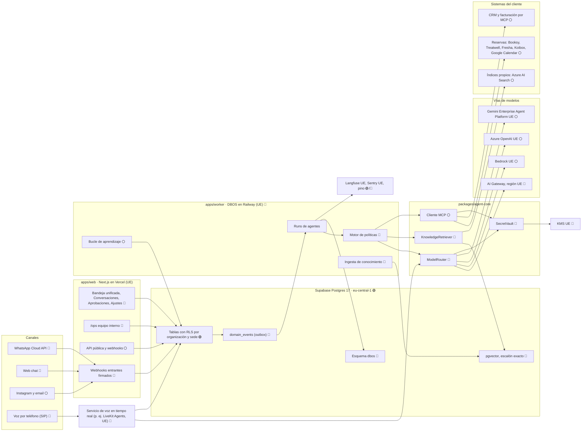
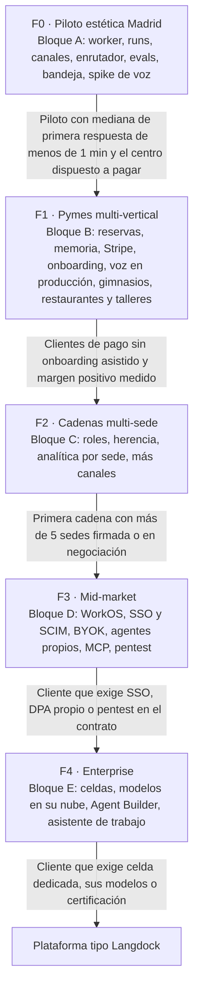
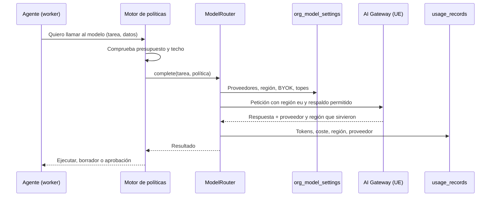

# ROADMAP_ENTERPRISE — de agentes para centros de estética a plataforma de agentes para empresas

**Fecha:** 23/10/2026 · **Autor:** Grok Bot, para Diego (producto) · **Base:** `main` en `b21b052` (incluye #83 y #84), PRs abiertos #80 y #82
**Estado del documento:** guía de negocio y arquitectura, versión 4 (24/10/2026: añade el producto en cuatro equipos de agentes y el copiloto con modo coach, §1.5–1.6; verticales por plantilla, §1.7; tabla de arquitectura enterprise «decidir ya / preparado / se activa con», §1.8; épicas B19–B24 y C10, ADR propuesto 0046. La v3 añadió el mapa del diseño del frontend, §5.0). Según el ADR 0023 (jerarquía de fuentes), esto tiene rango de `docs/design/`: **no es una decisión** hasta que cada punto pase a un ADR aceptado o al `docs/MANUAL.md`. Donde dice **«ADR propuesto»** es un ADR que todavía hay que escribir.

> **Cómo leer este documento.** Es una **hoja de ruta de servicios futuros y de necesidades clave de arquitectura**, no un corsé. Describe opciones, disparadores y decisiones reversibles para que escalar sea fácil cuando llegue el momento, **sin limitar lo que se construye ahora**. Solo hay una lista corta de **cimientos no negociables** (sección 1.4): controles de seguridad, aislamiento entre clientes, abstracción de modelos y residencia de datos / RGPD. Todo lo demás (herramientas, orden de los PRs, precios, nombres, fases) son **opciones** que se pueden cambiar si el desarrollo o el mercado lo aconsejan, dejando constancia en el STATUS o en un ADR.

**Qué se ha leído para escribirlo:** `docs/MANUAL.md` (completo), `docs/STATUS.md`, todos los ADRs de `docs/adr/` (0003, 0018–0032 y el *spike* de 0027), `TECHNICAL_SPEC.md`, `docs/design/{arquitectura-agentes-enterprise,benchmark-langdock,langdock-configuracion-arquitectura,modelo-precios}.md`, las auditorías del 2026-10-20 (seguridad) y 2026-10-23 (estado), `AGENTS.md`, la lista de zonas sensibles, el código de `packages/config` y `apps/web/src/i18n`, y el informe del piloto («Pilot vertical: Madrid SMB comparison»). Los datos de proveedores se han comprobado en la web el 23/10/2026 (fuentes en el anexo A).

---

## Índice

0. [Cómo usar este documento](#0-cómo-usar-este-documento)
1. [Resumen ejecutivo y tesis](#1-resumen-ejecutivo-y-tesis)
2. [Segmentos y fases de negocio](#2-segmentos-y-fases-de-negocio)
3. [Principios de arquitectura: diseñar ahora, activar después](#3-principios-de-arquitectura-diseñar-ahora-activar-después)
4. [Evaluación de las herramientas propuestas](#4-evaluación-de-las-herramientas-propuestas)
5. [Hoja de ruta técnica por fases](#5-hoja-de-ruta-técnica-por-fases)
6. [Decisiones a tomar ahora y ADRs nuevos](#6-decisiones-a-tomar-ahora-y-adrs-nuevos)
7. [Diagramas](#7-diagramas)
8. [Prompts sugeridos para Claude Code](#8-prompts-sugeridos-para-claude-code-punto-de-partida)
9. [Riesgos y anti-patrones](#9-riesgos-y-anti-patrones)
- [Anexo A. Fuentes externas](#anexo-a-fuentes-externas-consultadas-el-23102026)
- [Anexo B. Nombres de productos que han cambiado](#anexo-b-nombres-de-productos-que-han-cambiado-en-2026)

---

## 0. Cómo usar este documento

- **Para decidir:** la sección 6 lista lo que conviene decidir pronto, casi todo reversible. Todo lo demás se decide cuando llegue su disparador.
- **Para pasárselo a Claude Code:** la sección 8 trae 4 prompts **sugeridos como punto de partida**, uno por PR. Se pueden adaptar, reordenar o sustituir. Ninguno vuelve a tocar el despliegue de staging (arreglado en #83).
- **Para vender:** la sección 2 describe a quién, qué y cuándo pasar a la fase siguiente; la sección 2.8 recoge las **hipótesis de precio** abiertas y qué medir para elegir.
- **Leyenda de estado** que se usa en todo el documento:
  - 🟢 **construido** y verificado en `main`;
  - 🔵 **decidido** en un ADR aceptado o en el MANUAL, sin código todavía;
  - 🟡 **propuesto** en un ADR o diseño que aún no está aceptado;
  - ⚪ **nuevo**: lo propone este documento.

---

## 1. Resumen ejecutivo y tesis

### 1.1 La tesis en cinco frases

> **Tesis central: empezamos como GuruSup o heydiga (voz + WhatsApp, atención y ventas para pymes) con la vista puesta en Langdock, para ir escalando servicios y capacidades.** Primero, lo que una pyme entiende y paga hoy: que nadie se quede sin respuesta por teléfono o WhatsApp y que eso se convierta en citas y ventas. Después, sobre el mismo motor, lo que pide una empresa grande: agentes gobernados, conectados a sus herramientas, con sus modelos y sus reglas. Referencias verificadas el 23/10/2026 (anexo A): GuruSup ofrece agentes de IA omnicanal (WhatsApp, voz, email, web e Instagram, con contexto compartido entre canales y trabajo dentro del helpdesk del cliente); heydiga, recepcionista IA de teléfono y WhatsApp en Madrid; Langdock, plataforma de agentes para empresas.

1. **Moodly se vende por vertical y se construye como plataforma.** El cliente de hoy compra «mi WhatsApp contestado al momento». El de mañana compra «agentes gobernados sobre mis datos, mis modelos y mis herramientas». El motor es el mismo.
2. **Lo que hace «enterprise» a una plataforma de agentes no es usar muchas nubes.** Es dar al cliente **control**: qué modelo, en qué región, con qué claves, conectado a qué, quién entra, qué queda auditado, qué puede hacer cada agente sin permiso y cómo se demuestra todo eso.
3. **Moodly ya tiene decididos, y en parte construidos, los cimientos de ese control.** Lo que falta es construir el *runtime* de agentes y dejar **interfaces propias** en cada punto donde mañana habrá varias opciones (modelos, conocimiento, conectores, claves, celdas).
4. **Criterio de inversión:** se construye sobre todo lo que pide el cliente actual (centros de estética), y cada pieza nace con su interfaz, sus columnas de `organization_id`, su política por organización y sus tests de aislamiento. Así, activar un cliente grande es **configuración más un adaptador**, no rehacer.
5. **Las piezas grandes se activan, por defecto, cuando un cliente o una medición lo justifican** (Apigee, Agent Platform Pipelines, Azure AI Search, celdas dedicadas, BYOC de plataforma). Aquí quedan escritas su interfaz y su disparador; si aparece una razón para adelantarlas, se adelantan.

### 1.2 Qué exige un cliente enterprise y qué tiene ya Moodly

| Capacidad enterprise | Qué piden en la práctica | Estado en Moodly | Dónde |
|---|---|---|---|
| **Elección de modelo** | Varios proveedores, modelo por tarea, sin estar atado a uno | 🔵 decidido (enrutador propio sobre Vercel AI SDK) · ⚪ sin código | ADR 0019; MANUAL §5.11; `packages/agent-core` vacío |
| **Residencia de datos** | Datos en reposo en la UE; procesamiento por modelos en la región que elijan, sin saltos silenciosos | 🔵 decidido: residencia como política por organización, el *fallback* no cruza la frontera; celda compartida en la UE | ADR 0019 §1, ADR 0026 §6, MANUAL §11 |
| **BYOK / modelos en tu nube** | Usar sus claves o su Bedrock/Agent Platform/Azure | 🔵 decidido (3 modos de conexión) · ⚪ sin código; proveedor de KMS abierto | ADR 0019 §3–4, ADR 0028 §1; MANUAL §18 #6 |
| **Conectores** | Su CRM, su ERP, su calendario, sus documentos | 🟡 MCP primero + conectores nativos; skills `mcp` en el modelo de datos | MANUAL §7.1; ADR 0030 §2; tabla `skills.kind` 🟢 |
| **SSO / SCIM** | Entrar con Entra ID/Okta/Google, altas y bajas automáticas | 🔵 WorkOS elegido · 🟡 jerarquía de cuentas y permisos propuesta | ADR 0022 |
| **Auditoría** | Todo lo que hace un agente o una persona, exportable a su SIEM | 🟢 `audit_logs` de solo inserción · 🟡 exportación y SIEM | ADR 0021, ADR 0022 §10 |
| **Aislamiento** | Que sus datos nunca se mezclen; si hace falta, infraestructura dedicada | 🟢 RLS por pertenencia con 590 aserciones pgTAP, `tenantDb` (#78) · 🟡 celdas y celda dedicada | ADR 0003, 0026, 0028 |
| **Gobierno de agentes** | Qué puede hacer cada agente, quién aprueba, versiones y vuelta atrás | 🟢 techos de autonomía por clase de efecto en BD, configuración heredada con bloqueos y snapshots con hash (D1, D2) · ⚪ motor de políticas y aprobaciones | MANUAL §5.4–5.7; migraciones `20261023150000_agent_catalog`, `20261023170000_agent_config` |
| **Seguridad de IA** | Defensa ante inyección, envenenamiento, fuga entre clientes | 🟡 controles 3.1–3.8 definidos, solo 3.2 hecho | `docs/audits/2026-10-20-revision-seguridad-plataforma.md` §3 |
| **Evals** | Pruebas de calidad y de ataque antes de cada cambio | 🔵 decidido que existan y bloqueen el merge · ⚪ `packages/evals` vacío | MANUAL §12.4 |
| **Observabilidad y coste** | Saber qué hizo cada agente, cuánto costó y por qué falló | 🟢 pino + Sentry (UE) · 🟡 Langfuse + OpenTelemetry | ADR 0032; MANUAL §12 |
| **SLA, continuidad** | Disponibilidad comprometida, copias, restauración probada, página de estado | ⚪ staging en Supabase Free sin copias; producción exige Supabase Pro | STATUS «Bloqueado» |
| **Cumplimiento** | DPA, subencargados, RGPD, AI Act, ISO 27001/SOC 2, pentest | 🟡 DPA y lista dinámica de subencargados decididos; certificaciones sin fecha | ADR 0019 §6; MANUAL §10.6, §11 |
| **Administración delegada y roles a medida** | Responsables por región, auditor de solo lectura, facturación | 🟢 4 roles con alcance por región y local · 🟡 roles a medida y permisos materializados | ADR 0003, ADR 0022 §4, §7 |

**Conclusión:** casi todo lo difícil de «enterprise» ya está **pensado**. El hueco real es el *runtime* de agentes (paquetes `agent-core`, `skills`, `channels`, `integrations`, `knowledge`, `templates`, `evals` y el worker, hoy vacíos) y la operación de producción (Supabase Pro, revisión humana, DPAs).

### 1.3 Moodly frente a Langdock: dónde nos parecemos y dónde no

| | Langdock | Moodly hoy | Moodly en la fase 4 |
|---|---|---|---|
| Para quién | Empleados de empresas medianas y grandes; compra TI | Dueño o gerente de una pyme o cadena | Las dos cosas: agentes que atienden a **clientes** y un espacio de trabajo para **empleados** |
| Qué hace | Chat, agentes, *workflows*, API y conocimiento de empresa sobre muchos modelos | 4 agentes que atienden y ejecutan (citas, leads, cobros), con coach | Lo anterior + constructor de agentes y asistente de trabajo |
| Conectores | Integraciones propias + MCP (importar servidores remotos, OAuth) | MCP primero (diseño) | Catálogo MCP gobernado por el motor de políticas |
| Despliegue | SaaS en Azure UE; dedicado, BYOC y on-premise en Kubernetes | Vercel + Supabase en la UE | Celda compartida UE, celda dedicada, «modelos en tu nube», «plataforma en tu nube» bajo demanda (ADR 0028) |
| Precio | Desde 25 €/usuario/mes; enterprise a medida | Sin fijar: varias hipótesis abiertas (sección 2.8) | Probablemente distinto por segmento; se decide tras el piloto (ADR propuesto 0039) |

**Ventaja que hay que proteger:** Langdock no atiende a los clientes finales del negocio ni ejecuta acciones con techo de autonomía y aprobaciones. Moodly sí. La fase 4 añade la parte «Langdock» (empleados) **encima** del mismo motor, no al revés.

**Ojo con una decisión anterior:** `docs/design/benchmark-langdock.md` §1 concluye «no construimos un chat genérico para empleados». Ir hacia Langdock **reabre** esa conclusión, así que necesita su ADR (ADR propuesto 0038, sección 6). El ADR 0029 (asistente que actúa con los permisos del usuario) ya es la base técnica correcta para ese espacio de trabajo.

### 1.4 Cimientos no negociables y prácticas recomendadas

**Cimientos no negociables.** Son pocos a propósito: protegen a los clientes y son caros o imposibles de añadir después. Cambiarlos requiere un ADR aceptado y, en lo legal, asesoría.

1. **Controles de seguridad de IA** (3.1–3.8 de la auditoría del 2026-10-20, sección 3.10) antes de que un agente actúe con datos reales: IDs comprobadas contra el tenant, aprobaciones atadas al contenido, destinatarios fijados por el runtime, filtro de salida, evals de ataque.
2. **Aislamiento entre clientes:** toda tabla con datos de cliente lleva `organization_id`, RLS por pertenencia y su test pgTAP (ADR 0003); el acceso de plataforma va por `tenantDb` (#78); el tenant nunca lo decide el LLM ni un `payload`.
3. **Abstracción de modelos:** el código de negocio no llama directamente a un SDK de proveedor; pasa por una interfaz propia (ADR 0019). Así cualquier proveedor, gateway o «modelo en tu nube» es un cambio de configuración. *Qué* gateway o proveedor se usa detrás es una opción reversible (sección 4).
4. **Residencia de datos y RGPD:** datos en reposo en la UE para la celda compartida, residencia de inferencia como política por organización sin saltos silenciosos de región, DPAs y lista de subencargados al día, y transparencia de la Ley de IA (art. 50).

**Prácticas recomendadas (reversibles).** Facilitan escalar, pero se pueden adaptar si hay una buena razón; basta con dejarla escrita en el PR o en el STATUS.

- Lo que varía por cliente, mejor como **política en datos** que como un `if` en el código (modelos, región, autonomía, canales, límites, idioma, marca).
- Cada pieza externa, detrás de una **interfaz propia con una alternativa identificada** (ADR 0031 §5).
- Preferir lo que se pueda **autoalojar** en el núcleo (ADR 0028), para que una celda dedicada o BYOC no obligue a rehacer.
- **Un PR, una pieza revisable**, con CI en verde y sin tests debilitados (AGENTS.md; esto sí es regla del repo).
- Las piezas grandes, **cuando haya disparador**; mientras tanto, interfaz y disparador escritos aquí.

---

### 1.5 El producto: cuatro equipos de agentes y el copiloto (v4)

Moodly no son «4 bots de WhatsApp»: son **cuatro equipos de agentes** que llevan el día a día del negocio de principio a fin, por **voz, WhatsApp, Instagram y email**, 24 h, conectados a su CRM, agenda, facturación y proveedores. Cada equipo corresponde a uno de los 4 tipos de serie que ya existen en el catálogo (`AGENT_TYPES` en `@repo/config`; `create_builtin_agents` crea los 4 en `draft` en cada organización nueva).

| Equipo | Tipo de serie | Qué hace (de fábrica) | Skills e integraciones que necesita | Clase de efecto típica | Épicas |
|---|---|---|---|---|---|
| **Recepción** | `reception` | Reservar, mover y cancelar citas · recordatorio 24 h antes · **lista de espera automática** (ofrece el hueco liberado) · llamadas de voz fuera de horario | `BookingProvider` (Booksy, Treatwell, Fresha, Koibox, Mindbody, Google Calendar), voz (ADR propuesto 0045), WhatsApp con plantillas | `internal_write` / `external_message` | B1, B11, B17, B18, **B19** |
| **Atención al cliente** | `customer` | Precios, horarios y aseguradoras · instrucciones antes de la cita · **deriva cualquier duda médica a una persona** (nunca consejo médico) · pide reseña tras la visita | `KnowledgeRetriever` (ADR 0037), memoria (ADR 0024), Google Business Profile para reseñas | `read` / `external_message` | A9, B2, **B20** |
| **Comercial** | `sales` | Seguimiento de presupuestos · bonos y paquetes · reactivar clientes inactivos · cobros pendientes (aviso y enlace de pago) | `CrmProvider`, `PaymentProvider` (Stripe), segmentos de contactos | `external_message` / `financial` con aprobación | B7, B13, B14, **B21** |
| **Administración** | `admin` | Facturas a clientes, aseguradoras y proveedores · cobros pendientes y suscripciones · **aviso de material bajo mínimos y gestión de stock** | `InvoicingProvider` (Holded, Sage, Quipu…), `PaymentProvider`, `InventoryProvider` (nuevo) | `financial` (siempre con aprobación hasta que el techo lo permita) | **B22**, C5, C9 |

**Reglas comunes:** los cuatro equipos usan el mismo motor de políticas, la misma memoria y el mismo contacto en todos los canales; ninguno llama a un modelo directamente (enrutador, §3.1); cualquier efecto `financial` o de mensaje saliente pasa por los controles 3.3, 3.4 y 3.8 y por aprobación atada al hash. Lo que se activa en el piloto F0 es Recepción + Atención; Comercial y Administración entran en F1 (Administración es la que más toca zona financiera y, por tanto, la última en salir de `draft`).

### 1.6 El copiloto de Moodly (y su modo coach)

Por encima de los equipos está el **copiloto**: un agente con visión de **toda la plataforma** que ayuda a cada empresa a configurarlo y gestionarlo todo **desde dentro** (crear y ajustar agentes, conectar herramientas, revisar conversaciones, aprobar, explicar por qué un agente hizo algo). Su **modo coach** analiza los datos de la propia organización y **propone mejoras, detecta debilidades y señala oportunidades** (p. ej. «el 30 % de las llamadas perdidas son los sábados» es un ejemplo de formato, no un dato).

Es la evolución del asistente del ADR 0029 (actúa **con los permisos del usuario**) y del coach del MANUAL §5.12 + bucle de aprendizaje (§3.7, ADR propuesto 0042). «Control total» se entiende **gobernado**:

| Regla de gobierno | Cómo se cumple |
|---|---|
| Nunca más permisos que la persona que lo usa | El motor de políticas recibe al usuario que da la orden (control 3.6, ADR 0029); sin rol de servicio |
| Leer es libre, cambiar se confirma | Cada cambio es una **propuesta** con vista previa (diff de configuración) que la persona confirma; las de zona financiera o de alcance de cadena exigen aprobación de un admin |
| Todo queda auditado | Cada propuesta, confirmación y cambio en `audit_log` con el hash de lo aprobado y el actor real (persona + copiloto) |
| Probar antes de publicar | Los cambios de agentes pasan por las evals del vertical y `agent_versions` (B15) con vuelta atrás en un clic |
| El coach recomienda, no ejecuta | Las recomendaciones llevan evidencia (consulta y periodo) y se convierten en `proposals`; nunca cambia un agente solo |
| Aislamiento | Solo datos de su organización; patrones agregados entre clientes solo anónimos y con k ≥ 5 (§3.6) |
| Resistente a inyección | Lo que lee de conversaciones o MCP es dato, no instrucción (control 3.8); set de ataque específico del copiloto |

Fases: **lectura y explicación en F1** (B9), **cambios confirmados en F2–F3** (B23, D9), **coach con datos internos en F1–F2** (B4, C7, B24), **copiloto de cadena** (comparativa entre sedes) en F2. Se fija en el **ADR propuesto 0046**.

### 1.7 Verticales: muchas soluciones, un motor

Como HeyDiga, Moodly se enseña **por sectores**; a diferencia de HeyDiga, cada sector es una **plantilla** sobre la misma plataforma (`agent_templates`, herencia con bloqueos 🟢), no un producto aparte.

| Vertical | Qué cambia en la plantilla | Integración clave | Cuándo |
|---|---|---|---|
| **Centros de estética** (piloto) | Bonos y paquetes, lista de espera, reseñas | Booksy, Treatwell, Fresha, Koibox | **F0, piloto en Madrid** |
| Gimnasios y estudios | Altas, bajas, reactivación, clases | Mindbody, sistemas propios | F1 (B7) |
| Clínicas dentales y clínicas | Aseguradoras, instrucciones previas, derivación médica estricta | Software clínico | F1, **solo tras revisión legal** (B10, ADR propuesto 0043) |
| Restaurantes | Reservas por voz, grupos, alérgenos derivados | TheFork, CoverManager | F1 (B12) |
| Talleres | Presupuestos, aviso de coche listo, ITV | Software de taller / calendario | F1 (B12) |
| Otros (fisioterapia, peluquerías, academias, inmobiliarias…) | Plantilla nueva sobre los mismos 4 equipos | La que use el cliente (MCP o nativa) | Por demanda |

**El piloto de estética es la prueba, no el techo:** demuestra que los agentes hacen trabajo real y da los datos del bucle de aprendizaje. La web y el pitch pueden **mostrar** muchas verticales desde el principio; **activar** una exige sus evals en verde.

### 1.8 Arquitectura enterprise: qué se decide ya, qué queda preparado y qué se activa con cada cliente

Lo que hace a Langdock apto para empresas grandes no es usar cuatro nubes: es que el cliente **elige modelo y región, trae sus claves, conecta sus herramientas, tiene SSO y auditoría, y sus datos nunca se mezclan**. Casi todo eso ya está en los cimientos (RLS multi-tenant, organizaciones con regiones y sedes, auditoría, MFA, WorkOS decidido para SSO, agentes y skills extensibles, ADR 0030). Regla: **diseñar ya para empresas grandes, construir solo lo que pide el cliente que tenemos.**

**Decidir ahora, sobre el papel (barato, evita reescrituras):**
- **Enrutador de modelos propio** (§3.1, ADR 0019 + 0033): ningún agente llama a un proveedor; añadir Bedrock, Azure o Vertex es configuración.
- **BYOK y residencia en el modelo de datos** (§3.2, ADR 0034/0035): cada organización con proveedor, claves cifradas y región; activarlo es cosa de un cliente grande.
- **Conectores como skills `mcp`** (§3.4, ADR 0036): MCP es el estándar del sector (también Langdock) y da Salesforce, Jira o SAP sin atarse a Apigee.
- **Conocimiento detrás de una interfaz común** (§3.5, ADR 0037): pgvector hoy; Azure AI Search o Vertex/Agent Search mañana si un cliente lo exige.

**Añadir cuando un cliente lo justifique:**
- **Gateway de IA** (Vercel o Cloudflare): **pronto**, porque es barato y da caché, límites de gasto y respaldo.
- **Bedrock, Vertex y Azure:** cuando un cliente diga «solo uso mi nube».
- **Apigee, Vertex Pipelines, Agent Builder de Google:** solo si un cliente grande ya los tiene contratados.
- **LangGraph y Firestore:** probablemente nunca; DBOS (ADR 0027) y Supabase ya cubren eso y duplicarían el sistema.

| Pieza | 📝 Decidir ahora | 🧱 Preparado (columnas, interfaz, tests) | ⚡ Se activa con… | Pyme / autónomo (F0–F1) | Cadena multi-sede (F2) | Mid-market (F3) | Enterprise (F4) |
|---|---|---|---|---|---|---|---|
| Enrutador de modelos | ✔ ADR 0033 | `ModelRouter`, lint que prohíbe SDKs de proveedor | Primer agente (A6) | Modelos de Moodly, UE | Igual + topes por sede | Elección de modelo por organización | Modelos en su nube (E2) |
| Gateway de IA | ✔ elección | Detrás del enrutador | Pronto (coste, caché) | ✔ | ✔ | ✔ | Opcional: el suyo |
| BYOK | ✔ ADR 0034 | `org_model_settings`, secretos cifrados por KMS | Cliente que trae claves | — | — | ✔ claves de modelo (D3) | ✔ + clave de cifrado propia |
| Residencia de datos | ✔ ADR 0035 | `region` por organización, región registrada por llamada | Cliente que la exige | UE por defecto | UE | Informe de residencia | Celda dedicada (E1) |
| Conectores | ✔ ADR 0036 | `skills.kind = 'mcp'`, interfaces por tipo | Herramienta del cliente | Reservas, calendario, Stripe | + facturación, CRM | MCP propios del cliente (D5) | + Apigee/pasarela suya |
| Conocimiento | ✔ ADR 0037 | `KnowledgeRetriever`, versión de embeddings | Índice externo del cliente | pgvector | pgvector | pgvector | Azure AI Search / Agent Search (E3) |
| Identidad | 🔵 WorkOS | `accounts`, dominios | Cuestionario de seguridad | Email + MFA | Roles por sede (C1) | SSO/SCIM (D1) | + revisiones de acceso (E6) |
| Agentes y skills propios | 🟢 ADR 0030 | `origin = 'custom'`, `kind = 'composed'` | Cliente que quiere crear | Plantillas del sector | Plantillas de cadena | Agentes propios (D4) | Agent Builder (E4) |
| Copiloto | ✔ ADR 0046 | Permisos del usuario, `proposals`, auditoría | Desde F1 | Lectura + coach | Cambios confirmados, comparativa sedes | + gobierno por admin | + asistente de trabajo (E5) |
| Ejecución duradera | 🔵 ADR 0027 (DBOS) | Esquema `dbos`, worker | Ya | ✔ | ✔ | ✔ | ✔ (sin LangGraph) |

**El salto de negocio:** pasar de 4 agentes a **plataforma** = que el cliente cree sus agentes y skills (eso es Langdock) partiendo de plantillas por sector. Segmentos en orden: **autónomos y pymes → cadenas con muchas sedes** (el modelo de regiones y sedes ya está pensado para eso) **→ empresas medianas y grandes.**

---

## 2. Segmentos y fases de negocio

### 2.1 Vista general

Las fases de negocio (F0–F4) no son las fases técnicas del MANUAL §17 (0–5). Esta tabla las relaciona:

| Fase de negocio | Cliente | Oferta | Fases del MANUAL §17 que necesita | Disparador para empezarla |
|---|---|---|---|---|
| **F0 · Piloto estética** | 2–3 centros de estética independientes en Madrid, sin tratamientos médicos | Agente `customer` en WhatsApp + web chat, 4 semanas gratis; **voz como opción** si el centro recibe muchas llamadas (*spike* A18) | Cierre de la 0 + la 1 | Ahora |
| **F1 · Pymes multi-vertical** | Estética → gimnasios y estudios → clínicas y dentistas → restaurantes y talleres | 4 agentes con plantilla por sector, autoservicio; **voz como canal principal** junto a WhatsApp, Instagram y email | 1 → 2 y parte de la 3 (onboarding, Stripe, plantillas) | Piloto F0 cumple los criterios de la semana 4 y producción cumple sus condiciones de salida |
| **F2 · Cadenas multi-sede** | Grupos de 3–50 sedes (estética, gimnasios, clínicas) | Panel central, herencia con bloqueos, comparativa entre sedes, aprobaciones por sede | 2 y 3 (alta de sedes en lote, SSO opcional) | ≥ 10 pymes pagando, o una cadena que lo pide |
| **F3 · Mid-market** | Empresas de 50–1.000 empleados, con TI propia | Agentes propios, conectores MCP, SSO/SCIM, auditoría exportable, BYOK, residencia | 3 | Primer cliente que pide SSO o pasa un cuestionario de seguridad |
| **F4 · Enterprise (tipo Langdock)** | Grupos grandes, sectores regulados | Constructor de agentes, asistente de trabajo para empleados, conocimiento de empresa, «modelos en tu nube», celda dedicada | 3 (celdas) + 4 (Agent Builder) + 5 (Marketplace, opcional) | Carta de intención firmada que exige residencia, BYOK/BYOC o celda dedicada |

**Precios: no hay nada fijado.** En los documentos del repo hay al menos dos hipótesis sobre la mesa: «implantación + cuota mensual» (MANUAL §1.10) y «por agente con conversaciones incluidas» (`docs/design/modelo-precios.md`). Ninguna está decidida; las dos, junto con otras (por sede, por usuario, por consumo, por resultado, híbridos), se comparan en la **sección 2.8** y se eligen **después del piloto** con datos medidos (ADR propuesto 0039). Las cifras que aparecen en cada fase son solo ejemplos para dimensionar.

### 2.2 F0 · Piloto con centros de estética (ahora)

- **Cliente objetivo:** centros de estética y belleza independientes en Madrid, **sin tratamientos médicos** (fuera de los datos de salud). La mayoría de sus consultas llegan por escrito (WhatsApp e Instagram). Reservas en Booksy, Treatwell, Fresha o Koibox. Alternativa: gimnasios y estudios *boutique*.
- **Oferta:** agente `customer` en WhatsApp (Cloud API directa, ADR 0020) y web chat; **opcionalmente, la voz** (agente `reception` contestando las llamadas desviadas del centro) si el *spike* A18 está listo y el centro recibe muchas llamadas. Responde precios, horarios, dudas de tratamientos y recoge peticiones de cita. Lo que no sabe lo pregunta al dueño (`knowledge_request`, MANUAL §5.9) y lo delicado lo pasa a una persona (§5.10).
  - Semana 0: DPA, servicios, precios, horarios, políticas y las 30 preguntas más comunes; número de WhatsApp y línea base de volumen y tiempos de respuesta.
  - Semana 1: solo borradores (autonomía `draft`). Semana 2: responde solo las preguntas frecuentes. Semana 3: peticiones de cita. Semana 4: medir y ampliar.
- **Precio (opción para el piloto):** gratis 4 semanas a cambio de un caso de estudio y del permiso para medir (con DPA). Alternativa: piloto de pago simbólico para medir disposición a pagar. Durante el piloto se recogen los datos de la sección 2.8 para elegir modelo de precios.
- **Cómo se vende:** visita o llamada previa (en España, el mensaje comercial en frío necesita contacto previo; LSSI), demo de 15 minutos y el mensaje que ya tienes preparado en el informe del piloto.
- **Métricas de éxito (propuestas):**
  - mediana de primera respuesta en WhatsApp **< 1 minuto**;
  - **tasa de resolución autónoma** (sin intervención humana) medida por semana;
  - solicitudes de conocimiento por semana, **bajando**;
  - citas creadas o captadas por el agente frente a la línea base;
  - 0 incidentes de seguridad y 0 respuestas con datos inventados en las evals;
  - **coste de IA por conversación** medido (referencia de diseño: ≈ 0,02 €, `modelo-precios.md` §4), más el resto de datos de la sección 2.8.
- **Capacidades técnicas que necesita:** worker con DBOS, `contacts`/`conversations`/`messages`, enrutador v0, conocimiento v0, motor de políticas con aprobaciones atadas al hash, evals de ataque, WhatsApp + web chat, bandeja y aprobaciones en la web, `/ops` mínimo, producción con Supabase Pro (sección 5, bloque A).
- **Disparador:** ya está. **Cimiento no negociable:** ningún dato real antes de cumplir las condiciones de salida a producción (STATUS «En curso» → «Condición de salida a producción»).

### 2.3 F1 · Pymes multi-vertical con plantillas por sector

- **Cliente objetivo, en este orden:**
  1. **Estética** (el piloto convertido en producto).
  2. **Gimnasios y estudios *boutique*:** mismos canales escritos; encaja muy bien con el agente `sales` (reactivar socios, bonos).
  3. **Clínicas y dentistas:** solo después de la revisión legal de datos de salud (MANUAL §18 #12), con una **EIPD/DPIA**, minimización (citas y dudas generales, nunca historial clínico, MANUAL §11) y plantillas que bloqueen ciertas respuestas (nada de consejo médico).
  4. **Restaurantes y talleres:** son sobre todo de **teléfono**, así que llegan con la **voz** (sección 3.14), que este documento propone adelantar a F1. Los restaurantes ya tienen plataformas de reservas (TheFork, CoverManager) que hay que integrar, no sustituir.
- **Oferta:** los 4 agentes de serie con **plantilla por sector** (`agent_templates`: tono, mensajes, skills activas, autonomía, reglas). Onboarding en 6 pasos sin ayuda (MANUAL §9.6). Coach con datos internos (fase 2 del MANUAL).
- **Precio (opciones a validar, sección 2.8):** suscripción por agente con conversaciones incluidas (ejemplo de `modelo-precios.md`: 49 €/agente/mes con 250 conversaciones y 0,10 € la extra), suscripción por sede, paquete de agentes, o un híbrido con consumo. Referencias del sector (informe del piloto): Booksy 34,99 €/mes, recepcionista IA de Treatwell desde 69 €/mes, Luvia desde 89 €/mes. Sea cual sea el modelo, conviene un **límite de gasto con aviso** para que la pyme no se lleve sorpresas.
- **Cómo se vende:** casos del piloto, alianzas con distribuidores del sector (academias, proveedores de cosmética, software de reservas), contenido local (`docs/design/verticales-seo.md`), prueba de 14 días.
- **Métricas:** clientes de pago, retención a 90 días, tiempo de onboarding sin ayuda (< 1 día), tasa de resolución autónoma por vertical, margen bruto por conversación, recuperación del CAC en meses.
- **Capacidades que desbloquea:** plantillas versionadas, integración de reservas, memoria con procedencia (ADR 0024), objetivos con pantalla, Stripe con consumo medido, bucle de aprendizaje v0, idioma por organización.
- **Disparador:** el piloto cumple las métricas de la semana 4 en al menos 2 centros y producción está lista.

### 2.4 F2 · Cadenas multi-sede

- **Cliente objetivo:** grupos con 3–50 sedes: cadenas de estética, gimnasios, clínicas (tras F1), franquicias.
- **Oferta:** panel central con selector de alcance (ya construido 🟢), configuración central heredada con **bloqueos** (D2 🟢), aprobaciones por sede y rol, comparativa entre sedes (P7), alta de sedes en lote (CSV), redes de franquicia (`networks`, ADR 0022 §1), SSO opcional.
- **Precio (opciones a validar, sección 2.8):** por sede (ejemplo para dimensionar: 79–149 €/sede/mes según agentes activos), con o sin implantación asistida (el MANUAL §1.10 maneja 1.000–5.000 € como hipótesis), y contrato anual o mensual.
- **Cómo se vende:** venta consultiva a dirección de operaciones; piloto en 2–3 sedes de la cadena; caso de estudio de F1.
- **Métricas:** primera cadena con ≥ 5 sedes firmada; sedes activas por cuenta; diferencia de métricas entre sedes que el coach ayuda a cerrar.
- **Capacidades que desbloquea:** roles y permisos con alcance (primera parte del ADR 0022: `roles`, `role_permissions`, `invitations`), analítica multi-sede, eventos entre agentes (outbox, MANUAL §5.8), Instagram y email.
- **Disparador:** ≥ 10 pymes pagando o una cadena que lo pide expresamente.

### 2.5 F3 · Mid-market

- **Cliente objetivo:** empresas de 50–1.000 empleados con TI propia, que ya usan CRM (HubSpot, Salesforce, Pipedrive), Microsoft 365 o Google Workspace, y que envían cuestionarios de seguridad.
- **Oferta:** **agentes propios** (instrucciones + skills del catálogo, ADR 0030 fase 3), **skills `mcp`** de sus herramientas, SSO/SCIM con WorkOS, auditoría exportable y envío a su SIEM, **BYOK**, **política de residencia** por organización, asistente en modo lectura (ADR 0029), API pública y webhooks salientes.
- **Precio (opciones a validar, sección 2.8):** plan por volumen (sedes, agentes, conversaciones), por usuario si se usa el asistente interno, o híbrido; con posibles complementos (SSO/SCIM, auditoría avanzada, BYOK con precio de plataforma más bajo porque el coste de IA lo paga el cliente). Ejemplo para dimensionar: 500–2.500 €/mes con contrato anual.
- **Cómo se vende:** venta directa con demo técnica, **centro de confianza** (DPA, subencargados, informe de pentest, políticas) y respuestas preparadas al cuestionario de seguridad.
- **Métricas:** 3 clientes mid-market, cuestionarios superados, tiempo hasta el primer agente propio en producción, ARR.
- **Capacidades que desbloquea:** cuentas por encima de las organizaciones (`accounts`, `account_domains`), WorkOS, `effective_permissions`, KMS con clave por organización, `org_model_settings`, catálogo de conectores MCP gobernado, pentest externo.
- **Disparador:** el primer cliente que pide SSO, BYOK o un cuestionario de seguridad.

### 2.6 F4 · Enterprise, tipo Langdock

- **Cliente objetivo:** grupos grandes y sectores regulados (salud, seguros, banca, sector público), normalmente con un contrato de nube (AWS, Google Cloud o Azure) y exigencias de residencia.
- **Oferta:**
  - **constructor de agentes** sin programar: skills `composed`, flujos, versiones `draft → testing → published` y prueba en *sandbox* (ADR 0030 §4, fase 4);
  - **asistente de trabajo para empleados**: chat con el conocimiento de la empresa y sus herramientas, actuando siempre con los permisos de la persona (ADR 0029);
  - **conocimiento de empresa** con adaptadores a su buscador (Azure AI Search, Google Agent Search) si ya lo tienen;
  - **«modelos en tu nube»** (Bedrock, Gemini Enterprise Agent Platform o Azure en su cuenta) y **celda dedicada** en la región que elijan; **«plataforma en tu nube»** solo bajo demanda firmada (ADR 0028 §1);
  - gobierno: versiones de agente, publicación gradual y vuelta atrás, revisiones trimestrales de acceso, retención por política, ISO 27001 y SOC 2.
- **Precio (opciones a validar, sección 2.8):** lo habitual en este segmento es un contrato anual a medida que combine componentes (por usuario para el espacio de trabajo, por agente, sede o resultado para la atención, cuota fija por celda dedicada, soporte con SLA). Referencia: Langdock enterprise es a medida desde 1.000 usuarios (`modelo-precios.md` §3.4).
- **Cómo se vende:** venta enterprise con RFP, prueba de concepto pagada en su nube y referencias de F3.
- **Métricas:** primer contrato enterprise, uptime contra SLA, auditorías superadas, expansión dentro de la cuenta.
- **Capacidades que desbloquea:** directorio de celdas (`cell_directory`), celda dedicada con prueba de humo autoalojada (ADR 0026, 0028), adaptadores de conocimiento externos, Agent Builder, publicación gradual (`agent_versions`, `proposals`, `learning_signals`).
- **Disparador:** normalmente, una carta de intención que exige residencia, BYOK/BYOC o celda dedicada. Si antes aparece una oportunidad clara (inversión, socio, cliente ancla), se puede adelantar.

### 2.7 Cómo se pasa de «4 agentes» a plataforma sin perder el foco

| Palanca | Qué es | Ya existe | Cuándo se abre |
|---|---|---|---|
| Plantillas por sector | Misma plataforma, comportamiento de fábrica distinto por vertical | 🟢 herencia y snapshots (D2); ⚪ `agent_templates` | F1 |
| Agentes de plantilla | Agentes extra listos para activar («Reseñas», «Reactivación») | 🟢 `agent_types.origin = 'template'` | F1–F2 |
| Agentes propios | El cliente crea los suyos con skills del catálogo | 🟢 `agent_types.origin = 'custom'` (el seed ya crea «Eventos») | F3 |
| Skills `mcp` | Cada herramienta de un servidor MCP conectado se vuelve skill | 🟢 `skills.kind = 'mcp'` | F3 |
| Skills `composed` | El cliente combina piezas sin programar | 🟢 `skills.kind = 'composed'`, `definition` jsonb | F4 |
| Copiloto (antes «asistente») | Punto de entrada único: dirige agentes, explica, configura y, en modo coach, propone mejoras (§1.6) | 🟡 ADR 0029 · ⚪ ADR propuesto 0046 | Lectura y coach en F1, cambios confirmados en F2–F3, espacio de trabajo en F4 |
| Marketplace | Agentes y skills de terceros con revisión | 🟡 ADR 0030 fase 5 | Después de F4 |

### 2.8 Precios: hipótesis abiertas y qué medir para decidir

**Nada está fijado.** Esta sección no propone un precio: ordena las opciones para que el piloto recoja los datos que permiten elegir. La decisión se toma **después del piloto** en el ADR propuesto 0039 («Decidir modelo de precios tras el piloto»), y puede ser distinta por segmento (pyme, cadena, mid-market, enterprise).

| Opción | Cómo funciona | A favor | En contra | Encaja con | Qué hay que medir para valorarla |
|---|---|---|---|---|---|
| **Implantación + cuota mensual** (hipótesis del MANUAL §1.10) | Pago inicial por puesta en marcha y una cuota fija | Cubre el trabajo de alta; ingresos previsibles | Barrera de entrada para una pyme pequeña; escala mal si el alta es autoservicio | Cadenas, mid-market, enterprise | Horas reales de implantación por centro; si el cliente lo acepta sin descuento |
| **Por agente** con conversaciones incluidas (hipótesis de `modelo-precios.md`) | Cuota por cada agente activo; extra por encima de un umbral | Fácil de entender; se expande activando agentes | Si un agente hace mucho y otro poco, el precio no refleja el valor | Pymes (F1) | Conversaciones por agente y mes (p50/p90); qué agentes activan primero |
| **Por sede** | Cuota por cada local, con agentes incluidos o por niveles | Natural para cadenas; crece con el cliente | Una sede pequeña y una grande pagan igual | Cadenas (F2) | Variación del volumen entre sedes de la misma cadena |
| **Por usuario (asiento)** | Cuota por persona con acceso | Estándar en herramientas para empleados (Langdock) | No encaja con agentes que atienden a clientes finales; incentiva compartir cuentas | Asistente interno (F3–F4) | Usuarios internos activos por organización |
| **Por consumo** | Precio por conversación, mensaje o **minuto de voz** | Alineado con el coste; sin barrera de entrada | Factura impredecible; a la pyme le asustan las sorpresas | Voz, picos estacionales, API | Coste por conversación y por minuto; dispersión mensual |
| **Por resultado** | Precio por cita confirmada, lead cualificado o conversación resuelta | Máxima alineación con el valor; argumento comercial fuerte | Hay que demostrar la atribución; riesgo de disputas; ingresos variables | Agentes de recepción y comercial | Citas atribuibles al agente, verificadas en el sistema de reservas; ticket medio |
| **Minutos de voz** (dentro de cualquier modelo) | Bolsa de minutos incluida por plan y precio por minuto extra, o voz como complemento aparte | Es como se vende la voz en el mercado; el cliente lo entiende | El coste por minuto varía mucho según el stack | Cualquier segmento con teléfono | Coste real por minuto (STT + LLM + TTS + telefonía + plataforma), minutos por centro y mes, duración media de llamada |
| **Híbrido** | Cuota base (por agente o sede) + consumo o resultado por encima | Combina previsibilidad y alineación | Más difícil de explicar | Probable modelo final en varios segmentos | Todo lo anterior |

**Qué medir en el piloto (F0) para decidir:**

- **Coste:** coste de IA por conversación y por centro y mes (tokens, modelo, región), coste de WhatsApp por conversación, **coste por minuto de voz desglosado** (STT, LLM, TTS o modelo *realtime*, telefonía y plataforma), horas de soporte y de implantación de Moodly por centro.
- **Uso:** conversaciones por centro y mes, con su distribución (p50, p90) y estacionalidad; mensajes por conversación; **llamadas y minutos por centro y mes, duración media y % fuera de horario**; reparto por canal, agente y sede.
- **Valor:** tasa de resolución autónoma; citas creadas o captadas por el agente y su ticket medio; respuestas fuera de horario; tiempo de recepción ahorrado (estimado con el centro).
- **Disposición a pagar:** entrevistas al final del piloto (qué pagarían, qué les parece caro o barato, si prefieren cuota fija o variable), qué pagan hoy por sus herramientas (Booksy, Treatwell, recepcionista) y qué agente o función valoran más.
- **Criterios para elegir:** margen bruto suficiente con el coste medido, que la pyme entienda la factura en una frase, previsibilidad para el cliente, alineación con el valor que percibe y que el modelo escale a cadenas y empresas sin rehacerlo.

**Referencias de voz (23/10/2026, para dimensionar, no para copiar):** `modelo-precios.md` maneja como hipótesis 0,20 €/minuto; heydiga vende planes desde 49 €/mes con 200 minutos hasta 169 €/mes con 900 (más WhatsApp como complemento). Del lado del coste, las tarifas públicas de componentes van, según el stack, desde unos céntimos hasta más de 0,10 $ por minuto antes de telefonía (anexo A). El margen de la voz depende sobre todo del stack elegido en el *spike*.

**Para que la arquitectura no cierre ninguna opción:** medir desde el primer día en `usage_records` cada unidad candidata (conversaciones, mensajes, minutos de voz, runs, citas, usuarios activos, sedes y agentes activos), con eventos de resultado verificables (`domain_events`); guardar los **planes y precios como datos** (no en el código), y tratar Stripe como una implementación que lee esas medidas. Así cambiar de modelo de precios es configuración, no un desarrollo.

---

## 3. Principios de arquitectura: diseñar ahora, activar después

Cada apartado sigue el mismo esquema: **qué está decidido** (en ADRs ya aceptados), **qué se sugiere construir ahora**, **qué conviene dejar preparado** (interfaz, columnas, política) y **qué se activa después, con qué disparador**. Los bocetos de código, nombres de tablas y rutas son **orientativos**: Claude puede elegir otros diseños si encajan mejor con el monorepo, siempre que respeten los cimientos no negociables de la sección 1.4.

### 3.1 Capa de modelos: el enrutador de Moodly

**Decidido (🔵 ADR 0019, aceptado):** capa propia delgada sobre Vercel AI SDK; multi-proveedor y multi-región; tres modos de conexión (claves de Moodly, BYOK, modelos en la nube del cliente); residencia como política por organización sin cruzar la frontera en el *fallback*; secretos con KMS y clave por tenant; cada llamada registra proveedor, región, vía, tokens, coste y latencia. MANUAL §5.11: modelos por **tarea**, nunca un ID de modelo en el código de negocio. Siguen abiertos el AI Gateway y el proveedor de embeddings (§18 #5).

**Sugerido para ahora (v0, para el piloto):**
- Una interfaz `ModelRouter` en el runtime. Boceto (nombres orientativos):

  ```ts
  // packages/agent-core/src/models/router.ts (propuesta)
  export type TaskClass = "classify" | "extract" | "converse" | "reason" | "embed";

  export interface ModelPolicy {            // resuelta desde org_model_settings + plan
    residency: "any" | "eu" | "us";         // ADR 0019 §1
    allowedProviders: string[];             // p. ej. ["anthropic", "bedrock", "vertex"]
    modelByTask: Record<TaskClass, string>; // claves lógicas de packages/config, no IDs
    fallbackByTask: Record<TaskClass, string | null>;
    zeroDataRetention: boolean;
    budget: { perRunEur: number; perDayEur: number }; // corte duro antes de llamar
    connection: "managed" | "byok" | "customer_cloud";
  }

  export interface ModelCall {
    organizationId: string;   // lo pone el runtime, nunca el LLM
    runId: string;
    task: TaskClass;
    // mensajes, herramientas y esquema de salida (tipos del AI SDK)
  }

  export interface ModelRouter {
    generate(call: ModelCall, policy: ModelPolicy): Promise<RoutedResult>;
    // RoutedResult incluye provider, región resuelta, vía, tokens, coste y latencia
  }
  ```
- **Una implementación de producción para empezar**, `GatewayRouter`, que llama al gateway elegido a través del AI SDK, y una `FakeRouter` para los tests (MANUAL §13: los tests unitarios nunca llaman a un proveedor real).
- **Un proveedor principal y un respaldo**, ambos con servicio en la UE. Propuesta para medir en el piloto:
  - conversación: Claude Haiku 5.5 para lo rápido y Claude Sonnet 5.5 para lo marcado como complejo (precios y lineup actuales en el anexo A);
  - respaldo de otro proveedor con inferencia en la UE, por ejemplo Gemini en Gemini Enterprise Agent Platform o un modelo de OpenAI en Azure con *EU Data Zone*. Se elige por calidad medida en las evals, no por nombre.
- **Política por organización** en `org_model_settings` (entidad ya prevista en el ADR 0019 y en MANUAL §4.2 «Entidades añadidas»), con un valor por defecto de plataforma. En el piloto, `residency = 'eu'` para todos.
- **Registro de cada llamada:** `agent_runs` (tokens y coste) y `usage_records` (MANUAL §15); prompt y respuesta completos van a Langfuse, no a Postgres (ADR 0026 §2).
- **Límites de gasto en dos capas:** el enrutador corta antes de llamar si el run o el día superan su presupuesto (por organización, agente y run), y el gateway tiene un límite global como red de seguridad.
- **Frontera (cimiento de abstracción de modelos):** un test estructural, como `no-service-role.test.ts`, que falle si algo fuera del enrutador importa `@ai-sdk/<proveedor>` o un SDK de proveedor (`@anthropic-ai/sdk`, `openai`, `@google/genai`, `@aws-sdk/client-bedrock-runtime`).

**Gateway: opciones para el ADR 0033.** La opción que hoy parece más sencilla es **Vercel AI Gateway**, con Cloudflare AI Gateway o la llamada directa a proveedores como alternativas igual de válidas; el *spike* decide y la decisión es reversible porque todo va detrás de `ModelRouter`:
- **A favor de Vercel:** integración nativa con AI SDK 7; **inferencia regional** por petición (`inferenceRegion` con `geoRegion: 'eu'`) que **falla en lugar de salir de la región** y devuelve la región resuelta en la respuesta, que es justo la regla del ADR 0019; BYOK sin recargo; *Zero Data Retention* por petición en Pro; el equipo Pro de Vercel ya existe.
- **A vigilar en el *spike* del gateway:**
  - con BYOK, si la petición con las claves del cliente falla, Vercel la reintenta con sus credenciales de sistema (y la cobra). Para un cliente que exige «solo mis claves» hay que confirmar cómo impedirlo, o enviar esas peticiones directamente a su proveedor;
  - la región fija la inferencia del proveedor, pero la petición puede terminar y procesarse en cualquier región de Vercel antes de llegar al proveedor (Vercel dice que llegarán *hosts* fijados por región). Vercel entra en la lista de subencargados.
- **Cloudflare AI Gateway** ofrece caché, límites de frecuencia, **límites de gasto por metadatos** (usuario, equipo, organización), enrutado dinámico con *fallback*, BYOK con un modo «solo claves del cliente» (`byok_only`), registros que respetan el *Customer Metadata Boundary* de la UE y facturación unificada con un 5 % de comisión sobre los créditos. En la documentación consultada no aparece un equivalente a `inferenceRegion`; habría que comprobarlo.
- **La caché de respuestas casi no sirve aquí y tiene riesgo:** las conversaciones con clientes llevan datos personales y casi nunca se repiten exactas. Una caché compartida entre organizaciones sería una fuga. Se usa la **caché de prompts del proveedor** (instrucciones estables primero, `arquitectura-agentes-enterprise.md` §3) y, si se activa la caché del gateway, solo para tareas sin datos personales y con la organización en la clave.
- **El gateway es una vía, no una dependencia:** el enrutador debe poder llamar **directamente** a Bedrock, Agent Platform o Azure (en la cuenta del cliente) sin gateway. Es lo que pedirán «modelos en tu nube» y las celdas BYOC (ADR 0028).

**Preparado para después:** `provider_connections` (modo, región, vía), `model_providers` (catálogo), BYOK (3.2), pantalla **Ajustes → Modelos** con Proveedores · vías · residencia · topes (ADR 0019 «Consecuencias»).

**Se activa con cliente:** Bedrock, Agent Platform o Azure como vía (disparador: «solo uso mi nube»); modelos por organización y por agente (disparador: F3); embeddings en la región del cliente (disparador: residencia distinta de UE).

### 3.2 Secretos, BYOK y KMS

**Decidido (🔵 ADR 0019 §4, MANUAL §10.4):** cifrado de sobre (*envelope encryption*) con una clave por tenant en un KMS; los tokens solo se descifran en el worker al usarlos; Supabase Vault descartado como bóveda principal. **Abierto:** AWS KMS o GCP KMS (§18 #6).

**Sugerido para ahora:** el piloto necesita guardar al menos el token de WhatsApp de cada número y, en cuanto haya OAuth (Google Calendar, Booksy u otro), tokens por organización. Por eso el proveedor de KMS **se decide antes de la primera integración con credenciales por tenant**, no al llegar a enterprise.
- Interfaz `SecretVault` (`encrypt(orgId, plaintext)`, `decrypt(orgId, ref)`, `rotate(orgId)`) en el worker, con una implementación local para desarrollo y la del KMS elegido para staging y producción.
- Tabla `integration_secrets` (MANUAL §4.2) con la clave de datos cifrada y la referencia a la clave maestra; sin lectura desde `authenticated`.
- **Opción sugerida:** el KMS en la misma región que la celda (UE), con una clave maestra por organización creada al dar de alta la organización. Elegir el proveedor que menos subencargados añada: si los modelos se sirven por Bedrock, AWS KMS en `eu-central-1`; si por Agent Platform, Cloud KMS en `europe-west`.

**Preparado para después:** BYOK de modelos usa el mismo `SecretVault`; «modelos en tu nube» guarda un rol federado (sin claves de larga duración) en lugar de una API key; un cliente enterprise puede traer **su propia clave maestra** (*hold your own key*) en su KMS.

### 3.3 Ejecución duradera con DBOS (incluidos los bucles agente-validador)

**Decidido (🔵 ADR 0027, aceptado en #80, pendiente de merge; *spike* superado):** DBOS Transact 5.2.11 como librería en `apps/worker`, estado en el esquema `dbos`, un run = un workflow, cada llamada al modelo y cada `execute` de skill = un paso, ID determinista (`inbound:<id>`), una ejecución por conversación (`partitionConcurrency: 1`), aprobaciones con `recv()` y caducidad, tres colas de prioridad. Solo `apps/worker` importa DBOS; `packages/agent-core` define `RunContext`, `step()` y `waitFor()`. El PR #82 (W1) ya trae el worker; falta resolver conflictos y mergearlo.

**El patrón «un agente hace, otro valida» con los pasos de DBOS que ya hay:**

```
step("generate")  → borrador del agente (modelo de la tarea)
step("validate")  → 1) comprobaciones deterministas (esquema Zod, destinatario, precios contra business_rules,
                       nada de otro contacto o sede) 2) juez LLM barato con rúbrica versionada (opcional)
si falla y intentos < N → step("generate", feedback) ; si se agota → paso a humano (§5.10)
```

Cada vuelta es un paso guardado: si el worker cae a mitad, se reanuda sin repetir lo hecho. El número máximo de vueltas forma parte del límite de pasos por run (MANUAL §5.11). La validación determinista va **siempre**; el juez LLM solo donde aporte, porque duplica coste.

**Pendiente de diseño (regla 5 del *spike*):** equidad entre organizaciones en las colas, porque una cola admite una sola clave de partición. Propuesta: la cola `realtime` partida por conversación con un límite global, y la cola `batch` partida por organización.

**Se activa después:** mover el esquema `dbos` a su propia base de datos si sus escrituras superan el 30 % (ADR 0026 §5); Temporal solo si DBOS deja de cumplir (salida ya escrita en el ADR 0027).

### 3.4 Agentes, skills y conectores: MCP como estándar

**Decidido o propuesto:** 🟢 el modelo de datos del ADR 0030 ya está en `main` (`agent_types` con `origin`, `skills.kind` en `code`/`composed`/`mcp`, `agent_skills` con autonomía por agente); 🟡 MANUAL §7.1 «MCP primero» con interfaz interna por tipo (`calendar`, `booking`, `crm`, `invoicing`…); 🟢 test estructural que impide suponer 4 agentes (`apps/web/src/no-agent-key-logic.test.ts`).

**Por qué MCP y no Apigee como estándar de conectores:** MCP es hoy el estándar abierto del sector (gobernado por la Agentic AI Foundation de la Linux Foundation; especificación estable 2026-07-28). Langdock lo usa para importar servidores remotos con OAuth, y la propia Google ha publicado un servidor MCP remoto para Apigee API hub. Es decir: **si un cliente tiene Apigee, Moodly se conecta a él como un servidor MCP más**, sin atarse a Google.

**Sugerido para el piloto:** conectores **nativos** para lo que mueve el negocio del piloto (ADR 0031 §2): WhatsApp Cloud API en `packages/channels`, web chat y un conector de reservas o calendario en `packages/integrations` (Booksy, Treatwell, Fresha o Koibox según el centro; el acceso a sus APIs varía, así que la alternativa mínima es Google Calendar más la petición de cita en `draft`).

**Preparado:**
- Interfaz por tipo en `packages/integrations` (`CalendarProvider`, `BookingProvider`…), para que las skills no dependan del proveedor.
- Contrato de skill del MANUAL §5.5 (`preview` sin efectos + `execute` idempotente con `idempotency_key`).
- Cliente MCP genérico detrás de esa misma interfaz, con las protecciones de la revisión de seguridad §5.3/§7: lista blanca de servidores, credenciales solo del tenant, sin acceso a la red interna, respuestas tratadas como datos no confiables y toda herramienta sin clasificar como `external_message` en `draft` (ADR 0030 §2).

**Se activa con cliente:** catálogo MCP gobernado en Ajustes → Integraciones (F3); servidores MCP del cliente (Salesforce, Jira, SAP o su Apigee) (F3–F4); Marketplace (F5).

### 3.5 Conocimiento (RAG) con una interfaz y varios motores

**Propuesto (🟡 ADR 0025):** una sola función de recuperación en `packages/knowledge`, organización y alcance del runtime (nunca del LLM), filtro antes de ordenar, híbrida (vector + `tsvector` con *Reciprocal Rank Fusion*), tres escalones por tamaño de tenant, `embedding_model` y `embedding_dim` en cada fila y recall@10 ≥ 0,95 en CI.

**Sugerido para ahora:** `knowledge_sources` y `knowledge_chunks` con pgvector ≥ 0.8 en el escalón de **búsqueda exacta** (todas las pymes caben) y la ingesta de FAQs, precios, políticas y la web del centro. Precios y horarios vivos se leen de datos estructurados, no del texto indexado (MANUAL §6.1).

**Preparado:**

```ts
// packages/knowledge/src/retriever.ts (propuesta)
export interface KnowledgeRetriever {
  search(q: {
    organizationId: string;          // del runtime
    scope: { locationId?: string };  // alcance resuelto por el runtime
    query: string;
    k: number;
  }): Promise<Array<{ chunkId: string; content: string; score: number; citation: SourceRef }>>;
}
// Implementaciones: PgvectorRetriever (ahora) · AzureAiSearchRetriever · AgentSearchRetriever (Google) (con cliente)
```

- Todo resultado entra al prompt marcado como **dato no confiable** (MANUAL §5.3) y con su cita, venga del motor que venga.
- El adaptador externo vive en la **cuenta del cliente** cuando el cliente lo exige (su índice, su región); Moodly solo consulta con credenciales del tenant guardadas en `SecretVault`.

**Se activa con cliente:** Azure AI Search (búsqueda híbrida con RRF, *semantic ranker* y recuperación agéntica con citas) o Google Agent Search (antes Vertex AI Search) si el cliente ya tiene ahí sus documentos (F4). Particiones o celda propia si un tenant supera el umbral del ADR 0025.

### 3.6 Memoria con procedencia

**Propuesto (🟡 ADR 0024):** `memories` con `trust` (`owner`/`system`/`contact`) y `source_actor`; lo que dice un cliente final solo vale para ese cliente (`CHECK`); la memoria nunca cambia políticas; `memory_usages(memory_id, run_id)`; evals de envenenamiento que bloquean el merge.

**Orden recomendado:** primero `contacts` y `agent_runs` (la regla del alcance y `memory_usages` dependen de ellos), después `memories`. **Corrección a la propuesta anterior de Diego:** el aislamiento no se resuelve con `private.session_is_active()` (solo comprueba que la sesión está viva y con el MFA requerido); las políticas filtran por **pertenencia a la organización y alcance**, como todas las tablas (ADR 0003).

**Se activa después:** memoria de patrones agregados (k ≥ 5 contactos) para el coach (F1–F2); promoción de memorias de una sede a la organización con aprobación (F2).

### 3.7 Bucle de aprendizaje

**Diseño existente (🟡 `arquitectura-agentes-enterprise.md` §5):** no se reentrena el modelo; mejora la **configuración** del agente (conocimiento, reglas, ejemplos, prompts por versión) con señales → análisis nocturno → propuestas → aprobación en el coach → evals → publicación gradual → medición.

**Sugerido para F1, sin piezas nuevas:**
- Señales en Postgres (`learning_signals`): borradores editados antes de enviar, aprobaciones rechazadas, conversaciones tomadas por una persona, `knowledge_requests` y resultados (cita hecha o no).
- Un **workflow programado de DBOS** en la cola `batch` que agrupa fallos parecidos, propone entradas de conocimiento o ajustes de regla y los deja como `proposals` para que el dueño las apruebe.
- Llamadas en lote a la **Batch API** del proveedor cuando el volumen lo justifique (−50 % en Anthropic).
- Toda propuesta que cambie el comportamiento pasa por evals antes de publicarse.

**Se activa con cliente:** Vertex AI Pipelines (hoy *Gemini Enterprise Agent Platform Pipelines*, sobre Kubeflow) solo si un cliente enterprise exige que el procesamiento ocurra en su Google Cloud. Las trazas no van a GCS: van a Langfuse en la región de la celda (ADR 0026 §2).

### 3.8 Identidad

- **Ahora (🟢):** Supabase Auth con MFA TOTP obligatorio para administrar, MFA también en lecturas, revocación real de sesiones, freno del login, invitaciones con consentimiento.
- **Preparado (🔵/🟡 ADR 0022):** jerarquía `account → organization → region → location`; roles = conjuntos de permisos atómicos con alcance; `effective_permissions` materializada; bajas inmediatas; administración delegada sin escalada; dos admins de cuenta y cuenta de emergencia.
- **Se activa con cliente:** WorkOS (SSO, Directory Sync/SCIM, Admin Portal), primero con el *spike* de la fase C (login, MFA, SSO de prueba, revocación inmediata y los pgTAP en verde). Recomendación del ADR 0022: el mismo login (AuthKit) para todos, para que una pyme pase a enterprise activando el SSO sin migrar usuarios. Disparador: el primer cliente que pide SSO (F2–F3).

### 3.9 Tenancy y aislamiento

- **Ahora (🟢):** RLS activado y forzado en todas las tablas de `public`, acceso derivado de `memberships` (ADR 0003), helpers `SECURITY DEFINER` de solo lectura en `private`, mínimo privilegio con test estructural (#72), `createServiceDb().forOrganization(orgId)` como única vía de la *service role* (#78, control 3.2) y pgTAP para cada tabla (19 ficheros, 590 aserciones).
- **Cimiento para cada tabla nueva con datos de cliente:** `organization_id NOT NULL`, RLS por pertenencia y alcance, revokes de lo que no use ninguna política y test de aislamiento A/B y sede 1/sede 2. **Recomendado** además: si crece sin límite, **particionarla por mes desde su primera migración** (`messages`, `inbound_events`, `usage_records`, `audit_logs`; ADR 0026 §3).
- **Preparado (🟡 ADR 0026, 0028):** esquemas separados (`public`, `private`, `dbos`, `audit`), umbrales de salida medidos, **celdas** (compartida UE, dedicada, en la nube del cliente) con un `cell_directory` global que solo se crea antes de la segunda celda, imagen de contenedor de `apps/web` y prueba de humo con `docker compose` antes de la primera celda dedicada.
- **Se activa con cliente:** celda dedicada en la región que elija (F4); base de datos de réplica para analítica si las lecturas del coach superan el 20 % de la carga.

### 3.10 Controles de seguridad antes de la primera skill

**Cimiento no negociable.** La auditoría del 2026-10-20 (§3) exige estos controles **antes** de activar cualquier agente con datos reales. Solo el 3.2 está hecho. La forma de implementarlos es libre; que existan y estén probados, no.

| Control | Qué es | Cómo se implementa | Estado |
|---|---|---|---|
| 3.1 | Toda ID que proponga el LLM se comprueba contra el tenant, la sede y el contacto | Resolución acotada en el `SkillContext` antes de `preview`/`execute`; test con IDs de otro tenant | ⚪ |
| 3.2 | Cliente de BD acotado en el worker | `tenantDb` / `forOrganization` | 🟢 #78 |
| 3.3 | Aprobación atada al contenido exacto | `approvals.input_hash` = hash canónico de la entrada de la ejecución; al ejecutar se recalcula y se compara; aprobar exige sesión, rol, alcance y `aal2` para lo financiero; nunca por un enlace sin sesión | ⚪ |
| 3.4 | Destinatarios fijados por el runtime | El mensaje saliente va solo al contacto de la conversación; las skills de *outreach* reciben destinatarios de una consulta, nunca del LLM, y respetan `contacts.consents` | ⚪ |
| 3.5 | Filtro de salida | Sin reglas de plataforma, prompts, datos de otros contactos o sedes, ni enlaces fuera de los dominios del negocio | ⚪ |
| 3.6 | La consola interna actúa con los permisos del usuario | El motor de políticas recibe al usuario que da la orden y comprueba rol y alcance en cada efecto (y ADR 0029 para el asistente) | ⚪ |
| 3.7 | El tenant de un evento sale de la fila, nunca del `payload` | Consumidor del outbox | ⚪ |
| 3.8 | Evals de ataque antes de activar un agente | `packages/evals` con inyección, datos de otro tenant o sede, efectos fuera de alcance, envenenamiento de memoria e IDs ajenas; bloquean el merge | ⚪ |

### 3.11 Observabilidad y evals

- **Ahora (🟢 ADR 0032):** pino con censura y seudónimos HMAC, eventos de seguridad, `request.error`, Sentry en la UE con *tunnel* propio y sin datos personales.
- **Con el worker y el primer agente (🟡):** OpenTelemetry de extremo a extremo (webhook → workflow → run → LLM → skill → integración) y **Langfuse** en la UE o autoalojado (prompt resuelto, herramientas, tokens, coste, latencia y `trace_id`). El AI Gateway de Vercel puede además enviar una traza OpenTelemetry por petición (*trace drains*), útil para cuadrar el coste.
- **Evals (🔵 MANUAL §12.4):** sets por `agent_type × vertical` con comprobaciones deterministas y juez LLM con rúbrica versionada; sets de ataque (3.8), de memoria (ADR 0024), de recuperación (ADR 0025) y del asistente (ADR 0029). Se ejecutan en el CI en cada PR que toque prompts, plantillas, skills o el runtime, con presupuesto controlado, y cada incidente real se convierte en un caso nuevo.
- **Métricas de producto (MANUAL §12.3):** resolución autónoma, escalados, tiempos de respuesta, solicitudes de conocimiento, aprobaciones rechazadas, coste por conversación y por sede, salud de integraciones.

### 3.12 Cumplimiento

> No es asesoramiento jurídico; todo esto se valida con asesoría legal (MANUAL §11).

- **RGPD:** Moodly es **encargada del tratamiento** de los datos de los clientes finales. Hace falta una plantilla de DPA para clientes, DPAs firmados con cada proveedor y región, y la **lista pública de subencargados generada automáticamente** por proveedor, vía y región activos (ADR 0019 §6). Un gateway de IA, Langfuse y WorkOS entran en esa lista.
- **Residencia:** datos en reposo (BD, Storage, copias, logs, trazas) en la región de la celda (compartida: UE). El procesamiento por modelos sigue la política de la organización (ADR 0019). Para el piloto, «solo UE».
- **Datos de salud (categoría especial, art. 9 RGPD):** fuera del piloto. Antes de clínicas y dentistas: revisión legal (§18 #12), EIPD, minimización (citas y dudas generales), evals específicas y, probablemente, residencia y modelo con ZDR obligatorios para ese vertical.
- **AI Act:** las obligaciones de **transparencia del artículo 50** se aplican desde el **2 de agosto de 2026**: quien habla con un agente debe saber que es una IA. Moodly ya lo tiene como regla de plataforma (MANUAL §5.3) y debe estar en las evals. Las obligaciones de **alto riesgo** del anexo III se retrasan con el *Digital Omnibus* al **2 de diciembre de 2027**. La atención al cliente y las citas no son, en principio, alto riesgo, pero un agente de **RR. HH.** (que el ADR 0030 cita como ejemplo de plantilla) sí puede caer en el anexo III (empleo). No se ofrece sin análisis previo.
- **Certificaciones (MANUAL §10.6):** pentest externo antes del primer contrato enterprise; después ISO 27001 y SOC 2. Los controles de este documento están pensados para que la certificación no obligue a rehacer: auditoría de solo inserción, revisiones de acceso trimestrales (ADR 0022 §10), gestión de claves con KMS y registro de cada descifrado, cambios por PR con CI, restauraciones probadas.
- **Mensajería:** políticas de Meta (opt-in, plantillas, ventana de 24 h); LSSI para comunicaciones comerciales; consentimientos en `contacts.consents`.
- **Facturación española:** el agente `admin` opera siempre a través del software de facturación del cliente (Verifactu es responsabilidad de ese software, MANUAL §11).

### 3.13 Experiencia de uso: lo que pide Diego

| Preferencia | Cómo se resuelve | Estado / conflicto |
|---|---|---|
| **Interfaz mínima, tipo Apple o Langdock** | Patrones P1–P7 del MANUAL §9.3, tokens de diseño en un solo sitio, configuración profunda detrás de «Modo avanzado» (§1.7, §9.1) | 🟢 shell, Ajustes, Inicio y login con marca; ⚪ pantallas de negocio |
| **Un único sitio para agentes, peticiones, tareas y mensajes** | **Bandeja unificada** en Inicio (`/app`, P1): una vista de lectura (`work_items`, *view* con `security_invoker`, sin tabla nueva) que junta aprobaciones pendientes, `knowledge_requests`, conversaciones en modo humano, `tasks` y recomendaciones del coach, con filtros por agente, sede y tipo; cada elemento abre su panel lateral (P4) sin salir | ⚪ ADR propuesto 0040. No duplicar estado: cada objeto sigue en su tabla |
| **Personalización muy fácil por organización** | Tres capas (plantilla → interruptores → Modo avanzado, §1.7) sobre la herencia organización → región → sede con bloqueos (🟢 D2); el asistente propone cambios con vista previa y confirmación (ADR 0029); marca de la organización (logo y color de acento) con tokens | 🟢 herencia; ⚪ plantillas, interruptores y marca por organización |
| **Inglés por defecto, español como alternativa** | Hoy el código fija `DEFAULT_LOCALE = "es"` (`packages/config/src/index.ts`) y el MANUAL §9.9 dice «español por defecto e inglés». Propuesta: la **plataforma** usa `en` por defecto (web pública, alta de organizaciones nuevas, correos genéricos), cada **organización** tiene su idioma (`organizations.default_locale`, ya existe 🟢) y cada **persona** el suyo (`users.locale`, ya existe 🟢). La organización del piloto en Madrid queda en `es` | ⚪ ADR propuesto 0041; cambia MANUAL §9.9 y la constante |

### 3.14 Voz y omnicanal: un agente, una memoria, todos los canales

**Decisión de producto (23/10/2026): la voz (llamadas de teléfono) será un canal principal**, al mismo nivel que WhatsApp, Instagram y email, y entra **pronto** en la hoja de ruta. Motivo competitivo: en Madrid ya hay competidores que empiezan por la voz (p. ej. **heydiga**, recepcionista IA de teléfono y WhatsApp, con planes desde 49 €/mes por 200 minutos; anexo A). Lo que sigue son **opciones reversibles**; los únicos fijos son los cimientos de la sección 1.4 (aislamiento, controles de seguridad, abstracción de modelos, residencia/RGPD), que la voz cumple igual que los demás canales.

**Lo que ya prevé el repo (🟡 MANUAL):** `channel_accounts.channel` incluye `voice` y su agente por defecto es `reception` (MANUAL §4.2, §5); `usage_records.metric` incluye `voice_minutes`; tablas `calls`, `voice_personas`, `voice_profiles` y `voice_samples` en la capa de voz; pantalla `/app/llamadas`. MANUAL §18 #9 deja abiertos el momento y el proveedor. Este documento propone adelantar el momento.

**Arquitectura de canales (propuesta):**

- **Un agente, una memoria, muchos canales.** El cliente final es un `contact` con varias `contact_identities` (teléfono, WhatsApp, Instagram, email). Una llamada y un WhatsApp del mismo número son **el mismo contacto**: el agente ve el historial y la memoria de ese contacto (ADR 0024) venga por donde venga, y puede seguir por WhatsApp lo que empezó por teléfono (p. ej. enviar la confirmación de la cita). La identidad por número de teléfono se trata como **indicio, no como prueba** (los números se pueden falsear): para acciones sensibles, verificación adicional.
- **Mismo runtime y mismas reglas.** Una llamada es una `conversation` con `channel = 'voice'` y sus turnos son `messages` (transcripción). Las acciones (reservar, mover una cita) pasan por **las mismas skills y el mismo motor de políticas** (A8): la voz no tiene un camino propio para saltarse aprobaciones. En voz, lo que necesite aprobación se resuelve como en un canal escrito: «te lo confirmo por WhatsApp en unos minutos» o paso a una persona.
- **Capa de voz detrás de una interfaz propia** (cimiento de abstracción de modelos). Boceto orientativo: `VoiceGateway` en `packages/channels/voice` (entrada SIP/WebRTC, transferencia a humano, grabación opcional) y `RealtimeVoiceProvider` junto al enrutador (sesión de voz con STT, LLM y TTS o un modelo *speech-to-speech*), con la misma política por organización (residencia, proveedor, presupuesto) y el registro de proveedor, región y minutos en `usage_records`. Cambiar de proveedor de voz debería ser configuración más un adaptador.
- **Tiempo real fuera del worker de colas.** Una llamada es una sesión de audio de baja latencia: necesita un proceso que mantenga la conexión (un servicio de voz o un *agent worker* de la plataforma elegida). DBOS sigue sirviendo para lo durable alrededor de la llamada (resumen, memoria, tareas, confirmaciones), no para cada turno de audio.

**Dos patrones de stack (los dos válidos; se elige con un *spike*):**

| Patrón | Cómo funciona | A favor | En contra |
|---|---|---|---|
| **Cascada STT → LLM → TTS** | Transcripción en *streaming*, el LLM del enrutador decide (con herramientas), voz sintetizada en *streaming* | Usa el mismo enrutador y las mismas políticas que el texto; se puede elegir el mejor proveedor de cada pieza en español; más fácil de auditar (hay texto en cada paso) | Más piezas y más saltos de red; hay que cuidar la detección de turno y las interrupciones |
| ***Speech-to-speech* (modelo de voz en tiempo real)** | Un modelo recibe y genera audio directamente, con herramientas | Latencia y naturalidad muy buenas; menos piezas | Más atado a un proveedor; menos control del texto intermedio; coste por minuto más alto en los modelos grandes |

**Opciones de proveedores (verificadas el 23/10/2026; todas reversibles):**

| Pieza | Opciones | Notas para Moodly |
|---|---|---|
| **Orquestación de voz** | **LiveKit Agents** (código abierto, autoalojable, LiveKit Cloud con residencia UE y SIP fijado a la UE); **Pipecat** (código abierto); plataformas gestionadas **Vapi**, **Retell AI**, **ElevenLabs Agents** | LiveKit encaja con la portabilidad del ADR 0028. Vapi tiene región UE solo con su paquete Premier; Retell declara que hoy no opera servicios en la UE; ElevenLabs ofrece residencia UE en Enterprise. Las plataformas gestionadas aceleran el *spike*, pero hay que revisar residencia, DPA y subencargados |
| ***Speech-to-speech*** | **OpenAI Realtime** (`gpt-realtime-2.1` y `-mini`, con SIP y endpoint SIP de residencia UE); otros modelos *realtime* que vayan saliendo | Cobra por tokens de audio; los procesos con residencia regional llevan un recargo del 10 % en modelos recientes. Encaja como vía detrás de `RealtimeVoiceProvider` |
| **STT (español)** | **Deepgram** (Flux multilingüe y Nova-3 con español y endpoint UE), Speechmatics, AssemblyAI, ElevenLabs Scribe, Gemini/OpenAI | Medir con audio real de llamadas en español de España (acentos, ruido de salón, nombres de tratamientos) |
| **TTS (español)** | **ElevenLabs** (voces en español, clonación con consentimiento), Cartesia, OpenAI, otros | La calidad de la voz en español de España es lo que más nota el cliente; probar con el centro piloto |
| **Telefonía** | **Twilio** (Elastic SIP Trunking), Telnyx u operadores españoles con troncal SIP | Números españoles: Twilio exige un *regulatory bundle* con datos del negocio y, en números geográficos, dirección en la zona del prefijo; para llamadas comerciales salientes, desde el 17/10/2026 se usan números **+34 400**. Lo más fácil para el piloto: **mantener el número del negocio y desviar** (todas, fuera de horario o no atendidas), como hacen los competidores |

**Objetivos de calidad (propuestos, a medir en el *spike*):**

- **Latencia:** del fin de la frase del cliente al inicio de la respuesta, **p50 por debajo de ~800 ms y p95 por debajo de ~1,5 s**; *barge-in* (el cliente interrumpe y el agente calla) inmediato; nunca silencios largos sin un «un momento, lo miro».
- **Español:** tasa de error de transcripción medida con llamadas reales del vertical; voz natural de España (no neutra latinoamericana salvo que el negocio la prefiera); nombres de servicios, precios, fechas y horas pronunciados bien.
- **Resolución:** % de llamadas resueltas sin persona, transferencias correctas y citas creadas por llamada; cada fallo real se convierte en caso de eval (incluidas evals de voz con audio grabado de prueba, no de clientes).

**Cumplimiento específico de voz (validar con asesoría legal):**

- **Aviso de IA (Ley de IA, art. 50, desde el 2/08/2026):** el agente se presenta como asistente virtual al empezar la llamada. Debe estar en las evals.
- **Grabación y transcripción:** son datos personales (y la voz puede llegar a ser biométrica si se usa para identificar). Propuesta: **sin grabación de audio por defecto**; transcripción como registro de la conversación con aviso al inicio («esta llamada la atiende un asistente virtual y queda registrada para gestionar tu solicitud»); grabación de audio solo si la organización la activa, con su base jurídica, aviso explícito y retención corta configurable; nada de identificar por la voz sin un análisis específico. Residencia UE en STT, LLM, TTS, telefonía y almacenamiento, o el subencargado y la transferencia documentados.
- **Clonación de voz** (`voice_samples`): solo con consentimiento expreso de la persona cuya voz se clona.
- **Llamadas salientes** (recordatorios, reactivación): las comerciales necesitan consentimiento previo y números +34 400; las de servicio (recordatorio de una cita ya pedida) tienen otra base. Se distinguen en la skill y respetan `contacts.consents`.
- **Datos de salud por teléfono** (clínicas): mismas reglas que en la sección 3.12 y el ADR propuesto 0043.

**Cuándo entra (sin fechas, con disparadores):** *spike* de voz en paralelo al bloque A en cuanto exista el enrutador y el conocimiento v0 (A18); voz en producción en F1 (B11), y antes si el piloto o un cliente lo pide. Abre los verticales que viven del teléfono (restaurantes, talleres, clínicas tras su revisión legal) y deja de ser una desventaja frente a competidores que empiezan por la voz.

### 3.15 Capa de integraciones que crece por fases

**Idea:** el valor de los agentes crece con lo que pueden **consultar y hacer** en las herramientas del negocio. La capa de integraciones crece fase a fase, siempre por el mismo camino: **interfaz interna por tipo** (`BookingProvider`, `CalendarProvider`, `CrmProvider`, `PaymentProvider`, `InvoicingProvider`, `HelpdeskProvider`…), con **conectores nativos** donde mueven el negocio y **servidores MCP** donde existan y sean fiables, y cada herramienta convertida en **skill** con su clase de efecto, techo de autonomía y aprobación (ADR 0030, motor de políticas A8). Lo fijo es eso (credenciales del tenant en `SecretVault`, respuestas tratadas como datos no confiables, nada sin clasificar fuera de `draft`); **qué conectores, en qué orden y con qué proveedor son opciones** que se activan con su disparador.

| Categoría | Ejemplos | Fase orientativa | Vía probable | Disparador | Notas |
|---|---|---|---|---|---|
| **Reservas del sector** (España) | Booksy, Treatwell, Fresha, Koibox y otros del vertical; en restauración TheFork, CoverManager | F0–F1 | Nativo, según la API o el acceso de socio que ofrezca cada uno | El sistema que use el centro piloto o el siguiente cliente | El acceso a sus APIs varía y puede requerir acuerdo de socio; alternativa mínima: Google Calendar + petición de cita en `draft` |
| **Calendarios** | Google Calendar, Microsoft 365 / Outlook | F0–F1 | Nativo (OAuth) | Centros sin software de reservas; equipos que reservan en su calendario | Base de la skill de citas cuando no hay software del sector |
| **Pagos** | Stripe (enlaces de pago, señales o depósitos contra no-shows), TPV o pasarelas que use el negocio | F1 | Nativo | Un centro que quiere cobrar señal al reservar | Clase de efecto financiera: aprobación y `aal2` según el techo (control 3.3) |
| **CRM** | HubSpot, Pipedrive, Zoho CRM, Salesforce | F1–F3 (pymes: HubSpot, Pipedrive, Zoho; mid-market: Salesforce) | MCP si hay servidor oficial fiable; si no, nativo | Cliente que ya trabaja con su CRM; agente `sales` con leads | Moodly no sustituye el CRM: lee y escribe en el suyo (ADR 0023, fuente de verdad) |
| **Facturación y ERP** (España) | Holded, Sage, a3, Odoo y otros habituales | F2–F3 | Nativo o MCP, según el proveedor | Agente `admin` activado por un cliente | Siempre a través del software del cliente (Verifactu es suyo, MANUAL §11); MANUAL §18 #7 deja abierto cuáles primero |
| **Helpdesk** | Zendesk, Freshdesk, Intercom, Zoho Desk | F2–F3 | MCP o nativo | Cliente con equipo de soporte que no quiere cambiar de herramienta | El agente trabaja dentro de su helpdesk (abre, actualiza, resume tickets) |
| **Espacio de trabajo** | Google Workspace (Gmail, Drive), Microsoft 365 (Outlook, SharePoint, Teams) | F2 (email como canal) → F4 (conocimiento y asistente de trabajo) | Nativo para email; MCP o adaptador de conocimiento para documentos | Email como canal (C6); asistente de trabajo (E5) | Los documentos entran por `KnowledgeRetriever` con los permisos de la persona (ADR 0029) |
| **Pasarelas de APIs y conectores del cliente** | Apigee API hub, servidores MCP propios, iPaaS del cliente | F3–F4 | MCP | Cliente con su catálogo de APIs gobernado | Ver sección 4 (Apigee como servidor MCP) |

**Cómo se ve en el producto:** Ajustes → Integraciones con el estado de cada conexión (conectada, con error, caducada), qué skills habilita y qué agente las usa; los fallos de integración aparecen en la bandeja unificada (ADR propuesto 0040). **Cómo se ve en el código:** una carpeta por tipo y proveedor en `packages/integrations`, tests de contrato por interfaz, y el cliente MCP genérico detrás de las mismas interfaces (sección 3.4).

---

## 4. Evaluación de las herramientas propuestas

**Esto son opciones, no veredictos cerrados.** Cada fila dice cómo encaja hoy la herramienta y **qué la haría subir de prioridad**. Ninguna queda prohibida: cualquiera se puede reabrir con un ADR si cambia el contexto, siempre que respete los cimientos de la sección 1.4.

**Estados:** **Opción preferida hoy** (la que parece más sencilla para el piloto; se confirma con un *spike*) · **Preparar interfaz** (se diseña la interfaz o la columna; sin código del proveedor) · **Activar con cliente** (cuando un cliente o una medición lo pidan) · **No prioritaria hoy** (solapa con algo ya elegido; se reabre si se cumple su disparador).

Criterio aplicado: el del ADR 0031 §5 (¿nos diferencia?, ¿ve datos de clientes?, ¿tenemos salida?, ¿respeta permisos, aprobaciones y auditoría?, ¿funciona en celda dedicada o BYOC?, ¿está probada?) y el principio 9 del MANUAL §2 (hoy ningún framework de agentes ni motor *low-code* es pieza estructural; cambiarlo se haría con un ADR).

### 4.1 Tabla resumen

| Herramienta | Qué aporta | Solapamiento con lo que ya hay | Estado hoy | Qué la haría subir de prioridad |
|---|---|---|---|---|
| **Google Agent Builder** (desde el 22/04/2026, parte de **Gemini Enterprise Agent Platform**; *Agent Engine* pasa a *Agent Runtime*) | Agentes gestionados con RAG, memoria y sesiones listos; buscador empresarial | Duplica el runtime, el motor de políticas, la memoria (ADR 0024) y la ejecución (DBOS). Un agente de terceros no puede decidir: solo como herramienta controlada (ADR 0031 §4) | **No prioritaria hoy** como runtime · **Activar con cliente** como fuente de conocimiento (adaptador `AgentSearchRetriever`) o como vía de modelos | Cliente con sus documentos ya indexados en Google; o un cliente que exige ejecutar agentes en su Google Cloud |
| **LangChain.js / LangGraph.js** (1.0, *checkpointer* en Postgres) | Grafos de estado, ciclos agente-validador, persistencia del grafo | Duplica DBOS (ejecución duradera, reanudación, colas) y hoy no encaja con el principio 9 del MANUAL. Con Firestore, además, saca el estado de Postgres y de RLS | **No prioritaria hoy** | Grafos de agentes muy complejos que DBOS + código propio no resuelvan bien (medido), o una integración que la exija. El patrón agente-validador cabe hoy en pasos de DBOS (3.3) |
| **Firestore** (memoria de trabajo) | Estado de sesión rápido | Duplica Postgres; otro subencargado, otro borrado RGPD, fuera de RLS y de la celda | **No prioritaria hoy** | Una necesidad de latencia o de tiempo real que Postgres no cubra (medido), resolviendo antes aislamiento y residencia |
| **Genkit** (antes Firebase Genkit; JS 1.43, 21/10/2026, estable desde la 1.0) | Framework de flujos de IA, interfaz local para probar prompts y herramientas, monitorización en Firebase | Duplica el AI SDK como capa de modelos (ADR 0019) y Langfuse + `packages/evals` para trazas y pruebas | **No prioritaria hoy** como pieza · útil su interfaz local para experimentar | Si el equipo la prefiere para prototipar flujos, o si una vía de Google la requiere |
| **Vertex AI Pipelines** (hoy **Gemini Enterprise Agent Platform Pipelines**, sobre Kubeflow) | Procesamiento por lotes de ML a gran escala | El bucle de aprendizaje empieza con un workflow programado de DBOS y la Batch API (3.7) | **Activar con cliente** | Cliente enterprise que exige procesar en su Google Cloud, o volumen que Postgres + Batch API no aguanten (medido) |
| **Apigee / Integration Connectors** | Pasarela de APIs y cientos de conectores gestionados; **API hub tiene servidor MCP remoto (GA desde el 24/07/2026)**; Application Integration tiene conector MCP en *preview* | MANUAL §7.1 ya fija MCP primero con interfaz por tipo | **Activar con cliente**, conectándose a su Apigee **como un servidor MCP más** | Cliente que ya gobierna sus APIs con Apigee |
| **AWS Bedrock** | Claude (Fable 5.1, Opus 5.5, Sonnet 5.5, Haiku 5.5) y otros modelos en AWS, con perfiles de inferencia **solo UE** o en una región concreta; base de «modelos en tu nube» | Es una **vía** prevista en el ADR 0019 | **Preparar interfaz** ahora (el enrutador admite una vía directa) · **Activar con cliente** o como respaldo si la medición lo aconseja | «Solo uso mi AWS», residencia en una región concreta o un respaldo en la UE con mejor coste |
| **Amazon Titan** | Modelos propios de Amazon | Los modelos de **texto** Titan ya no están en el catálogo de Bedrock (sustituidos por Amazon Nova); siguen los **embeddings** Titan, que corren en la región, incluido Frankfurt | **No disponible** para texto (retirado por AWS) · Titan Text Embeddings, **candidato** a proveedor de embeddings en la UE (decisión §18 #5) | Elección de embeddings en el piloto |
| **Cloudflare AI Gateway** | Proxy único con caché, límites de frecuencia y de gasto por metadatos, enrutado dinámico con *fallback*, BYOK con modo «solo claves del cliente», registros con límite de metadatos en la UE | Compite con Vercel AI Gateway por el mismo hueco | **Opción alternativa** en el ADR del gateway (detrás de `ModelRouter`, cambiar es barato) | Si el *spike* del gateway muestra que Vercel no cumple la residencia o el modo «solo claves del cliente» |
| **Cloudflare Workers** | Lógica en el borde con latencia de milisegundos | Partiría el runtime en dos sitios y rompe la portabilidad del ADR 0028 (no se autoaloja igual) | **No prioritaria hoy** para lógica de agentes · útil para Turnstile (ya planificado en B3) y, si hace falta, WAF o webhooks en el borde | Necesidad de latencia en el borde para canales en tiempo real (p. ej. voz), resolviendo antes la portabilidad |
| **Azure AI (Foundry): modelos de OpenAI** | GPT en Azure con despliegue *EU Data Zone* | Es una vía prevista en el ADR 0019 | **Activar con cliente** · candidato a respaldo en la UE si gana en las evals | Cliente con contrato de Microsoft o que exige Azure |
| **Claude en Microsoft Foundry** | Claude dentro de Azure | A octubre de 2026 solo ofrece despliegue global o *US Data Zone*; Europa figura como «próximamente» | **No disponible** para clientes con residencia UE (requisito legal/contractual), sí para otros | Que Foundry ofrezca zona de datos UE para Claude |
| **Azure AI Search** | Búsqueda híbrida (vector + palabras clave con RRF), *semantic ranker*, recuperación agéntica con citas | `packages/knowledge` con pgvector híbrido (ADR 0025) | **Preparar interfaz** (`KnowledgeRetriever`) · **Activar con cliente** | Cliente con sus documentos ya en Azure AI Search, o volumen documental que pgvector no aguante (medido) |
| **Vercel AI Gateway** (añadida al análisis) | Un endpoint para muchos proveedores, *fallbacks*, BYOK sin recargo, ZDR, **inferencia regional que falla en vez de salir de la región**, límites y trazas | Es la pieza que el ADR 0019 dejó abierta | **Opción preferida hoy** (se confirma con un *spike* y el ADR 0033; reversible) | — |
| **LiveKit Agents** (orquestación de voz, código abierto, Cloud con residencia UE) | Sesiones de voz en tiempo real, SIP, detección de turno, *plugins* de STT/LLM/TTS | Nada: la voz es nueva | **Opción preferida hoy** para el *spike* de voz (autoalojable, ADR 0028); reversible | — |
| **OpenAI Realtime** (`gpt-realtime-2.1`, SIP con endpoint UE) | Voz *speech-to-speech* de baja latencia | Vía de modelo más; convive con el enrutador | **Opción a comparar** en el *spike* de voz | Si gana en latencia y naturalidad en español con coste aceptable |
| **ElevenLabs** (TTS y ElevenLabs Agents) | Voces en español de alta calidad; agentes de voz gestionados (residencia UE en Enterprise) | Agents solapa con nuestro runtime; el TTS no | **Opción preferida hoy** para TTS (a validar con el centro) · Agents **no prioritaria hoy** | Calidad de voz en español; un cliente que ya lo usa |
| **Deepgram** (Flux multilingüe, Nova-3; endpoint UE) | STT en *streaming* con español | Nada | **Opción a comparar** para STT | Mejor tasa de error en llamadas reales en español |
| **Vapi / Retell AI** (plataformas de voz gestionadas) | Agente de voz completo en días | Solapan con el runtime, las políticas y la memoria | **No prioritarias hoy** para producción (Vapi: UE solo en Premier; Retell: sin servicios en la UE) · útiles para un prototipo rápido sin datos reales | Si cambian sus condiciones de residencia o un cliente las trae |
| **Twilio / Telnyx / operador español** (telefonía SIP) | Números españoles, troncal SIP, desvío desde el número del negocio | Nada | **Preparar interfaz** (`VoiceGateway`) · el proveedor se elige en el *spike* | Requisitos de números (*regulatory bundle*, +34 400 para comerciales) y coste por minuto |
| **Patrón «enrutador de LLMs»** | Una función única que decide proveedor y modelo por coste, disponibilidad y tarea | Ya decidido en el ADR 0019 | **Cimiento** (abstracción de modelos, 3.1) | — |

### 4.2 Notas por herramienta

- **Agent Builder y el resto de Google.** Google renombró Vertex AI como **Gemini Enterprise Agent Platform** el 22/04/2026 (anexo B). Los modelos de Claude siguen disponibles allí («available on Agent Platform»). Lo útil para Moodly es la **vía de modelos** (Gemini y Claude con endpoints regionales) y, con cliente, **Agent Search** como fuente de conocimiento. Su runtime de agentes hoy no es prioritario, porque las políticas, aprobaciones, auditoría y memoria gobernada son el núcleo que el ADR 0031 §2 decide construir en casa; si un cliente lo exige, se puede integrar como herramienta controlada.
- **LangGraph.js.** Es una buena librería y su 1.0 trae persistencia en Postgres, pero hoy hace lo mismo que DBOS (pasos guardados, reanudación, esperas humanas), y el MANUAL §2.9 no prevé un framework de agentes como pieza estructural. Usarlo ahora supondría convivir con dos motores de estado; si en el futuro compensa, se reabre con un ADR. El ciclo «A hace, B valida, vuelve a A con *feedback*» cabe en tres pasos de DBOS (3.3).
- **Genkit.** Su interfaz local es cómoda, pero Moodly ya decidió AI SDK para los modelos, Langfuse para las trazas y `packages/evals` para las pruebas. Añadir Genkit ahora metería un segundo modelo de abstracción; para experimentar con prompts puede ser útil.
- **Vertex AI Pipelines.** Está pensado para *pipelines* de ML con Kubeflow. El aprendizaje de Moodly no reentrena modelos (`arquitectura-agentes-enterprise.md` §5): agrupa fallos y propone cambios de configuración. Con Postgres, DBOS y la Batch API hay margen para mucho volumen.
- **Apigee / Integration Connectors.** Dar «cientos de conectores» directamente al LLM sería peligroso sin el motor de políticas: cada herramienta tiene que tener clase de efecto, techo de autonomía y aprobación. MCP + skills `mcp` (ADR 0030) da lo mismo con nuestras garantías.
- **Bedrock.** La documentación de Anthropic lista los IDs de Bedrock para los cuatro modelos actuales. Bedrock tiene perfiles de inferencia **EU** (reparten la carga solo entre regiones de la UE) y llamadas **en una región** cuando hay que garantizar, por ejemplo, Frankfurt. Encaja con la política de residencia del ADR 0019 y con «modelos en tu nube» del ADR 0028.
- **Cloudflare.** El AI Gateway es una alternativa seria; sus límites de gasto por metadatos (por ejemplo, `orgId`) son una ventaja para la facturación por organización. Workers para la lógica de agentes no es prioritario, por portabilidad.
- **Azure.** Para OpenAI en la UE, la vía es Azure con *EU Data Zone*. Claude en Foundry todavía no tiene zona UE. Azure AI Search es de los mejores motores híbridos, pero solo compensa cuando el cliente ya tiene ahí sus documentos o cuando pgvector deje de bastar (medido con la eval de recall del ADR 0025).
- **Nombres de modelos.** El texto que recibiste mezclaba generaciones («Sonnet 3.5»). A 23/10/2026 los modelos actuales de Claude son **Fable 5.1, Opus 5.5, Sonnet 5.5 y Haiku 5.5**, con 1M de contexto, y Anthropic recomienda Haiku 5.5 para tareas de gran volumen y baja latencia (clasificar, extraer, enrutar). Los IDs nunca se escriben en el código de negocio: viven en `packages/config` por clase de tarea (MANUAL §5.11).

---

## 5. Hoja de ruta técnica por fases

**Es un orden sugerido, no un plan cerrado.** Las filas se pueden reordenar, partir, juntar o sustituir según lo que pida el piloto; lo que no cambia son los cimientos de la sección 1.4 y las reglas del repo. Cada fila es un **PR** (o una serie corta de PRs) revisable por separado, y la regla del STATUS se mantiene: **una pieza no empieza hasta que la anterior está mergeada, verificada sobre `main` y anotada en `docs/STATUS.md`.** Las piezas con migraciones, RLS, auth o secretos son zonas sensibles: hoy se mergean con la guarda autónoma, pero **antes del primer dato real se reactiva la revisión humana** (AGENTS.md).

**Ya resuelto, no repetir:** el despliegue a staging (arreglado en el PR #83), la protección de `main` (ruleset «main protection», id 25750907, con los 5 checks) y DMARC en `moodlycrm.com` (modo `p=none`).

### 5.0 Del diseño del frontend a las fases (24/10/2026)

El PDF de diseño «Moodly AI-selection» (84 pantallas, revisado en `docs/design/design-review.md`) dibuja casi todo el producto, desde el piloto hasta enterprise. **No obliga a construirlo en este orden**: la tabla dice en qué fase tiene sentido activar cada módulo y de qué pieza técnica depende, para que el diseño y el backend avancen juntos. Mientras su backend no exista, una pantalla puede vivir en el prototipo (#27) con datos de ejemplo.

| Módulo del diseño (págs. del PDF) | Fase sugerida | Depende de | IDs |
|---|---|---|---|
| Inicio, Conversaciones, tomar el control, Aprobaciones (31–35) | F0 | Runs y aprobaciones, contactos y mensajes, motor de políticas | A4, A5, A8, A13 |
| Conocimiento e ingesta con preguntas sin respuesta (53–54) | F0 | Conocimiento v0 | A9 |
| Reglas y autonomía (48–49) | F0 | Motor de políticas | A8 |
| Probar con comprobaciones del sector (46) | F0–F1 | Arnés de evals como puerta de activación | A7, B15 |
| Publicar, versiones y vuelta atrás (47) | F1 (básico) → F4 (gradual) | `agent_versions` | B15, E4 |
| Conectar canales y plantillas de WhatsApp (60, 78) | F0 | WhatsApp Cloud API, secretos | A11, A12, B18 |
| Llamadas y voz: elegir y clonar (40, 51) | *Spike* en F0, producción en F1 | Voz | A18, B11 |
| Agenda y horarios (36–37) | F1 | `BookingProvider`, conectores del sector | B1, B17 |
| Clientes y leads (38–39) | F0 (clientes), F1 (leads) | Contactos, agente `sales`, CRM | A5, B7, B14 |
| Memoria con confirmar o descartar (52) | F1 | ADR 0024 | B2 |
| Onboarding por sector, checkout, plan y facturación (57–58, 76–77) | F1 | Plantillas, Stripe, planes como datos | B5, B6 |
| Asistente (56) | F1 (lectura) → F3 (cambios) | ADR 0029 | B9, D9 |
| Privacidad RGPD del cliente final (68, 72) | F0–F1 | Borrado y exportación en cascada | A19 |
| App móvil: aprobar, chats, pausar agentes (24–25) | F1 | Bandeja y avisos *push* sobre la PWA | A13, B16 |
| Facturas (41) | F1–F2 | Pagos y ERP | B13, C9 |
| Coach y flujos Cuando / Si / Haz (50, 55) | F2 | Aprendizaje, eventos y DBOS | B4, C5, C7 |
| Red de franquicia con herencia, informes por sede (42–43) | F2 | Herencia y analítica | C2, C4 |
| Roles configurables (74) | F2 | ADR 0022 | C1 |
| Modelos: proveedores, residencia, topes, BYOK, subencargados (61–65, 67) | F1 (residencia y topes) → F3 (BYOK) | Enrutador, KMS, `usage_limits`, centro de confianza | A6, B5, D3, D8 |
| Integraciones con permisos y «proponer en vez de hacer» (78–79) | F1 → F3 (MCP) | Secretos y MCP | A12, D5 |
| API y webhooks (80) | F3 | API pública | D7 |
| SSO, SCIM, IPs y auditoría (83–84) | F3 | WorkOS y exportación | D1, D6 |
| Tu nube (66) y despliegue dedicado (27) | F4 | BYOC | E1, E2, E8 |

**Qué cambia en las fases a raíz del diseño** (sugerencias; se pueden reordenar):
- La **voz y la app móvil** suben a F1 como parte del producto pyme, no como extras.
- **Probar y publicar** con versiones básicas pasa a F1. El diseño las pone como puerta de activación y encaja con el control 3.8.
- El **RGPD por cliente final** se adelanta a la salida a producción, porque el diseño lo enseña al cliente desde el principio.
- **Residencia y topes** se activan en F1 con valores seguros (UE por defecto, paso a una persona al llegar al tope). La pantalla completa de proveedores y BYOK queda para F3.
- **Decisiones de producto que salen de la revisión** (no bloquean el desarrollo): unificar las variantes de precio en una tabla de planes en datos; residencia UE por defecto; un solo comportamiento al llegar al tope; aviso de IA siempre activado en voz y en el primer mensaje; inglés por defecto (ADR propuesto 0041); KPIs casi monocromos.

### Bloque A · Del estado actual al piloto en producción (F0)

| ID | Entregable | Depende de | Hecho cuando | Riesgo |
|---|---|---|---|---|
| A0 | Merge de **#80** (ADR 0027 y 0030 aceptados, STATUS al día) y actualizar el STATUS con las discrepancias del anexo de `TECHNICAL_SPEC.md` §17 | — | `main` con los ADRs aceptados; STATUS sin datos caducados (protección de `main`, CI, demo de staging, DMARC) | Bajo |
| A1 | **W1:** resolver conflictos de **#82** (worker DBOS, esquema `dbos` por migración, rol sin DDL) y mergear | A0 | CI verde; el worker arranca en local, un workflow sobrevive a `SIGKILL` | Medio: migración sensible y conflictos |
| A2 | **W2:** worker en Railway (UE) contra staging, conexión de **sesión** (no el *pooler* 6543), `executorID` único, `applicationVersion` por despliegue | A1 | Workflow de prueba encolado desde staging y reanudado tras reiniciar el contenedor; logs en pino | Medio: regla 8 del *spike* no probada contra el Postgres alojado |
| A3 | **W3:** outbox `domain_events` → workflow publicador → consumidor (tenant tomado de la fila, control 3.7) | A2 | Test de integración: evento con `payload` manipulado no cambia de tenant | Bajo |
| A4 | **Runs y aprobaciones:** `agent_runs`, `executions` (con `idempotency_key`), `approvals` con `input_hash` (control 3.3), RLS y pgTAP | A1 | pgTAP: aprobar con otro hash falla; sin `aal2` no se aprueba lo financiero; tenant A no ve runs de B | Alto: núcleo de seguridad; migración sensible |
| A5 | **Contactos y conversaciones:** `contacts`, `contact_identities`, `channel_accounts` (con `default_agent_type`), `conversations`, `messages` e `inbound_events` (estas dos **particionadas por mes**, ADR 0026 §3) | A4 | pgTAP de aislamiento y alcance por sede; test de que las particionadas lo están | Medio: particionado desde el principio |
| A6 | **Enrutador v0** + ADR 0033 (gateway): `ModelRouter`, `GatewayRouter`, `FakeRouter`, `org_model_settings` mínima, registro en `agent_runs`/`usage_records`, presupuesto por run y día, test de frontera de imports | A4 | Unitarios con `FakeRouter`; una llamada real en staging con `inferenceRegion: eu` y la región resuelta registrada; corte por presupuesto probado | Medio: decisión del gateway y del respaldo |
| A7 | **Arnés de evals** (`packages/evals`) con el set de ataque mínimo (control 3.8) y job de CI que bloquea el merge | A6 | Un agente de prueba que falla a propósito hace fallar el job; presupuesto de evals acotado | Medio: coste y estabilidad de un juez LLM |
| A8 | **Motor de políticas v0** (`packages/agent-core`): skill activa, autonomía efectiva = mín(config, techo), reglas de negocio, límites, IDs comprobadas contra el tenant (3.1), destinatarios del runtime (3.4), usuario que ordena (3.6), filtro de salida (3.5) | A4, A5 | Unitarios por decisión (ejecutar, borrador, aprobación, `knowledge_request`, rechazo); evals de ataque en verde | Alto: zona sensible (`packages/agent-core/.*(polic|autonom)`) |
| A9 | **Conocimiento v0:** `knowledge_sources`, `knowledge_chunks` (pgvector ≥ 0.8, escalón exacto), ingesta en el worker, `KnowledgeRetriever` + eval de recall, proveedor de embeddings elegido | A6 | Recall@10 ≥ 0,95; 1.000 tenants sintéticos sin filas cruzadas; `EXPLAIN ANALYZE` en el PR | Medio: elegir embeddings obliga a reindexar si se cambia |
| A10 | **Plantilla de estética** (`agent_templates` + `packages/templates/beauty`) y agente `customer` v0 con skills de lectura (responder con conocimiento, `knowledge_request`, paso a humano) | A7–A9 | Evals del vertical en verde; conversación de sandbox de punta a punta en staging | Medio: calidad de las respuestas |
| A11 | **Canales:** web chat y **WhatsApp Cloud API** (ADR 0020) con firma verificada, `inbound_events` idempotente y ventana de 24 h | A5, A10, **KMS decidido** | Mensaje real de un número de prueba → respuesta en `draft` → aprobación → envío | Medio: alta del número y plantillas de Meta |
| A12 | **Secretos:** `SecretVault` + `integration_secrets` con el KMS elegido | Decisión de KMS | Cifrar y descifrar por organización en el worker; ningún secreto legible por `authenticated` | Alto: zona sensible |
| A13 | **Web de trabajo:** bandeja unificada en Inicio (`work_items`), Conversaciones con tomar y devolver el control, Aprobaciones con vista previa (P2 + P4) | A4, A5, A8 | e2e por rol; axe sin fallos; la aprobación aplica exactamente lo que se vio | Medio |
| A14 | **`/ops` mínimo** (ADR 0021, PRs 2–4): `requirePlatformStaff()`, organizaciones, auditoría, acceso JIT | — | e2e del equipo interno; cada acceso queda en `audit_logs` | Bajo |
| A15 | **Langfuse (UE) + OpenTelemetry** en el worker | A6 | Una conversación de staging se sigue de punta a punta con su coste | Bajo |
| A16 | **Email con Resend (B4)** para invitaciones y avisos, sin token en la query (R-22) | Cuenta de Resend correcta | Invitación recibida en staging | Bajo |
| A17 | **Condiciones de salida a producción:** Supabase Pro en la UE con restauración probada, revisión humana reactivada (lista leída de la rama base), claves rotadas y generadas por una persona, proyecto de producción separado, Vercel Pro con *log drain*, DPAs (piloto y subencargados) | Todo lo anterior | Lista del STATUS marcada con evidencia | Alto: bloquea el piloto si se retrasa |
| A18 | ***Spike* de voz** (en paralelo, con datos de prueba): número de prueba con desvío SIP, agente `reception` que responde con el conocimiento v0 y transfiere a una persona, aviso de IA al inicio; comparar cascada (LiveKit + STT + enrutador + TTS) frente a *speech-to-speech*; medir latencia, calidad en español y coste por minuto; esbozo de `VoiceGateway`/`RealtimeVoiceProvider` y del ADR propuesto 0045 | A6, A9 | Informe con p50/p95 de latencia, tasa de error en español, coste por minuto desglosado y recomendación de stack | Medio: latencia y calidad del español |
| A19 | **RGPD del cliente final** (pantalla «Privacidad», págs. 68 y 72 del diseño): exportar y borrar un contacto en cascada (mensajes, memoria, llamadas, conocimiento derivado), con registro en auditoría | A5 | pgTAP y e2e: tras borrar, ninguna tabla conserva datos del contacto salvo la entrada de auditoría | Medio: alcance del borrado |

### Bloque B · Producto para pymes (F1)

| ID | Entregable | Depende de | Hecho cuando | Riesgo |
|---|---|---|---|---|
| B1 | **Reservas:** interfaz `BookingProvider` + el conector del primer centro (o Google Calendar como mínimo) y skill de cita `book_appointment` (`internal_write`/`external_message`, en `draft` al principio) | A10, A11, A12 | Cita real en el sistema del centro, sin duplicados al reintentar | Alto: APIs cerradas de Booksy/Treatwell |
| B2 | **Memoria con procedencia** (ADR 0024): `memories`, `memory_usages`, extracción posterior en la cola `batch` | A4, A5 | pgTAP del `CHECK` de alcance; eval de envenenamiento en verde | Medio |
| B3 | **Objetivos con pantalla** (`/app/objetivos`) y cálculo de `goal_progress` en el worker | A2 | e2e por rol; progreso calculado por un workflow programado | Bajo |
| B4 | **Bucle de aprendizaje v0:** `learning_signals`, workflow nocturno, `proposals` aprobables en el coach | A6, A13 | Una propuesta aceptada mejora una eval del cliente | Medio |
| B5 | **Stripe** con suscripción + consumo medido desde `usage_records`, `usage_limits` con aviso al 80 % y paso a humano al 100 % | ADR propuesto 0039 | Factura de prueba con consumo real; límite duro probado | Medio |
| B6 | **Onboarding sin ayuda** (MANUAL §9.6) con plantilla por sector y prueba en *sandbox* | A10 | Un centro nuevo termina el alta solo en < 1 día | Medio |
| B7 | **Plantilla de gimnasios** y agente `sales` v0 (reactivación, bonos) | A10, B5 | Evals del vertical en verde | Bajo |
| B8 | **Idioma:** `en` por defecto de plataforma, `organizations.default_locale` y `users.locale` (ADR propuesto 0041) | — | e2e en los dos idiomas; test de paridad de claves | Bajo |
| B9 | **Asistente en modo lectura** (ADR 0029 fase 2): diagnóstico y enseñar, con los permisos del usuario | A13 | Evals de escalada e inyección en verde | Medio |
| B10 | **Vertical regulado (preparación):** revisión legal, EIPD y plantilla de clínicas con bloqueos | §18 #12 | Informe legal favorable antes de cualquier dato de salud | Alto: legal |
| B11 | **Voz en producción:** llamadas desviadas del número del negocio, contacto unificado con WhatsApp (misma memoria), reservas por teléfono con las skills de B1, confirmación por WhatsApp, transferencia a humano, transcripción, grabación de audio solo si la organización la activa, minutos en `usage_records`, pantalla `/app/llamadas` | A18, B1, A11 | Llamada real → cita creada en el sistema del centro → confirmación por WhatsApp; latencia dentro del objetivo; aviso de IA en las evals | Medio: calidad y coste |
| B12 | **Plantillas de restaurantes y talleres** (sobre voz), con integración de su sistema de reservas (TheFork, CoverManager…) cuando exista | B11 | Evals del vertical en verde | Medio |
| B13 | **Pagos:** `PaymentProvider` + Stripe (enlace de pago o señal al reservar), como skill financiera con aprobación según techo | A8, B1 | Señal cobrada en una reserva de prueba; aprobación atada al hash | Medio: zona financiera |
| B14 | **Primer CRM** (HubSpot, Pipedrive o Zoho, el que traiga el cliente) detrás de `CrmProvider` | A8, A12 | Lead creado y actualizado en el CRM del cliente desde una conversación | Bajo |
| B15 | **Probar y publicar** (págs. 46–47): las evals del vertical como puerta para activar un agente, `agent_versions` con publicar y volver atrás (la publicación gradual sigue en E4) | A7, A10 | Un agente que no pasa sus comprobaciones no se activa; vuelta atrás en un clic probada | Medio |
| B16 | **App móvil sobre datos reales** (págs. 24–25): aprobar, chats, tomar el control y pausar agentes, con avisos *push* en la PWA | A13 | e2e móvil; aviso recibido en un iPhone real | Medio: *push* en iOS |
| B17 | **Conectores de reservas del sector** (Booksy, Treatwell, Fresha, Koibox, Mindbody…; no están en el catálogo del diseño) por API, socio o MCP, el que use cada piloto | B1 | Cita creada y anulada en el sistema real sin duplicados | Alto: APIs cerradas |
| B18 | **Plantillas y *opt-in* de WhatsApp** (pág. 78): estado de revisión de Meta sincronizado y consentimiento de contacto | A11 | Plantilla aprobada usada fuera de la ventana de 24 h; envío bloqueado sin *opt-in* | Bajo |
| B19 | **Recepción completa:** recordatorio 24 h (workflow programado DBOS + plantilla WhatsApp), **lista de espera automática** que ofrece el hueco liberado por orden y caduca la oferta, y atención de voz fuera de horario | B1, B11, B18 | Hueco cancelado → ofrecido → reservado sin intervención; sin dobles reservas al reintentar | Medio |
| B20 | **Atención al cliente:** aseguradoras y precios desde conocimiento, instrucciones previas a la cita, **derivación obligatoria de dudas médicas** a una persona y petición de reseña tras la visita | A9, B2 | Evals: cero consejo médico; reseña pedida solo tras cita completada y con consentimiento | Medio: legal en clínicas |
| B21 | **Comercial:** seguimiento de presupuestos, venta de bonos y paquetes, reactivación de inactivos y recordatorio de cobros pendientes con enlace de pago | B13, B14 | Bono vendido y cobrado en prueba; mensajes salientes con *opt-in* | Medio |
| B22 | **Administración:** `InvoicingProvider` (facturas a clientes, aseguradoras y proveedores en borrador), cobros pendientes y suscripciones (Stripe), `InventoryProvider` con **aviso de stock bajo mínimos** y propuesta de pedido a proveedor | A8, B13, C9 | Factura en borrador aprobada y emitida en el sistema del cliente; aviso de stock real; ninguna factura ni pedido sin aprobación | Alto: zona financiera |
| B23 | **Copiloto v1 (gobernado):** acciones de configuración como `proposals` con diff y confirmación, actor doble en auditoría, set de ataque propio (ADR propuesto 0046) | B9, B15, controles 3.3/3.4/3.6/3.8 | Cero cambios sin confirmación; aprobación de admin en cambios financieros o de cadena | Medio |
| B24 | **Modo coach del copiloto v0:** informe semanal con debilidades y oportunidades con evidencia (consulta y periodo), convertibles en propuestas | B4, B3 | Recomendación aceptada con impacto medido en el piloto | Bajo |

### Bloque C · Cadenas multi-sede (F2)

| ID | Entregable | Depende de | Hecho cuando | Riesgo |
|---|---|---|---|---|
| C1 | **Roles y permisos** (primera parte del ADR 0022): `roles`, `role_permissions`, roles de sistema + «auditor» y «facturación», ampliar y luego contraer desde `memberships` | — | Los 590 pgTAP siguen en verde y se amplían; anti-escalada probada | Alto: migración de auth |
| C2 | **Herencia visible:** `InheritanceBadge` (heredado / bloqueado / sobrescrito) en Ajustes de agente por sede | A10 | e2e: una sede no cambia lo bloqueado por la central | Bajo |
| C3 | **Alta de sedes en lote** (CSV) y onboarding asistido | — | 50 sedes importadas con validación | Bajo |
| C4 | **Analítica multi-sede** (P7) y comparativa | A15 | Métricas por sede cuadran con los runs | Medio |
| C5 | **Coordinación entre agentes** por eventos (cita → recurso → cobro en borrador, MANUAL §5.8) | A3, B1 | Flujo completo con un cliente real | Medio |
| C6 | **Instagram DM y email** en `packages/channels`, con el mismo contacto y memoria que WhatsApp y voz | A11 | Mensaje real por cada canal; un contacto que escribe por Instagram y llama ve un único historial | Medio: revisión de Meta |
| C7 | **Coach sobre datos internos** (MANUAL §5.12) con recomendaciones con evidencia | B3, B4 | Recomendaciones aceptadas con impacto medido | Medio |
| C8 | **Voz saliente** (recordatorios y confirmaciones de servicio; campañas solo con consentimiento y números +34 400) y llamadas simultáneas por sede | B11 | Recordatorio real con resultado registrado; consentimientos respetados en las evals | Medio: legal y reputación del número |
| C9 | **Facturación/ERP y helpdesk** (el que pida el primer cliente: Holded, Sage…; Zendesk, Freshdesk…) detrás de su interfaz, por MCP o nativo | A8, A12 | Acción real en el sistema del cliente con su clase de efecto y aprobación | Medio |
| C10 | **Copiloto de cadena:** comparativa entre sedes, propuestas que la central aprueba y aplica por herencia con bloqueos | B23, C1 | Propuesta aplicada a N sedes con una aprobación, auditada por sede | Medio |

### Bloque D · Mid-market (F3)

| ID | Entregable | Depende de | Hecho cuando | Riesgo |
|---|---|---|---|---|
| D1 | **Spike de WorkOS** (fase C del plan) y después cuentas (`accounts`, `account_domains`), SSO y SCIM | C1 | Criterios del ADR 0022 §3: revocación inmediata y pgTAP en verde | Alto |
| D2 | **Permisos efectivos materializados** y prueba de carga de 10.000 usuarios y 2.000 sedes con umbral en CI | C1 | `EXPLAIN ANALYZE` bajo el umbral | Medio |
| D3 | **BYOK de modelos** y pantalla Ajustes → Modelos (proveedores, vías, residencia, topes) | A6, A12 | Una organización con sus claves y residencia UE; el gateway no cae a credenciales de Moodly | Medio |
| D4 | **Agentes propios** (ADR 0030 fase 3) con skills del catálogo y prueba en *sandbox* | A8, A10 | Agente propio con dos skills de serie pasa por el motor de políticas | Medio |
| D5 | **Skills `mcp`:** cliente MCP con lista blanca, credenciales del tenant y clasificación por un admin | A8, A12 | Herramienta sin clasificar solo en `draft`; eval de inyección desde respuestas MCP | Alto: superficie de ataque nueva |
| D6 | **Auditoría exportable** (CSV/JSON) y envío firmado al SIEM | — | Exportación por organización con retención del plan | Bajo |
| D7 | **API pública y webhooks salientes** (cita creada, lead cualificado…) | A3 | Contrato versionado y firmado | Medio |
| D8 | **Centro de confianza:** DPA, lista de subencargados generada, pentest externo, página de estado y SLA por plan | A17 | Informe de pentest sin hallazgos críticos abiertos | Medio |
| D9 | **Asistente con cambios confirmados** (ADR 0029 fase 3) | B9 | Cero cambios sin confirmación en las evals | Medio |

### Bloque E · Enterprise (F4)

| ID | Entregable | Depende de | Hecho cuando | Riesgo |
|---|---|---|---|---|
| E1 | **Celda dedicada:** imagen de contenedor de `apps/web`, prueba de humo con `docker compose`, `cell_directory` y enrutado del login y los webhooks por celda | D8 | Los e2e pasan en la plataforma autoalojada; una organización vive en otra celda | Alto: operación |
| E2 | **«Modelos en tu nube»:** vía directa a Bedrock, Agent Platform o Azure en la cuenta del cliente, con rol federado | A6, D3 | Run real servido desde la cuenta del cliente con la región resuelta | Medio |
| E3 | **Adaptadores de conocimiento** externos (Azure AI Search, Agent Search) | A9 | La misma eval de recuperación pasa con el adaptador | Medio |
| E4 | **Agent Builder:** skills `composed`, flujos y versiones con publicación gradual y vuelta atrás (`agent_versions`, `proposals`) | D4, B4 | Una `composed` hereda la clase de efecto más alta; publicación al 10 % y vuelta atrás con un clic | Alto |
| E5 | **Asistente de trabajo para empleados** (ADR propuesto 0038): chat con conocimiento y conectores, siempre con los permisos de la persona | D5, D9, E3 | Evals de escalada, fuga entre personas y de inyección en verde | Alto: cambia el producto |
| E6 | **Gobierno enterprise:** revisiones de acceso trimestrales, retención por política, cuenta de emergencia, aprobación de cambios por un segundo admin | D1 | Informe de acceso firmado por el admin | Medio |
| E7 | **ISO 27001 y SOC 2** | D8 | Certificados | Alto: tiempo y coste |
| E8 | **«Plataforma en tu nube»** (BYOC completo), solo con demanda firmada | E1 | Despliegue en la cuenta del cliente pasando los e2e | Alto |

---

## 6. Decisiones a tomar ahora y ADRs nuevos

### 6.1 Lista de comprobación

Casi todas son **reversibles** (la recomendación es un punto de partida, no un compromiso). Las marcadas «antes de A…» conviene tenerlas antes de ese PR del bloque A; las que tocan cimientos (KMS, Supabase Pro, revisión humana, DPA) sí son condición para tratar datos reales.

| ✓ | Decisión | Opciones | Recomendación | Antes de | Dónde queda |
|---|---|---|---|---|---|
| ☐ | **Vertical y cliente piloto** (MANUAL §18 #3) | Estética; gimnasios; clínicas dentales | Estética no médica en Madrid; gimnasios de reserva. Dentistas solo tras revisión legal (§18 #12) | A10 | MANUAL §18 #3 → cerrada |
| ☐ | **AI Gateway** (§18 #5) | Vercel AI Gateway; Cloudflare AI Gateway; directo a proveedores | Vercel, tras un *spike* que pruebe la inferencia en la UE, el comportamiento de BYOK sin caer a credenciales propias y el coste | A6 | ADR 0033 |
| ☐ | **Proveedor principal y respaldo** | Anthropic (Claude) por Bedrock UE o API directa; OpenAI por Azure UE; Gemini por Agent Platform UE | Uno principal + un respaldo **de otro proveedor**, los dos con inferencia en la UE; elegido con las evals del vertical, no con la intuición | A6 | ADR 0033 + `org_model_settings` |
| ☐ | **Embeddings** (§18 #5) | Gemini, OpenAI, Titan Embeddings en Bedrock (Fráncfort), Cohere | El que dé mejor recall en español en la eval de A9 con residencia UE. Cambiarlo obliga a reindexar | A9 | ADR 0037 |
| ☐ | **Proveedor de KMS** (§18 #6) | AWS KMS; GCP Cloud KMS | El de la nube donde estén las vías de modelos principales (si Bedrock, AWS KMS en `eu-central-1`) | A11/A12 | ADR 0034 |
| ☐ | **Idioma por defecto** | `es` como hoy; `en` de plataforma con `es` por organización | `en` de plataforma, `es` en la organización del piloto | B8 (barato si se hace pronto) | ADR propuesto 0041 + MANUAL §9.9 |
| ☐ | **Condiciones del piloto y modelo de precios** (§18 #8) | Implantación + cuota; por agente; por sede; por usuario; por consumo; por resultado; híbrido (sección 2.8) | Ahora solo las condiciones del piloto (p. ej. gratis 4 semanas) y **qué se mide**; el modelo de precios se elige **después del piloto** con los datos | Ahora: medición (A6, B5); modelo: fin del piloto | ADR propuesto 0039 |
| ☐ | **Momento de Supabase Pro** (§18 #11) | Ahora; antes del primer dato real | Antes del primer dato real, con copia de seguridad restaurada en una prueba | A17 | STATUS |
| ☐ | **Reactivar la revisión humana** en rutas sensibles | Ahora; antes del primer dato real | Antes del primer dato real; la lista se lee de la rama base | A17 | AGENTS.md + `sensitive-paths.txt` |
| ☐ | **Plantilla de DPA y lista de subencargados** | Redactar ahora; al primer cliente | Ahora (es corta y la pide el primer centro serio) | A17 | Centro de confianza |
| ☐ | **Orden de integraciones** (MANUAL §13, §18 #7) | Reservas del sector, calendarios, pagos, CRM, facturación/ERP, helpdesk, espacio de trabajo (sección 3.15) | Reservas o calendario para el piloto; el resto, por disparador (lo que use el siguiente cliente) | B1 y siguientes | `packages/integrations` + ADR 0036 |
| ☐ | **Stack de voz** (MANUAL §18 #9) | Cascada (LiveKit/Pipecat + STT + enrutador + TTS) o *speech-to-speech* (OpenAI Realtime u otro); plataforma gestionada para prototipos; telefonía Twilio, Telnyx u operador español | Decidir tras el *spike* A18 con latencia, calidad en español, residencia y coste por minuto medidos; reversible detrás de `RealtimeVoiceProvider` | B11 | ADR propuesto 0045 |
| ☐ | **Sistema de reservas del piloto** (MANUAL §13) | Booksy, Treatwell, Fresha, Koibox, Google Calendar | El que use el centro piloto; Google Calendar como mínimo garantizado | B1 | ADR 0036 |
| ☐ | **Alcance del copiloto** | Solo lectura; cambios confirmados; cambios autónomos | Lectura + coach en F1; cambios siempre confirmados (nunca autónomos) | B23 | ADR propuesto 0046 |
| ☐ | **Aceptar o cerrar ADRs propuestos** | 0022 (resto), 0024, 0025, 0026, 0028, 0029 | Aceptar 0025 y 0026 con A5/A9; 0024 con B2; 0029 con B9; 0022 completo con D1; 0028 con E1 | Según la fila | MANUAL §19 |
| ☐ | **Redactar los ADR «por redactar»** que este plan usa | 0004, 0007, 0008, 0009, 0012, 0013 | Redactarlos en el PR que los implanta (0008 con A8, 0009 con A3, 0007 con D5…) en vez de abrir números nuevos | Según la fila | `docs/adr/` |

### 6.2 ADRs propuestos

Todos son **ADR propuesto**: hay que escribirlos con la plantilla `docs/adr/0000-plantilla.md` y aceptarlos antes de implantar lo que deciden. Los números siguen al último existente (0032); si al redactarlos ya hay otros, se renumeran.

**ADR propuesto 0004 (redactar el existente) · Orquestación propia con Vercel AI SDK, sin framework de agentes.** El registro del MANUAL ya lo tiene «por redactar». Hay que escribirlo ahora porque las propuestas de herramientas de la nube (LangGraph, Genkit, Agent Development Kit, Agent Runtime) vuelven a aparecer. Decide: el bucle del agente, el motor de políticas y la memoria son código propio en `packages/agent-core`; la durabilidad la da DBOS (ADR 0027); el acceso a modelos, el enrutador (ADR 0019); ningún framework de agentes es pieza estructural (MANUAL §2.9). Alternativas no elegidas hoy, con su motivo y la condición para reabrirlas: LangGraph (duplica la durabilidad de DBOS y su estado viviría fuera de nuestras tablas con RLS), Genkit (solapa con el AI SDK), runtimes de agentes gestionados (sacan el estado y las políticas del Postgres del tenant). Consecuencia: hoy se pueden usar como **vía** detrás del enrutador o como servidor MCP; si alguno llega a compensar como núcleo, se cambia con un ADR que mantenga los cimientos (aislamiento, controles 3.1–3.8, residencia).

**ADR 0033 · AI Gateway del enrutador de modelos.** Cierra la parte abierta del ADR 0019. Elige el gateway entre las opciones (Vercel AI Gateway, que hoy parece la más sencilla; Cloudflare AI Gateway; o llamada directa a proveedores), sabiendo que es reversible porque va detrás de `ModelRouter`, cómo se fija la región de inferencia (`eu`, fallando en vez de salir), cómo se registra la región y el proveedor que de verdad sirvieron cada llamada, y qué pasa si falla una clave BYOK (nunca caer en silencio a credenciales de Moodly). Incluye las condiciones del *spike*: latencia desde Fráncfort, terminación TLS del gateway y su ubicación, ZDR, coste del recargo y la prueba de que el respaldo de proveedor respeta la región. Consecuencia: los paquetes de dominio solo importan `ModelRouter`; una regla de lint lo impone.

**ADR 0034 (propuesta original; aceptado el 2026-10-30 con el texto de `docs/adr/`) · KMS, BYOK y gestión de secretos por tenant.** Cierra §18 #6. Decide el proveedor de KMS (recomendado AWS KMS en `eu-central-1` si las vías principales son de AWS), el cifrado en sobre con una clave de datos por organización, quién puede descifrar (solo el worker con un rol propio), la rotación, la revocación de una organización y el registro de cada uso en auditoría. Define también BYOK por niveles: claves del cliente para modelos (F3) y clave de cifrado del cliente (F4, bajo demanda). Consecuencia: ningún secreto se guarda en claro ni es legible por el rol `authenticated`.

**ADR 0035 (propuesta original; aceptado el 2026-10-30 con el texto de `docs/adr/`) · Residencia de datos operable.** El ADR 0019 promete residencia por tenant; este ADR la hace comprobable. Decide qué datos tienen residencia (base de datos, ficheros, logs, trazas, copias, inferencia, embeddings), cómo se demuestra (región registrada por llamada, lista de subencargados generada desde la configuración), qué se le enseña al cliente en Ajustes → Seguridad y cuándo una organización necesita su propia celda (ADR 0026). Consecuencia: vender «datos en la UE» deja de ser una promesa y pasa a ser un informe.

**ADR 0036 (propuesta original; aceptado el 2026-10-30 con el texto de `docs/adr/`) · Integraciones: MCP primero, con interfaz interna por tipo.** Decide que cada tipo de integración (reservas, calendario, CRM, facturación) tiene una interfaz interna (`BookingProvider`…) y que los conectores nuevos se consumen como servidores MCP cuando existan, con lista blanca, credenciales del tenant, clasificación de cada herramienta por clase de efecto y límite de tamaño y de llamadas. Alinea con la especificación MCP vigente (2026-07-28, sin estado) y con las pasarelas de API de clientes grandes (p. ej. el servidor MCP de Apigee API hub). Consecuencia: añadir el sistema de reservas o el CRM de un cliente no toca el núcleo.

**ADR 0037 (propuesta original; aceptado el 2026-10-30 con el texto de `docs/adr/`) · Interfaz de conocimiento y proveedor de embeddings.** Decide `KnowledgeRetriever` como única puerta de la recuperación, el proveedor de embeddings inicial con su eval, la versión del modelo de embeddings guardada en cada fragmento, cómo se reindexa sin cortar el servicio y qué adaptadores externos se permiten (Azure AI Search, Agent Search) para clientes que ya tienen su índice. Complementa el ADR 0025 (escalones dentro de Postgres). Consecuencia: cambiar de motor de búsqueda es un adaptador nuevo que pasa la misma eval.

**ADR propuesto 0038 · Espacio de trabajo tipo Langdock dentro de Moodly.** Reabre la conclusión de `docs/design/benchmark-langdock.md` §1. Decide que el asistente para empleados (chat con conocimiento, conectores y agentes propios) es un producto **posterior** (F4) construido sobre las mismas piezas (ADR 0029 para los permisos, 0030 para skills, 0033 para modelos, 0037 para conocimiento), y que, mientras no haya disparador, el foco comercial está en los agentes de cara al cliente final y el asistente de configuración. Propone como disparador un cliente de F3 que lo pide con presupuesto, o una oportunidad estratégica (inversión, socio). Consecuencia: el camino a Langdock queda abierto sin distraer del piloto.

**ADR propuesto 0039 · Decidir modelo de precios tras el piloto.** Hoy no hay ningún precio fijado: el MANUAL §1.10 (implantación + cuota) y `docs/design/modelo-precios.md` (por agente con conversaciones incluidas) son **dos hipótesis sobre la mesa**, junto a las de la sección 2.8 (por sede, por usuario, por consumo, por resultado, híbrido). Este ADR se escribe **al terminar el piloto**, con el coste, el uso, el valor y la disposición a pagar medidos, y decide: el modelo por segmento, la unidad de cobro y su definición exacta (qué es una «conversación» o un «resultado»), los topes por organización y su comportamiento (p. ej. avisar al 80 % y pasar a humano al 100 %, sin cortar a mitad de una conversación) y cómo se actualiza la etiqueta del MANUAL §1.10. **Lo único que conviene hacer ya** es medir todas las unidades candidatas en `usage_records` y guardar planes y precios como datos, para que ninguna opción quede cerrada. Consecuencia: Stripe se conecta a medidas que ya existen y el modelo se puede cambiar sin desarrollo.

**ADR propuesto 0040 · Bandeja unificada de trabajo.** Decide que agentes, peticiones, tareas, aprobaciones y conversaciones se ven en **un solo sitio** (Inicio), mediante una *view* de lectura `work_items` con `security_invoker` sobre las tablas existentes, con filtros por agente, sede y tipo, y sin duplicar estado. Fija el orden (urgente primero), la acción principal de cada tipo y la navegación lateral sin cambiar de pantalla. Consecuencia: la interfaz mínima tipo Apple/Langdock que pide producto, sin una tabla nueva que mantener sincronizada.

**ADR propuesto 0041 · Idioma por defecto.** Cambia MANUAL §9.9 y `DEFAULT_LOCALE`: la plataforma usa inglés por defecto; cada organización y cada persona eligen su idioma (columnas que ya existen); la organización del piloto queda en español. Decide también el idioma de las respuestas de los agentes (el del cliente final, no el de la interfaz) y la regla de CI de paridad de claves. Consecuencia: vender fuera de España no exige retocar la interfaz.

**ADR propuesto 0042 (o redactar 0013) · Bucle de aprendizaje.** Decide qué señales se guardan (correcciones, aprobaciones rechazadas, `knowledge_requests` resueltas, resultados de objetivos), cómo se convierten en **propuestas** que una persona aprueba (nunca cambios automáticos en el agente), cómo se mide la mejora con evals antes de publicarla y qué nunca se aprende (datos de un tenant para otro). Consecuencia: el agente mejora con el uso sin perder control ni aislamiento.

**ADR propuesto 0043 · Verticales regulados y datos de salud.** Decide qué hace falta antes de un vertical con datos de categoría especial (clínicas, dentistas): revisión legal (§18 #12), EIPD, base jurídica, plantillas con bloqueos (nunca diagnóstico ni consejo médico), retención reducida y, si procede, celda o configuración aparte. Recoge las fechas de la Ley de IA vigentes a 23/10/2026: transparencia del art. 50 desde el 2 de agosto de 2026; alto riesgo del anexo III aplazado al 2 de diciembre de 2027. Consecuencia: el vertical de clínicas no se activa sin informe legal favorable.

**ADR propuesto 0044 · Personalización por organización.** Decide qué puede cambiar cada organización sin código: marca (logo, color de acento con tokens, ADR 0018), nombre y tono de cada agente, plantilla del sector, idioma, horarios, reglas y límites, y qué está bloqueado por la central en cadenas (herencia, ADR 0005 por redactar). Todo es configuración en datos validada con Zod y versionada, nunca código por cliente. Consecuencia: «muy fácil de personalizar» sin ramas por cliente.

**ADR propuesto 0045 · Voz como canal principal.** Fija la voz como canal de primer nivel y su arquitectura: un contacto y una memoria para todos los canales, la voz usando las mismas skills y el mismo motor de políticas, la capa `VoiceGateway`/`RealtimeVoiceProvider` detrás de la abstracción de modelos, y el servicio de tiempo real separado del worker de colas. Elige el stack inicial con los datos del *spike* A18 (latencia, español, residencia, coste) dejando las demás opciones como alternativas. Define los objetivos de latencia, el aviso de IA, la política de transcripción y grabación (sin audio por defecto, retención corta, base jurídica revisada por asesoría legal), el consentimiento para clonación de voz y para llamadas comerciales salientes, y cómo se miden y cobran los minutos (enlaza con el ADR propuesto 0039). Actualiza MANUAL §17 y §18 #9.

**ADR propuesto 0046 · Copiloto de Moodly y modo coach.** Decide que el copiloto es la evolución del asistente del ADR 0029 y del coach (MANUAL §5.12, ADR propuesto 0042): actúa siempre con los permisos de la persona; leer es libre y todo cambio es una `proposal` con vista previa, confirmación y, en zona financiera o de alcance de cadena, aprobación de un admin; registra en `audit_log` el actor real (persona + copiloto) y el hash de lo aprobado; el modo coach solo recomienda con evidencia y nunca ejecuta; trata como dato (no instrucción) todo lo que lee (control 3.8); y fija sus evals (escalada, inyección, fuga entre organizaciones). Consecuencia: «control total de la plataforma» sin saltarse el motor de políticas.

---

## 7. Diagramas

### 7.1 Arquitectura objetivo (F3–F4), con lo que ya existe marcado

Leyenda en las etiquetas: 🟢 existe hoy · 🔵 se construye en el bloque A · ⚪ se activa con un cliente.



### 7.2 Fases y disparadores (sin fechas: cada fase empieza cuando se cumple su disparador)



### 7.3 Llamada a un modelo (enrutador)



---

## 8. Prompts sugeridos para Claude Code (punto de partida)

**Son un punto de partida, no un guion obligatorio.** Se pueden adaptar, partir, reordenar o sustituir según el estado real del repo y lo que pida el piloto; Claude puede proponer otro diseño si lo justifica en el PR. Lo que sí se mantiene en cualquier variante son los cimientos de la sección 1.4 y las reglas del repo (AGENTS.md). Este documento vive en `docs/design/roadmap-enterprise.md`.

**Orden sugerido:** el plan pendiente de Claude va primero y estos prompts no lo cambian: (1) mergear #80, (2) resolver y mergear #82 (W1), (3) W2 y W3 del worker. Después, A–D en este orden parece lo más natural, uno por PR, cada uno cuando el anterior esté mergeado y anotado en el STATUS.

**Reglas del repo que aplican a cualquier variante:** leer primero; un PR revisable; ningún test debilitado; migraciones con RLS y pgTAP; `pnpm check`, `pnpm test:db` y e2e en verde; merge solo con `scripts/safe-merge.sh` (squash fijando el commit) y con la evidencia comentada en el PR; actualizar `docs/STATUS.md`. **No tocar** `.github/workflows/deploy-staging.yml` ni `scripts/supabase/config-drift.sh`: el despliegue a staging ya se arregló en #83.

### Prompt A · Runs, ejecuciones y aprobaciones con hash (A4)

```text
Contexto: Moodly (monorepo pnpm + Turborepo). Lee antes de tocar nada, en este orden:
docs/STATUS.md, AGENTS.md, CLAUDE.md, docs/MANUAL.md (§5, §6, §8 y §19),
docs/adr/0003, 0019, 0026, 0027, 0030 y 0031, TECHNICAL_SPEC.md y
docs/design/roadmap-enterprise.md (§3.3, §3.10 y la fila A4 de §5).

Tarea (un solo PR): crear el modelo de datos de ejecución de agentes.
1. Migración nueva en packages/db con las tablas agent_runs, executions y approvals.
   - Todas con organization_id y location_id (nullable donde aplique), RLS activada y
     políticas por pertenencia (memberships), nunca por sesión.
   - executions.idempotency_key único por organización.
   - approvals guarda input_hash (sha256 de la entrada canónica de la acción). Aprobar
     solo es válido si el hash que se ejecuta es el mismo que se aprobó (control 3.3).
   - Las acciones de clase financiera exigen aal2 al aprobar.
2. Tipos y funciones de acceso en packages/db usando tenantDb / createServiceDb().forOrganization.
3. pgTAP: aislamiento entre organizaciones y sedes, aprobar con otro hash falla, sin aal2
   no se aprueba lo financiero, idempotency_key duplicada falla.
4. Actualiza docs/STATUS.md y, si el diseño cambia algo del ADR 0027 o 0030, dilo en el PR.

Restricciones:
- No introduzcas un framework de agentes ni un almacén de estado fuera de Postgres (LangGraph, Genkit,
  Firestore…) como pieza estructural sin proponerlo antes en un ADR (MANUAL §2.9).
- No toques .github/workflows/deploy-staging.yml ni scripts/supabase/config-drift.sh (#83).
- Es zona sensible (migración + RLS): ningún test se debilita ni se borra.
- Merge solo con scripts/safe-merge.sh, CI en verde sobre el commit exacto y la evidencia
  (salida de pnpm check, pnpm test:db y e2e) comentada en el PR.

Fuera de alcance: interfaz de Aprobaciones, motor de políticas, worker.
Entrega: enlace al PR, lista de tablas y políticas, número de aserciones pgTAP nuevas.
```

### Prompt B · Contactos, conversaciones y mensajes particionados (A5)

```text
Contexto: igual que el prompt A. Lee además docs/adr/0020 y 0026 §3, docs/design/mapa-pantallas-datos.md
y la fila A5 de docs/design/roadmap-enterprise.md §5. Comprueba en STATUS que A4 está mergeado.

Tarea (un solo PR): modelo de datos de conversación.
1. Migración con contacts, contact_identities (canal + identificador externo, único por
   organización), channel_accounts (con default_agent_type), conversations, messages e
   inbound_events.
2. messages e inbound_events particionadas por mes desde el principio (ADR 0026 §3), con la
   creación de particiones futuras automatizada y documentada.
3. inbound_events idempotente por (proveedor, id externo).
4. RLS por organización y alcance por sede; ningún dato de contacto legible fuera de su organización.
5. pgTAP: aislamiento, alcance por sede, idempotencia, y un test que falla si las tablas dejan
   de estar particionadas.
6. Actualiza docs/STATUS.md.

Restricciones: las del prompt A. No conectes WhatsApp todavía (eso es A11).
Fuera de alcance: webhooks, interfaz de Conversaciones.
Entrega: enlace al PR, esquema resumido y plan de particiones.
```

### Prompt C · Enrutador de modelos v0 y borrador del ADR 0033 (A6)

```text
Contexto: igual que el prompt A. Lee además docs/adr/0019 completo y
docs/design/roadmap-enterprise.md §3.1, §4 y la fila A6 de §5. Comprueba que A4 está mergeado.

Tarea (un solo PR, con el ADR en estado «propuesto»):
1. docs/adr/0033-ai-gateway.md con la plantilla 0000: Vercel AI Gateway recomendado,
   Cloudflare AI Gateway como alternativa, condiciones del spike (inferencia en eu que falla
   en vez de salir, BYOK sin caer a credenciales de Moodly, región registrada por llamada).
   Verifica en la documentación oficial actual cada afirmación técnica antes de escribirla.
2. packages/agent-core/src/models/: interfaz ModelRouter, GatewayRouter (AI SDK) y FakeRouter
   para tests. Registra proveedor, modelo, región resuelta, tokens y coste en agent_runs y en
   una tabla usage_records nueva (migración con RLS y pgTAP).
3. org_model_settings mínima: proveedor principal, respaldo, región permitida, tope por run y por día.
   Superar el tope corta la llamada con un error tipado.
4. Regla de lint o test de frontera: fuera de packages/agent-core/src/models nadie importa SDKs
   de proveedores (@ai-sdk/*, openai, @anthropic-ai/sdk...).
5. Unitarios con FakeRouter; una llamada real solo en staging y solo si hay credenciales;
   si no las hay, dilo y no la simules.
6. Actualiza docs/STATUS.md y el registro del MANUAL §19 (0033 propuesto).

Restricciones: las del prompt A. Ninguna clave en el código ni en los logs.
Fuera de alcance: BYOK por organización, pantalla de Ajustes → Modelos, KMS.
Entrega: enlace al PR, decisiones tomadas y lo que queda para el spike.
```

### Prompt D · Arnés de evals y set de ataque (A7)

```text
Contexto: igual que el prompt A. Lee además docs/design/seguridad-por-pilares.md, los controles 3.1–3.8
de docs/audits/2026-10-20-revision-seguridad-plataforma.md §3 y docs/design/roadmap-enterprise.md §3.11 y la fila A7 de §5. Comprueba que A6 está mergeado.

Tarea (un solo PR):
1. packages/evals: formato de caso (entrada, contexto del tenant, expectativa), ejecutor que usa
   ModelRouter (FakeRouter en tests unitarios) y comprobaciones deterministas primero; juez LLM
   solo donde no haya otra forma y con presupuesto acotado.
2. Set de ataque mínimo: inyección en mensaje del cliente, inyección en conocimiento, petición de
   datos de otro tenant, intento de saltarse una aprobación, intento de cambiar el destinatario.
3. Job de CI que corre las evals deterministas en cada PR y hace fallar el merge si alguna falla;
   las que llaman a un modelo, en un job aparte (programado o con etiqueta) con tope de coste.
4. Un agente de prueba que falla a propósito para demostrar que el job bloquea.
5. Si el job nuevo debe ser obligatorio, propón el cambio de scripts/merge-guard/required-checks.txt
   y del ruleset en el PR, pero no cambies el ruleset tú.
6. Actualiza docs/STATUS.md.

Restricciones: las del prompt A. No debilites ni saltes ningún check existente.
Fuera de alcance: evals del vertical de estética (llegan con A10).
Entrega: enlace al PR, lista de casos, coste estimado por ejecución.
```

---

## 9. Riesgos y anti-patrones

| Riesgo o anti-patrón | Señal | Qué hacer |
|---|---|---|
| **Construir para enterprise antes de tiempo** | PRs de SSO, celdas o BYOK que retrasan el piloto | Priorizar lo que pide el piloto; lo demás se diseña (interfaces, columnas) y se activa con disparador |
| **Hacer el piloto «a mano» y no poder repetirlo** | Configuración del centro en código o en SQL suelto | Todo como plantilla y configuración en datos (ADR propuesto 0044) |
| **Meter un framework de agentes en el núcleo sin decidirlo** | El estado del agente acaba fuera de Postgres o de RLS | ADR 0004 redactado; cualquier cambio de núcleo, por ADR y respetando los cimientos |
| **Atarse a un proveedor de modelos** | Imports de SDKs de proveedor fuera del enrutador | Regla de lint del prompt C; respaldo de otro proveedor desde el día 1 |
| **Residencia «de palabra»** | No se sabe en qué región se sirvió una llamada | Registrar la región resuelta por llamada; ADR 0035 |
| **El gateway cae a credenciales propias con BYOK** | Facturas de Moodly por tráfico de un cliente BYOK | Configurar BYOK sin respaldo a credenciales del sistema y probarlo en el *spike* |
| **Caché de respuestas entre tenants** | Respuestas iguales a clientes distintos | Sin caché de respuestas del gateway; solo *prompt caching* del proveedor |
| **Inyección de instrucciones por canales, conocimiento o MCP** | Una eval de ataque falla o un agente actúa fuera de su skill | Motor de políticas (A8), destinatarios del runtime (3.4), evals bloqueantes (A7) |
| **Aprobaciones que no aprueban lo que se ejecuta** | Cambio entre la vista previa y la acción | `input_hash` (3.3) y vista previa exacta en la interfaz |
| **Datos de salud sin base legal** | Plantilla de clínicas antes del informe legal | ADR propuesto 0043; bloqueo hasta informe favorable |
| **Costes de modelos sin techo** | Coste por conversación sube sin aviso | Topes por run y por día (A6), avisos (B5), coste por conversación en el panel |
| **Particionar tarde** | `messages` crece sin particiones | Particionar desde A5 |
| **Pasar a datos reales con la guarda autónoma** | Primer centro activo con merges sin revisión humana | Condición de A17: revisión humana reactivada antes |
| **Una interfaz con muchas pantallas** | El usuario busca en cinco sitios qué tiene pendiente | Bandeja unificada (ADR propuesto 0040) |
| **Fijar el precio antes de medir** | Precio publicado sin coste ni disposición a pagar medidos | Medir las unidades de la sección 2.8 en el piloto y decidir en el ADR propuesto 0039 |
| **Cerrar opciones de precio en el código** | Precios o planes escritos en el código, o una sola unidad medida | Planes y precios como datos; medir todas las unidades candidatas en `usage_records` |
| **Tratar esta hoja de ruta como un corsé** | Se descarta una idea buena porque «no está en el roadmap» | Proponerla en un PR o ADR; aquí solo son fijos los cimientos de la sección 1.4 |
| **Seguir nombres de productos ya cambiados** | Documentos que dicen «Vertex AI Search» o modelos Titan de texto | Anexo B; verificar la documentación oficial antes de cada ADR |
| **Abrir demasiados verticales a la vez** | Plantillas a medio hacer para cinco sectores | Estética primero, gimnasios después; restaurantes y talleres cuando la voz esté en producción (B11) |
| **Voz lenta o que suena a robot** | Silencios de más de 1–2 s, interrupciones mal gestionadas, mala pronunciación de nombres y precios | Objetivos de latencia de la sección 3.14 medidos en cada cambio; probar voces con el centro; evals de voz |
| **Grabar llamadas sin base ni aviso** | Audio guardado por defecto, sin aviso al inicio ni retención definida | Sin audio por defecto; aviso de IA y de registro al inicio; retención corta; revisión legal (3.14) |
| **Coste por minuto sin control** | Margen negativo en clientes con muchas llamadas | Minutos en `usage_records` desde el *spike*; topes por organización; precio de la voz validado en la sección 2.8 |
| **Un agente distinto por canal** | El cliente repite lo que ya dijo por WhatsApp cuando llama | Un contacto, una memoria (3.14); la voz usa las mismas skills y el mismo motor de políticas |
| **Un solo fundador y un solo agente de código como cuello de botella** | PRs grandes que nadie revisa | Un PR pequeño por fila de §5; evidencia en cada PR |

---

## Anexo A. Fuentes externas consultadas el 23/10/2026

Todas se abrieron el 23/10/2026. Antes de aceptar un ADR que dependa de ellas, **volver a comprobarlas**: varias cambian cada pocas semanas.

| Tema | Qué se comprobó | Fuente |
|---|---|---|
| Google: Vertex AI pasa a Gemini Enterprise Agent Platform | Renombrado el 22/04/2026; Agent Engine → Agent Runtime; Vertex AI Search → Agent Search | https://docs.cloud.google.com/gemini-enterprise-agent-platform/release-notes · https://docs.cloud.google.com/gemini-enterprise-agent-platform/vertex-ai-name-changes · https://docs.cloud.google.com/gemini-enterprise-agent-platform/build/runtime |
| AWS Bedrock: modelos Titan | Modelos de texto Titan retirados (sustituidos por Nova); Titan Embeddings sigue | https://docs.aws.amazon.com/bedrock/latest/userguide/model-lifecycle.html · https://docs.aws.amazon.com/bedrock/latest/userguide/model-lifecycle-legacy.html |
| AWS Bedrock: inferencia entre regiones | Perfiles de inferencia de la UE y uso dentro de la región | https://docs.aws.amazon.com/bedrock/latest/userguide/cross-region-inference.html |
| Genkit | Versión JS 1.43.0 (21/10/2026), estable desde 1.0 | https://github.com/firebase/genkit/releases |
| LangGraph.js | 1.0 con persistencia en Postgres | https://docs.langchain.com/oss/javascript/langgraph/persistence |
| Cloudflare AI Gateway | Caché, límites, gasto por metadatos, enrutado dinámico, BYOK con Secrets Store, `byok_only` (14/09/2026), facturación unificada, límite de metadatos en la UE | https://developers.cloudflare.com/ai-gateway/features/ · https://developers.cloudflare.com/ai-gateway/features/dynamic-routing/ · https://developers.cloudflare.com/ai-gateway/features/unified-billing/ · https://developers.cloudflare.com/ai-gateway/reference/pricing/ · https://developers.cloudflare.com/ai-gateway/changelog/ · https://developers.cloudflare.com/data-localization/ |
| Vercel AI Gateway | Inferencia regional (`eu`) que falla en vez de salir, BYOK sin recargo (con respaldo a credenciales del sistema si falla), ZDR por petición, precios | https://vercel.com/docs/ai-gateway · https://vercel.com/docs/ai-gateway/security-and-compliance/regional-inference · https://vercel.com/docs/ai-gateway/authentication-and-byok/byok · https://vercel.com/docs/ai-gateway/zero-data-retention · https://vercel.com/docs/ai-gateway/pricing · https://vercel.com/docs/ai-gateway/models-and-providers/provider-options |
| AI SDK 7 | Versión mayor vigente del Vercel AI SDK | https://vercel.com/blog/ai-sdk-7 |
| Modelos Claude | Gama actual, precios y disponibilidad en Bedrock, Google Cloud y Microsoft Foundry | https://platform.claude.com/docs/en/about-claude/models/overview |
| Claude en Microsoft Foundry | Despliegue global o zona de datos de EE. UU.; Europa «próximamente» | https://learn.microsoft.com/en-us/azure/ai-foundry/foundry-models/how-to/use-foundry-models-claude |
| Azure AI Search | Búsqueda híbrida con RRF, *semantic ranker*, *agentic retrieval* | https://learn.microsoft.com/en-us/azure/search/hybrid-search-overview · https://learn.microsoft.com/en-us/azure/search/agentic-retrieval-overview |
| Apigee | Servidor MCP remoto de API hub (regiones UE: `europe-north1`, `europe-west1`, `europe-west9`; no Fráncfort) | https://docs.cloud.google.com/apigee/docs/reference/apis/apihub/mcp/use-apihub-mcp · https://docs.cloud.google.com/apigee/docs/api-platform/apigee-mcp/apigee-mcp-overview |
| MCP | Especificación 2026-07-28 (sin estado); gobierno en la Agentic AI Foundation (Linux Foundation) | https://modelcontextprotocol.io/specification/2026-07-28 · https://www.linuxfoundation.org/press/linux-foundation-announces-the-formation-of-the-agentic-ai-foundation |
| Ley de IA de la UE | Art. 50 desde el 2/08/2026; alto riesgo del anexo III aplazado al 2/12/2027; anexo I al 2/08/2028 | https://ai-act-service-desk.ec.europa.eu/en/ai-act/timeline/timeline-implementation-eu-ai-act |
| Omnicanal: GuruSup | Agentes de IA para WhatsApp, voz, email, web e Instagram con contexto compartido entre canales; trabaja dentro de Zendesk, Intercom, Freshdesk o Zoho Desk | https://gurusup.com/es/soluciones-agentes-ia-empresas/whatsapp · https://gurusup.com/es/servicios |
| Voz: competidor en Madrid | heydiga: recepcionista IA de teléfono y WhatsApp, planes por minutos (49 €/200 min … 169 €/900 min), aviso de asistente virtual | https://heydiga.com/es · https://heydiga.com/es/precios · https://heydiga.com/es/empresas |
| Voz: OpenAI Realtime | SIP con endpoint de residencia UE (`sip-eu.api.openai.com`); `gpt-realtime-2.1` por tokens de audio; recargo del 10 % en procesamiento regional para modelos recientes | https://developers.openai.com/api/docs/guides/realtime-sip · https://developers.openai.com/api/docs/pricing |
| Voz: ElevenLabs Agents | 0,08 $/min adicional, LLM aparte, telefonía del operador aparte; residencia UE en Enterprise | https://elevenlabs.io/pricing/agents · https://elevenlabs.io/blog/introducing-european-data-residency |
| Voz: LiveKit y Deepgram | Residencia UE, SIP fijado a la UE (`*.eu.sip.livekit.cloud`), restricción de región de inferencia; Deepgram Flux multilingüe y Nova-3 con español y endpoint UE | https://docs.livekit.io/deploy/admin/regions/data-residency/ · https://docs.livekit.io/telephony/features/region-pinning/ · https://docs.livekit.io/agents/models/stt/deepgram/ |
| Voz: Vapi y Retell | Vapi: región UE solo con el paquete Premier; Retell: infraestructura en EE. UU., sin servicios en la UE | https://vapi.ai/pricing · https://www.retellai.com/glossary/data-residency · https://www.retellai.com/pricing |
| Voz: números en España | Twilio: *regulatory bundle* para números españoles; +34 400 para llamadas comerciales desde el 17/10/2026 | https://www.twilio.com/en-us/guidelines/es/regulatory · https://www.twilio.com/docs/sip-trunking |
| Langdock | Agentes, flujos, MCP, BYOK, alojamiento en Azure UE, dedicado, BYOC y local; precio desde 25 €/usuario/mes | https://docs.langdock.com/ · https://docs.langdock.com/administration/mcp · https://www.langdock.com/enterprise · https://www.langdock.com/pricing |

## Anexo B. Nombres de productos que han cambiado en 2026

Para no escribir ADRs ni prompts con nombres antiguos.

| Nombre antiguo | Nombre a 23/10/2026 | Nota |
|---|---|---|
| Vertex AI (plataforma de agentes y modelos) | **Gemini Enterprise Agent Platform** | Desde el 22/04/2026 |
| Vertex AI Agent Engine | **Agent Runtime** | La API puede seguir usando `ReasoningEngine` por compatibilidad |
| Vertex AI Search | **Agent Search** | Candidato a adaptador de conocimiento (E3) |
| Vertex AI Pipelines | **Agent Platform Pipelines** | No se usa en Moodly |
| Amazon Titan Text | **Amazon Nova** | Titan solo queda para embeddings |
| Azure AI Studio / Azure AI Foundry | **Microsoft Foundry** | Cambio de 2025, se incluye porque aún aparece en documentos; Claude disponible, pero no en una zona de datos de la UE a 23/10/2026 |
| MCP gobernado por Anthropic | **Agentic AI Foundation** (Linux Foundation) | Fundación creada a finales de 2025; la especificación vigente es la 2026-07-28 |
